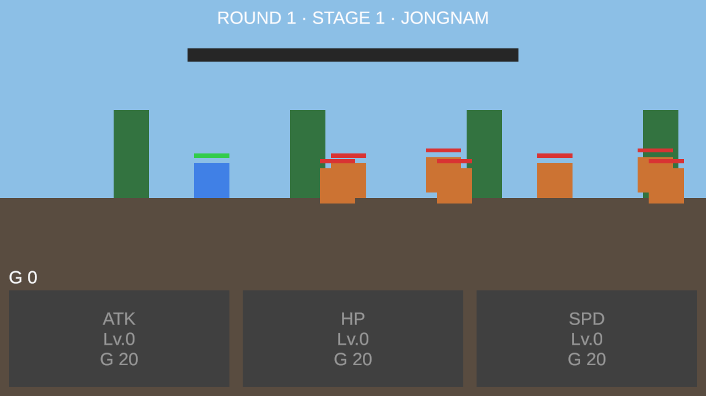
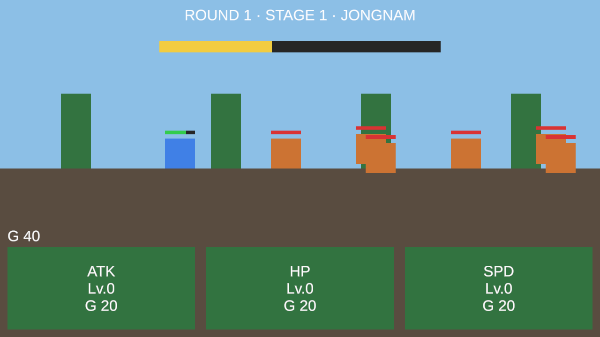
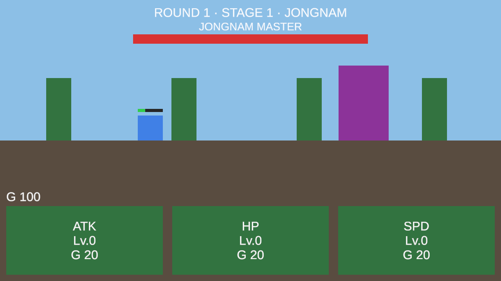

# 루프 증거: loop/20261117-113918 (묶음 테마회차)

- 판정: **통합 브랜치(`integration`)에 합침** — 관문 위반 0건, 합치기 전 전체 테스트 통과
- 합친 시각: 2026-11-17 11:59
- 병합 커밋: 태그 `loop-merged/20261117-113918` (`git show loop-merged/20261117-113918`)
- 작업 3건, 바뀐 파일 8개 (.meta 제외)
- 테스트 수: 222 → 236개. 합치기 전 실행: EditMode 304/304, PlayMode 2/2

이 문서는 루프 스크립트가 썼다. 테스트 결과와 관문은 스크립트가 직접 판정한 것이고, "완료 조건별 테스트"와 리뷰 의견은 교차 리뷰 에이전트의 판단이다. 가정과 화면은 사람이 본다.

## 사람이 볼 것

테스트로 판정하지 못한 것이다. 아래 화면 갈무리와 함께 본다.

- `020_stage_round_number`: Unity 라이선스가 활성화된 환경에서 전체 테스트와 새 에딧 모드 테스트를 실행해 통과 여부를 확인한다.
- `021_stage_theme_text`: Unity 라이선스 클라이언트 연결 문제를 해결한 환경에서 전체 테스트를 다시 실행해 통과를 확인한다.
- `022_stage_view_round_theme`: 실행하고 1초 뒤 화면 위쪽 가운데에 `ROUND 1 · STAGE 1 · JONGNAM` 이 한 줄로 잘리지 않고 보이고, 그 아래에 빈 노란 진행 바가 보인다.
- `022_stage_view_round_theme`: 에디터에서 실행해 1스테이지의 10마리를 모두 처치하면 바가 가득 찬 빨간 바로 바뀌고 그 위에 `JONGNAM MASTER` 가 잘리지 않고 보인다.
- `022_stage_view_round_theme`: 에디터에서 실행해 1스테이지 보스를 처치하면 금화가 50 늘고, 전투 화면이 가려졌다가 열리며 스테이지 글자가 `ROUND 1 · STAGE 2 · BEGGAR CLAN` 이 된다. 가려진 동안에도 보유 금화와 강화 버튼은 보이고, 버튼은 어둡고 눌리지 않는다. 열린 뒤 바는 빈 노란 바다.
- `022_stage_view_round_theme`: 에디터에서 실행해 제자의 체력이 0이 되면 같은 방식으로 가려졌다가 같은 스테이지 글자로 처음부터 다시 시작한다. 금화와 강화 단계는 그대로다.
- `022_stage_view_round_theme`: 실행 1초 뒤 화면 위쪽 가운데에 `ROUND 1 · STAGE 1 · JONGNAM`이 한 줄로 잘리지 않고 보이고 그 아래 빈 노란 진행 바가 보이는지 확인한다.
- `022_stage_view_round_theme`: 1스테이지의 일반 몬스터 10마리 처치 후 바가 가득 찬 빨간 바로 바뀌고 그 위에 `JONGNAM MASTER`가 잘리지 않고 보이는지 확인한다.
- `022_stage_view_round_theme`: 1스테이지 보스 처치 후 금화가 50 늘고 전투 화면이 가려졌다 열리며 `ROUND 1 · STAGE 2 · BEGGAR CLAN`이 표시되는지 확인한다. 가려진 동안 금화와 강화 버튼은 보이고 버튼은 어둡고 눌리지 않으며, 열린 뒤 바는 빈 노란 바인지 확인한다.
- `022_stage_view_round_theme`: 제자의 체력이 0이 되면 같은 방식으로 가려졌다 열리고 같은 스테이지가 처음부터 다시 시작하며 금화와 강화 단계가 유지되는지 확인한다.

## 에이전트가 스스로 정한 것 (가정)

사양과 작업 문서에 없어 에이전트가 정한 것 전부다. 마음에 들지 않으면 후속 작업으로 고친다.

- `020_stage_round_number`: 없음. 공개 연결 지점과 계산식은 기존 사양과 같다.
- `021_stage_theme_text`: 없음. 공개 연결 지점과 값은 기존 사양과 같다.
- `022_stage_view_round_theme`: 추가 가정이나 임시 수치는 없다. 글자 크기 600×16과 300×16은 작업 문서의 임시값을 그대로 사용했다. 공개 연결 지점은 바꾸지 않았다.

## 화면 갈무리

합치기 직전의 코드로 게임을 실행해 찍은 것이다 (플레이 모드 테스트, 파일 이름의 숫자는 실행 후 지난 게임 시간).

**game_001s.png**



**game_010s.png**



**game_030s.png**




## 작업 요약

| 작업 | 구현 | 리뷰 | 새 테스트 | 바뀐 화면 코드 |
| --- | --- | --- | --- | --- |
| `020_stage_round_number` | codex(시도 1) | claude (교차): 통과 | 7 | 0 |
| `021_stage_theme_text` | codex(시도 1) | claude (교차): 통과 | 7 | 0 |
| `022_stage_view_round_theme` | codex(시도 1~2) | claude (교차): 통과, 고침 1회 | 0 | 1 |

## 관문 (스크립트 판정)

- 위반: 0건
- 확인 필요: 없음

## 작업별 기록

### 020_stage_round_number

- 구현: codex(시도 1)
- 리뷰: claude (교차): 통과
- 바뀐 내용: 전체 진행 번호에서 회차와 화면상 스테이지 번호를 계산하고 경계 및 전환 테스트를 추가했다. Unity 라이선스 초기화 실패로 테스트 실행 결과는 확인하지 못했다.
- 리뷰 의견: StageProgress에 사양 연결 지점대로 StageNumber에서 매번 계산하는 DisplayStageNumber·RoundNumber를 더했고, 새 테스트 파일이 완료 조건마다 상황과 숫자 기대값을 직접 검사한다. 하지 말 것 침범, 화면 코드 변경, 기존 테스트 수정은 없다.
- 작업 문서 원본: `docs/history/020_stage_round_number.md`

| 완료 조건 | 대응하는 테스트 | 판정 |
| --- | --- | --- |
| 따로 적지 않으면 `wallet = new Wallet(0)`, `upgrades = new StatUpgrades(wallet, 공격력, 최대 체력, 1.0)`(항목 앞의 `(공격력, 최대 체력)`), `battle = new Battle(upgrades)`, `stage = new StageProgress(wallet, upgrades, battle, new MinRandom(), startStage)` 로 만든 것이다. "1칸 진행"은 `battle.Step()` 을 한 번 부르는 것이다. 알림 횟수는 `StageProgress` 를 만든 직후 구독해 센 누적 횟수다. | StageProgressRoundTests.Create (조건의 생성 방식과 생성 직후 구독을 그대로 따름) | 있음 |
| `Assets/Tests/EditMode/Stage/StageProgressRoundTests.cs` 에 아래 조건마다 테스트가 하나 이상 있고 모두 통과한다. | StageProgressRoundTests (파일과 클래스가 있고 아래 조건마다 테스트가 있음) | 있음 |
| (10, 100) 으로 `startStage` 1, 2, 3, 4, 5, 6 을 넣어 각각 새로 만들고 `Begin()` 전에 읽으면, `StageNumber` 는 1, 2, 3, 4, 5, 6, `RoundNumber` 는 1, 1, 1, 1, 1, 2, `DisplayStageNumber` 는 1, 2, 3, 4, 5, 1 이다. | StageProgressRoundTests.BeforeBegin_StageNumbersReflectClampedStart (TestCase 1~6) | 있음 |
| (10, 100) 으로 `startStage` 0 과 -3 을 넣어 각각 만들면 `StageNumber`, `RoundNumber`, `DisplayStageNumber` 는 모두 1 이다. | StageProgressRoundTests.BeforeBegin_StageNumbersReflectClampedStart (TestCase 0, -3) | 있음 |
| (1000, 100), `startStage: 5` 로 만들어 `Begin()` 을 부르고 `battle.AddEnemy(EnemyKind.Boss, 5, 1.0)` 뒤 1칸 진행하면, 금화는 90, `StageCleared` 가 5를 담아 1번 오고, `Phase` 는 `FadingOut`, `StageNumber` 는 5 다. | StageProgressRoundTests.FifthStageCleared_AdvancesToSecondRoundAtCoveredTransition | 있음 |
| 위에 이어 `Tick(0.5)` 를 부르면 `StageNumber` 는 6, `RoundNumber` 는 2, `DisplayStageNumber` 는 1 이고, `StageStarted` 가 6을 담아 1번 더 오며, 금화는 90 이고 `upgrades.GetLevel(StatType.Attack)`, `GetLevel(StatType.Health)`, `GetLevel(StatType.AttackSpeed)` 는 모두 0 그대로다. | StageProgressRoundTests.FifthStageCleared_AdvancesToSecondRoundAtCoveredTransition (started == [5, 6]) | 있음 |
| (10, 30), `startStage: 6` 으로 만들어 `Begin()` 을 부르면 `battle.Enemies` 의 일반 상대 10명의 `MaxHealth` 는 모두 80, `Attack` 은 모두 15 이다. | StageProgressRoundTests.SixthStageEnemies_UseTotalStageNumberForStats | 있음 |
| (10, 30), `startStage: 6` 으로 `Begin()` 뒤 `battle.AddEnemy(EnemyKind.Boss, 6, 1.0)` 이 돌려준 보스의 `MaxHealth` 는 250, `Attack` 은 30 이다. | StageProgressRoundTests.SixthStageEnemies_UseTotalStageNumberForStats | 있음 |
| `StageRewards.NormalGold(6)` 은 20, `StageRewards.BossGold(6)` 은 100 이다. | StageProgressRoundTests.SixthStageRewards_UseTotalStageNumber | 있음 |
| (10, 30), `startStage: 6` 으로 `Begin()` 뒤 `battle.AddEnemy(EnemyKind.Boss, 6, 1.0)` 을 부르고 1칸 진행하면 보스는 살아 있고(`Health` 240) `StageFailed` 가 6을 담아 1번 온다. 이어서 `Tick(0.5)` 를 부르면 `StageNumber` 6, `RoundNumber` 2, `DisplayStageNumber` 1, `battle.Enemies.Count` 10(모두 `EnemyKind.Normal`), `battle.DiscipleHealth` 30, `DefeatedNormalCount` 0, `Boss` 는 `null` 이다. | StageProgressRoundTests.SixthStageFailed_RetriesSameRoundAndResetsBattle | 있음 |
| (10, 100), `startStage: 6` 으로 만든 스테이지의 `StageNumber` 를 읽어(6) 새 지갑·강화 (10, 100)·전투·`MinRandom` 과 그 값으로 다른 스테이지를 만들어 `Begin()` 을 부르면, `StageNumber` 6, `RoundNumber` 2, `DisplayStageNumber` 1, `DefeatedNormalCount` 0, `Boss` 는 `null` 이고 일반 상대 10명의 `MaxHealth` 는 모두 80 이다. | StageProgressRoundTests.RestoredTotalStage_ReconstructsRoundAndEnemies | 있음 |
| `wallet = new Wallet(0)`, `upgrades = new StatUpgrades(wallet, 100000000000, 100000000000, 1.0)`, `startStage: int.MaxValue` 로 만들어 `Begin()` 뒤 `battle.AddEnemy(EnemyKind.Boss, int.MaxValue, 1.0)` 을 부르고 1칸 진행하면 금화는 21474836510 이고 `StageCleared` 가 `int.MaxValue` 를 담아 1번 온다. 이어서 `Tick(0.5)` 를 부르면 예외 없이 `StageNumber` 는 `int.MaxValue`, `RoundNumber` 는 429496730, `DisplayStageNumber` 는 2 다. | StageProgressRoundTests.MaxStageCleared_RoundNumbersRemainValidWithoutOverflow | 있음 |
| 기존 테스트가 모두 통과한다. (위 "기존 테스트"의 두 테스트, `StageProgressTests`, `StageProgressKillTests`, `StageProgressOutcomeTests`, `StageProgressFadeTests`, `StageLayoutTests`, `StageRewardsTests`, `CoreAssemblyTests.Core_DoesNotReferenceUnity` 포함) | 루프의 전체 테스트 실행 | 루프가 판정 |

리뷰 지적 (합친 뒤에도 남은 것):

- [note] 보고서의 테스트 결과에는 구현 환경에 Unity 라이선스가 없어 테스트를 실행하지 못했다고 적혀 있다. 실제 통과 여부는 루프의 테스트 실행 결과로 판정해야 한다 (tasks/doing/020_stage_round_number.md 보고서).
- [note] 작업 문서 끝에 '## 보고서' 절이 두 번 붙어 있다 (중단 뒤 다시 시작한 흔적). 내용은 서로 맞는다.

새 테스트 7개: `StageProgressRoundTests.BeforeBegin_StageNumbersReflectClampedStart`, `StageProgressRoundTests.FifthStageCleared_AdvancesToSecondRoundAtCoveredTransition`, `StageProgressRoundTests.MaxStageCleared_RoundNumbersRemainValidWithoutOverflow`, `StageProgressRoundTests.RestoredTotalStage_ReconstructsRoundAndEnemies`, `StageProgressRoundTests.SixthStageEnemies_UseTotalStageNumberForStats`, `StageProgressRoundTests.SixthStageFailed_RetriesSameRoundAndResetsBattle`, `StageProgressRoundTests.SixthStageRewards_UseTotalStageNumber`

### 021_stage_theme_text

- 구현: codex(시도 1)
- 리뷰: claude (교차): 통과
- 바뀐 내용: 회차·스테이지·테마 표시와 테마별 보스 이름 및 경계값 테스트를 추가했다. Unity 라이선스 연결 실패로 테스트 실행 결과는 확인하지 못했다.
- 리뷰 의견: StageText에 RoundStageLabel·ThemeName·ThemedBossName이 사양의 연결 지점과 수치표대로 추가됐습니다(U+00B7 가운뎃점, InvariantCulture, 범위 밖 입력은 ArgumentOutOfRangeException). 완료 조건마다 기대값을 직접 검사하는 테스트가 있습니다. 기존 API와 기존 테스트는 바뀌지 않았고 하지 말 것도 침범하지 않았습니다.
- 작업 문서 원본: `docs/history/021_stage_theme_text.md`

| 완료 조건 | 대응하는 테스트 | 판정 |
| --- | --- | --- |
| `Assets/Tests/EditMode/Stage/StageTextTests.cs` 에 아래 조건마다 테스트가 하나 이상 있고 모두 통과한다. | StageTextTests 의 새 테스트 7개(TestCase 포함). 조건 2~9마다 테스트가 하나 이상 있다 | 있음 |
| `StageText.RoundStageLabel(2, 1)` 은 `"ROUND 2 · STAGE 1 · JONGNAM"` 이다. | StageTextTests.RoundStageLabel_ValidInputs_FormatsRoundStageAndTheme(2,1) | 있음 |
| `StageText.RoundStageLabel(1, 5)` 는 `"ROUND 1 · STAGE 5 · HEAVENLY DEMON"` 이다. | StageTextTests.RoundStageLabel_ValidInputs_FormatsRoundStageAndTheme(1,5) | 있음 |
| `CultureInfo.CurrentCulture` 를 `de-DE` 로 바꾼 동안 `StageText.RoundStageLabel(1234, 3)` 은 `"ROUND 1234 · STAGE 3 · NAMGUNG"` 이다 (테스트 끝에 문화권을 되돌린다). | StageTextTests.RoundStageLabel_CurrentCultureIsGerman_UsesInvariantNumbers (finally에서 문화권 복원) | 있음 |
| `StageText.ThemeName(1)`~`ThemeName(5)` 는 순서대로 `"JONGNAM"`, `"BEGGAR CLAN"`, `"NAMGUNG"`, `"DEMON CULT"`, `"HEAVENLY DEMON"` 이다. | StageTextTests.ThemeName_ValidStage_ReturnsTheme (1~5) | 있음 |
| `StageText.ThemedBossName(1)`~`ThemedBossName(5)` 는 순서대로 `"JONGNAM MASTER"`, `"BEGGAR CLAN MASTER"`, `"NAMGUNG SWORDSMAN"`, `"DEMON CULT COMMANDER"`, `"HEAVENLY DEMON"` 이다. | StageTextTests.ThemedBossName_ValidStage_ReturnsBoss (1~5) | 있음 |
| `ThemeName(0)`, `ThemeName(6)` 은 `ArgumentOutOfRangeException` 이다. | StageTextTests.ThemeName_InvalidStage_Throws (0, 6) | 있음 |
| `ThemedBossName(0)`, `ThemedBossName(6)` 은 `ArgumentOutOfRangeException` 이다. | StageTextTests.ThemedBossName_InvalidStage_Throws (0, 6) | 있음 |
| `RoundStageLabel(1, 0)`, `RoundStageLabel(1, 6)`, `RoundStageLabel(0, 1)`, `RoundStageLabel(-1, 1)` 은 `ArgumentOutOfRangeException` 이다. | StageTextTests.RoundStageLabel_InvalidInput_Throws (1,0 / 1,6 / 0,1 / -1,1) | 있음 |
| 기존 테스트가 모두 통과한다. (위 "기존 테스트"의 네 테스트, `CoreAssemblyTests.Core_DoesNotReferenceUnity` 포함) | 루프의 전체 테스트 실행 | 루프가 판정 |

리뷰 지적 (합친 뒤에도 남은 것):

- [note] 보고서에 따르면 구현 에이전트는 Unity 라이선스 연결 문제로 테스트를 직접 실행하지 못했습니다. 통과 여부는 루프의 테스트 결과로 판단합니다.
- [note] Assets/Scripts/Core/Stage/StageText.cs:24-29 RoundStageLabel은 stage 범위를 ThemeName 호출로 검사합니다. 이 때문에 예외의 매개변수 이름은 stage가 됩니다. 조건에는 영향이 없습니다.

새 테스트 7개: `StageTextTests.RoundStageLabel_CurrentCultureIsGerman_UsesInvariantNumbers`, `StageTextTests.RoundStageLabel_InvalidInput_Throws`, `StageTextTests.RoundStageLabel_ValidInputs_FormatsRoundStageAndTheme`, `StageTextTests.ThemeName_InvalidStage_Throws`, `StageTextTests.ThemeName_ValidStage_ReturnsTheme`, `StageTextTests.ThemedBossName_InvalidStage_Throws`, `StageTextTests.ThemedBossName_ValidStage_ReturnsBoss`

### 022_stage_view_round_theme

- 구현: codex(시도 1~2)
- 리뷰: claude (교차): 통과, 고침 1회
- 바뀐 내용: 스테이지 화면에 회차와 테마별 보스 이름을 표시하고 작업 보고서를 추가했습니다. 이전 루프에서 테스트와 관문이 통과했으며 이번 수정에서 Unity 테스트는 다시 실행하지 않았습니다.
- 리뷰 의견: StageView.cs만 고쳤고, 요구사항대로 글자 영역 크기를 600×16·300×16으로 바꿨다. 스테이지 글자는 Core의 RoundStageLabel(RoundNumber, DisplayStageNumber), 보스 이름은 ThemedBossName(DisplayStageNumber)을 Redraw마다 넣는다. WarnOnce 처리와 IsBossActive일 때만 보이는 조건은 그대로 남아 있고, 화면 코드에서 계산하는 부분도 없다.
- 작업 문서 원본: `docs/history/022_stage_view_round_theme.md`

| 완료 조건 | 대응하는 테스트 | 판정 |
| --- | --- | --- |
| StageView.cs` 가 컴파일 오류 없이 컴파일되고, `StageView.cs` 에 `StageText.StageLabel(` 와 `StageText.BossName` 이라는 글자가 없으며, 기존 테스트가 모두 통과한다. (플레이 모드의 `GameBootTests`, 에딧 모드의 `StageTextTests`, `StageProgressRoundTests`, `CoreAssemblyTests.Core_DoesNotReferenceUnity` 포함) | 루프의 컴파일·전체 테스트 실행. grep으로 확인하니 StageView.cs에 StageText.StageLabel( / StageText.BossName이 없다 | 루프가 판정 |
| 실행하고 1초 뒤 화면 위쪽 가운데에 `ROUND 1 · STAGE 1 · JONGNAM` 이 한 줄로 잘리지 않고 보이고, 그 아래에 빈 노란 진행 바가 보인다. | 사람 확인 | 사람 확인 |
| 에디터에서 실행해 1스테이지의 10마리를 모두 처치하면 바가 가득 찬 빨간 바로 바뀌고 그 위에 `JONGNAM MASTER` 가 잘리지 않고 보인다. | 사람 확인 | 사람 확인 |
| 에디터에서 실행해 1스테이지 보스를 처치하면 금화가 50 늘고, 전투 화면이 가려졌다가 열리며 스테이지 글자가 `ROUND 1 · STAGE 2 · BEGGAR CLAN` 이 된다. 가려진 동안에도 보유 금화와 강화 버튼은 보이고, 버튼은 어둡고 눌리지 않는다. 열린 뒤 바는 빈 노란 바다. | 사람 확인 | 사람 확인 |
| 에디터에서 실행해 제자의 체력이 0이 되면 같은 방식으로 가려졌다가 같은 스테이지 글자로 처음부터 다시 시작한다. 금화와 강화 단계는 그대로다. | 사람 확인 | 사람 확인 |

리뷰 지적 (합친 뒤에도 남은 것):

- [note] _bossName과 _bossNameObject가 같은 대상을 가리켜 _bossNameObject는 없어도 된다 (Assets/Scripts/Game/Stage/StageView.cs:38-39). 동작에는 영향이 없다.
- [note] 보고서의 테스트 결과 절에 Unity 컴파일과 테스트를 직접 다시 돌리지 않았다고 적혀 있다. 컴파일·테스트 통과는 루프가 판정한다.

## 확인하고 되돌리는 방법

```
git diff loop-merged/20261117-113918^1 loop-merged/20261117-113918            # 이 루프가 바꾼 것 전부
git merge --ff-only loop-merged/20261117-113918         # (main 에서) 이 루프까지만 올린다
git revert -m 1 loop-merged/20261117-113918             # (main 에 올린 뒤) 이 루프만 되돌린다
```
