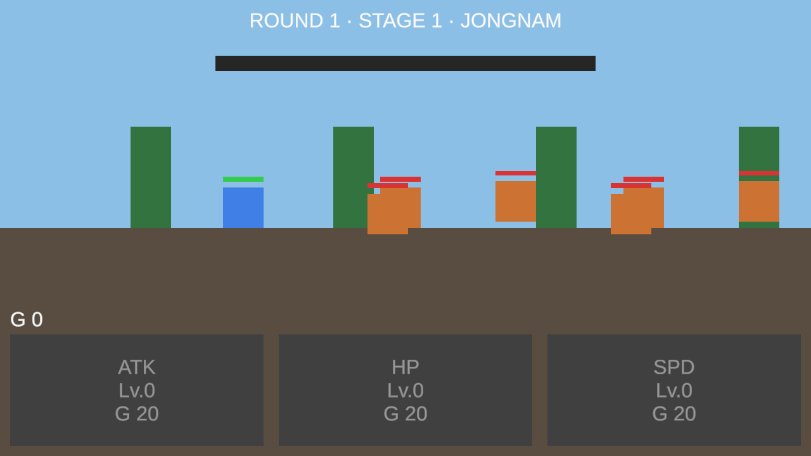
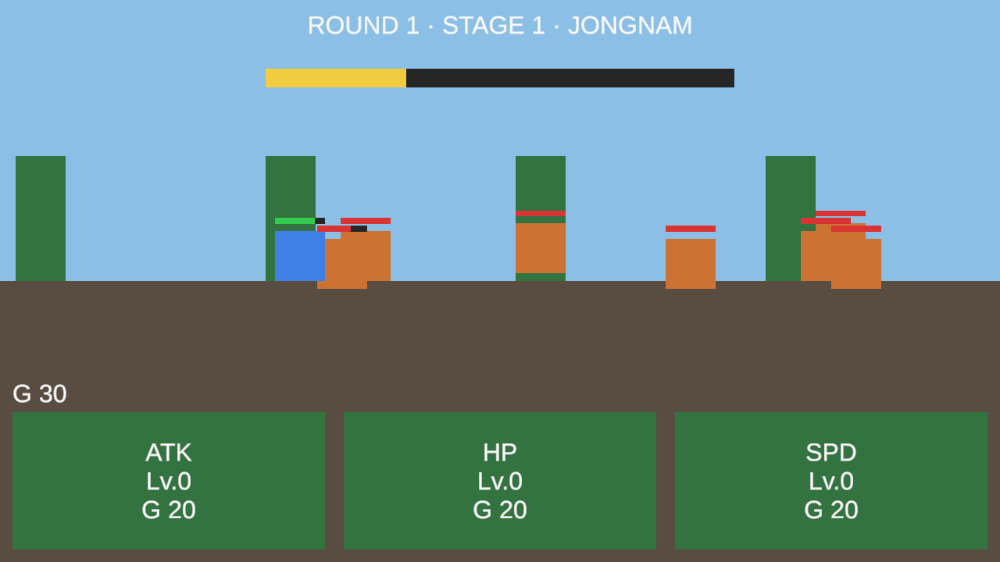
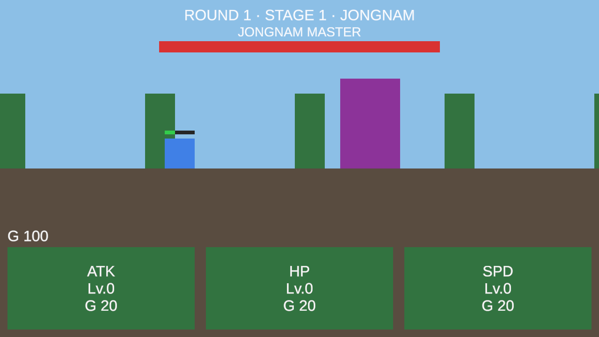

# 루프 증거: loop/20261117-115917 (묶음 스테이지소개)

- 판정: **통합 브랜치(`integration`)에 합침** — 관문 위반 0건, 합치기 전 전체 테스트 통과
- 합친 시각: 2026-11-17 12:07
- 병합 커밋: 태그 `loop-merged/20261117-115917` (`git show loop-merged/20261117-115917`)
- 작업 1건, 바뀐 파일 6개 (.meta 제외)
- 테스트 수: 236 → 245개. 합치기 전 실행: EditMode 323/323, PlayMode 2/2
- 이 묶음에서 **보류로 남아 합쳐지지 않은 작업**: 024_stage_intro_tick.md

이 문서는 루프 스크립트가 썼다. 테스트 결과와 관문은 스크립트가 직접 판정한 것이고, "완료 조건별 테스트"와 리뷰 의견은 교차 리뷰 에이전트의 판단이다. 가정과 화면은 사람이 본다.

## 사람이 볼 것

테스트로 판정하지 못한 것이다. 아래 화면 갈무리와 함께 본다.

- 없음

## 에이전트가 스스로 정한 것 (가정)

사양과 작업 문서에 없어 에이전트가 정한 것 전부다. 마음에 들지 않으면 후속 작업으로 고친다.

- 없음

## 화면 갈무리

합치기 직전의 코드로 게임을 실행해 찍은 것이다 (플레이 모드 테스트, 파일 이름의 숫자는 실행 후 지난 게임 시간).

**game_001s.png**



**game_010s.png**



**game_030s.png**




## 작업 요약

| 작업 | 구현 | 리뷰 | 새 테스트 | 바뀐 화면 코드 |
| --- | --- | --- | --- | --- |
| `023_stage_intro_begin` | codex(시도 1) | claude (교차): 통과 | 9 | 0 |

## 관문 (스크립트 판정)

- 위반: 0건
- 확인 필요: 없음

## 작업별 기록

### 023_stage_intro_begin

- 구현: codex(시도 1)
- 리뷰: claude (교차): 통과
- 바뀐 내용: ???? ? ?? ?? ??? ??, ?? ?? ? ?? ?? ???? ????. Unity ?? ??? ??.
- 리뷰 의견: 소개 단계, 본 소개 번호, Begin 의 소개 판단, IntroLine 이 사양과 작업 문서대로 구현됐다. 완료 조건마다 숫자까지 확인하는 테스트가 있다. 하지 말 것 범위(Tick 의 소개 처리, Combat/Currency/StatUpgrade/Game 폴더)는 건드리지 않았다. 다만 주석 두 곳의 한글이 깨졌고, 설명 주석 하나가 다른 메서드 위로 옮겨졌다.
- 작업 문서 원본: `docs/history/023_stage_intro_begin.md`

| 완료 조건 | 대응하는 테스트 | 판정 |
| --- | --- | --- |
| 따로 적지 않으면 `wallet = new Wallet(0)`, `upgrades = new StatUpgrades(wallet, 공격력, 최대 체력, 1.0)`(항목 앞의 `(공격력, 최대 체력)`), `battle = new Battle(upgrades)`, `stage = new StageProgress(wallet, upgrades, battle, new MinRandom(), startStage, seenIntroStage)` 로 만든 것이다 (`startStage` 를 적지 않으면 1). "1칸 진행"은 `battle.Step()` 을 한 번 부르는 것이다. 알림 횟수와 순서는 `StageProgress` 를 만든 직후 구독해 기록한 것이다. | StageProgressIntroTests.Create 보조 메서드가 이 구성 그대로 만든다 | 있음 |
| `Assets/Tests/EditMode/Stage/StageProgressIntroTests.cs` 와 `Assets/Tests/EditMode/Stage/StageTextTests.cs` 에 아래 조건마다 테스트가 하나 이상 있고 모두 통과한다. | 두 파일에 아래 조건별 테스트가 있다 (통과 여부는 루프가 실행해 확인) | 있음 |
| (10, 100) 으로 `seenIntroStage` 를 생략해 만들면 `SeenIntroStage` 는 5 이다. | StageProgressIntroTests.Constructor_DefaultSeen_StartsAtFiveWithoutIntro | 있음 |
| (10, 100) 으로 `seenIntroStage` 에 0, 3, −2, 9 를 넣어 각각 만들면 예외 없이 `SeenIntroStage` 는 0, 3, 0, 5 이다. | StageProgressIntroTests.Constructor_SeenValue_ClampsAndStartsPlaying (경우 4개, DoesNotThrow 포함) | 있음 |
| 위 다섯 경우(생략, 0, 3, −2, 9) 모두 `Begin()` 전의 `IsIntroShowing` 은 `false`, `Phase` 는 `Playing` 이다. | StageProgressIntroTests.Constructor_DefaultSeen_StartsAtFiveWithoutIntro, Constructor_SeenValue_ClampsAndStartsPlaying | 있음 |
| (10, 100), `seenIntroStage: 0` 으로 만들어 `Begin()` 을 부르면 `SeenIntroStage` 1, `Phase` `Intro`, `IsIntroShowing` `true`, `battle.Paused` `true`, `upgrades.Locked` `false`, `FadeAlpha` 0.0, `battle.Enemies.Count` 10 이다. | StageProgressIntroTests.Begin_UnseenFirstStage_PausesAfterPlacementAndNotifiesInOrder | 있음 |
| (10, 100), `seenIntroStage: 0` 으로 `Begin()` 을 부르면 `StageStarted` 가 1을 담아 1번, 그 뒤에 `Changed` 가 1번 오고, `StageStarted` 를 받는 시점에 읽은 `SeenIntroStage` 는 1, `Phase` 는 `Intro` 다. | StageProgressIntroTests.Begin_UnseenFirstStage_PausesAfterPlacementAndNotifiesInOrder (알림 순서 [started:1, changed], 알림 처리 안에서 상태 확인) | 있음 |
| (10, 100), `seenIntroStage: 0` 으로 `Begin()` 뒤 `battle.AddEnemy(EnemyKind.Normal, 1, 0.8)` 을 부르고 1칸 진행하면 금화 0, `DefeatedNormalCount` 0, `battle.DisciplePosition` 0 이고 `Changed` 는 더 오지 않는다 (모두 1번). | StageProgressIntroTests.Intro_BattleStepAndTick_LeaveBattleAndPhaseUnchanged | 있음 |
| `wallet = new Wallet(20)`, (10, 100), `seenIntroStage: 0` 으로 `Begin()` 뒤 `upgrades.TryUpgrade(StatType.Attack)` 은 `true` 이고, 금화는 0, `Phase` 는 `Intro` 그대로다. | StageProgressIntroTests.Intro_UpgradeWithGold_SucceedsWithoutEndingIntro | 있음 |
| (10, 100), `startStage: 3, seenIntroStage: 3` 으로 `Begin()` 을 부르면 `Phase` `Playing`, `battle.Paused` `false`, `SeenIntroStage` 3 이다. | StageProgressIntroTests.Begin_SeenAndRound_DetermineIntro(3,3,Playing,false,3) | 있음 |
| (10, 100), `startStage: 3, seenIntroStage: 2` 로 `Begin()` 을 부르면 `Phase` `Intro`, `SeenIntroStage` 3 이다. | StageProgressIntroTests.Begin_SeenAndRound_DetermineIntro(3,2,Intro,true,3) | 있음 |
| (10, 100), `startStage: 7, seenIntroStage: 0` 으로 `Begin()` 을 부르면 (2회차) `Phase` `Playing`, `battle.Paused` `false`, `SeenIntroStage` 0 이다. | StageProgressIntroTests.Begin_SeenAndRound_DetermineIntro(7,0,Playing,false,0) | 있음 |
| (10, 100), `seenIntroStage` 생략으로 `Begin()` 을 부르면 `Phase` `Playing`, `battle.Paused` `false`, `SeenIntroStage` 5 이다. | StageProgressIntroTests.Constructor_DefaultSeen_StartsAtFiveWithoutIntro | 있음 |
| `StageText.IntroLine(1)`~`IntroLine(5)` 는 위 표의 영문 문구와 글자 하나까지 같다. | StageTextTests.IntroLine_ValidStage_ReturnsExactLine (경우 5개, 표의 문구와 같은지 대조함) | 있음 |
| `StageText.IntroLine(0)` 과 `IntroLine(6)` 은 `ArgumentOutOfRangeException` 이다. | StageTextTests.IntroLine_InvalidStage_Throws (0, 6) | 있음 |
| `(int)StagePhase.Playing`, `FadingOut`, `FadingIn`, `Intro` 는 0, 1, 2, 3 이다. | StageProgressIntroTests.StagePhase_Values_PreserveExistingNumbers | 있음 |
| 기존 테스트가 모두 통과한다. (`StageProgressTests`, `StageProgressKillTests`, `StageProgressOutcomeTests`, `StageProgressFadeTests`, `StageProgressRoundTests`, `StageTextTests`, `CoreAssemblyTests.Core_DoesNotReferenceUnity` 포함) | 루프가 전체 테스트를 실행해 판정 | 루프가 판정 |

리뷰 지적 (합친 뒤에도 남은 것):

- [note] 새로 넣은 주석의 한글이 '?' 로 깨졌다: Assets/Scripts/Core/Stage/StagePhase.cs:15 의 Intro 설명 주석, Assets/Scripts/Core/Stage/StageProgress.cs:198-201 의 PlaceStage 설명 주석.
- [note] Assets/Scripts/Core/Stage/StageProgress.cs:187-196: 원래 PlaceStage 를 설명하던 주석('스테이지 배치: battle.Reset → …')이 새 메서드 ShouldShowIntro 위에 붙어 있다. 그래서 ShouldShowIntro 에 맞지 않는 설명이 달렸고, PlaceStage 에는 깨진 사본만 남았다. 동작에는 영향이 없다.
- [note] _introElapsed(StageProgress.cs:33)는 지금 값을 넣기만 하고 읽는 곳이 없다. 024 가 Tick 에서 쓸 자리이므로 범위 안이다. IntroSeconds 에는 사양처럼 '(임시)' 주석이 없다.

새 테스트 9개: `StageProgressIntroTests.Begin_SeenAndRound_DetermineIntro`, `StageProgressIntroTests.Begin_UnseenFirstStage_PausesAfterPlacementAndNotifiesInOrder`, `StageProgressIntroTests.Constructor_DefaultSeen_StartsAtFiveWithoutIntro`, `StageProgressIntroTests.Constructor_SeenValue_ClampsAndStartsPlaying`, `StageProgressIntroTests.Intro_BattleStepAndTick_LeaveBattleAndPhaseUnchanged`, `StageProgressIntroTests.Intro_UpgradeWithGold_SucceedsWithoutEndingIntro`, `StageProgressIntroTests.StagePhase_Values_PreserveExistingNumbers`, `StageTextTests.IntroLine_InvalidStage_Throws`, `StageTextTests.IntroLine_ValidStage_ReturnsExactLine`

## 확인하고 되돌리는 방법

```
git diff loop-merged/20261117-115917^1 loop-merged/20261117-115917            # 이 루프가 바꾼 것 전부
git merge --ff-only loop-merged/20261117-115917         # (main 에서) 이 루프까지만 올린다
git revert -m 1 loop-merged/20261117-115917             # (main 에 올린 뒤) 이 루프만 되돌린다
```
