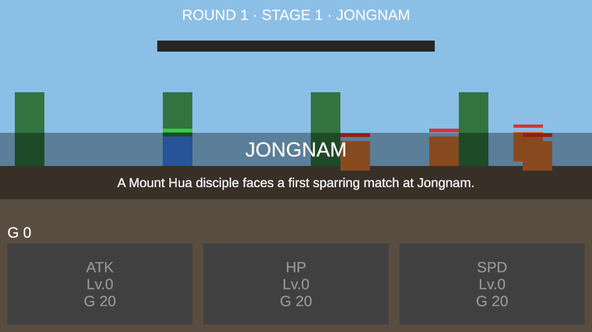
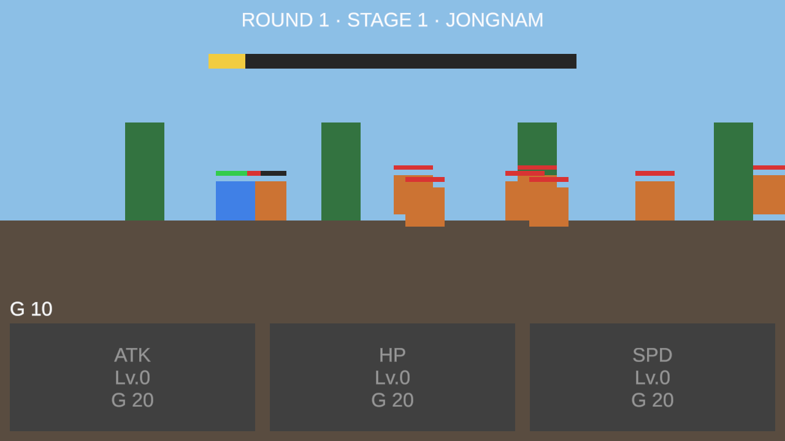
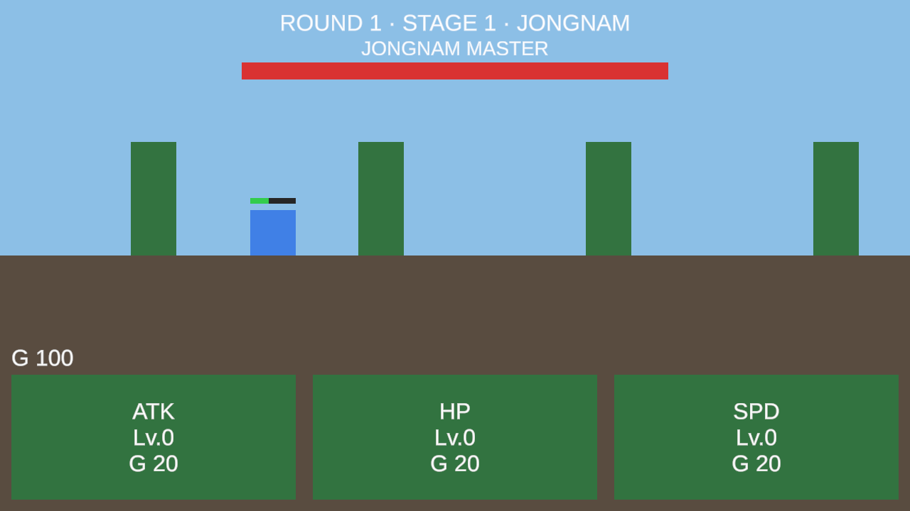

# 루프 증거: loop/20261117-123053 (묶음 스테이지소개)

- 판정: **통합 브랜치(`integration`)에 합침** — 관문 위반 0건, 합치기 전 전체 테스트 통과
- 합친 시각: 2026-11-17 12:38
- 병합 커밋: 태그 `loop-merged/20261117-123053` (`git show loop-merged/20261117-123053`)
- 작업 2건, 바뀐 파일 7개 (.meta 제외)
- 테스트 수: 245 → 254개. 합치기 전 실행: EditMode 333/333, PlayMode 2/2

이 문서는 루프 스크립트가 썼다. 테스트 결과와 관문은 스크립트가 직접 판정한 것이고, "완료 조건별 테스트"와 리뷰 의견은 교차 리뷰 에이전트의 판단이다. 가정과 화면은 사람이 본다.

## 사람이 볼 것

테스트로 판정하지 못한 것이다. 아래 화면 갈무리와 함께 본다.

- `024_stage_intro_tick`: 완료 조건에 [사람 확인] 항목은 없다.
- `024_stage_intro_tick`: 화면에서 소개 패널이 3초 보이고 닫히는 것은 025(화면·`GameRoot`)가 끝난 뒤 확인한다.
- `025_stage_view_intro`: 실행하고 1초 뒤 화면 가운데에 반투명 검은 바탕 위로 `JONGNAM` 과 `A Mount Hua disciple faces a first sparring match at Jongnam.` 이 잘리지 않고 보이고, 화면 위쪽의 `ROUND 1 · STAGE 1 · JONGNAM` 과 빈 노란 진행 바도 보인다.
- `025_stage_view_intro`: 실행하고 10초 뒤에는 소개 패널이 보이지 않고 제자와 몬스터가 싸우고 있다.
- `025_stage_view_intro`: 에디터에서 실행해 처음 약 3초 동안 제자와 몬스터가 움직이지 않고, 그동안에도 금화가 충분하면 강화 버튼을 눌러 강화할 수 있으며, 소개가 사라지면 전투가 시작된다.
- `025_stage_view_intro`: 에디터에서 실행해 1스테이지 보스를 처치하면 전투 화면이 가려졌다가 열린 뒤 화면 가운데에 `BEGGAR CLAN` 과 그 소개 문구가 약 3초 보이고, 그동안 전투가 멈춰 있다가 소개가 사라지면 시작된다.
- `025_stage_view_intro`: 에디터에서 실행해 제자의 체력이 0이 되면 가려졌다가 같은 스테이지로 다시 시작하고, 이때 소개는 다시 나오지 않는다.
- `025_stage_view_intro`: 위를 해 보는 동안 콘솔에 예외(빨간 줄)가 없다.
- `025_stage_view_intro`: [사람 확인] 실행하고 1초 뒤 화면 가운데에 반투명 검은 바탕 위로 `JONGNAM` 과 `A Mount Hua disciple faces a first sparring match at Jongnam.` 이 잘리지 않고 보이고, 화면 위쪽의 `ROUND 1 · STAGE 1 · JONGNAM` 과 빈 노란 진행 바도 보인다.
- `025_stage_view_intro`: [사람 확인] 실행하고 10초 뒤에는 소개 패널이 보이지 않고 제자와 몬스터가 싸우고 있다.
- `025_stage_view_intro`: [사람 확인] 에디터에서 실행해 처음 약 3초 동안 제자와 몬스터가 움직이지 않고, 그동안에도 금화가 충분하면 강화 버튼을 눌러 강화할 수 있으며, 소개가 사라지면 전투가 시작된다.
- `025_stage_view_intro`: [사람 확인] 에디터에서 실행해 1스테이지 보스를 처치하면 전투 화면이 가려졌다가 열린 뒤 화면 가운데에 `BEGGAR CLAN` 과 그 소개 문구가 약 3초 보이고, 그동안 전투가 멈춰 있다가 소개가 사라지면 시작된다.
- `025_stage_view_intro`: [사람 확인] 에디터에서 실행해 제자의 체력이 0이 되면 가려졌다가 같은 스테이지로 다시 시작하고, 이때 소개는 다시 나오지 않는다.
- `025_stage_view_intro`: [사람 확인] 위를 해 보는 동안 콘솔에 예외(빨간 줄)가 없다.
- `025_stage_view_intro`: 추가: 소개 패널이 강화 버튼 등 다른 UI 와 겹쳐 가리지 않는지 (패널은 캔버스 자식 중 늦게 만들어지는 편이라 겹치면 위에 그려진다. 누름은 막지 않는다).

## 에이전트가 스스로 정한 것 (가정)

사양과 작업 문서에 없어 에이전트가 정한 것 전부다. 마음에 들지 않으면 후속 작업으로 고친다.

- `024_stage_intro_tick`: 023 테스트의 `Tick(10.0)` 을 사용자 승인에 따라 `Tick(2.9)` 로 바꿨다.
- `024_stage_intro_tick`: 새 테스트는 023 파일에 더하지 않고 요구사항이 허용한 새 파일 `StageProgressIntroTickTests.cs` 에 두었다 (023 파일을 한 줄 외에는 그대로 두려고).
- `024_stage_intro_tick`: 소개 비교의 허용 오차는 페이드와 같은 상수 `FadeTolerance`(1e-9)를 함께 쓴다. 사양의 값과 같다.
- `024_stage_intro_tick`: 사양(`docs/spec/stage.md`)의 "시간"·"연결 지점"이 이미 이 동작대로 적혀 있어 사양 문서는 고치지 않았다. 공개 연결 지점 모양은 바뀌지 않았다.
- `025_stage_view_intro`: 제목·문구 글자 상자는 패널의 위쪽/아래쪽 절반에 앵커로 꽉 채우고(여백 0), 기존 글자와 같이 줄바꿈 없음(`NoWrap`)으로 했다. 문구(약 60자, 14pt)는 640 폭 안에 들어간다고 보았다.
- `025_stage_view_intro`: 소개 패널 수치(위치·크기·색·글자 크기)는 작업 문서·사양의 임시값을 그대로 썼다.
- `025_stage_view_intro`: 사양(`docs/spec/stage.md` "화면", "연결 지점", 변경 기록)이 이미 이 구현과 같아 사양 문서는 고치지 않았다.
- `025_stage_view_intro`: `GameRoot` 의 생성 줄 끝에 `// startStage: 1, seenIntroStage: 0` 주석을 같은 줄에 붙였다.

## 화면 갈무리

합치기 직전의 코드로 게임을 실행해 찍은 것이다 (플레이 모드 테스트, 파일 이름의 숫자는 실행 후 지난 게임 시간).

**game_001s.png**



**game_010s.png**



**game_030s.png**




## 작업 요약

| 작업 | 구현 | 리뷰 | 새 테스트 | 바뀐 화면 코드 |
| --- | --- | --- | --- | --- |
| `024_stage_intro_tick` | claude(시도 1) | codex (교차): 통과 | 9 | 0 |
| `025_stage_view_intro` | claude(시도 1) | codex (교차): 통과 | 0 | 2 |

## 관문 (스크립트 판정)

- 위반: 0건
- 확인 필요:
  - `Assets/Tests/EditMode/Stage/StageProgressIntroTests.cs` — 있던 검사(Assert) 1줄을 지우거나 바꿈 (작업 024_stage_intro_tick)
    - 지워짐: `Assert.DoesNotThrow(() => stage.Tick(10.0));`
    - 새로 들어옴: `Assert.DoesNotThrow(() => stage.Tick(2.9));`

## 작업별 기록

### 024_stage_intro_tick

- 구현: claude(시도 1)
- 리뷰: codex (교차): 통과
- 바뀐 내용: StageProgress.Tick 이 소개 시간(3초)을 세어 소개를 끝내고 전투 멈춤을 푼다. 가려진 순간의 교체에서 소개 판단을 해, 1회차에서 처음 들어가는 스테이지면 페이드인이 끝난 뒤 소개(Intro)로 간다 (남은 시간은 버림). 023 테스트의 Tick(10.0) 을 답변대로 Tick(2.9) 로 바꿨다. 새 테스트는 StageProgressIntroTickTests.cs 에 있다. EditMode 333/333, PlayMode 2/2 통과.
- 리뷰 의견: 완료 조건을 검사하는 테스트와 구현을 확인했으며, 요구사항이나 사양에 어긋나는 문제는 발견하지 못했다. 기존 테스트의 변경은 작업 문서의 사용자 답변에서 승인한 한 줄에 한정된다.
- 작업 문서 원본: `docs/history/024_stage_intro_tick.md`

| 완료 조건 | 대응하는 테스트 | 판정 |
| --- | --- | --- |
| 따로 적지 않으면 `wallet = new Wallet(0)`, `upgrades = new StatUpgrades(wallet, 공격력, 최대 체력, 1.0)`(항목 앞의 `(공격력, 최대 체력)`), `battle = new Battle(upgrades)`, `stage = new StageProgress(wallet, upgrades, battle, new MinRandom(), startStage, seenIntroStage)` 로 만든 것이다 (`startStage` 를 적지 않으면 1). "1칸 진행"은 `battle.Step()` 을 한 번 부르는 것이다. 알림 횟수는 `StageProgress` 를 만든 직후 구독해 센 누적 횟수다. "소개 뒤 성공 상태"는 (1000, 100), `seenIntroStage: 0` 으로 `Begin()` → `Tick(3.0)` → `battle.AddEnemy(EnemyKind.Boss, 1, 1.0)` → 1칸 진행한 상태다. 이때 `StageCleared` 가 1을 담아 1번 왔고 `Phase` 는 `FadingOut` 이다. | StageProgressIntroTickTests.Create, ClearFirstStage 및 이를 호출하는 테스트 | 있음 |
| `Assets/Tests/EditMode/Stage/` 의 `StageProgressIntroTests.cs`(또는 `StageProgressIntroTickTests.cs`)에 아래 조건마다 테스트가 하나 이상 있고 모두 통과한다. | StageProgressIntroTickTests의 각 테스트 본문과 검사 확인 | 있음 |
| (10, 100), `seenIntroStage: 0` 으로 `Begin()` 뒤 `Tick(2.9)` 를 부르면 `Phase` 는 `Intro`, `battle.Paused` 는 `true` 다. | StageProgressIntroTickTests.BeginIntro_CountsThreeSeconds_AndNotifiesOnlyOnEnd | 있음 |
| 위에 이어 `Tick(0.1)` 을 부르면 `Phase` 는 `Playing`, `IsIntroShowing` 은 `false`, `battle.Paused` 는 `false` 이고 이 `Tick` 동안 `Changed` 가 1번 온다. | StageProgressIntroTickTests.BeginIntro_CountsThreeSeconds_AndNotifiesOnlyOnEnd | 있음 |
| (10, 100), `seenIntroStage: 0` 으로 `Begin()` 뒤 `battle.AddEnemy(EnemyKind.Normal, 1, 0.8)` 이 돌려준 적은, 1칸 진행한 뒤 `Health` 30 이고, `Tick(3.0)` 뒤 다시 1칸 진행하면 `Health` 20 이다. | StageProgressIntroTickTests.Intro_PausesCombatUntilFinished | 있음 |
| (1000, 100), `seenIntroStage: 0` 으로 `Begin()` 뒤 `Tick(3.0)` 을 부르면 `Phase` 는 `Playing` 이다. | StageProgressIntroTickTests.BeginIntro_TickThree_StartsPlaying | 있음 |
| 소개 뒤 성공 상태에서 `Tick(0.5)` 를 부르면 `StageNumber` 2, `Phase` `FadingIn`, `SeenIntroStage` 2 이고 `StageStarted` 가 2를 담아 1번 더 오며, `StageStarted` 를 받는 시점에 읽은 `SeenIntroStage` 는 2 다. | StageProgressIntroTickTests.Transition_IntroducesNextStageAfterFade | 있음 |
| 위에 이어 `Tick(0.5)` 를 부르면 `Phase` `Intro`, `battle.Paused` `true`, `upgrades.Locked` `false`, `FadeAlpha` 0.0 이다. | StageProgressIntroTickTests.Transition_IntroducesNextStageAfterFade | 있음 |
| 위에 이어 `Tick(3.0)` 을 부르면 `Phase` `Playing`, `battle.Paused` `false` 다. | StageProgressIntroTickTests.Transition_IntroducesNextStageAfterFade | 있음 |
| 소개 뒤 성공 상태에서 `Tick(1.5)` 를 부르면 `Phase` 는 `Intro`, `StageNumber` 는 2 다. | StageProgressIntroTickTests.TransitionTickOnePointFive_DiscardsRemainderBeforeIntro | 있음 |
| 위에 이어 `Tick(2.9)` 를 부르면 `Phase` 는 `Intro` 그대로이고, 다시 `Tick(0.1)` 을 부르면 `Phase` 는 `Playing` 이다. | StageProgressIntroTickTests.TransitionTickOnePointFive_DiscardsRemainderBeforeIntro | 있음 |
| 소개 뒤 성공 상태에서 `Tick(4.0)` 한 번을 부르면 `Phase` `Intro`, `IsIntroShowing` `true`, `battle.Paused` `true` 이고 `StageStarted` 가 2를 담아 1번 더 온다. 이어서 `Tick(3.0)` 을 부르면 `Phase` `Playing`, `battle.Paused` `false` 다. | StageProgressIntroTickTests.TransitionTickFour_EntersIntroAtZero | 있음 |
| (10, 5), `seenIntroStage: 0` 으로 `Begin()` → `Tick(3.0)` → `battle.AddEnemy(EnemyKind.Normal, 1, 0.8)` → 1칸 진행하면 `StageFailed` 가 1을 담아 1번 온다. 이어서 `Tick(1.0)` 을 부르면 `StageNumber` 1, `Phase` `Playing`, `battle.Paused` `false`, `upgrades.Locked` `false`, `SeenIntroStage` 1 이고 `StageStarted` 가 1을 담아 한 번 더 온다 (모두 2번). | StageProgressIntroTickTests.Failure_RetryDoesNotRepeatIntro | 있음 |
| (1000, 100), `startStage: 5, seenIntroStage: 4` 로 `Begin()` 을 부르면 `Phase` `Intro`, `SeenIntroStage` 5 다. 이어서 `Tick(3.0)` → `battle.AddEnemy(EnemyKind.Boss, 5, 1.0)` → 1칸 진행하면 `StageCleared` 가 5를 담아 1번 오고, 이어서 `Tick(1.0)` 을 부르면 `StageNumber` 6, `RoundNumber` 2, `Phase` `Playing`, `battle.Paused` `false`, `SeenIntroStage` 5 다. | StageProgressIntroTickTests.FifthStageCleared_SecondRoundHasNoIntro | 있음 |
| 소개 뒤 성공 상태에서 `Tick(0.5)` 직후(페이드인 중) 읽은 `StageNumber`(2)와 `SeenIntroStage`(2)로 새 지갑·강화 (1000, 100)·전투·`MinRandom` 과 새 스테이지를 만들어 `Begin()` 을 부르면 `Phase` 는 `Playing`, `SeenIntroStage` 는 2 다. | StageProgressIntroTickTests.RestoreDuringFadeOrIntro_DoesNotRepeatSeenIntro(false) | 있음 |
| 소개 뒤 성공 상태에서 `Tick(0.5)`, `Tick(0.5)`, `Tick(1.0)` 을 부른 때(소개 도중) 읽은 값은 `StageNumber` 2, `SeenIntroStage` 2 이고, 그 값으로 위와 같은 방법으로 새 스테이지를 만들어 `Begin()` 을 부르면 `Phase` 는 `Playing` 이다. | StageProgressIntroTickTests.RestoreDuringFadeOrIntro_DoesNotRepeatSeenIntro(true) | 있음 |
| 기존 테스트가 모두 통과한다. (`StageProgressTests`, `StageProgressKillTests`, `StageProgressOutcomeTests`, `StageProgressFadeTests`, `StageProgressRoundTests`, 023 의 `StageProgressIntroTests`, `CoreAssemblyTests.Core_DoesNotReferenceUnity` 포함) | 기존 전체 테스트 실행 결과 | 루프가 판정 |

새 테스트 9개: `StageProgressIntroTickTests.BeginIntro_CountsThreeSeconds_AndNotifiesOnlyOnEnd`, `StageProgressIntroTickTests.BeginIntro_TickThree_StartsPlaying`, `StageProgressIntroTickTests.Failure_RetryDoesNotRepeatIntro`, `StageProgressIntroTickTests.FifthStageCleared_SecondRoundHasNoIntro`, `StageProgressIntroTickTests.Intro_PausesCombatUntilFinished`, `StageProgressIntroTickTests.RestoreDuringFadeOrIntro_DoesNotRepeatSeenIntro`, `StageProgressIntroTickTests.TransitionTickFour_EntersIntroAtZero`, `StageProgressIntroTickTests.TransitionTickOnePointFive_DiscardsRemainderBeforeIntro`, `StageProgressIntroTickTests.Transition_IntroducesNextStageAfterFade`

관문 확인 필요:

- `Assets/Tests/EditMode/Stage/StageProgressIntroTests.cs` — 있던 검사(Assert) 1줄을 지우거나 바꿈
    - 지워짐: `Assert.DoesNotThrow(() => stage.Tick(10.0));`
    - 새로 들어옴: `Assert.DoesNotThrow(() => stage.Tick(2.9));`

### 025_stage_view_intro

- 구현: claude(시도 1)
- 리뷰: codex (교차): 통과
- 바뀐 내용: StageView 에 소개 패널(StageIntroPanel: 가운데 640x72 반투명 검은 바탕, 제목 ThemeName 22pt, 문구 IntroLine 14pt)을 마지막에 만들어 IsIntroShowing 일 때만 보이게 하고 Initialize/Changed 때 다시 그린다. TMP 실패는 WarnOnce. GameRoot 의 StageProgress 생성 인자를 (…, new System.Random(), 1, 0) 으로 바꿨다. 유니티 테스트 EditMode 333/333, PlayMode 2/2 통과.
- 리뷰 의견: 변경된 코드가 작업 문서의 소개 패널 및 GameRoot 조립 요구사항과 일치한다. 컴파일과 기존 테스트는 루프가 판정하며 화면 동작은 사람 확인 항목이다.
- 작업 문서 원본: `docs/history/025_stage_view_intro.md`

| 완료 조건 | 대응하는 테스트 | 판정 |
| --- | --- | --- |
| StageView.cs` 와 `GameRoot.cs` 가 컴파일 오류 없이 컴파일되고, `GameRoot.cs` 의 `StageProgress` 생성 호출에 `seenIntroStage` 값으로 0 이 들어가며, 기존 테스트가 모두 통과한다. (플레이 모드의 `GameBootTests`, 에딧 모드의 `StageProgressIntroTests`, `StageTextTests`, `CoreAssemblyTests.Core_DoesNotReferenceUnity` 포함) | 루프의 컴파일 및 기존 테스트 실행 | 루프가 판정 |
| 실행하고 1초 뒤 화면 가운데에 반투명 검은 바탕 위로 `JONGNAM` 과 `A Mount Hua disciple faces a first sparring match at Jongnam.` 이 잘리지 않고 보이고, 화면 위쪽의 `ROUND 1 · STAGE 1 · JONGNAM` 과 빈 노란 진행 바도 보인다. | 에디터에서 실행 후 화면 확인 | 사람 확인 |
| 실행하고 10초 뒤에는 소개 패널이 보이지 않고 제자와 몬스터가 싸우고 있다. | 에디터에서 실행 후 화면 확인 | 사람 확인 |
| 에디터에서 실행해 처음 약 3초 동안 제자와 몬스터가 움직이지 않고, 그동안에도 금화가 충분하면 강화 버튼을 눌러 강화할 수 있으며, 소개가 사라지면 전투가 시작된다. | 에디터에서 전투와 강화 버튼 확인 | 사람 확인 |
| 에디터에서 실행해 1스테이지 보스를 처치하면 전투 화면이 가려졌다가 열린 뒤 화면 가운데에 `BEGGAR CLAN` 과 그 소개 문구가 약 3초 보이고, 그동안 전투가 멈춰 있다가 소개가 사라지면 시작된다. | 에디터에서 1스테이지 보스 처치 후 확인 | 사람 확인 |
| 에디터에서 실행해 제자의 체력이 0이 되면 가려졌다가 같은 스테이지로 다시 시작하고, 이때 소개는 다시 나오지 않는다. | 에디터에서 제자 패배 후 확인 | 사람 확인 |
| 위를 해 보는 동안 콘솔에 예외(빨간 줄)가 없다. | 에디터 콘솔 확인 | 사람 확인 |

## 확인하고 되돌리는 방법

```
git diff loop-merged/20261117-123053^1 loop-merged/20261117-123053            # 이 루프가 바꾼 것 전부
git merge --ff-only loop-merged/20261117-123053         # (main 에서) 이 루프까지만 올린다
git revert -m 1 loop-merged/20261117-123053             # (main 에 올린 뒤) 이 루프만 되돌린다
```
