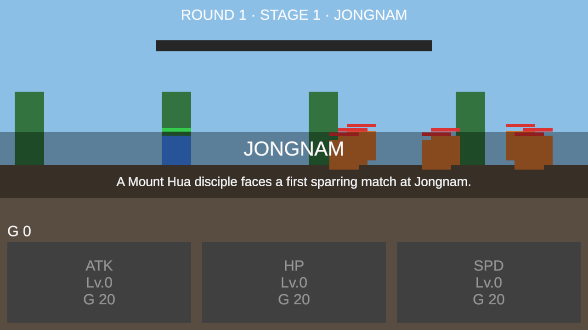
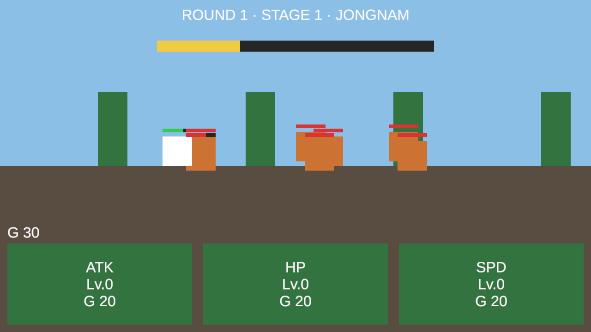
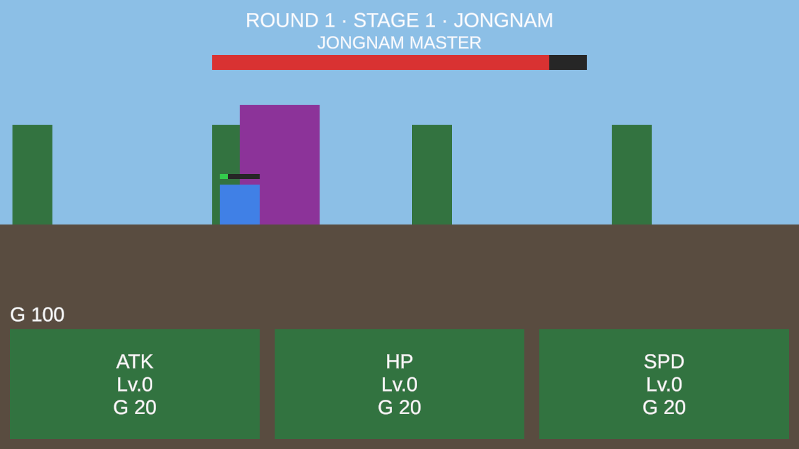

# 루프 증거: loop/20261117-134243 (묶음 저장)

- 판정: **통합 브랜치(`integration`)에 합침** — 관문 위반 0건, 합치기 전 전체 테스트 통과
- 합친 시각: 2026-11-17 14:23
- 병합 커밋: 태그 `loop-merged/20261117-134243` (`git show loop-merged/20261117-134243`)
- 작업 6건, 바뀐 파일 29개 (.meta 제외)
- 테스트 수: 254 → 313개. 합치기 전 실행: EditMode 391/391, PlayMode 16/16
- 이 묶음에서 **보류로 남아 합쳐지지 않은 작업**: 032_save_game_root.md

이 문서는 루프 스크립트가 썼다. 테스트 결과와 관문은 스크립트가 직접 판정한 것이고, "완료 조건별 테스트"와 리뷰 의견은 교차 리뷰 에이전트의 판단이다. 가정과 화면은 사람이 본다.

## 사람이 볼 것

테스트로 판정하지 못한 것이다. 아래 화면 갈무리와 함께 본다.

- `027_save_codec`: 수정 후 Unity 전체 테스트를 직접 완료하지 못했으므로 루프의 전체 테스트 결과를 확인한다.
- `028_auto_save`: Unity 라이선스 클라이언트 연결이 복구된 환경에서 전체 테스트 결과를 확인한다.
- `029_auto_save_retry`: Unity 라이선스 클라이언트 연결 실패로 테스트를 직접 완료하지 못했으므로 라이선스가 정상인 환경에서 전체 테스트 결과를 확인한다.
- `030_file_save_store`: Unity 라이선스 클라이언트 연결을 복구한 환경에서 전체 에딧 모드 및 플레이 모드 테스트를 실행해 통과 여부를 확인한다.
- `031_save_views`: 에디터에서 손상 창을 띄웠을 때(032 뒤, `save.dat` 을 아무 글자로 바꾸고 실행) 화면 가운데에 `SAVE DATA IS CORRUPTED`, 그 아래 `START A NEW GAME? THE OLD SAVE WILL BE REPLACED.`, 그 아래 초록 `NEW GAME` 버튼이 겹치지 않고 보이며 뒤 화면은 어둡게 가려진다.
- `031_save_views`: 에디터에서 저장 실패 중일 때(032 뒤, `save.dat` 을 읽기 전용으로 바꾸고 금화를 얻음) 화면 오른쪽 위 진행 바 아래에 빨간 `SAVE FAILED` 가 보인다.
- `031_save_views`: 032 뒤 `save.dat`을 임의의 글자로 바꾸고 실행하여 가운데 손상 제목과 문구, 초록 NEW GAME 버튼이 겹치지 않고 보이고 뒤 화면이 어둡게 가려지는지 확인한다.
- `031_save_views`: 032 뒤 `save.dat`을 읽기 전용으로 바꾸고 금화를 얻어 오른쪽 위 진행 바 아래에 빨간 SAVE FAILED가 보이는지 확인한다.
- `031_save_views`: Unity 라이선스 연결을 복구한 뒤 전체 에딧 모드와 플레이 모드 테스트 및 컴파일을 확인한다.

## 에이전트가 스스로 정한 것 (가정)

사양과 작업 문서에 없어 에이전트가 정한 것 전부다. 마음에 들지 않으면 후속 작업으로 고친다.

- `026_save_data`: 없음. 공개 연결 지점은 기존 저장 사양과 같다.
- `027_save_codec`: 없음. 공개 연결 지점과 동작은 기존 사양을 따른다.
- `028_auto_save`: 없음. 공개 연결 지점과 수치는 기존 사양과 작업 문서를 따른다.
- `029_auto_save_retry`: 없음. 공개 연결 지점은 변경하지 않았다.
- `030_file_save_store`: 없음. 공개 연결 지점과 동작은 기존 사양을 따른다.
- `031_save_views`: 재초기화 시 기존 실패 표시와 이벤트 구독을 교체한다. 새 게임 콜백이 예외를 던져도 창을 제거한다.

## 화면 갈무리

합치기 직전의 코드로 게임을 실행해 찍은 것이다 (플레이 모드 테스트, 파일 이름의 숫자는 실행 후 지난 게임 시간).

**game_001s.png**



**game_010s.png**



**game_030s.png**




## 작업 요약

| 작업 | 구현 | 리뷰 | 새 테스트 | 바뀐 화면 코드 |
| --- | --- | --- | --- | --- |
| `026_save_data` | codex(시도 1) | claude (교차): 통과 | 12 | 0 |
| `027_save_codec` | codex(시도 1~2) | claude (교차): 통과 | 14 | 0 |
| `028_auto_save` | codex(시도 1) | claude (교차): 통과 | 13 | 0 |
| `029_auto_save_retry` | codex(시도 1) | claude (교차): 통과 | 6 | 0 |
| `030_file_save_store` | codex(시도 1) | claude (교차): 통과 | 6 | 1 |
| `031_save_views` | codex(시도 1) | claude (교차): 통과 | 8 | 2 |

## 관문 (스크립트 판정)

- 위반: 0건
- 확인 필요: 없음

## 작업별 기록

### 026_save_data

- 구현: codex(시도 1)
- 리뷰: claude (교차): 통과
- 바뀐 내용: 저장 값 묶음과 Capture, 불러오기 상태와 결과, 표시 문자열 및 에딧 모드 테스트를 추가했다. Unity 라이선스 연결 실패로 테스트 실행 결과는 후속 검증이 필요하다.
- 리뷰 의견: SaveData·SaveLoadStatus·SaveLoadResult·SaveText 가 작업 문서의 공개 모양 그대로 순수 C#으로 구현됐고, 완료 조건마다 테스트가 있으며 Assert 가 조건의 숫자와 상황을 그대로 검사한다. 하지 말 것 범위와 다른 기능 코드는 건드리지 않았다.
- 작업 문서 원본: `docs/history/026_save_data.md`

| 완료 조건 | 대응하는 테스트 | 판정 |
| --- | --- | --- |
| "스테이지 객체"는 `new StageProgress(wallet, upgrades, new Battle(upgrades), new System.Random(0), startStage, seenIntroStage)` 이고, 강화는 시작 능력치 `(10, 100, 1.0)` 으로 만든다. | SaveDataTests.Restore_OutOfRangeValues_FeatureConstructorsClamp, SaveDataTests.Capture_BeforeBegin_CopiesValuesWithoutChangesOrEvents (두 테스트 모두 이 방식으로 만듦) | 있음 |
| `Assets/Tests/EditMode/Save/SaveDataTests.cs`, `SaveLoadResultTests.cs`, `SaveTextTests.cs` 에 아래 조건마다 테스트가 하나 이상 있고 모두 통과한다. | 세 테스트 파일이 있고 아래 조건마다 테스트가 있음 | 있음 |
| `SaveData.CurrentVersion` 은 1 이다. | SaveDataTests.CurrentVersion_IsOne | 있음 |
| `new SaveData(1234, 3, 2, 10, 7, 5, 638000000000000000)` 의 일곱 속성은 차례로 1234, 3, 2, 10, 7, 5, 638000000000000000 이다. | SaveDataTests.Constructor_StoresAllValues | 있음 |
| `new SaveData(-5, 0, 0, 15, 0, 9, 0)` 은 예외 없이 만들어지고 `Gold` −5, `AttackSpeedLevel` 15, `StageNumber` 0, `SeenIntroStage` 9 가 그대로다. | SaveDataTests.Constructor_OutOfRangeValues_ArePreserved | 있음 |
| `new SaveData(-5, 0, 0, 15, 0, 9, 0)` 의 값으로 `new Wallet(-5)`, `new StatUpgrades(wallet, 10, 100, 1.0, 0, 0, 15)`, 스테이지 객체(`startStage: 0`, `seenIntroStage: 9`)를 만들면 `Balance` 0, `GetLevel(StatType.AttackSpeed)` 10, `StageNumber` 1, `SeenIntroStage` 5 이다. | SaveDataTests.Restore_OutOfRangeValues_FeatureConstructorsClamp | 있음 |
| `new Wallet(500)`, 단계 `(2, 1, 3)` 인 `StatUpgrades`, `startStage: 4`, `seenIntroStage: 3` 인 스테이지 객체(`Begin` 전)로 `SaveData.Capture(wallet, upgrades, stage, 100)` 을 하면 일곱 값이 500, 2, 1, 3, 4, 3, 100 이다. | SaveDataTests.Capture_BeforeBegin_CopiesValuesWithoutChangesOrEvents | 있음 |
| 위 `Capture` 뒤 `wallet.Balance` 500, 세 단계 2·1·3, `stage.StageNumber` 4, `stage.SeenIntroStage` 3, `stage.HasBegun` `false` 가 그대로이고, `Capture` 동안 `BalanceChanged`·`Upgraded`·`StageStarted` 는 한 번도 오지 않는다. | SaveDataTests.Capture_BeforeBegin_CopiesValuesWithoutChangesOrEvents | 있음 |
| `SaveData.Capture` 에 `wallet`, `upgrades`, `stage` 를 하나씩 `null` 로 넣으면 각각 `ArgumentNullException` 이다. | SaveDataTests.Capture_NullDependencies_ThrowsArgumentNull | 있음 |
| `new SaveLoadResult(SaveLoadStatus.Loaded, null)` 은 `ArgumentException` 이다. | SaveLoadResultTests.Constructor_LoadedWithoutData_ThrowsArgumentException | 있음 |
| `new SaveLoadResult(SaveLoadStatus.Empty, new SaveData(0, 0, 0, 0, 1, 0, 0))` 은 `ArgumentException` 이다. | SaveLoadResultTests.Constructor_EmptyWithData_ThrowsArgumentException | 있음 |
| `new SaveLoadResult(SaveLoadStatus.Corrupt, null)` 은 `Status` `Corrupt`, `Data` `null`, `HasSaveData` `false` 이다. | SaveLoadResultTests.Constructor_CorruptWithoutData_HasNoSaveData | 있음 |
| `new SaveLoadResult(SaveLoadStatus.Loaded, data)` 는 `Status` `Loaded`, `Data` 가 넣은 그 객체, `HasSaveData` `true` 이다. | SaveLoadResultTests.Constructor_LoadedWithData_ReturnsSameData | 있음 |
| `SaveLoadStatus` 의 정수 값은 `Empty` 0, `Loaded` 1, `Corrupt` 2, `UnsupportedVersion` 3 이다. | SaveLoadResultTests.StatusValues_MatchSaveFormat | 있음 |
| `SaveText` 의 네 값은 `"SAVE FAILED"`, `"SAVE DATA IS CORRUPTED"`, `"START A NEW GAME? THE OLD SAVE WILL BE REPLACED."`, `"NEW GAME"` 이다. | SaveTextTests.TextConstants_MatchSpecifiedStrings | 있음 |
| 기존 테스트가 모두 통과한다. | 루프의 전체 테스트 실행 | 루프가 판정 |

리뷰 지적 (합친 뒤에도 남은 것):

- [note] 보고서에 따르면 구현한 에이전트는 Unity 테스트를 직접 실행하지 못했다(라이선스/임시 파일 오류). 통과 여부는 루프의 테스트 결과로 확인한다.
- [note] SaveDataTests.Capture_BeforeBegin_CopiesValuesWithoutChangesOrEvents (Assets/Tests/EditMode/Save/SaveDataTests.cs:52) 는 세 알림을 카운터 하나로 함께 센다. 조건(한 번도 오지 않음)은 충분히 검사한다.

새 테스트 12개: `SaveDataTests.Capture_BeforeBegin_CopiesValuesWithoutChangesOrEvents`, `SaveDataTests.Capture_NullDependencies_ThrowsArgumentNull`, `SaveDataTests.Constructor_OutOfRangeValues_ArePreserved`, `SaveDataTests.Constructor_StoresAllValues`, `SaveDataTests.CurrentVersion_IsOne`, `SaveDataTests.Restore_OutOfRangeValues_FeatureConstructorsClamp`, `SaveLoadResultTests.Constructor_CorruptWithoutData_HasNoSaveData`, `SaveLoadResultTests.Constructor_EmptyWithData_ThrowsArgumentException`, `SaveLoadResultTests.Constructor_LoadedWithData_ReturnsSameData`, `SaveLoadResultTests.Constructor_LoadedWithoutData_ThrowsArgumentException`, `SaveLoadResultTests.StatusValues_MatchSaveFormat`, `SaveTextTests.TextConstants_MatchSpecifiedStrings`

### 027_save_codec

- 구현: codex(시도 1~2)
- 리뷰: claude (교차): 통과
- 바뀐 내용: 저장 코덱 테스트의 공통 검증을 각 테스트 본문으로 옮겨 관문이 인식하도록 수정했다. 기존 검증 조건을 유지했다.
- 리뷰 의견: SaveCodec 의 Encode/Decode 가 작업 문서의 파일 형식과 판정 순서 그대로 구현됐고, 완료 조건마다 상황과 기대값(숫자 포함)을 직접 확인하는 테스트가 있다. 하지 말 것 침범과 UnityEngine 의존은 없다.
- 작업 문서 원본: `docs/history/027_save_codec.md`

| 완료 조건 | 대응하는 테스트 | 판정 |
| --- | --- | --- |
| 아래에서 "기준 글자"는 `"version=1\ngold=1234\nattackLevel=3\nhealthLevel=2\nattackSpeedLevel=10\nstageNumber=7\nseenIntroStage=5\nsavedAtUtcTicks=638000000000000000\n"` 이다. | SaveCodecTests.Standard 상수 (기준 글자와 같음) | 있음 |
| `Assets/Tests/EditMode/Save/SaveCodecTests.cs` 에 아래 조건마다 테스트가 하나 이상 있고 모두 통과한다. | SaveCodecTests 전체 (조건 3~24 각각 대응) | 있음 |
| `SaveCodec.Encode(new SaveData(1234, 3, 2, 10, 7, 5, 638000000000000000))` 은 기준 글자와 같다. | SaveCodecTests.Encode_StandardData_ProducesExactText | 있음 |
| 기준 글자를 `Decode` 하면 `Status` `Loaded`, `HasSaveData` `true` 이고 `Data` 의 일곱 값이 1234, 3, 2, 10, 7, 5, 638000000000000000 이다. | SaveCodecTests.Decode_StandardText_LoadsAllValues | 있음 |
| `Decode(null)` 은 `Status` `Empty`, `Data` `null`, `HasSaveData` `false` 이다. | SaveCodecTests.Decode_Null_IsEmpty | 있음 |
| `Decode("")` 은 `Status` `Corrupt`, `Data` `null`, `HasSaveData` `false` 이다. | SaveCodecTests.Decode_EmptyOrMalformed_IsCorrupt("") | 있음 |
| `Decode("hello")` 는 `Status` `Corrupt`, `Data` `null`, `HasSaveData` `false` 이다. | SaveCodecTests.Decode_EmptyOrMalformed_IsCorrupt("hello") | 있음 |
| 기준 글자에서 `version=1\n` 줄을 뺀 글자는 `Corrupt` 이다. | SaveCodecTests.Decode_MissingOrInvalidField_IsCorrupt("version=1\n", "") | 있음 |
| 기준 글자의 `version=1` 을 `version=abc` 로 바꾼 글자는 `Corrupt` 이다. | SaveCodecTests.Decode_MissingOrInvalidField_IsCorrupt("version=1", "version=abc") | 있음 |
| 기준 글자의 `version=1` 을 `version=2` 로 바꾼 글자는 `UnsupportedVersion`, `Data` `null`, `HasSaveData` `false` 이다. | SaveCodecTests.Decode_UnknownVersion_IsUnsupported("2") | 있음 |
| 기준 글자의 `version=1` 을 `version=0` 으로 바꾼 글자는 `UnsupportedVersion` 이다. | SaveCodecTests.Decode_UnknownVersion_IsUnsupported("0") | 있음 |
| 한 줄짜리 `"version=2\n"` 은 `UnsupportedVersion` 이다. | SaveCodecTests.Decode_UnknownVersionAlone_IsUnsupported | 있음 |
| 기준 글자에서 `gold=1234\n` 줄을 뺀 글자는 `Corrupt` 이다. | SaveCodecTests.Decode_MissingOrInvalidField_IsCorrupt("gold=1234\n", "") | 있음 |
| 기준 글자에서 `savedAtUtcTicks=638000000000000000\n` 줄을 뺀 글자는 `Corrupt` 이다. | SaveCodecTests.Decode_MissingOrInvalidField_IsCorrupt("savedAtUtcTicks=638000000000000000\n", "") | 있음 |
| 기준 글자의 `gold=1234` 를 `gold=12a`, `gold= 12`, `gold=99999999999999999999` 로 각각 바꾼 세 글자는 모두 `Corrupt` 이다. | SaveCodecTests.Decode_MissingOrInvalidField_IsCorrupt (TestCase 세 개) | 있음 |
| 기준 글자의 `attackLevel=3` 을 `attackLevel=3000000000` 으로 바꾼 글자는 `Corrupt` 이다. | SaveCodecTests.Decode_MissingOrInvalidField_IsCorrupt("attackLevel=3", "attackLevel=3000000000") | 있음 |
| 기준 글자 끝에 `gold=5\n` 을 붙인 글자(같은 이름 두 번)는 `Corrupt` 이다. | SaveCodecTests.Decode_DuplicateOrMalformedLine_IsCorrupt("gold=5\n") | 있음 |
| 기준 글자 끝에 `oops\n` 을 붙인 글자(`=` 없는 줄)는 `Corrupt` 이다. | SaveCodecTests.Decode_DuplicateOrMalformedLine_IsCorrupt("oops\n") | 있음 |
| 기준 글자의 `\n` 을 모두 `\r\n` 으로 바꾼 글자는 `Loaded` 이고 일곱 값이 1234, 3, 2, 10, 7, 5, 638000000000000000 이다. | SaveCodecTests.Decode_Crlf_LoadsAllValues | 있음 |
| 기준 글자의 `gold=1234\n` 뒤에 `\n`(빈 줄)과 `extra=1\n` 을 넣은 글자는 `Loaded` 이고 일곱 값이 1234, 3, 2, 10, 7, 5, 638000000000000000 이다. | SaveCodecTests.Decode_BlankAndExtraLines_LoadsAllValues | 있음 |
| `new SaveData(-5, 0, 0, 15, 0, 9, 0)` 을 `Encode` 한 뒤 `Decode` 하면 `Loaded` 이고 `Gold` −5, `AttackSpeedLevel` 15, `StageNumber` 0, `SeenIntroStage` 9, `SavedAtUtcTicks` 0 이다. | SaveCodecTests.RoundTrip_OutOfRangeValues_ArePreserved | 있음 |
| 지금 문화권을 `de-DE` 로 바꾼 채 `new SaveData(1234567, 0, 0, 0, 1, 0, -1)` 을 `Encode` 하면 `gold=1234567\n` 과 `savedAtUtcTicks=-1\n` 이 들어 있다. | SaveCodecTests.RoundTrip_GermanCulture_UsesInvariantNumbers | 있음 |
| 지금 문화권을 `de-DE` 로 바꾼 채 위 글자를 `Decode` 하면 `Loaded` 에 `Gold` 1234567, `SavedAtUtcTicks` −1 이다. | SaveCodecTests.RoundTrip_GermanCulture_UsesInvariantNumbers | 있음 |
| `SaveCodec.Encode(null)` 은 `ArgumentNullException` 이다. | SaveCodecTests.Encode_Null_Throws | 있음 |
| 기존 테스트가 모두 통과한다. | 루프 전체 테스트 | 루프가 판정 |

리뷰 지적 (합친 뒤에도 남은 것):

- [note] 보고서의 테스트 결과에 '수정 후 run_unity_tests.py 가 대기하여 중단했다'고 적혀 있다. 이번 변경이 통과하는지는 루프의 전체 테스트 결과로 확인해야 한다.
- [note] SaveCodecTests.cs 의 Decode_UnknownVersionWithMalformedOrDuplicateLine_IsCorrupt 는 완료 조건에 없는 추가 테스트다. 판정 순서(2단계가 3단계보다 먼저)와 맞으므로 문제는 없다.

새 테스트 14개: `SaveCodecTests.Decode_BlankAndExtraLines_LoadsAllValues`, `SaveCodecTests.Decode_Crlf_LoadsAllValues`, `SaveCodecTests.Decode_DuplicateOrMalformedLine_IsCorrupt`, `SaveCodecTests.Decode_EmptyOrMalformed_IsCorrupt`, `SaveCodecTests.Decode_MissingOrInvalidField_IsCorrupt`, `SaveCodecTests.Decode_Null_IsEmpty`, `SaveCodecTests.Decode_StandardText_LoadsAllValues`, `SaveCodecTests.Decode_UnknownVersionAlone_IsUnsupported`, `SaveCodecTests.Decode_UnknownVersionWithMalformedOrDuplicateLine_IsCorrupt`, `SaveCodecTests.Decode_UnknownVersion_IsUnsupported`, `SaveCodecTests.Encode_Null_Throws`, `SaveCodecTests.Encode_StandardData_ProducesExactText`, `SaveCodecTests.RoundTrip_GermanCulture_UsesInvariantNumbers`, `SaveCodecTests.RoundTrip_OutOfRangeValues_ArePreserved`

### 028_auto_save

- 구현: codex(시도 1)
- 리뷰: claude (교차): 통과
- 바뀐 내용: 저장소 인터페이스와 메모리 저장소, 자동 저장 및 에딧 모드 테스트를 추가했다. Unity 라이선스 연결 실패로 테스트 실행 결과는 확인하지 못했다.
- 리뷰 의견: ISaveStore, MemorySaveStore, AutoSave가 작업 문서의 공개 모양과 동작대로 구현됐다. 완료 조건마다 테스트가 있고, 각 테스트는 조건에 적힌 상황과 숫자를 직접 검사한다. '하지 말 것'에 적힌 범위(029 몫인 재시도 대기와 예외 처리, 다른 기능의 코드, Game 코드)는 건드리지 않았다.
- 작업 문서 원본: `docs/history/028_auto_save.md`

| 완료 조건 | 대응하는 테스트 | 판정 |
| --- | --- | --- |
| "스테이지 객체"는 `new StageProgress(wallet, upgrades, new Battle(upgrades), new System.Random(0), startStage, seenIntroStage)`(따로 적지 않으면 `startStage: 1`, `seenIntroStage: 5`), 강화는 `new StatUpgrades(wallet, 10, 100, 1.0)` 이다. "가짜 저장소"는 `FakeSaveStore`, "쓴 횟수"는 `WriteCount`, "마지막 글자"는 `LastText` 이다. `AutoSave` 는 따로 적지 않으면 `new AutoSave(가짜 저장소, wallet, upgrades, stage)` 이다. | AutoSaveTests.Create 도우미가 정의대로 만든다 (FakeSaveStore는 요구한 모양을 모두 갖춤) | 있음 |
| `Assets/Tests/EditMode/Save/MemorySaveStoreTests.cs` 와 `Assets/Tests/EditMode/Save/AutoSaveTests.cs` 에 아래 조건마다 테스트가 하나 이상 있고 모두 통과한다. | 두 파일에 아래 조건마다 테스트가 있음 (통과 여부는 루프의 테스트 실행) | 있음 |
| `new MemorySaveStore()` 의 `Text` 는 `null` 이고, `TryWrite("abc")` 는 `true` 이며 그 뒤 `Text` 는 `"abc"` 이다. | MemorySaveStoreTests.Write_Text_IsStored | 있음 |
| `MemorySaveStore.TryWrite(null)` 은 `ArgumentNullException` 이다. | MemorySaveStoreTests.Write_Null_ThrowsArgumentNull | 있음 |
| `AutoSave` 생성자에 `store`, `wallet`, `upgrades`, `stage` 를 하나씩 `null` 로 넣으면 각각 `ArgumentNullException` 이다. | AutoSaveTests.Constructor_NullDependency_ThrowsArgumentNull | 있음 |
| `AutoSave` 를 만든 직후 쓴 횟수 0, `Enabled` `true`, `IsDirty` `false`, `HasFailed` `false` 이고, 그 상태에서 `Flush(100)` 은 `false`, 쓴 횟수 0 이다. | AutoSaveTests.Constructor_AndCleanFlush_DoNotWrite | 있음 |
| `new Wallet(0)` 으로 만든 `AutoSave` 에서 `wallet.Add(10)` 을 하면 `IsDirty` 가 `true` 이고 쓴 횟수는 0 이다. | AutoSaveTests.BalanceChange_FlushWritesOnceAndClearsDirty | 있음 |
| 이어서 `Flush(100)` 은 `true`, 쓴 횟수 1, `IsDirty` `false` 이고, 마지막 글자를 `SaveCodec.Decode` 하면 `Loaded` 에 `Gold` 10, `SavedAtUtcTicks` 100 이다. | AutoSaveTests.BalanceChange_FlushWritesOnceAndClearsDirty (ReadLast로 Loaded 확인) | 있음 |
| 이어서 바로 `Flush(200)` 은 `false`, 쓴 횟수 1 이다. | AutoSaveTests.BalanceChange_FlushWritesOnceAndClearsDirty | 있음 |
| `new Wallet(100)` 으로 만든 `AutoSave` 에서 `upgrades.TryUpgrade(StatType.Attack)`(금화 80, 공격력 단계 1) 뒤 `wallet.Add(5)` 를 하고 `Flush(100)` 을 한 번 부르면 쓴 횟수 1 이고 마지막 글자의 `Gold` 85, `AttackLevel` 1 이다. | AutoSaveTests.UpgradeAndBalanceChange_FlushCombinesChanges | 있음 |
| `new Wallet(0)` 으로 만든 `AutoSave` 에서 `wallet.Add(0)`, 실패하는 `upgrades.TryUpgrade(StatType.Attack)`, `wallet.TrySpend(5)` 를 해도 `IsDirty` 는 `false` 이다. | AutoSaveTests.UnchangedOperations_DoNotMarkDirty | 있음 |
| `startStage: 1`, `seenIntroStage: 0` 인 스테이지 객체로 `AutoSave` 를 만든 뒤 `stage.Begin()` 을 부르면 `IsDirty` 가 `true` 이다. | AutoSaveTests.StageBegin_FlushStoresIntroProgress | 있음 |
| 이어서 `Flush(100)` 은 `true` 이고 마지막 글자를 `Decode` 하면 `StageNumber` 1, `SeenIntroStage` 1 이다. | AutoSaveTests.StageBegin_FlushStoresIntroProgress | 있음 |
| 변화가 없는 `AutoSave` 에서 `SaveNow(500)` 은 `true`, 쓴 횟수 1, 마지막 글자의 `SavedAtUtcTicks` 500 이다. | AutoSaveTests.SaveNow_WithoutChanges_WritesTimestamp | 있음 |
| 가짜 저장소의 `Succeeds` 를 `false` 로 하고 `wallet.Add(10)` → `Flush(100)` 을 하면 `false`, 쓴 횟수 1, `IsDirty` `true` 이다. | AutoSaveTests.Flush_StoreFails_LeavesDirty | 있음 |
| `new Wallet(0)`, `enabled: false` 로 만든 `AutoSave` 에서 `wallet.Add(10)` 을 하면 `IsDirty` 는 `false` 이고, `Flush(100)` 과 `SaveNow(100)` 은 둘 다 `false`, 쓴 횟수 0 이다. | AutoSaveTests.Disabled_AndEnabled_TracksOnlyLaterChanges | 있음 |
| 이어서 `Enable()` 뒤 `Enabled` 는 `true`, `IsDirty` 는 `false` 이고, `wallet.Add(5)` → `Flush(200)` 은 `true`, 쓴 횟수 1, 마지막 글자의 `Gold` 15 이다. | AutoSaveTests.Disabled_AndEnabled_TracksOnlyLaterChanges | 있음 |
| 이어서 `Enable()` 을 한 번 더 불러도 `Enabled` `true`, `IsDirty` `false`, 쓴 횟수 1 그대로다. | AutoSaveTests.Disabled_AndEnabled_TracksOnlyLaterChanges | 있음 |
| `AutoSave.Tick` 에 −0.1, `double.NaN`, `double.PositiveInfinity` 를 넣으면 각각 `ArgumentOutOfRangeException` 이다. | AutoSaveTests.Tick_InvalidTime_ThrowsArgumentOutOfRange (TestCase 4개) | 있음 |
| 대기가 없는 `AutoSave` 에서 `Tick(0)` 과 `Tick(1.0)` 뒤 `IsDirty` `false`, `HasFailed` `false`, 쓴 횟수 0 그대로다. | AutoSaveTests.Tick_WithoutWait_DoesNothing | 있음 |
| 기존 테스트가 모두 통과한다. | 루프의 전체 테스트 실행 | 루프가 판정 |

리뷰 지적 (합친 뒤에도 남은 것):

- [note] 보고서의 '테스트 결과'에는 구현한 에이전트가 Unity 라이선스 문제로 테스트를 직접 실행하지 못했다고 적혀 있다. 통과 여부는 루프의 테스트 실행 결과로 판정한다.
- [note] FailedChanged는 작업 문서대로 선언만 했고 아직 쓰는 곳이 없다 (Assets/Scripts/Core/Save/AutoSave.cs:32). 그래서 컴파일 경고 CS0067이 날 수 있는데, 029에서 이 이벤트를 보내기 시작하면 사라진다.

새 테스트 13개: `AutoSaveTests.BalanceChange_FlushWritesOnceAndClearsDirty`, `AutoSaveTests.Constructor_AndCleanFlush_DoNotWrite`, `AutoSaveTests.Constructor_NullDependency_ThrowsArgumentNull`, `AutoSaveTests.Disabled_AndEnabled_TracksOnlyLaterChanges`, `AutoSaveTests.Flush_StoreFails_LeavesDirty`, `AutoSaveTests.SaveNow_WithoutChanges_WritesTimestamp`, `AutoSaveTests.StageBegin_FlushStoresIntroProgress`, `AutoSaveTests.Tick_InvalidTime_ThrowsArgumentOutOfRange`, `AutoSaveTests.Tick_WithoutWait_DoesNothing`, `AutoSaveTests.UnchangedOperations_DoNotMarkDirty`, `AutoSaveTests.UpgradeAndBalanceChange_FlushCombinesChanges`, `MemorySaveStoreTests.Write_Null_ThrowsArgumentNull`, `MemorySaveStoreTests.Write_Text_IsStored`

### 029_auto_save_retry

- 구현: codex(시도 1)
- 리뷰: claude (교차): 통과
- 바뀐 내용: 자동 저장 실패 시 재시도 대기와 상태 변화 알림을 구현하고 저장소 예외를 실패로 처리했다. 재시도 테스트를 추가했으며 Unity 라이선스 연결 실패로 테스트 실행은 완료하지 못했다.
- 리뷰 의견: AutoSave.Write 가 예외를 잡아 실패로 보고, 실패할 때마다 재시도 대기를 3.0 으로 다시 두며, HasFailed 가 실제로 바뀐 때에만 FailedChanged 를 보낸다. 이 동작은 사양과 같고, 완료 조건마다 숫자까지 확인하는 테스트가 있다.
- 작업 문서 원본: `docs/history/029_auto_save_retry.md`

| 완료 조건 | 대응하는 테스트 | 판정 |
| --- | --- | --- |
| 따로 적지 않으면 `wallet = new Wallet(0)`, `upgrades = new StatUpgrades(wallet, 10, 100, 1.0)`, `stage = new StageProgress(wallet, upgrades, new Battle(upgrades), new System.Random(0))`, `store = new FakeSaveStore()`, `autoSave = new AutoSave(store, wallet, upgrades, stage)` 이다. "시도"는 `store.WriteCount`, "마지막 글자"는 `store.LastText` 이다. `FailedChanged` 는 `AutoSave` 를 만든 직후 구독해 받은 값을 차례로 기록한다. | AutoSaveRetryTests.SetUp (조건대로 객체를 만들고, 만든 직후 FailedChanged 를 구독해 changes 에 기록) | 있음 |
| `Assets/Tests/EditMode/Save/AutoSaveRetryTests.cs` 에 아래 조건마다 테스트가 하나 이상 있고 모두 통과한다. | AutoSaveRetryTests 의 테스트 6개 (파일 위치와 네임스페이스가 요구대로임) | 있음 |
| `store.Succeeds = false` 로 하고 `wallet.Add(10)` → `Flush(100)` 을 하면 `false`, 시도 1, `HasFailed` `true`, `IsDirty` `true` 이다. | AutoSaveRetryTests.FailedFlush_WaitsAndRetriesWithCurrentTimestamp | 있음 |
| 위 실패에서 `FailedChanged` 는 `true` 를 담아 정확히 한 번 온다. | AutoSaveRetryTests.FailedFlush_WaitsAndRetriesWithCurrentTimestamp (CollectionAssert.AreEqual({true}, changes)) | 있음 |
| 위 실패에 이어 `store.Succeeds = true` 로 바꾸고 바로 `Flush(200)` 을 하면 `false` 이고 시도는 1 그대로다. | AutoSaveRetryTests.FailedFlush_WaitsAndRetriesWithCurrentTimestamp | 있음 |
| 이어서 `Tick(2.9)` 뒤 `Flush(250)` 은 `false` 이고 시도는 1 그대로다. | AutoSaveRetryTests.FailedFlush_WaitsAndRetriesWithCurrentTimestamp | 있음 |
| 이어서 `Tick(0.1)` 뒤 `Flush(300)` 은 `true`, 시도 2, `HasFailed` `false`, `IsDirty` `false` 이고 마지막 글자를 `Decode` 하면 `SavedAtUtcTicks` 300 이다. | AutoSaveRetryTests.FailedFlush_WaitsAndRetriesWithCurrentTimestamp | 있음 |
| 위 흐름 전체에서 `FailedChanged` 는 모두 두 번, 차례로 `true`, `false` 를 담아 온다. | AutoSaveRetryTests.FailedFlush_WaitsAndRetriesWithCurrentTimestamp (CollectionAssert.AreEqual({true,false}, changes)) | 있음 |
| `store.Succeeds = false` 로 둔 채 `wallet.Add(10)` → `Flush(100)` → `Tick(3.0)` → `Flush(200)` 을 하면 시도 2, `HasFailed` `true` 이고 `FailedChanged` 는 한 번만(`true`) 온다. | AutoSaveRetryTests.RepeatedFailure_RestartsWaitWithoutDuplicateEvent | 있음 |
| 이어서 `Tick(2.9)` → `Flush(300)` 을 하면 `false` 이고 시도는 2 그대로다 (두 번째 실패에서 대기를 다시 3.0 으로 셌다). | AutoSaveRetryTests.RepeatedFailure_RestartsWaitWithoutDuplicateEvent | 있음 |
| `store.Succeeds = false` 로 `wallet.Add(10)` → `Flush(100)` 실패 뒤 `store.Succeeds = true` 로 바꾸고 `wallet.Add(5)` → `Tick(1.0)` → `Flush(400)` 을 하면 `false` 이고 시도는 1 그대로다 (대기 중의 새 변화도 쓰지 않는다). | AutoSaveRetryTests.ChangeDuringRetryWait_DoesNotWriteEarly | 있음 |
| `store.Throws = true` 로 하고 `wallet.Add(10)` → `Flush(100)` 을 하면 예외 없이 `false`, `HasFailed` `true`, `IsDirty` `true` 이다. | AutoSaveRetryTests.Flush_StoreThrows_ReportsFailureWithoutThrowing | 있음 |
| `store.Throws = true` 로 하고 `SaveNow(100)` 을 부르면 예외 없이 `false`, `HasFailed` `true` 이다. | AutoSaveRetryTests.SaveNow_StoreThrows_ReportsFailureWithoutThrowing | 있음 |
| `store.Succeeds = false` 로 `wallet.Add(10)` → `Flush(100)` 실패 뒤 대기 중에 `store.Succeeds = true` 로 바꾸고 `SaveNow(600)` 을 부르면 `true`, 시도 2, `HasFailed` `false`, `IsDirty` `false`, 마지막 글자의 `SavedAtUtcTicks` 600 이다. | AutoSaveRetryTests.SaveNow_DuringRetryWait_WritesAndClearsWait | 있음 |
| 위 `SaveNow(600)` 성공 뒤 바로 `wallet.Add(1)` → `Flush(700)` 은 `true`, 시도 3 이다 (성공으로 대기가 0 이 되었다). | AutoSaveRetryTests.SaveNow_DuringRetryWait_WritesAndClearsWait | 있음 |
| 기존 테스트가 모두 통과한다. | 루프의 전체 테스트 실행 | 루프가 판정 |

리뷰 지적 (합친 뒤에도 남은 것):

- [note] 보고서를 보면 구현 에이전트는 Unity 라이선스 문제로 테스트를 직접 돌려 보지 못했다. 그래서 신규 테스트와 기존 테스트가 실제로 통과하는지는 루프의 테스트 실행 결과로 확인해야 한다.
- [note] AutoSave.cs:53 이 catch (Exception) 으로 모든 예외를 삼킨다. 사양(save.md 31줄 '예외를 밖으로 내보내지 않는다')과 같으므로 문제는 없다.

새 테스트 6개: `AutoSaveRetryTests.ChangeDuringRetryWait_DoesNotWriteEarly`, `AutoSaveRetryTests.FailedFlush_WaitsAndRetriesWithCurrentTimestamp`, `AutoSaveRetryTests.Flush_StoreThrows_ReportsFailureWithoutThrowing`, `AutoSaveRetryTests.RepeatedFailure_RestartsWaitWithoutDuplicateEvent`, `AutoSaveRetryTests.SaveNow_DuringRetryWait_WritesAndClearsWait`, `AutoSaveRetryTests.SaveNow_StoreThrows_ReportsFailureWithoutThrowing`

### 030_file_save_store

- 구현: codex(시도 1)
- 리뷰: claude (교차): 통과
- 바뀐 내용: 파일 저장소와 임시 폴더 기반 플레이 모드 테스트를 추가했다. Unity 라이선스 연결 실패로 테스트 실행은 확인하지 못했다.
- 리뷰 의견: FileSaveStore 는 작업 문서와 사양의 공개 모양, 읽기와 쓰기 순서(임시 파일에 쓰고 Replace 또는 Move, 실패하면 임시 파일을 지우고 false), BOM 없는 UTF-8 쓰기를 그대로 구현했고, 완료 조건마다 플레이 모드 테스트가 기대값까지 확인한다. 구현 에이전트는 Unity 라이선스 문제로 테스트를 직접 돌리지 못했으므로 컴파일과 통과 여부는 루프가 판정한다.
- 작업 문서 원본: `docs/history/030_file_save_store.md`

| 완료 조건 | 대응하는 테스트 | 판정 |
| --- | --- | --- |
| "임시 폴더"는 테스트마다 새로 정한, 아직 만들지 않은 폴더 경로다 (테스트가 따로 만들라고 적은 경우만 만든다). | FileSaveStoreTests.SetUp (테스트마다 Guid 경로만 정하고 만들지 않음, TearDown 에서 지우며 예외 무시) | 있음 |
| Assets/Tests/PlayMode/Save/FileSaveStoreTests.cs` 에 아래 조건마다 테스트가 하나 이상 있고 모두 통과한다. | FileSaveStoreTests 의 6개 테스트가 조건 3~10 을 모두 다룬다 (통과 여부는 루프 실행 결과) | 있음 |
| new FileSaveStore(null)` 과 `new FileSaveStore("")` 은 각각 `ArgumentException`(또는 그 하위 타입)이다. | FileSaveStoreTests.Constructor_NullOrEmptyDirectory_ThrowsArgumentException | 있음 |
| 아직 없는 임시 폴더의 `FileSaveStore.Load()` 는 `Status` `Empty`, `Data` `null` 이다. | FileSaveStoreTests.Load_MissingDirectory_ReturnsEmpty | 있음 |
| 같은 저장소의 `TryWrite("abc")` 는 `true` 이고, 그 뒤 임시 폴더의 `save.dat` 을 읽은 내용은 `"abc"` 이며 `save.tmp` 파일은 없다. | FileSaveStoreTests.TryWrite_NewFile_WritesUtf8WithoutBomAndRemovesTemporaryFile | 있음 |
| TryWrite("abc")` 로 쓴 `save.dat` 의 첫 세 바이트는 `0x61 0x62 0x63` 이다 (BOM 없음). | FileSaveStoreTests.TryWrite_NewFile_WritesUtf8WithoutBomAndRemovesTemporaryFile (전체 바이트가 {0x61,0x62,0x63} 인지 확인) | 있음 |
| TryWrite("abc")` 뒤 `Load()` 는 `Corrupt` 이다. | FileSaveStoreTests.Load_InvalidThenReplacedSave_ReturnsCorruptThenLoaded | 있음 |
| 이어서 `SaveCodec.Encode(new SaveData(1234, 3, 2, 10, 7, 5, 638000000000000000))` 을 `TryWrite` 하면 `true` 이고 (이미 있는 `save.dat` 을 바꾸는 경우), `Load()` 는 `Loaded` 에 일곱 값 1234, 3, 2, 10, 7, 5, 638000000000000000 이며 `save.tmp` 파일은 없다. | FileSaveStoreTests.Load_InvalidThenReplacedSave_ReturnsCorruptThenLoaded | 있음 |
| 임시 폴더를 만들고 `save.dat` 을 `"old"` 로 써 둔 뒤 같은 폴더에 `save.tmp` 라는 이름의 **폴더**를 만들어 두면, `TryWrite("new")` 는 예외 없이 `false` 이고 `save.dat` 의 내용은 `"old"` 그대로다. | FileSaveStoreTests.TryWrite_TemporaryPathIsDirectory_PreservesExistingFile | 있음 |
| TryWrite(null)` 은 `ArgumentNullException` 이다. | FileSaveStoreTests.TryWrite_NullText_ThrowsArgumentNullException | 있음 |
| 화면 코드가 컴파일되고 기존 테스트가 모두 통과한다. | 루프의 컴파일과 전체 테스트 실행 | 루프가 판정 |

리뷰 지적 (합친 뒤에도 남은 것):

- [note] 구현 에이전트의 보고서에 따르면 Unity 라이선스 연결 실패로 테스트를 직접 실행하지 못했다. 컴파일과 통과 여부는 루프의 테스트 실행 결과로 확인해야 한다.
- [note] Load 는 File.ReadAllText(path, Encoding.UTF8) 로 읽어 BOM 이 있으면 떼어 낸다. 요구사항의 'UTF-8 로 읽는다'와 맞고 문제는 없다 (Assets/Scripts/Game/Save/FileSaveStore.cs:25).

새 테스트 6개: `FileSaveStoreTests.Constructor_NullOrEmptyDirectory_ThrowsArgumentException`, `FileSaveStoreTests.Load_InvalidThenReplacedSave_ReturnsCorruptThenLoaded`, `FileSaveStoreTests.Load_MissingDirectory_ReturnsEmpty`, `FileSaveStoreTests.TryWrite_NewFile_WritesUtf8WithoutBomAndRemovesTemporaryFile`, `FileSaveStoreTests.TryWrite_NullText_ThrowsArgumentNullException`, `FileSaveStoreTests.TryWrite_TemporaryPathIsDirectory_PreservesExistingFile`

### 031_save_views

- 구현: codex(시도 1)
- 리뷰: claude (교차): 통과
- 바뀐 내용: 저장 실패 표시와 손상 오류 창 및 플레이 모드 테스트를 추가했다. Unity 라이선스 연결 문제로 테스트 실행은 확인하지 못했다.
- 리뷰 의견: SaveView 와 SaveErrorView 가 작업 문서의 공개 모양, 배치 수치, 동작대로 구현됐습니다. 플레이 모드 완료 조건마다 상황과 기대값을 직접 확인하는 테스트가 있습니다. 하지 말 것 침범과 화면 코드 안의 계산은 없습니다.
- 작업 문서 원본: `docs/history/031_save_views.md`

| 완료 조건 | 대응하는 테스트 | 판정 |
| --- | --- | --- |
| `SaveViewTests` 의 Core 객체는 `wallet = new Wallet(0)`, `upgrades = new StatUpgrades(wallet, 10, 100, 1.0)`, `stage = new StageProgress(wallet, upgrades, new Battle(upgrades), new System.Random(0))`, `autoSave = new AutoSave(가짜 저장소, wallet, upgrades, stage)` 이다. "프레임을 넘긴다"는 `yield return null` 을 두 번 하는 것이다. | SaveViewTests.SetUp (Core 객체가 조건과 같음), 프레임 넘김은 yield return null 두 번 | 있음 |
| Assets/Tests/PlayMode/Save/SaveViewTests.cs` 와 `Assets/Tests/PlayMode/Save/SaveErrorViewTests.cs` 에 아래 조건마다 테스트가 하나 이상 있고 모두 통과한다. | SaveViewTests, SaveErrorViewTests (두 파일 모두 있고 조건 3~13을 다룸) | 있음 |
| SaveView.Initialize(autoSave, canvas)` 뒤 캔버스 아래에 `SaveFailedText` 오브젝트가 있고 `activeSelf` 는 `false` 다. | SaveViewTests.Initialize_CreatesHiddenLabel | 있음 |
| SaveView` 를 붙인 뒤 `wallet.Add(10)` 을 하고 프레임을 넘기면 가짜 저장소의 시도가 1 이고 `autoSave.IsDirty` 는 `false` 다. | SaveViewTests.Change_FlushesAtFrameEnd | 있음 |
| 가짜 저장소를 실패하게 하고 `wallet.Add(10)` 뒤 프레임을 넘기면 `autoSave.HasFailed` 가 `true` 이고 `SaveFailedText` 의 `activeSelf` 는 `true` 다. | SaveViewTests.FailureAndRecovery_UpdatesLabel | 있음 |
| 이어서 가짜 저장소를 성공하게 하고 `autoSave.SaveNow(1)` 을 부르면 `SaveFailedText` 의 `activeSelf` 는 `false` 다. | SaveViewTests.FailureAndRecovery_UpdatesLabel | 있음 |
| SaveView` 의 오브젝트에 `SendMessage("OnApplicationPause", true)` 를 하면 가짜 저장소의 시도가 1 늘고, `SendMessage("OnApplicationPause", false)` 는 시도를 늘리지 않는다. | SaveViewTests.Pause_OnlyTrueSaves | 있음 |
| SaveErrorView.Initialize(canvas, null)` 은 `ArgumentNullException` 이다. | SaveErrorViewTests.Initialize_NullArguments_Throws | 있음 |
| 자식 하나(`Other`)가 있는 캔버스에서 `SaveErrorView.Initialize(canvas, 동작)` 을 하면 캔버스의 마지막 자식이 `SaveErrorPanel` 이다. | SaveErrorViewTests.Initialize_CreatesLastFullScreenBlockingPanelAndButton | 있음 |
| SaveErrorPanel` 에는 `raycastTarget` 이 `true` 인 `Image` 가 있고 앵커가 (0, 0)~(1, 1) 이다. | SaveErrorViewTests.Initialize_CreatesLastFullScreenBlockingPanelAndButton | 있음 |
| SaveErrorPanel` 아래에서 찾은 `NewGameButton` 에 `Button` 이 있다. | SaveErrorViewTests.Initialize_CreatesLastFullScreenBlockingPanelAndButton | 있음 |
| NewGameButton` 의 `Button.onClick.Invoke()` 를 같은 프레임에 두 번 하면 동작은 한 번만 불린다. | SaveErrorViewTests.ClickTwice_InvokesOnceAndDestroysObjects | 있음 |
| 위처럼 누른 뒤 프레임을 넘기면 `SaveErrorPanel` 오브젝트와 `SaveErrorView` 가 붙은 오브젝트가 모두 없어져 있다 (`== null`). | SaveErrorViewTests.ClickTwice_InvokesOnceAndDestroysObjects | 있음 |
| 화면 코드가 컴파일되고 기존 테스트가 모두 통과한다. | 루프의 컴파일·전체 테스트 실행 | 루프가 판정 |
| 에디터에서 손상 창을 띄웠을 때(032 뒤, `save.dat` 을 아무 글자로 바꾸고 실행) 화면 가운데에 `SAVE DATA IS CORRUPTED`, 그 아래 `START A NEW GAME? THE OLD SAVE WILL BE REPLACED.`, 그 아래 초록 `NEW GAME` 버튼이 겹치지 않고 보이며 뒤 화면은 어둡게 가려진다. | - | 사람 확인 |
| 에디터에서 저장 실패 중일 때(032 뒤, `save.dat` 을 읽기 전용으로 바꾸고 금화를 얻음) 화면 오른쪽 위 진행 바 아래에 빨간 `SAVE FAILED` 가 보인다. | - | 사람 확인 |

리뷰 지적 (합친 뒤에도 남은 것):

- [note] 구현한 에이전트는 Unity 라이선스 문제로 테스트와 컴파일을 직접 돌리지 못했다고 보고했습니다. 통과 여부는 루프의 테스트 실행 결과로 판단해야 합니다. 특히 TMP 의 `textWrappingMode`/`TextWrappingModes` API 가 이 프로젝트의 TMP 버전에 있는지는 컴파일 결과로 확인해야 합니다 (Assets/Scripts/Game/Save/SaveErrorView.cs:66).
- [note] 보고서의 가정 두 가지는 사양과 어긋나지 않는 사소한 결정입니다. 하나는 `onNewGame` 이 예외를 던져도 `finally` 에서 창을 지우는 것(SaveErrorView.cs:42), 다른 하나는 다시 Initialize 하면 기존 글자와 구독을 바꾸는 것(SaveView.cs:17-18)입니다.
- [note] SaveErrorView 는 Initialize 를 두 번 부르면 패널을 두 개 만듭니다. 작업 범위의 요구사항은 아니라서 문제 삼지 않습니다 (SaveErrorView.cs:18).

새 테스트 8개: `SaveErrorViewTests.ClickTwice_InvokesOnceAndDestroysObjects`, `SaveErrorViewTests.Initialize_CreatesLastFullScreenBlockingPanelAndButton`, `SaveErrorViewTests.Initialize_NullArguments_Throws`, `SaveViewTests.Change_FlushesAtFrameEnd`, `SaveViewTests.FailureAndRecovery_UpdatesLabel`, `SaveViewTests.Initialize_CreatesHiddenLabel`, `SaveViewTests.Initialize_NullArguments_Throws`, `SaveViewTests.Pause_OnlyTrueSaves`

## 확인하고 되돌리는 방법

```
git diff loop-merged/20261117-134243^1 loop-merged/20261117-134243            # 이 루프가 바꾼 것 전부
git merge --ff-only loop-merged/20261117-134243         # (main 에서) 이 루프까지만 올린다
git revert -m 1 loop-merged/20261117-134243             # (main 에 올린 뒤) 이 루프만 되돌린다
```
