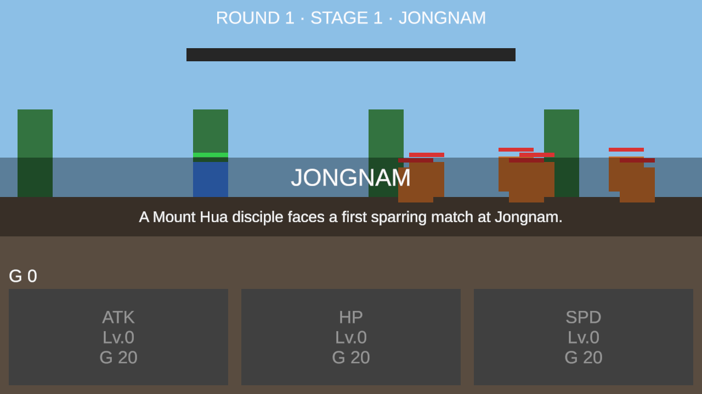
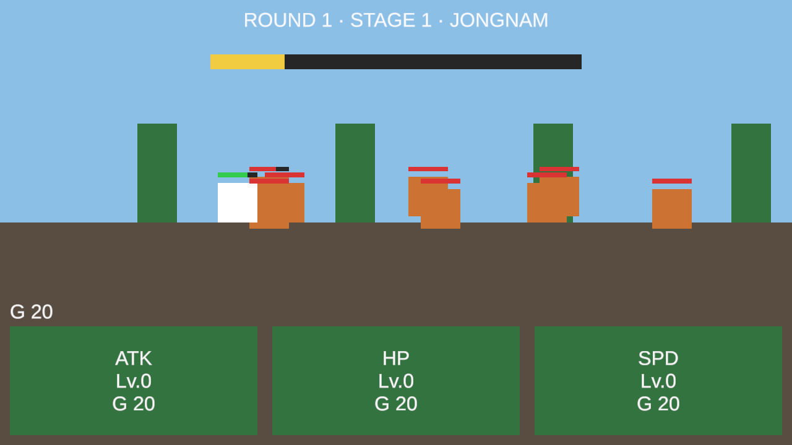
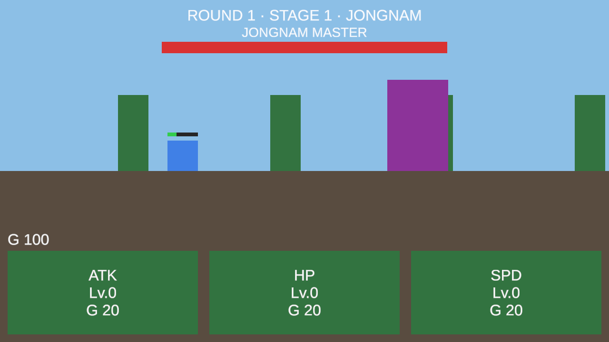

# 루프 증거: loop/20261117-143608 (묶음 저장)

- 판정: **통합 브랜치(`integration`)에 합침** — 관문 위반 0건, 합치기 전 전체 테스트 통과
- 합친 시각: 2026-11-17 14:40
- 병합 커밋: 태그 `loop-merged/20261117-143608` (`git show loop-merged/20261117-143608`)
- 작업 1건, 바뀐 파일 3개 (.meta 제외)
- 테스트 수: 313 → 319개. 합치기 전 실행: EditMode 391/391, PlayMode 22/22

이 문서는 루프 스크립트가 썼다. 테스트 결과와 관문은 스크립트가 직접 판정한 것이고, "완료 조건별 테스트"와 리뷰 의견은 교차 리뷰 에이전트의 판단이다. 가정과 화면은 사람이 본다.

## 사람이 볼 것

테스트로 판정하지 못한 것이다. 아래 화면 갈무리와 함께 본다.

- `032_save_game_root`: 루프의 화면 갈무리(1초·10초·30초)에 손상 창이 없고 `SAVE FAILED` 글자도 보이지 않으며, 지금까지처럼 스테이지 1 소개와 전투가 보인다.
- `032_save_game_root`: 에디터에서 `Application.persistentDataPath` 의 `save.dat` 을 지우고 실행하면 스테이지 1 소개부터 시작한다. 금화를 모아 강화한 뒤 끄고 다시 켜면 금화·강화 단계·스테이지 번호가 끄기 전과 같고, 이미 본 소개는 다시 나오지 않는다.
- `032_save_game_root`: 에디터에서 `save.dat` 을 아무 글자(예: `hello`)로 바꾸고 실행하면 손상 창이 뜨고 뒤의 전투는 멈춰 있으며 강화 버튼이 눌리지 않는다. 그 상태로 끄고 다시 켜면 같은 창이 다시 뜬다. `NEW GAME` 을 누르면 창이 사라지고 처음 값(금화 0, 스테이지 1 소개)으로 시작하며, 그 뒤 `save.dat` 이 `version=1` 로 시작하는 여덟 줄로 바뀌어 있다.
- `032_save_game_root`: 에디터에서 `save.dat` 의 첫 줄을 `version=2` 로 바꾸고 실행하면 오류 창 없이 처음 값으로 시작하고, 그 뒤 `save.dat` 의 첫 줄이 `version=1` 로 바뀌어 있다.
- `032_save_game_root`: 에디터에서 실행 중에 `save.dat` 을 읽기 전용으로 바꾸고 금화를 얻으면 오른쪽 위에 `SAVE FAILED` 가 뜨고, 읽기 전용을 풀면 몇 초 안에 사라진다.
- `032_save_game_root`: 루프의 1초·10초·30초 화면 갈무리에 손상 창과 `SAVE FAILED`가 없고 스테이지 1 소개와 전투가 보이는지 확인한다.
- `032_save_game_root`: 에디터에서 저장 파일을 지우고 시작한 뒤 금화를 모아 강화하고 재실행하여 금화·강화 단계·스테이지 복원과 이미 본 소개 생략을 확인한다.
- `032_save_game_root`: 손상된 파일로 실행하여 오류 창, 전투 정지, 강화 버튼 차단과 재실행 시 유지 여부를 확인하고, `NEW GAME` 뒤 초기 시작과 판 1의 여덟 줄 저장을 확인한다.
- `032_save_game_root`: 첫 줄이 `version=2`인 파일로 실행하여 오류 없이 초기 시작하고 판 1로 덮어쓰는지 확인한다.
- `032_save_game_root`: 실행 중 저장 파일을 읽기 전용으로 바꾸어 `SAVE FAILED`가 표시되고 해제 후 몇 초 안에 사라지는지 확인한다.

## 에이전트가 스스로 정한 것 (가정)

사양과 작업 문서에 없어 에이전트가 정한 것 전부다. 마음에 들지 않으면 후속 작업으로 고친다.

- `032_save_game_root`: 없음. 공개 연결 지점과 동작은 기존 저장 사양을 따른다.

## 화면 갈무리

합치기 직전의 코드로 게임을 실행해 찍은 것이다 (플레이 모드 테스트, 파일 이름의 숫자는 실행 후 지난 게임 시간).

**game_001s.png**



**game_010s.png**



**game_030s.png**




## 작업 요약

| 작업 | 구현 | 리뷰 | 새 테스트 | 바뀐 화면 코드 |
| --- | --- | --- | --- | --- |
| `032_save_game_root` | claude(시도 1) | codex (교차): 통과 | 6 | 1 |

## 관문 (스크립트 판정)

- 위반: 0건
- 확인 필요: 없음

## 작업별 기록

### 032_save_game_root

- 구현: claude(시도 1)
- 리뷰: codex (교차): 통과
- 바뀐 내용: 답변대로 GameRootSaveTests 의 [UnitySetUp] 에서 Assert.Ignore(배치 모드 아닐 때 건너뛰기) 줄을 지웠다. GameRoot.cs(저장 불러오기·시작 값 복원·AutoSave·[SaveView]·손상 시 [SaveErrorView]·StartNewGame)는 이전 작업 중 커밋 그대로다. 전체 테스트 통과: EditMode 391/391, PlayMode 22/22 (새 GameRootSaveTests 6개 포함).
- 리뷰 의견: 변경 코드와 테스트를 확인했으며, 완료 조건과 요구사항에 어긋나는 문제를 발견하지 못했다. 사람의 답변대로 테스트 건너뛰기 코드도 제거되어 있다.
- 작업 문서 원본: `docs/history/032_save_game_root.md`

| 완료 조건 | 대응하는 테스트 | 판정 |
| --- | --- | --- |
| Assets/Tests/PlayMode/Save/GameRootSaveTests.cs` 에 아래 조건마다 테스트가 하나 이상 있고 모두 통과한다. 이 클래스의 테스트는 배치 모드(루프와 명령줄 테스트)에서 판정하며, 건너뛰는 코드(`Assert.Ignore`·`[Ignore]` 등)는 넣지 않는다. | GameRootSaveTests의 테스트 6개 및 건너뛰기 코드 확인 | 있음 |
| 배치 모드에서 게임이 켜지면 `GameRoot.LoadResult.Status` 가 `Empty` 이고 `GameRoot.LoadResult.HasSaveData` 는 `false` 다. | GameRootSaveTests.BatchBoot_LoadResultIsEmpty | 있음 |
| 배치 모드에서 게임이 켜지면 `GameRoot.AutoSave` 는 `null` 이 아니고 `Enabled` 가 `true` 다. | GameRootSaveTests.BatchBoot_AutoSaveIsEnabled | 있음 |
| 배치 모드에서 게임이 켜지면 `GameRoot.StageProgress.StageNumber` 가 1, `GameRoot.StageProgress.HasBegun` 이 `true` 다. | GameRootSaveTests.BatchBoot_FirstStageHasBegun | 있음 |
| 배치 모드에서 게임이 켜지고 몇 프레임 뒤 `GameRoot.AutoSave.IsDirty` 는 `false`, `HasFailed` 는 `false` 다 (첫 `Begin` 의 저장이 `[SaveView]` 의 `Flush` 로 끝났다). | GameRootSaveTests.BatchBoot_InitialSaveHasFlushed | 있음 |
| 배치 모드에서 `[Game]` 의 자식에 `[SaveView]` 가 있고 `SaveView` 컴포넌트가 붙어 있다. | GameRootSaveTests.BatchBoot_HasSaveView | 있음 |
| 배치 모드에서 `[Game]` 의 자식에 `[SaveErrorView]` 가 없고, `UiCanvas` 아래에 `SaveErrorPanel` 이 없다. | GameRootSaveTests.BatchBoot_HasNoErrorViewOrPanel | 있음 |
| 화면 코드가 컴파일되고 기존 테스트(`GameBootTests` 포함)가 모두 통과한다. | 컴파일 및 기존 테스트 | 루프가 판정 |
| 루프의 화면 갈무리(1초·10초·30초)에 손상 창이 없고 `SAVE FAILED` 글자도 보이지 않으며, 지금까지처럼 스테이지 1 소개와 전투가 보인다. | 루프의 화면 갈무리 확인 | 사람 확인 |
| 에디터에서 `Application.persistentDataPath` 의 `save.dat` 을 지우고 실행하면 스테이지 1 소개부터 시작한다. 금화를 모아 강화한 뒤 끄고 다시 켜면 금화·강화 단계·스테이지 번호가 끄기 전과 같고, 이미 본 소개는 다시 나오지 않는다. | 에디터에서 저장 삭제 후 진행 및 재실행 | 사람 확인 |
| 에디터에서 `save.dat` 을 아무 글자(예: `hello`)로 바꾸고 실행하면 손상 창이 뜨고 뒤의 전투는 멈춰 있으며 강화 버튼이 눌리지 않는다. 그 상태로 끄고 다시 켜면 같은 창이 다시 뜬다. `NEW GAME` 을 누르면 창이 사라지고 처음 값(금화 0, 스테이지 1 소개)으로 시작하며, 그 뒤 `save.dat` 이 `version=1` 로 시작하는 여덟 줄로 바뀌어 있다. | 에디터에서 손상 파일로 실행 및 새 게임 확인 | 사람 확인 |
| 에디터에서 `save.dat` 의 첫 줄을 `version=2` 로 바꾸고 실행하면 오류 창 없이 처음 값으로 시작하고, 그 뒤 `save.dat` 의 첫 줄이 `version=1` 로 바뀌어 있다. | 에디터에서 지원하지 않는 판의 파일로 실행 | 사람 확인 |
| 에디터에서 실행 중에 `save.dat` 을 읽기 전용으로 바꾸고 금화를 얻으면 오른쪽 위에 `SAVE FAILED` 가 뜨고, 읽기 전용을 풀면 몇 초 안에 사라진다. | 에디터에서 저장 파일의 읽기 전용 설정과 해제 확인 | 사람 확인 |

새 테스트 6개: `GameRootSaveTests.BatchBoot_AutoSaveIsEnabled`, `GameRootSaveTests.BatchBoot_FirstStageHasBegun`, `GameRootSaveTests.BatchBoot_HasNoErrorViewOrPanel`, `GameRootSaveTests.BatchBoot_HasSaveView`, `GameRootSaveTests.BatchBoot_InitialSaveHasFlushed`, `GameRootSaveTests.BatchBoot_LoadResultIsEmpty`

## 확인하고 되돌리는 방법

```
git diff loop-merged/20261117-143608^1 loop-merged/20261117-143608            # 이 루프가 바꾼 것 전부
git merge --ff-only loop-merged/20261117-143608         # (main 에서) 이 루프까지만 올린다
git revert -m 1 loop-merged/20261117-143608             # (main 에 올린 뒤) 이 루프만 되돌린다
```
