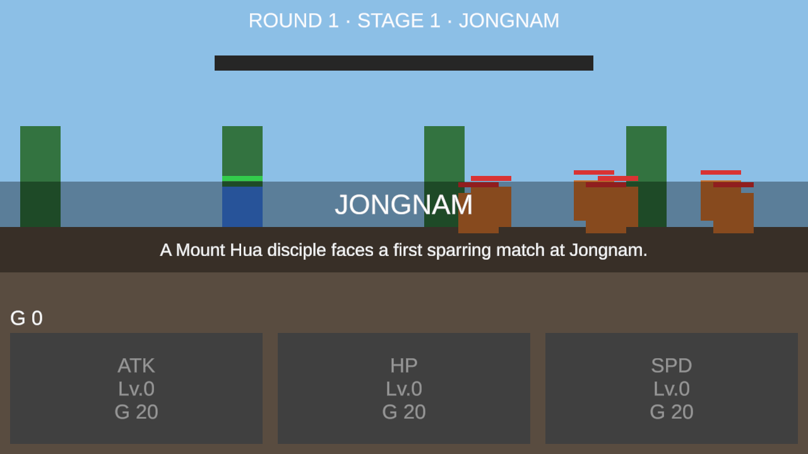
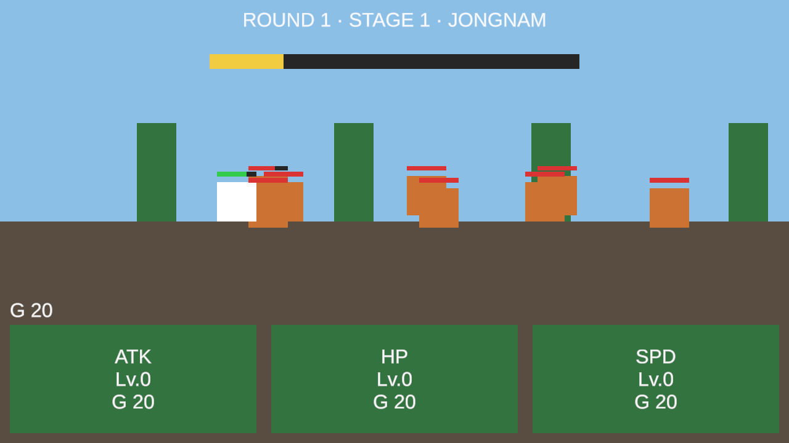
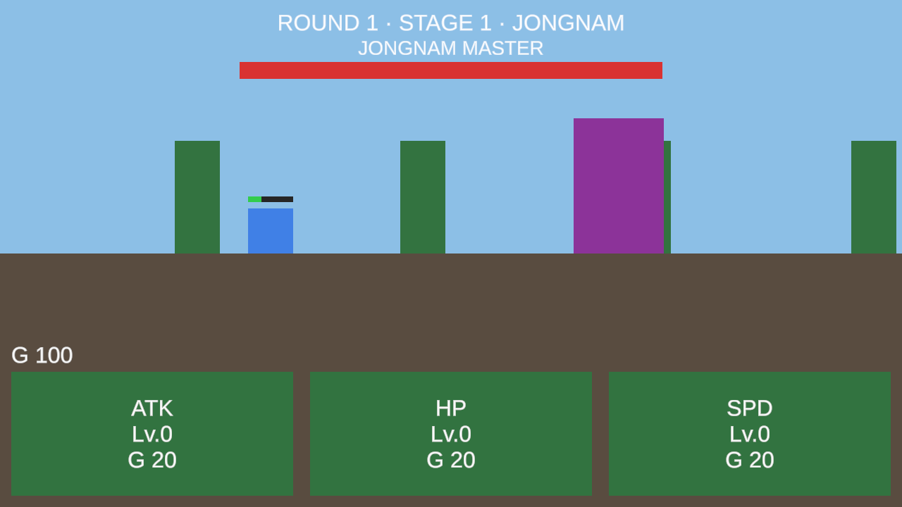

# 루프 증거: loop/20261117-151529 (묶음 오프라인보상)

- 판정: **통합 브랜치(`integration`)에 합침** — 관문 위반 0건, 합치기 전 전체 테스트 통과
- 합친 시각: 2026-11-17 15:29
- 병합 커밋: 태그 `loop-merged/20261117-151529` (`git show loop-merged/20261117-151529`)
- 작업 4건, 바뀐 파일 13개 (.meta 제외)
- 테스트 수: 319 → 338개. 합치기 전 실행: EditMode 438/438, PlayMode 22/22
- 이 묶음에서 **보류로 남아 합쳐지지 않은 작업**: 037_offline_lifecycle.md

이 문서는 루프 스크립트가 썼다. 테스트 결과와 관문은 스크립트가 직접 판정한 것이고, "완료 조건별 테스트"와 리뷰 의견은 교차 리뷰 에이전트의 판단이다. 가정과 화면은 사람이 본다.

## 사람이 볼 것

테스트로 판정하지 못한 것이다. 아래 화면 갈무리와 함께 본다.

- `036_offline_view`: 10분 전 저장 파일로 실행했을 때 보상 창의 시간·금화·CLAIM과 가림막 배치가 사양과 맞는지 확인한다.
- `036_offline_view`: 9시간 전 저장 파일로 실행했을 때 적용 8시간 줄이 보이는지 확인한다.
- `036_offline_view`: 저장 실패를 유도해 RETRY 표시와 재시도를 확인한다.

## 에이전트가 스스로 정한 것 (가정)

사양과 작업 문서에 없어 에이전트가 정한 것 전부다. 마음에 들지 않으면 후속 작업으로 고친다.

- `033_offline_calculator`: 없음. 공개 계약과 수치는 기존 사양을 따랐다.
- `034_offline_claim`: 없음. 공개 계약과 동작은 기존 오프라인 보상 사양을 따른다.
- `035_offline_text`: 없음. 공개 연결 지점은 사양과 같다.
- `036_offline_view`: 화면 소유 오브젝트가 외부에서 파괴되는 경우에도 캔버스의 가림막을 함께 제거한다.
- `036_offline_view`: 공개 계약과 화면 규칙은 기존 사양과 같아 사양 변경은 없다.

## 화면 갈무리

합치기 직전의 코드로 게임을 실행해 찍은 것이다 (플레이 모드 테스트, 파일 이름의 숫자는 실행 후 지난 게임 시간).

**game_001s.png**



**game_010s.png**



**game_030s.png**




## 작업 요약

| 작업 | 구현 | 리뷰 | 새 테스트 | 바뀐 화면 코드 |
| --- | --- | --- | --- | --- |
| `033_offline_calculator` | codex(시도 1) | claude (교차): 통과 | 6 | 0 |
| `034_offline_claim` | codex(시도 1) | claude (교차): 통과 | 5 | 0 |
| `035_offline_text` | codex(시도 1) | claude (교차): 통과 | 8 | 0 |
| `036_offline_view` | codex(시도 1) | claude (교차): 통과 | 0 | 1 |

## 관문 (스크립트 판정)

- 위반: 0건
- 확인 필요: 없음

## 작업별 기록

### 033_offline_calculator

- 구현: codex(시도 1)
- 리뷰: claude (교차): 통과
- 바뀐 내용: 오프라인 보상 계산과 복귀 판단을 구현하고 경계 조건의 에딧 모드 테스트를 추가했다. Unity 테스트는 루프 판정을 기다린다.
- 리뷰 의견: OfflineRewardCalculator와 OfflineRewardResult가 사양의 공개 계약(상수, 계산 순서, 스테이지 검사 먼저, 음수·역행 시각은 경과 0, 상한, 10초 단위 버림, StageRewards.NormalGold 사용, 생성자 internal)대로 Core에 구현됐습니다. 완료 조건마다 숫자까지 확인하는 테스트가 있습니다.
- 작업 문서 원본: `docs/history/033_offline_calculator.md`

| 완료 조건 | 대응하는 테스트 | 판정 |
| --- | --- | --- |
| Assets/Tests/EditMode/OfflineReward/OfflineRewardCalculatorTests.cs에 아래 조건마다 테스트가 하나 이상 있고 모두 통과한다. | OfflineRewardCalculatorTests 전체 (아래 조건별 테스트가 모두 이 파일에 있음) | 있음 |
| IntervalTicks는 100000000이고 MaxTicks는 288000000000이다. | OfflineRewardCalculatorTests.Constants_MatchSpecifiedIntervals | 있음 |
| T0에서 6000000000틱 후 1스테이지 결과는 경과와 적용 6000000000, 60마리, 금화 600, HasReward true, IsCapped false다. | OfflineRewardCalculatorTests.Calculate_ElapsedAndStage_ReturnsExpectedReward(6000000000,1,...) | 있음 |
| 250000000틱 경과는 적용 200000000틱, 2마리, 금화 20이다. | OfflineRewardCalculatorTests.Calculate_ElapsedAndStage_ReturnsExpectedReward(250000000,1,...) | 있음 |
| 99999999틱 경과는 적용 0, 처치 0, 금화 0이며 보상이 없다. | OfflineRewardCalculatorTests.Calculate_ElapsedAndStage_ReturnsExpectedReward(99999999,1,...) | 있음 |
| 100000000틱 경과는 1마리, 금화 10이며 보상이 있다. | OfflineRewardCalculatorTests.Calculate_ElapsedAndStage_ReturnsExpectedReward(100000000,1,...) | 있음 |
| 324000000000틱 경과는 적용 288000000000, 2880마리, 금화 28800이며 상한을 초과한다. | OfflineRewardCalculatorTests.Calculate_ElapsedAndStage_ReturnsExpectedReward(324000000000,1,...) | 있음 |
| 정확히 288000000000틱 경과는 금화 28800이며 상한 초과가 아니다. | OfflineRewardCalculatorTests.Calculate_ElapsedAndStage_ReturnsExpectedReward(288000000000,1,...) | 있음 |
| 6000000000틱 경과에서 3스테이지는 금화 840, 6스테이지는 금화 1200이다. | OfflineRewardCalculatorTests.Calculate_ElapsedAndStage_ReturnsExpectedReward(6000000000,3,... / 6000000000,6,...) | 있음 |
| 같은 시각과 역행한 시각은 각각 경과와 적용 및 금화가 0이고 보상과 상한 초과가 없다. | OfflineRewardCalculatorTests.Calculate_InvalidOrEqualTimes_ReturnsNoReward(T0,T0 / T0,T0-1) | 있음 |
| 저장 시각 또는 현재 시각이 음수인 경우와 long.MinValue, long.MaxValue 조합은 예외 없이 경과와 금화가 0이다. | OfflineRewardCalculatorTests.Calculate_InvalidOrEqualTimes_ReturnsNoReward(-1,T0 / T0,-1 / MinValue,MaxValue / MaxValue,MinValue) | 있음 |
| 저장 시각 0, 현재 T0은 경과 T0, 적용 288000000000, 금화 28800이며 상한을 초과한다. | OfflineRewardCalculatorTests.Calculate_ZeroSavedTime_CapsElapsedTime | 있음 |
| stageNumber 0과 -1은 경과가 0이어도 ArgumentOutOfRangeException이다. | OfflineRewardCalculatorTests.Calculate_InvalidStage_ThrowsEvenWithNoElapsedTime(0 / -1) | 있음 |
| 9시간 경과와 int.MaxValue 스테이지는 2880마리, 금화 12369505829760이다. | OfflineRewardCalculatorTests.Calculate_ElapsedAndStage_ReturnsExpectedReward(324000000000,int.MaxValue,...) | 있음 |
| 저장이 최신이고 정확히 100000000틱 경과한 복귀는 재시작한다. | OfflineRewardCalculatorTests.ShouldRestartOnResume_TimesAndSaveState_ReturnsExpected(T0,T0+100000000,true,true) | 있음 |
| 99999999틱 경과, 최신이 아닌 저장, 역행 시각, 음수 시각의 복귀는 각각 재시작하지 않는다. | OfflineRewardCalculatorTests.ShouldRestartOnResume_TimesAndSaveState_ReturnsExpected(99999999 / false 저장 / T0-1 / -1 두 경우 / MinValue,MaxValue) | 있음 |
| 기존 테스트가 모두 통과한다. | 루프의 전체 테스트 실행 | 루프가 판정 |

리뷰 지적 (합친 뒤에도 남은 것):

- [note] OfflineRewardResult.HasReward를 사양처럼 저장 속성이 아니라 식 본문 속성(Gold > 0)으로 구현했습니다 (Assets/Scripts/Core/OfflineReward/OfflineRewardResult.cs:19). 공개 계약과 동작은 같아서 문제는 없습니다.

새 테스트 6개: `OfflineRewardCalculatorTests.Calculate_ElapsedAndStage_ReturnsExpectedReward`, `OfflineRewardCalculatorTests.Calculate_InvalidOrEqualTimes_ReturnsNoReward`, `OfflineRewardCalculatorTests.Calculate_InvalidStage_ThrowsEvenWithNoElapsedTime`, `OfflineRewardCalculatorTests.Calculate_ZeroSavedTime_CapsElapsedTime`, `OfflineRewardCalculatorTests.Constants_MatchSpecifiedIntervals`, `OfflineRewardCalculatorTests.ShouldRestartOnResume_TimesAndSaveState_ReturnsExpected`

### 034_offline_claim

- 구현: codex(시도 1)
- 리뷰: claude (교차): 통과
- 바뀐 내용: 오프라인 보상 단일 지급과 저장 실패 재시도를 구현하고 에딧 모드 테스트를 추가했다. Unity 테스트는 루프 판정을 기다린다.
- 리뷰 의견: OfflineRewardClaimState와 OfflineRewardClaim이 사양의 공개 계약, 생성자 검증, TryClaim 순서(Done이면 바로 true, 첫 시도에만 Add·Enable, 그다음 SaveNow)대로 구현됐습니다. 테스트는 사양 완료 조건 초안 12~17번의 상황과 숫자를 그대로 검사합니다.
- 작업 문서 원본: `docs/history/034_offline_claim.md`

| 완료 조건 | 대응하는 테스트 | 판정 |
| --- | --- | --- |
| Assets/Tests/EditMode/OfflineReward/OfflineRewardClaimTests.cs에 아래 조건마다 테스트가 하나 이상 있고 모두 통과한다. | OfflineRewardClaimTests 전체 (테스트 5개가 조건 2~11을 모두 다룸) | 있음 |
| 생성자에서 wallet, autoSave, reward를 각각 null로 주면 ArgumentNullException이다. | OfflineRewardClaimTests.Constructor_NullDependencies_ThrowsArgumentNull | 있음 |
| 보상이 없는 결과를 생성자에 주면 ArgumentException이다. | OfflineRewardClaimTests.Constructor_NoReward_ThrowsArgumentException | 있음 |
| 보상 준비 직후 Waiting, 미지급, 잔액 100, 쓰기 0, 자동 저장 비활성이고 SaveNow는 false로 쓰지 않는다. | OfflineRewardClaimTests.Prepared_BeforeClaim_DoesNotPayOrSave | 있음 |
| 보상 준비 후 T0 + 7000000000에서 받으면 성공하고 Done, 지급됨, 잔액 700, 자동 저장 활성, 쓰기 1회다. | OfflineRewardClaimTests.Claim_Succeeds_PaysOnceAndSavesTimestamp | 있음 |
| 성공한 저장의 금화는 700이고 저장 시각은 T0 + 7000000000이다. | OfflineRewardClaimTests.Claim_Succeeds_PaysOnceAndSavesTimestamp (SaveCodec.Decode로 Gold·SavedAtUtcTicks 확인) | 있음 |
| 성공 후 저장 시각에서 50000000틱 경과한 계산에는 보상이 없다. | OfflineRewardClaimTests.Claim_Succeeds_PaysOnceAndSavesTimestamp | 있음 |
| 성공 후 다시 받으면 true이고 잔액 700, 쓰기 1회를 유지한다. | OfflineRewardClaimTests.Claim_Succeeds_PaysOnceAndSavesTimestamp | 있음 |
| 저장 실패 시 false, SaveFailed, 지급됨, 잔액 700, 시도 1회이고 HasFailed와 IsDirty가 true다. | OfflineRewardClaimTests.Claim_TwoFailuresThenSuccess_RetriesOnlySave | 있음 |
| 저장 실패 후 다시 실패하면 false이고 잔액 700, 시도 2회다. | OfflineRewardClaimTests.Claim_TwoFailuresThenSuccess_RetriesOnlySave | 있음 |
| 두 실패 후 T0 + 8000000000에 성공하면 Done, 잔액 700, 시도 3회, HasFailed false이며 저장 금화는 700, 저장 시각은 T0 + 8000000000이다. | OfflineRewardClaimTests.Claim_TwoFailuresThenSuccess_RetriesOnlySave | 있음 |
| 기존 테스트가 모두 통과한다. | 루프의 전체 테스트 실행 | 루프가 판정 |

리뷰 지적 (합친 뒤에도 남은 것):

- [note] 조건 5~8을 테스트 하나(Claim_Succeeds_PaysOnceAndSavesTimestamp)에, 조건 9~11을 테스트 하나(Claim_TwoFailuresThenSuccess_RetriesOnlySave)에 함께 넣었습니다(OfflineRewardClaimTests.cs:64, :82). 검사는 충분하지만, 실패하면 어느 조건에서 떨어졌는지 테스트 이름만으로는 알 수 없습니다.

새 테스트 5개: `OfflineRewardClaimTests.Claim_Succeeds_PaysOnceAndSavesTimestamp`, `OfflineRewardClaimTests.Claim_TwoFailuresThenSuccess_RetriesOnlySave`, `OfflineRewardClaimTests.Constructor_NoReward_ThrowsArgumentException`, `OfflineRewardClaimTests.Constructor_NullDependencies_ThrowsArgumentNull`, `OfflineRewardClaimTests.Prepared_BeforeClaim_DoesNotPayOrSave`

### 035_offline_text

- 구현: codex(시도 1)
- 리뷰: claude (교차): 통과
- 바뀐 내용: 오프라인 보상 표시 문구와 완료 조건별 에딧 모드 테스트를 추가했다. Unity 테스트는 루프 판정을 기다린다.
- 리뷰 의견: OfflineRewardText의 상수 4개와 공개 메서드는 사양의 연결 지점과 같고, 시간 표시는 초 단위로 내려 불변 문화권으로 쓰며 금화는 GoldText.Format을 쓴다. 완료 조건마다 기대값을 직접 비교하는 에딧 모드 테스트가 있다. 하지 말 것을 건드리지 않았고 .meta 파일도 있다.
- 작업 문서 원본: `docs/history/035_offline_text.md`

| 완료 조건 | 대응하는 테스트 | 판정 |
| --- | --- | --- |
| Assets/Tests/EditMode/OfflineReward/OfflineRewardTextTests.cs에 아래 조건마다 테스트가 하나 이상 있고 모두 통과한다. | OfflineRewardTextTests (조건 2~8마다 테스트가 있는지 확인했고, 통과 여부는 루프 실행 결과로 본다) | 있음 |
| FormatDuration은 324000000000, 6000000000, 250000000, 99999999, 0, 3600000000000을 각각 9:00:00, 0:10:00, 0:00:25, 0:00:09, 0:00:00, 100:00:00으로 표시한다. | OfflineRewardTextTests.FormatDuration_NonNegativeTicks_FormatsWholeSeconds (TestCase 6개) | 있음 |
| FormatDuration(-1)은 ArgumentOutOfRangeException이다. | OfflineRewardTextTests.FormatDuration_NegativeTicks_Throws | 있음 |
| ElapsedLine(324000000000)은 AWAY 9:00:00이다. | OfflineRewardTextTests.ElapsedLine_NineHours_FormatsAwayTime | 있음 |
| AppliedLine(288000000000)은 REWARD FOR 8:00:00 (MAX)이다. | OfflineRewardTextTests.AppliedLine_EightHours_FormatsMaximumTime | 있음 |
| GoldLine(28800)은 G 28,800이다. | OfflineRewardTextTests.GoldLine_Reward_UsesGoldFormat | 있음 |
| Title, SaveFailedMessage, ClaimButton, RetryButton은 각각 OFFLINE REWARD, SAVE FAILED. TAP RETRY., CLAIM, RETRY다. | OfflineRewardTextTests.Constants_Labels_MatchSpecifiedText | 있음 |
| ButtonLabel은 SaveFailed에서 RETRY, Waiting·Done·정의되지 않은 99에서 CLAIM이다. | OfflineRewardTextTests.ButtonLabel_State_ReturnsExpectedLabel (TestCase 4개) | 있음 |
| 기존 테스트가 모두 통과한다. | 루프의 전체 테스트 실행 | 루프가 판정 |

리뷰 지적 (합친 뒤에도 남은 것):

- [note] FormatDuration_OtherCulture_UsesInvariantFormatting(OfflineRewardTextTests.cs:28)은 ar-SA 문화권을 만들어 쓴다. 실행 환경에 그 문화권 데이터가 없으면 이 테스트만 환경 탓으로 실패할 수 있다. 완료 조건 밖의 추가 검사라 판정에는 영향이 없다.

새 테스트 8개: `OfflineRewardTextTests.AppliedLine_EightHours_FormatsMaximumTime`, `OfflineRewardTextTests.ButtonLabel_State_ReturnsExpectedLabel`, `OfflineRewardTextTests.Constants_Labels_MatchSpecifiedText`, `OfflineRewardTextTests.ElapsedLine_NineHours_FormatsAwayTime`, `OfflineRewardTextTests.FormatDuration_NegativeTicks_Throws`, `OfflineRewardTextTests.FormatDuration_NonNegativeTicks_FormatsWholeSeconds`, `OfflineRewardTextTests.FormatDuration_OtherCulture_UsesInvariantFormatting`, `OfflineRewardTextTests.GoldLine_Reward_UsesGoldFormat`

### 036_offline_view

- 구현: codex(시도 1)
- 리뷰: claude (교차): 통과
- 바뀐 내용: 오프라인 보상 창과 저장 실패 재시도 표시, 중복 콜백 방지를 구현했다. Unity 컴파일과 테스트는 루프 판정을 기다린다.
- 리뷰 의견: OfflineRewardView 가 사양 화면 절을 그대로 따른다. 가림막, 창, 여섯 줄 글자, 버튼의 좌표·크기·색·조건부 표시가 모두 맞다. 받기 버튼은 현재 UTC 틱으로 TryClaim 을 부르고 onClaimed 는 한 번만 호출하며, 실패하면 실패 문구와 RETRY 를 보인다. GameRoot 조립이나 Core·다른 기능은 건드리지 않았다.
- 작업 문서 원본: `docs/history/036_offline_view.md`

| 완료 조건 | 대응하는 테스트 | 판정 |
| --- | --- | --- |
| 화면 코드가 컴파일되고 기존 테스트가 모두 통과한다. | - | 루프가 판정 |
| 10분 전 저장 파일로 실행했을 때 보상 창의 시간·금화·CLAIM과 가림막 배치가 사양과 맞는지 확인한다. | - | 사람 확인 |
| 9시간 전 저장 파일로 실행했을 때 적용 8시간 줄이 보이는지 확인한다. | - | 사람 확인 |
| 저장 실패를 유도해 RETRY 표시와 재시도를 확인한다. | - | 사람 확인 |

리뷰 지적 (합친 뒤에도 남은 것):

- [note] 가림막이 캔버스의 직접 자식이라 OfflineRewardView 오브젝트 밖에 있다. 그래서 성공할 때 overlay 와 gameObject 를 함께 없애고, OnDestroy 에서도 overlay 를 정리한다 (OfflineRewardView.cs:56, 101-104). 사양의 '자기 오브젝트를 없앤다'와 같은 결과이고, 보고서 가정에도 적혀 있다.
- [note] TMP 예외 처리는 글자를 만들 때와 바꿀 때만 감싼다 (OfflineRewardView.cs:80-90, 94-99). 기존 CurrencyView·StageView 와 같은 방식이다.

## 확인하고 되돌리는 방법

```
git diff loop-merged/20261117-151529^1 loop-merged/20261117-151529            # 이 루프가 바꾼 것 전부
git merge --ff-only loop-merged/20261117-151529         # (main 에서) 이 루프까지만 올린다
git revert -m 1 loop-merged/20261117-151529             # (main 에 올린 뒤) 이 루프만 되돌린다
```
