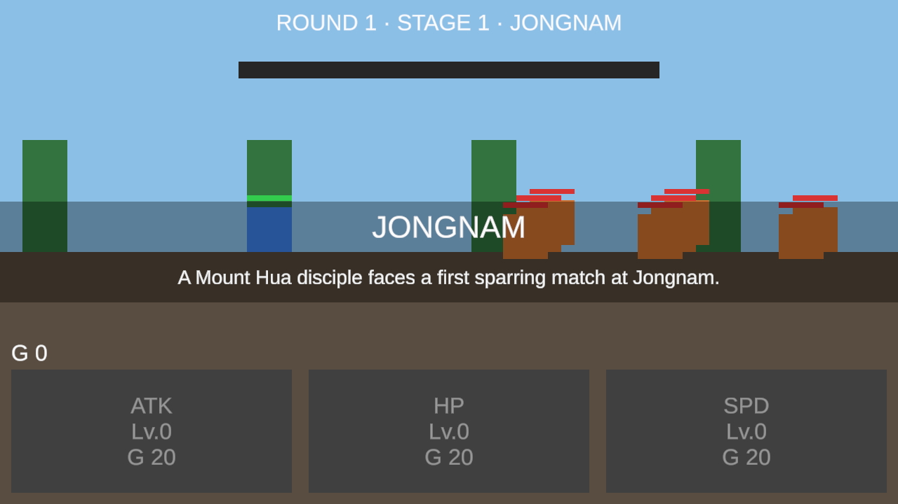
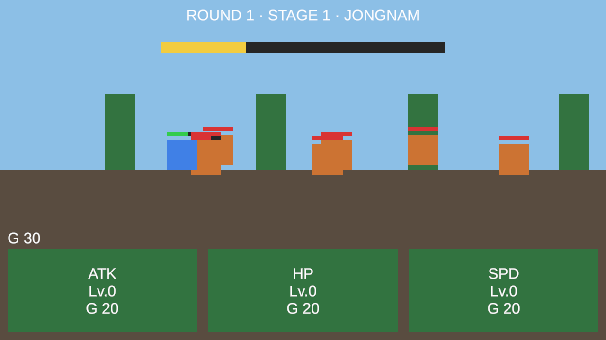
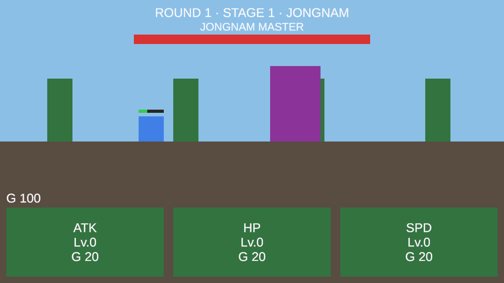

# 루프 증거: loop/20261117-161017 (묶음 오프라인보상)

- 판정: **통합 브랜치(`integration`)에 합침** — 관문 위반 0건, 합치기 전 전체 테스트 통과
- 합친 시각: 2026-11-17 16:13
- 병합 커밋: 태그 `loop-merged/20261117-161017` (`git show loop-merged/20261117-161017`)
- 작업 1건, 바뀐 파일 6개 (.meta 제외)
- 테스트 수: 338 → 341개. 합치기 전 실행: EditMode 438/438, PlayMode 25/25

이 문서는 루프 스크립트가 썼다. 테스트 결과와 관문은 스크립트가 직접 판정한 것이고, "완료 조건별 테스트"와 리뷰 의견은 교차 리뷰 에이전트의 판단이다. 가정과 화면은 사람이 본다.

## 사람이 볼 것

테스트로 판정하지 못한 것이다. 아래 화면 갈무리와 함께 본다.

- `037_offline_lifecycle`: 10분 전 저장을 불러오면 보상 창이 열린 동안 전투와 저장이 멈추고 CLAIM 성공 후 전투가 시작되는지 확인한다.
- `037_offline_lifecycle`: CLAIM 전 종료 후 다시 켜면 이전 저장 시각부터 보상을 다시 계산하는지 확인한다.
- `037_offline_lifecycle`: 폰 빌드에서 10초 이상 백그라운드에 둔 뒤 복귀하면 저장된 스테이지 처음부터 보상 창과 함께 시작하는지 확인한다.
- `037_offline_lifecycle`: 저장 실패 상태에서 백그라운드 복귀 시 재시작하지 않고 RETRY 창이 남는지 확인한다.

## 에이전트가 스스로 정한 것 (가정)

사양과 작업 문서에 없어 에이전트가 정한 것 전부다. 마음에 들지 않으면 후속 작업으로 고친다.

- `037_offline_lifecycle`: 같은 루트에 Restart가 중복 호출되면 재시작 오브젝트를 한 번만 만든다.
- `037_offline_lifecycle`: 다음 프레임 보장을 위해 재시작 오브젝트의 생성 프레임을 기록한다.

## 화면 갈무리

합치기 직전의 코드로 게임을 실행해 찍은 것이다 (플레이 모드 테스트, 파일 이름의 숫자는 실행 후 지난 게임 시간).

**game_001s.png**



**game_010s.png**



**game_030s.png**




## 작업 요약

| 작업 | 구현 | 리뷰 | 새 테스트 | 바뀐 화면 코드 |
| --- | --- | --- | --- | --- |
| `037_offline_lifecycle` | claude(시도 1) | claude (같은 에이전트): 통과 | 3 | 3 |

## 관문 (스크립트 판정)

- 위반: 0건
- 확인 필요: 없음

## 작업별 기록

### 037_offline_lifecycle

- 구현: claude(시도 1)
- 리뷰: claude (같은 에이전트): 통과
- 바뀐 내용: 16:08 답변대로 코드는 바꾸지 않고 기존 작업 중 커밋을 사양과 다시 대조했다. GameRoot의 오프라인 보상 계산·보상 창·Restart, GameRestarter, OfflineResumeWatcher, 배치 모드 플레이 모드 테스트(Assert.Ignore 없음)가 사양과 맞는다. 전체 유니티 테스트 통과 (EditMode 438/438, PlayMode 25/25).
- 리뷰 의견: GameRoot의 Awake 순서(4번 다음 계산, 5번 enabled 조건, 6번 손상 창/보상 창/Begin, 7번 배치 모드가 아닐 때 감시 조립), Restart, GameRestarter, OfflineResumeWatcher가 사양 docs/spec/offline_reward.md의 동작·연결 지점과 맞습니다. 플레이 모드 테스트 3개는 Assert.Ignore 없이 완료 조건 1~3을 직접 확인하고, 15:43 답변도 반영됐습니다.
- 작업 문서 원본: `docs/history/037_offline_lifecycle.md`

| 완료 조건 | 대응하는 테스트 | 판정 |
| --- | --- | --- |
| 배치 모드 시작 시 OfflineReward와 OfflineRewardClaim은 null, IsResumeRestart는 false다. 이 테스트는 루프와 명령줄의 배치 모드에서 판정하며, 건너뛰는 코드(Assert.Ignore·[Ignore] 등)는 넣지 않는다. | GameRootOfflineRewardTests.BatchBoot_HasNoOfflineRewardOrRestart | 있음 |
| 배치 모드 시작 시 AutoSave.Enabled와 StageProgress.HasBegun은 true다. | GameRootOfflineRewardTests.BatchBoot_AutomaticSaveAndStageAreStarted | 있음 |
| 배치 모드의 [Game] 아래에 [OfflineRewardView]와 [OfflineResumeWatcher]가 없다. | GameRootOfflineRewardTests.BatchBoot_HasNoOfflineObjects | 있음 |
| 화면 코드가 컴파일되고 기존 테스트가 모두 통과한다. | 루프의 컴파일·전체 테스트 실행 | 루프가 판정 |
| 10분 전 저장을 불러오면 보상 창이 열린 동안 전투와 저장이 멈추고 CLAIM 성공 후 전투가 시작되는지 확인한다. | - | 사람 확인 |
| CLAIM 전 종료 후 다시 켜면 이전 저장 시각부터 보상을 다시 계산하는지 확인한다. | - | 사람 확인 |
| 폰 빌드에서 10초 이상 백그라운드에 둔 뒤 복귀하면 저장된 스테이지 처음부터 보상 창과 함께 시작하는지 확인한다. | - | 사람 확인 |
| 저장 실패 상태에서 백그라운드 복귀 시 재시작하지 않고 RETRY 창이 남는지 확인한다. | - | 사람 확인 |

리뷰 지적 (합친 뒤에도 남은 것):

- [note] 배치 모드에서는 MemorySaveStore와 Decode(null)을 써서 항상 Empty로 시작합니다(Assets/Scripts/Game/GameRoot.cs:52-56). 그래서 플레이 모드 테스트는 '보상 없음' 경로만 확인하고, 보상 창·Restart 경로는 사양대로 사람 확인에 맡겨져 있습니다.
- [note] 보고서의 가정(Restart를 여러 번 불러도 첫 호출만 처리, GameRestarter가 생성 프레임을 기록해 다음 프레임에 루트 생성, 정적 필드 NextIsResumeRestart로 재시작 표시 전달)은 사양의 '다음 프레임'·'정확히 한 번 전달'과 어긋나지 않습니다 (GameRoot.cs:128-138, GameRestarter.cs:9-18).

새 테스트 3개: `GameRootOfflineRewardTests.BatchBoot_AutomaticSaveAndStageAreStarted`, `GameRootOfflineRewardTests.BatchBoot_HasNoOfflineObjects`, `GameRootOfflineRewardTests.BatchBoot_HasNoOfflineRewardOrRestart`

## 확인하고 되돌리는 방법

```
git diff loop-merged/20261117-161017^1 loop-merged/20261117-161017            # 이 루프가 바꾼 것 전부
git merge --ff-only loop-merged/20261117-161017         # (main 에서) 이 루프까지만 올린다
git revert -m 1 loop-merged/20261117-161017             # (main 에 올린 뒤) 이 루프만 되돌린다
```
