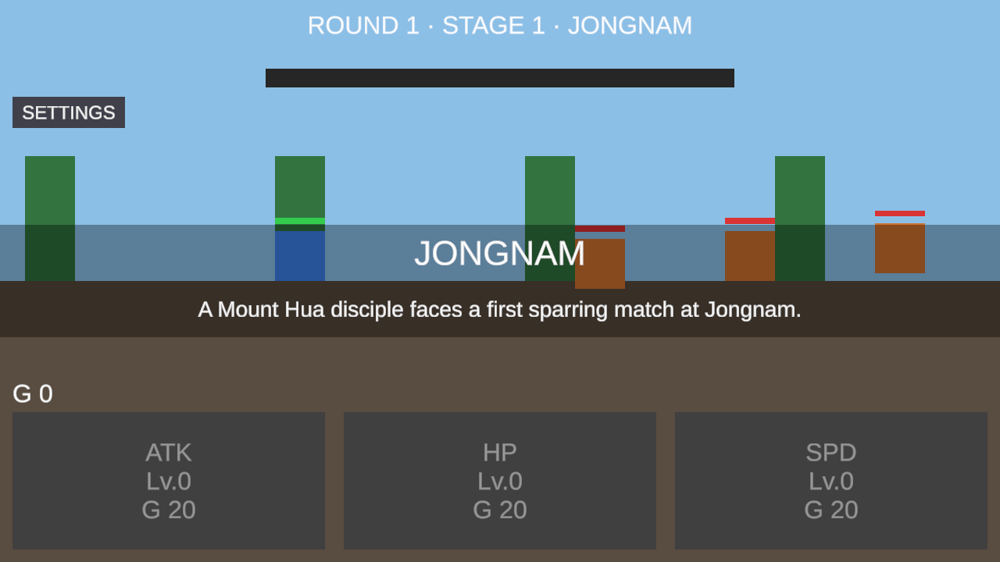
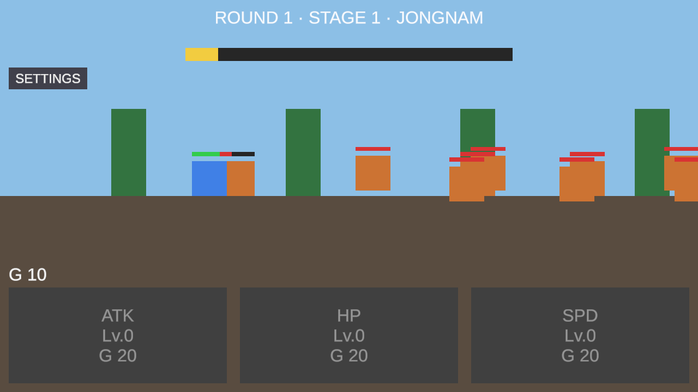
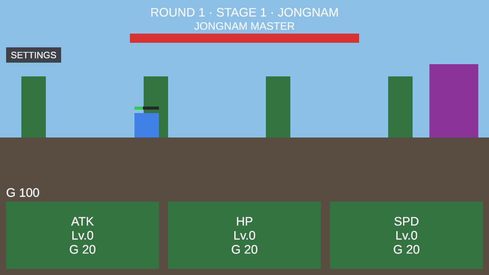

# 루프 증거: loop/20261117-182336 (묶음 시작화면)

- 판정: **통합 브랜치(`integration`)에 합침** — 관문 위반 0건, 합치기 전 전체 테스트 통과
- 합친 시각: 2026-11-17 18:48
- 병합 커밋: 태그 `loop-merged/20261117-182336` (`git show loop-merged/20261117-182336`)
- 작업 7건, 바뀐 파일 27개 (.meta 제외)
- 테스트 수: 341 → 386개. 합치기 전 실행: EditMode 499/499, PlayMode 45/45

이 문서는 루프 스크립트가 썼다. 테스트 결과와 관문은 스크립트가 직접 판정한 것이고, "완료 조건별 테스트"와 리뷰 의견은 교차 리뷰 에이전트의 판단이다. 가정과 화면은 사람이 본다.

## 사람이 볼 것

테스트로 판정하지 못한 것이다. 아래 화면 갈무리와 함께 본다.

- `042_start_screen_view`: 실제 화면의 배치와 글꼴 표시를 확인한다. 시작 화면의 게임 루트 조립은 후속 작업 범위다.
- `043_settings_view`: 후속 조립 작업 이후 설정 창의 실제 배치와 입력 흐름을 에디터에서 확인한다.
- `044_start_menu_root`: 에디터에서 `save.dat` 없이 플레이하면 시작 화면에 `PLUM BLOSSOM SWORD`, `START`, `SETTINGS`가 보이고, `START`를 누르면 1스테이지가 시작된다. 멈췄다 다시 플레이하면 `CONTINUE`가 보인다. (배치 모드의 화면 갈무리에는 시작 화면이 나오지 않으므로 에디터에서 해 봐야 한다)
- `044_start_menu_root`: 에디터에서 시작 화면의 `SETTINGS`로 슬라이더를 30·60으로 바꾸고 `CLOSE` → 플레이를 멈췄다 다시 켜서 열면 30·60이다.
- `044_start_menu_root`: 실행하고 10초 뒤 화면 갈무리에서 왼쪽 위 `SETTINGS` 버튼이 금화 표시·저장 실패 글자 자리와 겹치지 않는다.
- `044_start_menu_root`: 에디터에서 게임 중 `SETTINGS`(또는 Esc)로 창을 열면 전투가 계속되고, Esc로 닫힌다.
- `044_start_menu_root`: 에디터에서 `TO TITLE`을 누르면 시작 화면에 `CONTINUE`가 보이고, 누르면 같은 스테이지 처음부터 보상 창 없이 시작된다.
- `044_start_menu_root`: 에디터에서 `QUIT GAME`을 누르면 플레이 모드가 멈추고, 다시 켜면 `CONTINUE`가 보인다.
- `044_start_menu_root`: 에디터에서 `save.dat`을 읽기 전용으로 바꾸고 `TO TITLE`·`QUIT GAME`을 누르면 `SAVE FAILED. TRY AGAIN.`이 보이고 떠나지 않는다.
- `044_start_menu_root`: 에디터에서 `save.dat`을 아무 글자로 바꾸고 `START`를 누르면 손상 창이 뜬다.
- `044_start_menu_root`: 폰 빌드에서 시작 화면에 10초 이상 백그라운드로 둔 뒤 돌아오면 시작 화면이 다시 뜨고, 안드로이드 뒤로 가기 키가 게임 중 설정 창을 여닫는다.

## 에이전트가 스스로 정한 것 (가정)

사양과 작업 문서에 없어 에이전트가 정한 것 전부다. 마음에 들지 않으면 후속 작업으로 고친다.

- `038_start_menu_rules`: 없음. 공개 연결 지점은 사양과 같다.
- `039_volume_settings`: 없음. 기본 음량 80은 작업 문서와 사양에 명시된 임시값이다.
- `039_volume_settings`: 공개 연결 지점은 사양과 같아 사양 수정은 필요하지 않았다.
- `040_leave_game`: 없음. 공개 연결 지점과 동작은 기존 사양을 따른다.
- `041_start_menu_text`: 없음. 공개 연결 지점은 사양과 같다.
- `042_start_screen_view`: 테스트 어셈블리 정의를 변경하지 않기 위해 TMP 컴포넌트의 `text` 속성은 리플렉션으로 읽는다. 화면 크기와 색상은 사양에 적힌 임시값을 사용한다.
- `043_settings_view`: 슬라이더 손잡이는 양 끝에서 잘리지 않도록 이동 영역의 좌우에 각각 6픽셀 여백을 두었다. 공개 연결 지점은 사양과 같다.
- `044_start_menu_root`: 없음. 공개 연결 지점은 기존 시작 메뉴 사양을 따른다.

## 화면 갈무리

합치기 직전의 코드로 게임을 실행해 찍은 것이다 (플레이 모드 테스트, 파일 이름의 숫자는 실행 후 지난 게임 시간).

**game_001s.png**



**game_010s.png**



**game_030s.png**




## 작업 요약

| 작업 | 구현 | 리뷰 | 새 테스트 | 바뀐 화면 코드 |
| --- | --- | --- | --- | --- |
| `038_start_menu_rules` | codex(시도 1) | claude (교차): 통과 | 7 | 0 |
| `039_volume_settings` | codex(시도 1) | claude (교차): 통과 | 5 | 0 |
| `040_leave_game` | codex(시도 1) | claude (교차): 통과 | 5 | 0 |
| `041_start_menu_text` | codex(시도 1) | claude (교차): 통과 | 8 | 0 |
| `042_start_screen_view` | codex(시도 1~2) | claude (교차): 통과 | 9 | 1 |
| `043_settings_view` | codex(시도 1) | claude (교차): 통과 | 7 | 2 |
| `044_start_menu_root` | codex(시도 1) | claude (교차): 통과 | 4 | 2 |

## 관문 (스크립트 판정)

- 위반: 0건
- 확인 필요: 없음

## 작업별 기록

### 038_start_menu_rules

- 구현: codex(시도 1)
- 리뷰: claude (교차): 통과
- 바뀐 내용: 시작 화면 열거형과 판단 규칙 여섯 개 및 에딧 모드 테스트를 추가했다. Unity 테스트는 루프에서 판정한다.
- 리뷰 의견: 열거형 네 개와 StartMenuRules 메서드 여섯 개가 사양의 연결 지점과 작업 문서 요구사항 그대로 순수 C#으로 구현됐다. 완료 조건의 입력 조합은 모두 TestCase로 기대값까지 검사된다. 다른 기능 코드, 화면, 어셈블리 정의는 바뀌지 않았다.
- 작업 문서 원본: `docs/history/038_start_menu_rules.md`

| 완료 조건 | 대응하는 테스트 | 판정 |
| --- | --- | --- |
| `Assets/Tests/EditMode/StartMenu/StartMenuRulesTests.cs`에 아래 조건마다 테스트가 하나 이상 있고 모두 통과한다. | StartMenuRulesTests 전체 (조건별 TestCase 확인, 통과 여부는 루프 실행 결과) | 있음 |
| `StartButton(Loaded)`는 `Continue`이다. | StartMenuRulesTests.StartButton_Status_ReturnsExpectedButton(Loaded, Continue) | 있음 |
| `StartButton(Empty)`, `StartButton(UnsupportedVersion)`, `StartButton(Corrupt)`, `StartButton((SaveLoadStatus)99)`는 모두 `NewGame`이다. | StartMenuRulesTests.StartButton_Status_ReturnsExpectedButton (Empty/UnsupportedVersion/Corrupt/99 → NewGame) | 있음 |
| `ShowsStartScreen(Launch, false)`는 `true`, `ShowsStartScreen(Launch, true)`는 `false`이다. | StartMenuRulesTests.ShowsStartScreen_EntryAndBatchMode_ReturnsExpected (Launch,false,true / Launch,true,false) | 있음 |
| `ShowsStartScreen(ResumeInGame, false)`와 `ShowsStartScreen(ResumeInGame, true)`는 모두 `false`이다. | StartMenuRulesTests.ShowsStartScreen_EntryAndBatchMode_ReturnsExpected (ResumeInGame 두 경우 → false) | 있음 |
| `ShowsStartScreen(ResumeOnTitle, false)`, `(ResumeOnTitle, true)`, `(TitleReturn, false)`, `(TitleReturn, true)`, `((StartEntry)99, false)`는 모두 `true`이다. | StartMenuRulesTests.ShowsStartScreen_EntryAndBatchMode_ReturnsExpected (ResumeOnTitle×2, TitleReturn×2, 99×2 → true) | 있음 |
| `CalculatesOfflineReward`는 `Launch`, `ResumeInGame`, `ResumeOnTitle`, `(StartEntry)99`에서 `true`이다. | StartMenuRulesTests.CalculatesOfflineReward_Entry_ReturnsExpected (Launch/ResumeInGame/ResumeOnTitle/99 → true) | 있음 |
| `CalculatesOfflineReward(TitleReturn)`은 `false`이다. | StartMenuRulesTests.CalculatesOfflineReward_Entry_ReturnsExpected (TitleReturn → false) | 있음 |
| `AutoSaveStartsEnabled(Loaded, false)`는 `true`이다. | StartMenuRulesTests.AutoSaveStartsEnabled_StatusAndReward_ReturnsExpected (Loaded,false → true) | 있음 |
| `AutoSaveStartsEnabled`의 `(Loaded, true)`, `(Empty, false)`, `(Empty, true)`, `(UnsupportedVersion, false)`, `(Corrupt, false)`, `((SaveLoadStatus)99, false)`는 모두 `false`이다. | StartMenuRulesTests.AutoSaveStartsEnabled_StatusAndReward_ReturnsExpected (여섯 조합 → false) | 있음 |
| `ResumeEntry(true)`는 `ResumeOnTitle`, `ResumeEntry(false)`는 `ResumeInGame`이다. | StartMenuRulesTests.ResumeEntry_ScreenState_ReturnsExpected | 있음 |
| `BackKey(true, x, y)`는 `x`, `y`의 네 조합 모두 `CloseSettings`이다. | StartMenuRulesTests.BackKey_State_ReturnsExpected (true,x,y 네 조합 → CloseSettings) | 있음 |
| `BackKey(false, false, true)`는 `OpenSettings`이다. | StartMenuRulesTests.BackKey_State_ReturnsExpected (false,false,true → OpenSettings) | 있음 |
| `BackKey(false, false, false)`, `BackKey(false, true, false)`, `BackKey(false, true, true)`는 모두 `None`이다. | StartMenuRulesTests.BackKey_State_ReturnsExpected (세 조합 → None) | 있음 |
| 기존 테스트가 모두 통과한다. | 루프의 전체 테스트 실행 | 루프가 판정 |

리뷰 지적 (합친 뒤에도 남은 것):

- [note] 보고서의 '테스트 결과'에는 Unity 테스트를 직접 실행하지 않았다고 적혀 있다. 통과 여부는 루프의 테스트 실행 결과로만 확인된다.

새 테스트 7개: `StartMenuRulesTests.AutoSaveStartsEnabled_StatusAndReward_ReturnsExpected`, `StartMenuRulesTests.BackKey_State_ReturnsExpected`, `StartMenuRulesTests.CalculatesOfflineReward_Entry_ReturnsExpected`, `StartMenuRulesTests.EnumValues_MatchPublicContract`, `StartMenuRulesTests.ResumeEntry_ScreenState_ReturnsExpected`, `StartMenuRulesTests.ShowsStartScreen_EntryAndBatchMode_ReturnsExpected`, `StartMenuRulesTests.StartButton_Status_ReturnsExpectedButton`

### 039_volume_settings

- 구현: codex(시도 1)
- 리뷰: claude (교차): 통과
- 바뀐 내용: 배경음악과 효과음 음량 값, 범위 제한, 비율 및 변경 알림을 구현하고 에딧 모드 테스트를 추가했다. Unity 테스트는 루프의 판정을 기다린다.
- 리뷰 의견: VolumeSettings는 사양의 연결 지점과 똑같이 구현됐습니다. 상수, 생성자에서 범위 밖 값 잘라내기, 비율, 값이 실제로 바뀔 때만 보내는 알림이 모두 있습니다. 완료 조건마다 숫자까지 확인하는 에딧 모드 테스트가 있습니다.
- 작업 문서 원본: `docs/history/039_volume_settings.md`

| 완료 조건 | 대응하는 테스트 | 판정 |
| --- | --- | --- |
| `Assets/Tests/EditMode/StartMenu/VolumeSettingsTests.cs`에 아래 조건마다 테스트가 하나 이상 있고 모두 통과한다. | VolumeSettingsTests (파일 있음, 아래 조건별 테스트 확인, 통과 여부는 루프 실행 결과) | 있음 |
| `VolumeSettings.MinVolume`은 0, `MaxVolume`은 100, `DefaultVolume`은 80이다. | VolumeSettingsTests.Constants_HaveSpecifiedValues | 있음 |
| `new VolumeSettings()`는 `Bgm` 80, `Sfx` 80, `BgmScale` 0.8, `SfxScale` 0.8이다. | VolumeSettingsTests.Constructor_Defaults_ReturnsDefaultValuesAndScales | 있음 |
| `new VolumeSettings(-5, 150)`은 예외 없이 `Bgm` 0, `Sfx` 100이다. | VolumeSettingsTests.Constructor_OutOfRange_ClampsWithoutThrowing(-5,150) | 있음 |
| `new VolumeSettings(int.MinValue, int.MaxValue)`는 예외 없이 `Bgm` 0, `Sfx` 100이다. | VolumeSettingsTests.Constructor_OutOfRange_ClampsWithoutThrowing(int.MinValue,int.MaxValue) | 있음 |
| `new VolumeSettings(30, 55)`는 `Bgm` 30, `Sfx` 55, `BgmScale` 0.3, `SfxScale` 0.55이다. | VolumeSettingsTests.Constructor_InRange_PreservesValuesAndScales | 있음 |
| `new VolumeSettings()`에 `Changed` 횟수를 기록하고 `SetBgm(30)`을 하면 `Bgm` 30, `Sfx` 80, 알림 1번이다. | VolumeSettingsTests.SetVolumes_ChangesAndClampedDuplicates_NotifyOnlyAfterChanges | 있음 |
| 이어서 `SetBgm(30)`을 다시 하면 알림은 1번 그대로다. | VolumeSettingsTests.SetVolumes_ChangesAndClampedDuplicates_NotifyOnlyAfterChanges | 있음 |
| 이어서 `SetSfx(150)`을 하면 `Sfx` 100, 알림 2번이다. | VolumeSettingsTests.SetVolumes_ChangesAndClampedDuplicates_NotifyOnlyAfterChanges | 있음 |
| 이어서 `SetSfx(int.MaxValue)`를 하면 `Sfx` 100, 알림 2번 그대로다. | VolumeSettingsTests.SetVolumes_ChangesAndClampedDuplicates_NotifyOnlyAfterChanges | 있음 |
| 이어서 `SetBgm(-1)`을 하면 `Bgm` 0, 알림 3번이다. | VolumeSettingsTests.SetVolumes_ChangesAndClampedDuplicates_NotifyOnlyAfterChanges | 있음 |
| 이어서 `SetBgm(int.MinValue)`를 하면 예외 없이 `Bgm` 0, 알림 3번 그대로다. | VolumeSettingsTests.SetVolumes_ChangesAndClampedDuplicates_NotifyOnlyAfterChanges | 있음 |
| 기존 테스트가 모두 통과한다. | 루프의 전체 테스트 실행 | 루프가 판정 |

리뷰 지적 (합친 뒤에도 남은 것):

- [note] 사양과 요구사항에는 생성자가 Changed를 보내지 않는다고 적혀 있지만, 이를 직접 확인하는 테스트는 없습니다. 생성자 실행 중에는 구독자가 있을 수 없어서 구조상 알림이 나갈 수 없으므로 문제로 보지 않습니다 (Assets/Scripts/Core/StartMenu/VolumeSettings.cs:11-15).

새 테스트 5개: `VolumeSettingsTests.Constants_HaveSpecifiedValues`, `VolumeSettingsTests.Constructor_Defaults_ReturnsDefaultValuesAndScales`, `VolumeSettingsTests.Constructor_InRange_PreservesValuesAndScales`, `VolumeSettingsTests.Constructor_OutOfRange_ClampsWithoutThrowing`, `VolumeSettingsTests.SetVolumes_ChangesAndClampedDuplicates_NotifyOnlyAfterChanges`

### 040_leave_game

- 구현: codex(시도 1)
- 리뷰: claude (교차): 통과
- 바뀐 내용: 떠나기 전 저장 판정과 실패·재시도 및 비활성 저장 테스트를 구현했다. Unity 테스트 판정은 루프에서 수행한다.
- 리뷰 의견: LeaveGame은 사양의 연결 지점대로 구현됐습니다. 생성자의 null 검사, AutoSave.SaveNow 위임, HasFailed 갱신이 모두 들어 있습니다. 완료 조건마다 테스트가 있고, 각 테스트는 상황과 기대 수치(쓴 횟수, Gold, SavedAtUtcTicks)를 직접 검사합니다. 하지 말 것을 건드리지 않았고, 다른 기능의 코드나 화면 코드도 바꾸지 않았습니다.
- 작업 문서 원본: `docs/history/040_leave_game.md`

| 완료 조건 | 대응하는 테스트 | 판정 |
| --- | --- | --- |
| `Assets/Tests/EditMode/StartMenu/LeaveGameTests.cs`에 아래 조건마다 테스트가 하나 이상 있고 모두 통과한다. | LeaveGameTests (조건 2~9에 대응하는 테스트 5개, 통과 여부는 루프 실행 결과) | 있음 |
| `new LeaveGame(null)`은 `ArgumentNullException`이다. | LeaveGameTests.Constructor_NullAutoSave_ThrowsArgumentNull | 있음 |
| 떠나기 준비 직후 `HasFailed`는 `false`이고 쓴 횟수는 0이다. | LeaveGameTests.Constructor_ValidAutoSave_DoesNotWriteOrFail | 있음 |
| 떠나기 준비 뒤 `wallet.Add(10)`을 하고 `TryLeave(100)`을 하면 `true`이고, `HasFailed`는 `false`, 쓴 횟수는 1이다. | LeaveGameTests.TryLeave_ChangedWallet_SavesCurrentData | 있음 |
| 위 경우 마지막 글자를 `SaveCodec.Decode`하면 `Gold` 10, `SavedAtUtcTicks` 100이다. | LeaveGameTests.TryLeave_ChangedWallet_SavesCurrentData | 있음 |
| 떠나기 준비에서 가짜 저장소를 실패하게 하고 `TryLeave(100)`을 하면 `false`, `HasFailed` `true`, 시도 1, `autoSave.HasFailed` `true`이다. | LeaveGameTests.TryLeave_FailureAndImmediateRetries_TrackEachResult | 있음 |
| 이어서 `TryLeave(200)`을 하면 `false`, 시도 2이다. | LeaveGameTests.TryLeave_FailureAndImmediateRetries_TrackEachResult | 있음 |
| 이어서 저장소를 성공하게 바꾸고 `TryLeave(300)`을 하면 `true`, `HasFailed` `false`, 시도 3, 마지막 글자의 `SavedAtUtcTicks`는 300이다. | LeaveGameTests.TryLeave_FailureAndImmediateRetries_TrackEachResult | 있음 |
| 떠나기 준비를 `AutoSave`를 `enabled: false`로 바꿔 만들고 `TryLeave(100)`을 하면 `false`, `HasFailed` `true`, 쓴 횟수 0이다. | LeaveGameTests.TryLeave_DisabledAutoSave_FailsWithoutWriting | 있음 |
| 기존 테스트가 모두 통과한다. | 루프의 전체 테스트 실행 | 루프가 판정 |

리뷰 지적 (합친 뒤에도 남은 것):

- [note] 보고서에 따르면 구현한 에이전트는 Unity 테스트를 직접 실행하지 않았습니다. 테스트가 통과하는지는 루프의 실행 결과로 확인합니다.

새 테스트 5개: `LeaveGameTests.Constructor_NullAutoSave_ThrowsArgumentNull`, `LeaveGameTests.Constructor_ValidAutoSave_DoesNotWriteOrFail`, `LeaveGameTests.TryLeave_ChangedWallet_SavesCurrentData`, `LeaveGameTests.TryLeave_DisabledAutoSave_FailsWithoutWriting`, `LeaveGameTests.TryLeave_FailureAndImmediateRetries_TrackEachResult`

### 041_start_menu_text

- 구현: codex(시도 1)
- 리뷰: claude (교차): 통과
- 바뀐 내용: 시작 메뉴 표시 상수와 버튼 및 음량 문자열을 구현하고 에딧 모드 테스트를 추가했다. Unity 테스트는 루프 판정을 기다린다.
- 리뷰 의견: StartMenuText가 사양의 연결 지점과 똑같이 구현됐고, 완료 조건마다 기대 문자열을 직접 확인하는 에딧 모드 테스트가 있습니다. 하지 말 것 범위, 다른 기능 코드, UnityEngine 의존은 건드리지 않았습니다.
- 작업 문서 원본: `docs/history/041_start_menu_text.md`

| 완료 조건 | 대응하는 테스트 | 판정 |
| --- | --- | --- |
| `Assets/Tests/EditMode/StartMenu/StartMenuTextTests.cs`에 아래 조건마다 테스트가 하나 이상 있고 모두 통과한다. | StartMenuTextTests (조건 2~9에 대응하는 테스트가 모두 있음, 통과 여부는 루프 실행 결과로 판정) | 있음 |
| `Title`, `NewGameButton`, `ContinueButton`은 각각 `"PLUM BLOSSOM SWORD"`, `"START"`, `"CONTINUE"`이다. | StartMenuTextTests.TitleAndStartButtons_Constants_MatchLabels | 있음 |
| `SettingsButton`, `SettingsTitle`은 둘 다 `"SETTINGS"`이다. | StartMenuTextTests.SettingsLabels_Constants_MatchLabels | 있음 |
| `ToTitleButton`, `QuitButton`, `CloseButton`은 각각 `"TO TITLE"`, `"QUIT GAME"`, `"CLOSE"`이다. | StartMenuTextTests.ActionButtons_Constants_MatchLabels | 있음 |
| `LeaveFailedMessage`는 `"SAVE FAILED. TRY AGAIN."`이다. | StartMenuTextTests.LeaveFailedMessage_Constant_MatchesLabel | 있음 |
| `StartButtonLabel(Continue)`는 `"CONTINUE"`, `StartButtonLabel(NewGame)`은 `"START"`이다. | StartMenuTextTests.StartButtonLabel_Kind_ReturnsExpected (Continue, NewGame 경우) | 있음 |
| `StartButtonLabel((StartButtonKind)99)`는 `"START"`이다. | StartMenuTextTests.StartButtonLabel_Kind_ReturnsExpected ((StartButtonKind)99 경우) | 있음 |
| `BgmLine(80)`은 `"BGM 80"`, `BgmLine(100)`은 `"BGM 100"`이다. | StartMenuTextTests.BgmLine_Volume_ReturnsExpected | 있음 |
| `SfxLine(0)`은 `"SFX 0"`, `SfxLine(-5)`는 `"SFX -5"`이다. | StartMenuTextTests.SfxLine_Volume_ReturnsExpected | 있음 |
| 기존 테스트가 모두 통과한다. | 루프의 전체 테스트 실행 | 루프가 판정 |

리뷰 지적 (합친 뒤에도 남은 것):

- [note] Assets/Tests/EditMode/StartMenu/StartMenuTextTests.cs:62 의 VolumeLines_CustomCulture_UseInvariantUnclampedNumbers 는 요구사항(불변 문화권, 잘라내지 않음)을 추가로 확인하는 테스트입니다. 작업 범위 안이라 문제 없습니다.

새 테스트 8개: `StartMenuTextTests.ActionButtons_Constants_MatchLabels`, `StartMenuTextTests.BgmLine_Volume_ReturnsExpected`, `StartMenuTextTests.LeaveFailedMessage_Constant_MatchesLabel`, `StartMenuTextTests.SettingsLabels_Constants_MatchLabels`, `StartMenuTextTests.SfxLine_Volume_ReturnsExpected`, `StartMenuTextTests.StartButtonLabel_Kind_ReturnsExpected`, `StartMenuTextTests.TitleAndStartButtons_Constants_MatchLabels`, `StartMenuTextTests.VolumeLines_CustomCulture_UseInvariantUnclampedNumbers`

### 042_start_screen_view

- 구현: codex(시도 1~2)
- 리뷰: claude (교차): 통과
- 바뀐 내용: 시작 화면과 플레이 모드 테스트를 구현하고 새 게임 버튼의 START 문구 검사를 관문이 인식하도록 수정했다. Unity 테스트와 관문 판정은 루프 스크립트가 수행한다.
- 리뷰 의견: StartScreenView가 작업 문서와 사양(start_menu.md "시작 화면", "연결 지점")대로 구현됐다. [플레이 모드] 완료 조건마다 상황과 기대값을 확인하는 테스트가 있다. 하지 말 것 침범, 다른 기능 코드 수정, 화면 코드 안의 계산은 없다.
- 작업 문서 원본: `docs/history/042_start_screen_view.md`

| 완료 조건 | 대응하는 테스트 | 판정 |
| --- | --- | --- |
| Assets/Tests/PlayMode/StartMenu/StartScreenViewTests.cs`에 아래 `[플레이 모드]` 조건마다 테스트가 하나 이상 있고 모두 통과한다. | StartScreenViewTests 전체 (조건 2~11마다 테스트 있음, 통과 여부는 루프 실행 결과) | 있음 |
| Initialize`에 `canvas`를 `null`로 넣으면 `ArgumentNullException`이다. | StartScreenViewTests.Initialize_NullCanvas_Throws | 있음 |
| Initialize`에 `onStart`를 `null`로 넣으면 `ArgumentNullException`이다. | StartScreenViewTests.Initialize_NullStart_Throws | 있음 |
| Initialize`에 `onOpenSettings`를 `null`로 넣으면 `ArgumentNullException`이다. | StartScreenViewTests.Initialize_NullSettings_Throws | 있음 |
| 캔버스에 자식 하나를 먼저 둔 뒤 `Initialize(canvas, Continue, …)`를 하면 "StartScreenPanel"은 캔버스의 마지막 자식이다. | StartScreenViewTests.Initialize_Continue_CreatesFullScreenLastPanelAndLabels | 있음 |
| 위 경우 "StartScreenPanel"의 앵커는 (0, 0)~(1, 1)이고 그 `Image`의 `raycastTarget`은 `true`이다. | StartScreenViewTests.Initialize_Continue_CreatesFullScreenLastPanelAndLabels | 있음 |
| 위 경우 패널 아래 글자에 `"PLUM BLOSSOM SWORD"`, `"CONTINUE"`, `"SETTINGS"`가 있다. | StartScreenViewTests.Initialize_Continue_CreatesFullScreenLastPanelAndLabels (CollectionAssert.AreEquivalent) | 있음 |
| 새 캔버스에서 `Initialize(canvas, NewGame, …)`를 하면 "StartButton"의 글자는 `"START"`이다. | StartScreenViewTests.Initialize_NewGame_ShowsStartLabel | 있음 |
| SettingsButton"의 `onClick`을 두 번 부르면 `onOpenSettings`가 2번 불린다. | StartScreenViewTests.SettingsClickedTwice_InvokesCallbackTwice | 있음 |
| StartButton"의 `onClick`을 같은 프레임에 두 번 부르면 `onStart`가 1번 불린다. | StartScreenViewTests.StartClickedTwice_InvokesOnceAndDestroysObjects | 있음 |
| 위 경우 한 프레임 뒤 "StartScreenPanel"과 `StartScreenView`가 붙었던 오브젝트가 없다. | StartScreenViewTests.StartClickedTwice_InvokesOnceAndDestroysObjects | 있음 |
| 화면 코드가 컴파일되고 기존 테스트가 모두 통과한다. | 루프의 컴파일·전체 테스트 실행 | 루프가 판정 |

리뷰 지적 (합친 뒤에도 남은 것):

- [note] 테스트의 Texts 헬퍼(Assets/Tests/PlayMode/StartMenu/StartScreenViewTests.cs:132)는 테스트 어셈블리 정의를 바꾸지 않으려고 TMP 형식을 리플렉션으로 읽는다. 보고서의 가정에 적혀 있고, Unity.TextMeshPro 어셈블리가 없으면 Type.GetType(..., true)에서 테스트가 실패하므로 검사가 약해지지는 않는다.
- [note] 작업 문서에 없는 테스트 두 개(Initialize_CreatesSpecifiedLayoutAndButtonStyles, DestroyView_DestroysPanel)가 더 있다. 배치·색 값과 '밖에서 지워질 때 패널도 지움' 요구사항(StartScreenView.cs:81 OnDestroy)을 확인한다. 문제는 없다.

새 테스트 9개: `StartScreenViewTests.DestroyView_DestroysPanel`, `StartScreenViewTests.Initialize_Continue_CreatesFullScreenLastPanelAndLabels`, `StartScreenViewTests.Initialize_CreatesSpecifiedLayoutAndButtonStyles`, `StartScreenViewTests.Initialize_NewGame_ShowsStartLabel`, `StartScreenViewTests.Initialize_NullCanvas_Throws`, `StartScreenViewTests.Initialize_NullSettings_Throws`, `StartScreenViewTests.Initialize_NullStart_Throws`, `StartScreenViewTests.SettingsClickedTwice_InvokesCallbackTwice`, `StartScreenViewTests.StartClickedTwice_InvokesOnceAndDestroysObjects`

### 043_settings_view

- 구현: codex(시도 1)
- 리뷰: claude (교차): 통과
- 바뀐 내용: 설정 창과 PlayerPrefs 음량 저장을 구현하고 플레이 모드 테스트를 추가했다. Unity 테스트는 루프 판정을 기다린다.
- 리뷰 의견: SettingsView와 VolumePrefs가 요구사항의 연결 지점, 화면 구조, 동작대로 구현됐습니다. 플레이 모드 테스트는 완료 조건마다 상황과 기대값(횟수, 글자, 켜짐 여부)을 직접 검사합니다. 하지 말 것 범위와 Core·기존 테스트는 건드리지 않았습니다.
- 작업 문서 원본: `docs/history/043_settings_view.md`

| 완료 조건 | 대응하는 테스트 | 판정 |
| --- | --- | --- |
| Assets/Tests/PlayMode/StartMenu/SettingsViewTests.cs`에 아래 `[플레이 모드]` 조건마다 테스트가 하나 이상 있고 모두 통과한다. | SettingsViewTests 전체 (조건 2~16이 모두 테스트로 대응됨, 통과 여부는 루프 실행 결과) | 있음 |
| Initialize`에 `canvas`, `volume`, `leaveGame`, `onReturnToTitle`, `onQuit`, `saveVolume`을 하나씩 `null`로 넣으면 각각 `ArgumentNullException`이다. | SettingsViewTests.Initialize_NullArguments_Throws | 있음 |
| 떠나기 준비의 `LeaveGame`과 `new VolumeSettings()`로 `Initialize`한 뒤 `IsOpen`은 `false`, "SettingsPanel"은 있고 꺼져 있으며, "GameSettingsButton"은 켜져 있다. | SettingsViewTests.Initialize_GameButton_OpensInGame | 있음 |
| 위처럼 만든 뒤 "GameSettingsButton"의 `onClick`을 부르면 `IsOpen` `true`, `Mode` `InGame`이다. | SettingsViewTests.Initialize_GameButton_OpensInGame | 있음 |
| 위처럼 만든 뒤 `Open(Title)`을 하면 "SettingsPanel"이 켜져 있고 캔버스의 마지막 자식이다. | SettingsViewTests.Open_SwitchModes_RefreshesAndMovesPanelToFront (뒤에 다른 자식을 붙인 다음 마지막 자식인지 확인) | 있음 |
| 위 `Open(Title)` 뒤 "ToTitleButton", "QuitButton", "LeaveFailedMessage"는 꺼져 있고 "BgmLabel"의 글자는 `"BGM 80"`이다. | SettingsViewTests.Open_SwitchModes_RefreshesAndMovesPanelToFront | 있음 |
| 이어서 `Open(InGame)`을 하면 `IsOpen`은 `true` 그대로이고 "ToTitleButton", "QuitButton"이 켜지며 "LeaveFailedMessage"는 꺼져 있다. | SettingsViewTests.Open_SwitchModes_RefreshesAndMovesPanelToFront | 있음 |
| 위처럼 만들어 `Open(InGame)`한 뒤 "BgmSlider"의 `value`를 30으로 하면 `volume.Bgm` 30, "BgmLabel" `"BGM 30"`이다. | SettingsViewTests.SlidersAndClose_UpdateVolumeLabelsAndSaveOnce | 있음 |
| 이어서 "SfxSlider"의 `value`를 0으로 하면 `volume.Sfx` 0, "SfxLabel" `"SFX 0"`이다. | SettingsViewTests.SlidersAndClose_UpdateVolumeLabelsAndSaveOnce | 있음 |
| 이어서 "CloseButton"의 `onClick`을 부르면 `IsOpen` `false`, "SettingsPanel"은 꺼지고 `saveVolume`은 1번 불린다. | SettingsViewTests.SlidersAndClose_UpdateVolumeLabelsAndSaveOnce | 있음 |
| 이어서 `Close()`를 한 번 더 불러도 `saveVolume`은 1번 그대로다. | SettingsViewTests.SlidersAndClose_UpdateVolumeLabelsAndSaveOnce | 있음 |
| 가짜 저장소를 실패하게 하고 `Open(InGame)` 뒤 "ToTitleButton"의 `onClick`을 부르면 `onReturnToTitle` 0번, `saveVolume` 0번, `IsOpen` `true`, "LeaveFailedMessage"가 켜져 있다. | SettingsViewTests.LeaveFailure_ReopenAndRecover_ShowsFailureAndSavesBeforeTitle | 있음 |
| 이어서 "QuitButton"의 `onClick`을 불러도 `onQuit`은 0번이다. | SettingsViewTests.LeaveFailure_ReopenAndRecover_ShowsFailureAndSavesBeforeTitle | 있음 |
| 이어서 `Close()` 뒤 `Open(InGame)`을 하면 "LeaveFailedMessage"는 켜져 있다. | SettingsViewTests.LeaveFailure_ReopenAndRecover_ShowsFailureAndSavesBeforeTitle | 있음 |
| 이어서 저장소를 성공하게 바꾸고 "ToTitleButton"의 `onClick`을 부르면 `onReturnToTitle` 1번, `saveVolume` 2번(앞의 `Close` 1번 + 떠나기 1번)이다. | SettingsViewTests.LeaveFailure_ReopenAndRecover_ShowsFailureAndSavesBeforeTitle | 있음 |
| 새로 만든 성공하는 저장소의 창에서 `Open(InGame)` 뒤 "QuitButton"의 `onClick`을 부르면 `onQuit` 1번, `saveVolume` 1번, `onReturnToTitle` 0번이다. | SettingsViewTests.Quit_Success_SavesAndInvokesQuit | 있음 |
| 화면 코드가 컴파일되고 기존 테스트가 모두 통과한다. | 루프의 컴파일·전체 테스트 실행 | 루프가 판정 |

리뷰 지적 (합친 뒤에도 남은 것):

- [note] 슬라이더 손잡이 이동 영역의 좌우 6픽셀 여백(SettingsView.cs:138)은 사양에 없는 값입니다. 다만 보고서의 가정에 적혀 있고 표시용 임시값이라 문제 삼지 않습니다.
- [note] GameSettingsButton의 anchoredPosition을 Button 도우미 안과 SettingsView.cs:36에서 두 번 설정합니다. 결과는 같아서 정리 수준의 지적입니다.
- [note] 완료 조건 밖의 테스트도 있습니다. ApplicationEvents_SaveOnlyOnPauseTrueAndQuit는 Initialize 전과 pause=false에서 저장하지 않는지 확인합니다. Open_SwitchModes 테스트는 Open이 Changed 알림을 보내지 않는지(SetValueWithoutNotify)도 확인합니다. 요구사항을 더 검증하는 것이라 좋습니다.

새 테스트 7개: `SettingsViewTests.ApplicationEvents_SaveOnlyOnPauseTrueAndQuit`, `SettingsViewTests.Initialize_GameButton_OpensInGame`, `SettingsViewTests.Initialize_NullArguments_Throws`, `SettingsViewTests.LeaveFailure_ReopenAndRecover_ShowsFailureAndSavesBeforeTitle`, `SettingsViewTests.Open_SwitchModes_RefreshesAndMovesPanelToFront`, `SettingsViewTests.Quit_Success_SavesAndInvokesQuit`, `SettingsViewTests.SlidersAndClose_UpdateVolumeLabelsAndSaveOnce`

### 044_start_menu_root

- 구현: codex(시도 1)
- 리뷰: claude (교차): 통과
- 바뀐 내용: 시작 화면과 설정·떠나기·뒤로 가기를 GameRoot에 연결하고 배치 모드 플레이 모드 테스트를 추가했다. Unity 테스트는 루프 판정을 기다린다.
- 리뷰 의견: GameRoot의 Awake 순서, 시작 흐름, Restart/ReturnToTitle, 앱 종료, 음량 쓰기, BackKeyWatcher가 사양과 작업 문서의 요구대로 구현됐다. 배치 모드 플레이 모드 조건은 GameRootStartMenuTests 의 Assert 로 모두 검사된다. 하지 말 것을 침범한 곳은 없다.
- 작업 문서 원본: `docs/history/044_start_menu_root.md`

| 완료 조건 | 대응하는 테스트 | 판정 |
| --- | --- | --- |
| Assets/Tests/PlayMode/StartMenu/GameRootStartMenuTests.cs`에 아래 `[플레이 모드]` 조건마다 테스트가 하나 이상 있고 모두 통과한다. | GameRootStartMenuTests 의 테스트 4개가 조건 2~12를 모두 다룸 (통과 여부는 루프 실행 결과) | 있음 |
| 배치 모드에서 게임이 켜지면 `GameRoot.Entry`는 `Launch`, `IsResumeRestart`는 `false`, `IsStartScreenShowing`은 `false`이다. | GameRootStartMenuTests.BatchBoot_UsesLaunchAndSkipsStartScreen | 있음 |
| 배치 모드에서 `[Game]` 아래에 `[StartScreenView]`가 없고 캔버스 아래에 "StartScreenPanel"이 없다. | GameRootStartMenuTests.BatchBoot_UsesLaunchAndSkipsStartScreen | 있음 |
| 배치 모드에서 `[Game]` 아래 `[SettingsView]`에 `SettingsView`가 붙어 있고, `GameRoot.Settings`가 그것이며 `IsOpen`은 `false`이다. | GameRootStartMenuTests.BatchBoot_InitializesSettingsAndBackKey | 있음 |
| 배치 모드에서 캔버스 아래에 "GameSettingsButton"이 있다. | GameRootStartMenuTests.BatchBoot_InitializesSettingsAndBackKey | 있음 |
| 배치 모드에서 `GameRoot.Volume`은 `Bgm` 80, `Sfx` 80이다. | GameRootStartMenuTests.BatchBoot_InitializesSettingsAndBackKey | 있음 |
| 배치 모드에서 `GameRoot.LeaveGame`은 `null`이 아니고 `HasFailed`는 `false`이다. | GameRootStartMenuTests.BatchBoot_InitializesSettingsAndBackKey | 있음 |
| 배치 모드에서 `StageProgress.HasBegun`은 `true`, `AutoSave.Enabled`는 `true`이다. | GameRootStartMenuTests.BatchBoot_StartsStageAndAutoSave | 있음 |
| 배치 모드에서 `[Game]` 아래에 `[BackKeyWatcher]`가 있고 `BackKeyWatcher`가 붙어 있다. | GameRootStartMenuTests.BatchBoot_InitializesSettingsAndBackKey | 있음 |
| 배치 모드에서 켠 뒤 `Battle.Paused`를 읽어 두고 `GameRoot.Settings.Open(SettingsMode.InGame)`을 하면 `IsOpen` `true`, `Mode` `InGame`이고 "SettingsPanel"이 켜져 있으며 캔버스의 마지막 자식이다. | GameRootStartMenuTests.InGameSettings_OpenAndCloseWithoutChangingBattlePause | 있음 |
| 위 경우 `Battle.Paused`는 읽어 둔 값 그대로다. | GameRootStartMenuTests.InGameSettings_OpenAndCloseWithoutChangingBattlePause | 있음 |
| 이어서 `Close()`를 하면 `IsOpen` `false`이고 "SettingsPanel"은 꺼져 있다. | GameRootStartMenuTests.InGameSettings_OpenAndCloseWithoutChangingBattlePause | 있음 |
| 화면 코드가 컴파일되고 기존 테스트(`GameBootTests`, `GameRootSaveTests`, `GameRootOfflineRewardTests` 포함)가 모두 통과한다. | 루프의 컴파일·전체 테스트 실행 | 루프가 판정 |
| 에디터에서 `save.dat` 없이 플레이하면 시작 화면에 `PLUM BLOSSOM SWORD`, `START`, `SETTINGS`가 보이고, `START`를 누르면 1스테이지가 시작된다. 멈췄다 다시 플레이하면 `CONTINUE`가 보인다. (배치 모드의 화면 갈무리에는 시작 화면이 나오지 않으므로 에디터에서 해 봐야 한다) | - | 사람 확인 |
| 에디터에서 시작 화면의 `SETTINGS`로 슬라이더를 30·60으로 바꾸고 `CLOSE` → 플레이를 멈췄다 다시 켜서 열면 30·60이다. | - | 사람 확인 |
| 실행하고 10초 뒤 화면 갈무리에서 왼쪽 위 `SETTINGS` 버튼이 금화 표시·저장 실패 글자 자리와 겹치지 않는다. | - | 사람 확인 |
| 에디터에서 게임 중 `SETTINGS`(또는 Esc)로 창을 열면 전투가 계속되고, Esc로 닫힌다. | - | 사람 확인 |
| 에디터에서 `TO TITLE`을 누르면 시작 화면에 `CONTINUE`가 보이고, 누르면 같은 스테이지 처음부터 보상 창 없이 시작된다. | - | 사람 확인 |
| 에디터에서 `QUIT GAME`을 누르면 플레이 모드가 멈추고, 다시 켜면 `CONTINUE`가 보인다. | - | 사람 확인 |
| 에디터에서 `save.dat`을 읽기 전용으로 바꾸고 `TO TITLE`·`QUIT GAME`을 누르면 `SAVE FAILED. TRY AGAIN.`이 보이고 떠나지 않는다. | - | 사람 확인 |
| 에디터에서 `save.dat`을 아무 글자로 바꾸고 `START`를 누르면 손상 창이 뜬다. | - | 사람 확인 |
| 폰 빌드에서 시작 화면에 10초 이상 백그라운드로 둔 뒤 돌아오면 시작 화면이 다시 뜨고, 안드로이드 뒤로 가기 키가 게임 중 설정 창을 여닫는다. | - | 사람 확인 |

리뷰 지적 (합친 뒤에도 남은 것):

- [note] 보고서의 '테스트 결과'에 Unity 컴파일과 플레이 모드 테스트를 직접 돌리지 않았다고 적혀 있다. 통과 여부는 루프 실행 결과로 확인해야 한다.
- [note] BackKeyWatcher.Update (Assets/Scripts/Game/StartMenu/BackKeyWatcher.cs:21) 의 `root == null` 검사는 Initialize 전인지 확인하는 용도로 맞다. 다만 GameRoot 가 Destroy 된 프레임에 Unity 의 null 비교로도 빠져나가므로 의도와 다르지 않다. 문제는 아니다.

새 테스트 4개: `GameRootStartMenuTests.BatchBoot_InitializesSettingsAndBackKey`, `GameRootStartMenuTests.BatchBoot_StartsStageAndAutoSave`, `GameRootStartMenuTests.BatchBoot_UsesLaunchAndSkipsStartScreen`, `GameRootStartMenuTests.InGameSettings_OpenAndCloseWithoutChangingBattlePause`

## 확인하고 되돌리는 방법

```
git diff loop-merged/20261117-182336^1 loop-merged/20261117-182336            # 이 루프가 바꾼 것 전부
git merge --ff-only loop-merged/20261117-182336         # (main 에서) 이 루프까지만 올린다
git revert -m 1 loop-merged/20261117-182336             # (main 에 올린 뒤) 이 루프만 되돌린다
```
