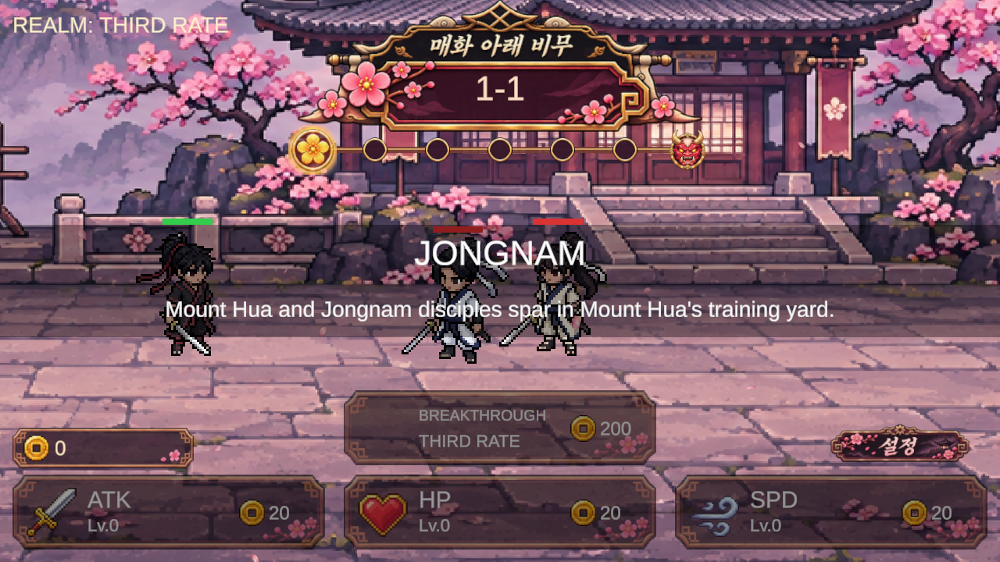
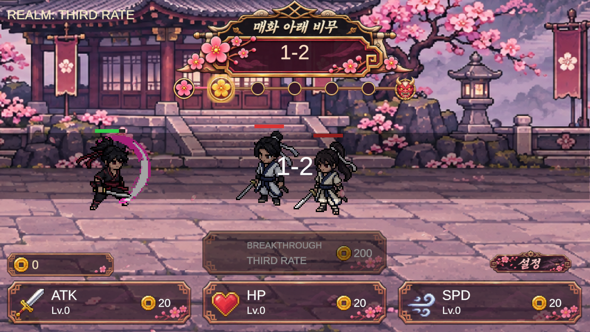
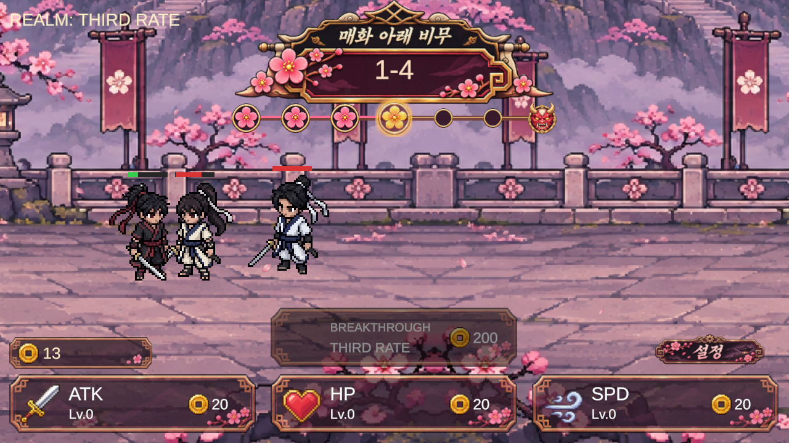

# 루프 증거: loop/20261118-121225 (묶음 realm)

- 판정: **통합 브랜치(`integration`)에 합침** — 관문 위반 0건, 합치기 전 전체 테스트 통과
- 합친 시각: 2026-11-18 12:26
- 병합 커밋: 태그 `loop-merged/20261118-121225` (`git show loop-merged/20261118-121225`)
- 작업 4건, 바뀐 파일 18개 (.meta 제외)
- 테스트 수: 466 → 497개. 합치기 전 실행: EditMode 627/627, PlayMode 77/77

이 문서는 루프 스크립트가 썼다. 테스트 결과와 관문은 스크립트가 직접 판정한 것이고, "완료 조건별 테스트"와 리뷰 의견은 교차 리뷰 에이전트의 판단이다. 가정과 화면은 사람이 본다.

## 사람이 볼 것

테스트로 판정하지 못한 것이다. 아래 화면 갈무리와 함께 본다.

- `045_realm_rules_text`: 다섯 메타 파일의 인덱스에는 이전 설정이 남아 있으므로 루프 스크립트가 작업 트리의 복원 내용을 반영해야 한다.
- `047_realm_view`: 실행하고 10초 뒤 화면 왼쪽 위 구석에 `REALM: THIRD RATE` 글자가 보인다 (경지 이름 그림이 없으므로 글자).
- `047_realm_view`: 실행하고 10초 뒤 화면 아래쪽 가운데, HP 강화 버튼 바로 위에 돌파 버튼이 강화 버튼과 같은 바탕 그림으로 겹치지 않고 보이고, `BREAKTHROUGH` / `THIRD RATE` / 금화 아이콘 옆 `200` 이 적혀 있다 (그림 모드 조건이 안 되면 단색 바탕에 `G 200`).
- `047_realm_view`: 에디터에서 실행해 금화가 200 보다 적을 때 돌파 버튼이 어둡고 눌러도 아무 일이 없는지 본다.
- `047_realm_view`: 에디터에서 금화 200 이상일 때 돌파 버튼을 눌러 본다: 금화가 200 줄고, 왼쪽 위가 `REALM: SECOND RATE`, 버튼이 `SECOND RATE` / `500` 으로 바뀌고, 강화 버튼과 같은 성공 연출(눌림, 경지 이름 글자가 금빛으로 변함)이 나온다.
- `047_realm_view`: 에디터에서 초절정까지 돌파해 본다: 버튼 비용 자리에 `MAX` 가 보이고 금화 아이콘이 숨고 눌리지 않는다.
- `047_realm_view`: 에디터에서 스테이지 전환 페이드 동안 돌파 버튼이 강화 버튼과 함께 어두워지고 눌리지 않는지 본다.
- `047_realm_view`: 실행 10초 뒤 왼쪽 위에 `REALM: THIRD RATE`가 보이는지 확인한다.
- `047_realm_view`: 실행 10초 뒤 HP 버튼 위에 돌파 버튼과 `BREAKTHROUGH` / `THIRD RATE` / 금화 아이콘 옆 `200`이 겹치지 않고 보이는지 확인한다. 그림 모드가 아니면 단색과 `G 200`을 확인한다.
- `047_realm_view`: 금화 200 미만일 때 버튼이 어둡고 눌리지 않는지 확인한다.
- `047_realm_view`: 금화 200 이상에서 돌파하면 금화가 200 줄고 경지 표시와 버튼이 `SECOND RATE`, `500`으로 바뀌며 성공 연출이 나오는지 확인한다.
- `047_realm_view`: 초절정에서 `MAX`가 보이고 금화 아이콘이 숨으며 버튼이 눌리지 않는지 확인한다.
- `047_realm_view`: 스테이지 전환 페이드 동안 강화 버튼과 함께 돌파 버튼이 어두워지고 눌리지 않는지 확인한다.
- `048_realm_aura_view`: 실행하고 10초 뒤 화면에서 제자 주변에 오오라가 보이지 않는다 (삼류).
- `048_realm_aura_view`: 에디터에서 금화를 200 이상 모아 돌파해 본다: 제자 주변에 하늘색 오오라가 0.4초 동안 커졌다가 돌아온 뒤 은은하게 깜빡이고, 제자가 오오라 앞에 그려지며 제자가 걸어가도 발밑을 따라간다.
- `048_realm_aura_view`: 에디터에서 초절정까지 돌파해 본다: 오오라가 매화 분홍이다.
- `048_realm_aura_view`: 에디터에서 스테이지 전환 페이드와 패배 동안에도 오오라가 그대로 보이는지 본다.
- `048_realm_aura_view`: 실행 10초 뒤 삼류에서 제자 주변에 오오라가 보이지 않는지 확인한다.
- `048_realm_aura_view`: 금화 200 이상으로 돌파해 하늘색 오오라의 0.4초 크기 연출, 깜빡임, 제자 뒤 정렬과 이동 추적을 확인한다.
- `048_realm_aura_view`: 초절정 오오라가 매화 분홍인지 확인한다.
- `048_realm_aura_view`: 스테이지 전환 페이드와 패배 동안에도 오오라가 보이는지 확인한다.

## 에이전트가 스스로 정한 것 (가정)

사양과 작업 문서에 없어 에이전트가 정한 것 전부다. 마음에 들지 않으면 후속 작업으로 고친다.

- `045_realm_rules_text`: 없음. 공개 연결 지점과 수치는 기존 사양을 따랐다.
- `046_realm_progress`: 없음. 공개 연결 지점과 동작은 기존 사양을 따르므로 사양 변경은 없다.
- `047_realm_view`: 사양의 위치, 크기, 색과 글자 크기는 임시값을 그대로 사용했다. 공개 연결 지점은 사양과 같다.
- `047_realm_view`: `Art/UI/Realm/name_<AssetId>`가 없으면 해당 경지는 글자로 표시한다.
- `047_realm_view`: `Art/UI/Realm/button`이 없으면 `Art/UI/StatUpgrade/button`을 사용하고, 그것도 없거나 `Art/UI/StatUpgrade/coin`이 없으면 단색 버튼과 글자를 표시한다.
- `047_realm_view`: `Art/UI/Realm/icon`이 없으면 아이콘 자리를 비운다.
- `047_realm_view`: 재사용하는 성공 연출이 읽는 `Art/StartMenu/petal_open`, `Art/StartMenu/petal_curled`가 없으면 해당 꽃잎을 표시하지 않는다.
- `048_realm_aura_view`: 그림은 Resources 경로 `Art/Effects/aura_` 뒤에 경지별 AssetId를 붙여 읽는다. 없으면 경지 색의 원형 그러데이션을 표시한다.
- `048_realm_aura_view`: 짝수 크기 텍스처의 거리는 픽셀 중심을 기준으로 측정하며, 그림 애니메이션은 새 경지에서 첫 프레임부터 시작한다.

## 화면 갈무리

합치기 직전의 코드로 게임을 실행해 찍은 것이다 (플레이 모드 테스트, 파일 이름의 숫자는 실행 후 지난 게임 시간).

**game_001s.png**



**game_010s.png**



**game_030s.png**




## 작업 요약

| 작업 | 구현 | 리뷰 | 새 테스트 | 바뀐 화면 코드 |
| --- | --- | --- | --- | --- |
| `045_realm_rules_text` | codex(시도 1) | claude (교차): 통과 | 16 | 0 |
| `046_realm_progress` | codex(시도 1) | claude (교차): 통과 | 15 | 0 |
| `047_realm_view` | codex(시도 1) | claude (교차): 통과 | 0 | 2 |
| `048_realm_aura_view` | codex(시도 1) | claude (교차): 통과 | 0 | 2 |

## 관문 (스크립트 판정)

- 위반: 0건
- 확인 필요: 없음

## 작업별 기록

### 045_realm_rules_text

- 구현: codex(시도 1)
- 리뷰: claude (교차): 통과
- 바뀐 내용: 경지 규칙과 표시·오오라 구현 및 테스트를 확인하고, 사용자 승인에 따라 StatUpgrade 가져오기 설정을 유지했다. Unity 테스트는 루프 판정을 기다린다.
- 리뷰 의견: Core/Realm 의 다섯 타입이 작업 문서의 연결 지점 모양과 수치대로 순수 C#으로 구현됐고, 세 테스트 파일이 완료 조건마다 기대값을 직접 확인한다. 이번 변경에는 Core/Realm 과 테스트, .meta 파일만 들어 있고 범위 밖 파일은 없다.
- 작업 문서 원본: `docs/history/045_realm_rules_text.md`

| 완료 조건 | 대응하는 테스트 | 판정 |
| --- | --- | --- |
| `Assets/Tests/EditMode/Realm/RealmRulesTests.cs`, `RealmTextTests.cs`, `RealmAuraTests.cs` 에 아래 조건마다 테스트가 하나 이상 있고 모두 통과한다. | 세 파일이 있고 아래 2~23 조건마다 테스트가 있음 (통과 여부는 루프 실행 결과) | 있음 |
| `RealmRules.BonusPercent` 는 `ThirdRate` 부터 순서대로 0, 10, 20, 30, 40 을 돌려준다. | RealmRulesTests.Rules_ValidLevel_ReturnExpectedValues | 있음 |
| `RealmRules.BonusPercent((RealmLevel)99)` 는 `ArgumentOutOfRangeException` 을 던진다. | RealmRulesTests.Rules_InvalidLevel_Throws | 있음 |
| `RealmRules.BreakthroughCost` 는 `ThirdRate` 부터 순서대로 200, 500, 1000, 2000, 0 을 돌려준다. | RealmRulesTests.Rules_ValidLevel_ReturnExpectedValues | 있음 |
| `RealmRules.BreakthroughCost((RealmLevel)99)` 는 `ArgumentOutOfRangeException` 을 던진다. | RealmRulesTests.Rules_InvalidLevel_Throws | 있음 |
| `RealmRules.LevelCount` 는 5 다. | RealmRulesTests.LevelCount_IsFive | 있음 |
| `RealmText.Name` 은 `ThirdRate` 부터 순서대로 `"THIRD RATE"`, `"SECOND RATE"`, `"FIRST RATE"`, `"PEAK"`, `"TRANSCENDENT"` 를 돌려주고, `(RealmLevel)99` 는 `ArgumentOutOfRangeException` 을 던진다. | RealmTextTests.Text_ValidLevel_ReturnsNameAndAssetId, RealmTextTests.Text_InvalidLevel_ThrowsEvenAtMax | 있음 |
| `RealmText.Label(SecondRate)` 는 `"REALM: SECOND RATE"`, `RealmText.Label(ThirdRate)` 는 `"REALM: THIRD RATE"` 이고, `Label((RealmLevel)99)` 는 `ArgumentOutOfRangeException` 을 던진다. | RealmTextTests.Label_ValidLevel_ReturnsLabel, RealmTextTests.Text_InvalidLevel_ThrowsEvenAtMax | 있음 |
| `RealmText.AssetId` 는 `ThirdRate` 부터 순서대로 `"third_rate"`, `"second_rate"`, `"first_rate"`, `"peak"`, `"transcendent"` 를 돌려주고, `(RealmLevel)99` 는 `ArgumentOutOfRangeException` 을 던진다. | RealmTextTests.Text_ValidLevel_ReturnsNameAndAssetId, RealmTextTests.Text_InvalidLevel_ThrowsEvenAtMax | 있음 |
| `RealmText.Cost` 는 (500, false) → `"G 500"`, (1000, false) → `"G 1,000"`, (0, true) → `"MAX"`, (2000, true) → `"MAX"`, (-5, false) → `"G -5"` 를 돌려준다. | RealmTextTests.Cost_AmountAndMax_ReturnsExpectedText | 있음 |
| `RealmText.ButtonLabel` 은 (`SecondRate`, 500, false) → `"BREAKTHROUGH\nSECOND RATE\nG 500"`, (`Transcendent`, 0, true) → `"BREAKTHROUGH\nTRANSCENDENT\nMAX"` 를 돌려준다. | RealmTextTests.ButtonLabel_CurrentLevelAndCost_ReturnsThreeLines | 있음 |
| `RealmText.ButtonLabel((RealmLevel)99, 500, false)` 는 `ArgumentOutOfRangeException` 을 던진다. | RealmTextTests.Text_InvalidLevel_ThrowsEvenAtMax | 있음 |
| `RealmText.ButtonTitle` 은 `"BREAKTHROUGH"` 다. | RealmTextTests.ButtonLabel_CurrentLevelAndCost_ReturnsThreeLines | 있음 |
| `RealmAura.HasAura` 는 `ThirdRate` 에 false, `SecondRate`·`FirstRate`·`Peak`·`Transcendent` 에 true 를 돌려주고, `(RealmLevel)99` 는 `ArgumentOutOfRangeException` 을 던진다. | RealmAuraTests.Aura_ValidLevel_ReturnsPresenceAndColor, RealmAuraTests.Aura_InvalidLevel_Throws | 있음 |
| `RealmAura.Color` 는 `SecondRate` → (0.55, 0.85, 1.00, 0.35), `FirstRate` → (0.35, 0.55, 1.00, 0.40), `Peak` → (0.70, 0.40, 1.00, 0.45), `Transcendent` → (1.00, 0.55, 0.75, 0.50), `ThirdRate` → (0, 0, 0, 0) 을 R, G, B, A 로 돌려준다. | RealmAuraTests.Aura_ValidLevel_ReturnsPresenceAndColor | 있음 |
| `RealmAura.Color((RealmLevel)99)` 는 `ArgumentOutOfRangeException` 을 던진다. | RealmAuraTests.Aura_InvalidLevel_Throws | 있음 |
| `RealmAura.PulseAlpha(SecondRate, t)` 는 t = 0 → 0.2625, 0.4 → 0.35, 1.2 → 0.175, 1.6 → 0.2625 다 (오차 1e-9). | RealmAuraTests.PulseAlpha_ElapsedTime_ReturnsExpectedAlpha | 있음 |
| `RealmAura.PulseAlpha(ThirdRate, 0.4)` 는 0 이다. | RealmAuraTests.PulseAlpha_ThirdRate_ReturnsZero | 있음 |
| `RealmAura.PulseAlpha(SecondRate, double.NaN)` 과 `PulseAlpha(SecondRate, double.PositiveInfinity)` 는 `ArgumentOutOfRangeException` 을 던진다. | RealmAuraTests.PulseAlpha_NonFiniteTime_Throws | 있음 |
| `RealmAura.PulseAlpha((RealmLevel)99, 0)` 은 `ArgumentOutOfRangeException` 을 던진다. | RealmAuraTests.Aura_InvalidLevel_Throws | 있음 |
| `RealmAura.BurstScale` 은 0 → 1.5, 0.2 → 1.25, 0.4 → 1.0, 1.0 → 1.0 을 돌려준다 (오차 1e-9). | RealmAuraTests.BurstScale_ElapsedTime_ReturnsExpectedScale | 있음 |
| `RealmAura.BurstScale` 은 -1 → 1.5, `double.PositiveInfinity` → 1.0 을 돌려주고 예외가 없다. | RealmAuraTests.BurstScale_ElapsedTime_ReturnsExpectedScale | 있음 |
| `RealmAura.BurstScale(double.NaN)` 은 `ArgumentOutOfRangeException` 을 던진다. | RealmAuraTests.BurstScale_NaN_Throws | 있음 |
| 기존 테스트가 모두 통과한다 (`CoreAssemblyTests.Core_DoesNotReferenceUnity` 포함). | 루프의 전체 테스트 실행 | 루프가 판정 |

리뷰 지적 (합친 뒤에도 남은 것):

- [note] RealmAura.HasAura 가 경지를 직접 나누지 않고 Color(realm).A > 0 으로 판정한다 (Assets/Scripts/Core/Realm/RealmAura.cs:13). 지금 수치에서는 결과가 같고, 답변 절에서도 기록만 하고 고치지 않기로 했다.
- [note] StatUpgrade .png.meta 5개는 이번 diff(loop/20261118-121225..3d9a2c7)에 들어 있지 않다. 답변 절의 결정대로 이 파일들은 지적하지 않았다.

새 테스트 16개: `RealmAuraTests.AuraColor_Constructor_DoesNotValidateValues`, `RealmAuraTests.Aura_InvalidLevel_Throws`, `RealmAuraTests.Aura_ValidLevel_ReturnsPresenceAndColor`, `RealmAuraTests.BurstScale_ElapsedTime_ReturnsExpectedScale`, `RealmAuraTests.BurstScale_NaN_Throws`, `RealmAuraTests.PulseAlpha_ElapsedTime_ReturnsExpectedAlpha`, `RealmAuraTests.PulseAlpha_NonFiniteTime_Throws`, `RealmAuraTests.PulseAlpha_ThirdRate_ReturnsZero`, `RealmRulesTests.LevelCount_IsFive`, `RealmRulesTests.Rules_InvalidLevel_Throws`, `RealmRulesTests.Rules_ValidLevel_ReturnExpectedValues`, `RealmTextTests.ButtonLabel_CurrentLevelAndCost_ReturnsThreeLines`, `RealmTextTests.Cost_AmountAndMax_ReturnsExpectedText`, `RealmTextTests.Label_ValidLevel_ReturnsLabel`, `RealmTextTests.Text_InvalidLevel_ThrowsEvenAtMax`, `RealmTextTests.Text_ValidLevel_ReturnsNameAndAssetId`

### 046_realm_progress

- 구현: codex(시도 1)
- 리뷰: claude (교차): 통과
- 바뀐 내용: 경지 진행과 금화 돌파, 잠금 및 알림을 구현하고 완료 조건별 에딧 모드 테스트를 작성했다. Unity 테스트는 루프 판정을 기다린다.
- 리뷰 의견: RealmProgress 는 사양의 연결 지점 모양과 처리 순서(잠금 → 최대 → TrySpend → 경지 증가 → BrokeThrough)를 그대로 구현했다. 테스트가 완료 조건마다 상황과 기대 숫자를 직접 확인한다. Core 의 유니티 의존, 하지 말 것 침범, 화면 코드 변경은 없다.
- 작업 문서 원본: `docs/history/046_realm_progress.md`

| 완료 조건 | 대응하는 테스트 | 판정 |
| --- | --- | --- |
| `Assets/Tests/EditMode/Realm/RealmProgressTests.cs` 에 아래 조건마다 테스트가 하나 이상 있고 모두 통과한다. | RealmProgressTests 전체 (조건마다 대응 테스트 있음, 통과 여부는 루프 실행 결과) | 있음 |
| 새로 만들면 `Current` 는 `ThirdRate`, `IsMax` 는 false, `BonusPercent` 는 0, `NextCost` 는 200, `Locked` 는 false 다. | RealmProgressTests.NewProgress_HasInitialValues | 있음 |
| 금화 3700 에서 `TryBreakthrough` 를 4번 부르면 모두 true 이고, 부르기 전의 `NextCost` 는 순서대로 200, 500, 1000, 2000 이며, 끝난 뒤 `Current` 는 `Transcendent`, `IsMax` 는 true, `BonusPercent` 는 40, `NextCost` 는 0, 금화는 0 이다. | RealmProgressTests.FourBreakthroughs_ReachMaximumAndSpendAll | 있음 |
| 금화 1000 에서 `TryBreakthrough` 를 1번 부르면 `Current` 는 `SecondRate`, `BonusPercent` 는 10, `NextCost` 는 500, 금화는 800 이다. | RealmProgressTests.Breakthrough_WithEnoughGold_UpdatesValues | 있음 |
| 금화 199 에서 `TryBreakthrough` 는 false 이고 `Current` 는 `ThirdRate`, 금화는 199 이며 `BrokeThrough` 와 `BalanceChanged` 는 0번 온다. | RealmProgressTests.Breakthrough_InsufficientGold_ChangesNothing | 있음 |
| 금화 200 에서 `TryBreakthrough` 는 true 이고 `Current` 는 `SecondRate`, 금화는 0 이다. | RealmProgressTests.Breakthrough_ExactCost_Succeeds | 있음 |
| 금화 1000 에서 `TryBreakthrough` 를 3번 부르면 결과는 순서대로 true, true, false 이고 `Current` 는 `FirstRate`, 금화는 300 이다. | RealmProgressTests.Breakthrough_RepeatedCalls_UseCurrentCostAndBalance | 있음 |
| `new RealmProgress(wallet, 4)` 에 금화 10000 이 있어도 `TryBreakthrough` 는 false, `CanBreakthrough` 는 false 이고 금화는 10000, `Current` 는 `Transcendent` 이며 `BrokeThrough` 와 `BalanceChanged` 는 0번 온다. | RealmProgressTests.Maximum_CannotBreakthroughOrNotify | 있음 |
| 금화 1000 에서 `TryBreakthrough` 를 부르면 `BrokeThrough` 가 `SecondRate` 를 담아 1번 오고, 받는 쪽에서 읽은 `Current` 는 `SecondRate`, `BonusPercent` 는 10, `NextCost` 는 500 이다. | RealmProgressTests.Breakthrough_Notifications_ExposeStateInOrder | 있음 |
| 금화 1000 에서 `TryBreakthrough` 를 부르면 `Wallet.BalanceChanged` 가 `BrokeThrough` 보다 먼저 오고, `BalanceChanged` 를 받는 시점에 읽은 `Current` 는 `ThirdRate` 다. | RealmProgressTests.Breakthrough_Notifications_ExposeStateInOrder | 있음 |
| 금화 200 에서 `CanBreakthrough` 는 true, 금화 199 에서는 false 이고, 부른 뒤 금화와 경지는 그대로이며 알림은 0번 온다. | RealmProgressTests.CanBreakthrough_ChecksBalanceWithoutChanges(200,true)/(199,false) | 있음 |
| `SetLocked(true)` 를 부르면 `Locked` 는 true 이고 `LockedChanged` 가 true 를 담아 1번 온다. | RealmProgressTests.Lock_ChangesOnlyNotifyAfterStateChanges | 있음 |
| `SetLocked(true)` 뒤에 한 번 더 `SetLocked(true)` 를 부르면 `LockedChanged` 는 더 오지 않는다 (모두 합쳐 1번). | RealmProgressTests.Lock_ChangesOnlyNotifyAfterStateChanges | 있음 |
| 금화 1000 에서 `SetLocked(true)` 뒤 `CanBreakthrough` 는 false, `TryBreakthrough` 는 false 이고 금화는 1000, `Current` 는 `ThirdRate` 이며 `BrokeThrough` 는 0번 온다. | RealmProgressTests.Locked_BlocksChecksAndBreakthroughWithoutChanges | 있음 |
| 바로 위 상태에서 `SetLocked(false)` 를 부르면 `LockedChanged` 가 false 를 담아 1번 오고, 그 뒤 `TryBreakthrough` 는 true 다. | RealmProgressTests.Lock_ChangesOnlyNotifyAfterStateChanges, RealmProgressTests.Locked_BlocksChecksAndBreakthroughWithoutChanges | 있음 |
| 새로 만든 직후 `SetLocked(false)` 를 부르면 `LockedChanged` 는 0번 온다. | RealmProgressTests.Lock_ChangesOnlyNotifyAfterStateChanges | 있음 |
| 금화 500 으로 `new RealmProgress(wallet, 2)` 를 만들면 `Current` 는 `FirstRate`, `BonusPercent` 는 20, `NextCost` 는 1000 이고, 만드는 동안 금화는 500 그대로이며 `BalanceChanged` 는 0번 온다. | RealmProgressTests.Constructor_RestoresLevelWithoutSpendingOrNotifying | 있음 |
| `new RealmProgress(wallet, -1)` 의 `Current` 는 `ThirdRate` 이고 예외가 없다. | RealmProgressTests.Constructor_OutOfRangeLevel_Clamps(-1, ThirdRate) | 있음 |
| `new RealmProgress(wallet, 7)` 의 `Current` 는 `Transcendent` 이고 예외가 없다. | RealmProgressTests.Constructor_OutOfRangeLevel_Clamps(7, Transcendent) | 있음 |
| `new RealmProgress(null)` 은 `ArgumentNullException` 을 던진다. | RealmProgressTests.Constructor_NullWallet_Throws | 있음 |
| 기존 테스트가 모두 통과한다 (`CoreAssemblyTests.Core_DoesNotReferenceUnity` 포함). | 루프 전체 테스트 실행 | 루프가 판정 |

리뷰 지적 (합친 뒤에도 남은 것):

- [note] 조건 12, 13, 15, 16 을 테스트 하나(Assets/Tests/EditMode/Realm/RealmProgressTests.cs:163)에 몰아서 검사한다. 첫 SetLocked(true) 직후의 알림 횟수는 따로 확인하지 않고, 두 번째 호출 뒤에 모아 둔 목록이 [true] 인지로 함께 확인한다. 결과는 맞지만 조건별로 테스트를 나누면 실패했을 때 원인을 찾기 쉽다.
- [note] 보고서의 '테스트 결과'에는 테스트를 직접 실행하지 않았다고 적혀 있다. 통과 여부는 루프의 테스트 실행 결과로 확인해야 한다.

새 테스트 15개: `RealmProgressTests.Breakthrough_ExactCost_Succeeds`, `RealmProgressTests.Breakthrough_InsufficientGold_ChangesNothing`, `RealmProgressTests.Breakthrough_Notifications_ExposeStateInOrder`, `RealmProgressTests.Breakthrough_RepeatedCalls_UseCurrentCostAndBalance`, `RealmProgressTests.Breakthrough_ToMaximum_NotificationExposesMaximumValues`, `RealmProgressTests.Breakthrough_WithEnoughGold_UpdatesValues`, `RealmProgressTests.CanBreakthrough_ChecksBalanceWithoutChanges`, `RealmProgressTests.Constructor_NullWallet_Throws`, `RealmProgressTests.Constructor_OutOfRangeLevel_Clamps`, `RealmProgressTests.Constructor_RestoresLevelWithoutSpendingOrNotifying`, `RealmProgressTests.FourBreakthroughs_ReachMaximumAndSpendAll`, `RealmProgressTests.Lock_ChangesOnlyNotifyAfterStateChanges`, `RealmProgressTests.Locked_BlocksChecksAndBreakthroughWithoutChanges`, `RealmProgressTests.Maximum_CannotBreakthroughOrNotify`, `RealmProgressTests.NewProgress_HasInitialValues`

### 047_realm_view

- 구현: codex(시도 1)
- 리뷰: claude (교차): 통과
- 바뀐 내용: 경지 표시와 돌파 버튼을 구현하고 GameRoot의 경지 및 강화 잠금을 연결했다. Unity 테스트는 루프 판정을 기다린다.
- 리뷰 의견: GameRoot 연결(Realm 생성 순서, 잠금 구독, CreateStatUpgradeView 바로 뒤의 [RealmView] 조립)과 RealmView 의 경지 표시·돌파 버튼(그림 모드와 대체 모드, 이벤트 구독과 해제, Core 값 그대로 사용)이 요구사항대로 구현됐다. 하지 말 것 범위도 건드리지 않았다.
- 작업 문서 원본: `docs/history/047_realm_view.md`

| 완료 조건 | 대응하는 테스트 | 판정 |
| --- | --- | --- |
| 화면 코드가 컴파일되고 기존 테스트가 모두 통과한다 (플레이 모드 `GameBootTests` 포함: 게임을 켜서 `[Game]` 이 조립되는 동안 오류 로그가 없다). | 루프의 컴파일과 전체 테스트 실행 | 루프가 판정 |
| GameRoot` 에 `public PlumSword.Core.Realm.RealmProgress Realm { get; private set; }` 가 있고, `Awake` 가 `Wallet` 을 만든 직후 `StatUpgrades` 보다 먼저 `Realm` 을 만들며, `StatUpgrades.LockedChanged` 를 구독해 `Realm.SetLocked` 를 같은 값으로 부르고, `CreateStatUpgradeView()` 바로 뒤에 `[RealmView]` 를 조립한다. | 루프의 컴파일 (코드 읽기로도 GameRoot.cs 의 순서와 구독을 확인함) | 루프가 판정 |
| RealmView` 의 모든 그림은 `Resources.Load` 로 읽고, 읽은 값이 `null` 이면 요구사항의 대체 표시(경지 글자, 단색 버튼)로 그린다. | 루프의 컴파일 (코드 읽기로도 Resources.Load 와 null 대체 처리를 확인함) | 루프가 판정 |
| 실행하고 10초 뒤 화면 왼쪽 위 구석에 `REALM: THIRD RATE` 글자가 보인다 (경지 이름 그림이 없으므로 글자). | 사람 확인 | 사람 확인 |
| 실행하고 10초 뒤 화면 아래쪽 가운데, HP 강화 버튼 바로 위에 돌파 버튼이 강화 버튼과 같은 바탕 그림으로 겹치지 않고 보이고, `BREAKTHROUGH` / `THIRD RATE` / 금화 아이콘 옆 `200` 이 적혀 있다 (그림 모드 조건이 안 되면 단색 바탕에 `G 200`). | 사람 확인 | 사람 확인 |
| 에디터에서 실행해 금화가 200 보다 적을 때 돌파 버튼이 어둡고 눌러도 아무 일이 없는지 본다. | 사람 확인 | 사람 확인 |
| 에디터에서 금화 200 이상일 때 돌파 버튼을 눌러 본다: 금화가 200 줄고, 왼쪽 위가 `REALM: SECOND RATE`, 버튼이 `SECOND RATE` / `500` 으로 바뀌고, 강화 버튼과 같은 성공 연출(눌림, 경지 이름 글자가 금빛으로 변함)이 나온다. | 사람 확인 | 사람 확인 |
| 에디터에서 초절정까지 돌파해 본다: 버튼 비용 자리에 `MAX` 가 보이고 금화 아이콘이 숨고 눌리지 않는다. | 사람 확인 | 사람 확인 |
| 에디터에서 스테이지 전환 페이드 동안 돌파 버튼이 강화 버튼과 함께 어두워지고 눌리지 않는지 본다. | 사람 확인 | 사람 확인 |

리뷰 지적 (합친 뒤에도 남은 것):

- [note] GameRoot.cs:47 의 `Realm` 속성에는 옆 속성(Wallet, UiCanvas)처럼 붙는 `<summary>` 주석이 없다.
- [note] RealmView.cs 의 그림 모드는 Refresh 에서 frame·글자 색을 직접 칠한 뒤 StatUpgradeButtonEffect.Update 가 매 프레임 frame·이름 색을 다시 칠한다. StatUpgradeView 와 같은 방식이라 동작에는 문제가 없다.
- [note] 대체 모드 글자(RealmView.cs 의 fallbackLabel)에는 줄바꿈 끄기가 없다. 200×48 칸에 글자 크기 14이므로 `THIRD RATE G 200` 같은 글자는 들어갈 것으로 보이며, 사람 확인 5에서 보면 된다.

### 048_realm_aura_view

- 구현: codex(시도 1)
- 리뷰: claude (교차): 통과
- 바뀐 내용: 경지별 오오라 화면과 돌파 연출을 구현하고 GameRoot에 조립했다. Unity 테스트는 루프 판정을 기다린다.
- 리뷰 의견: RealmAuraView 의 조립, 그림·대체 모드, 위치 추적, 돌파 연출, 구독 해제와 정리가 작업 문서대로 구현됐다. 색·깜빡임·연출 크기는 RealmAura 값을 그대로 쓰고, 하지 말 것 범위도 침범하지 않았다.
- 작업 문서 원본: `docs/history/048_realm_aura_view.md`

| 완료 조건 | 대응하는 테스트 | 판정 |
| --- | --- | --- |
| 화면 코드가 컴파일되고 기존 테스트가 모두 통과한다 (플레이 모드 `GameBootTests` 포함: 게임을 켜서 `[Game]` 이 조립되는 동안 오류 로그가 없다). | 루프의 컴파일·전체 테스트 실행 | 루프가 판정 |
| GameRoot.Awake` 가 `CreateCombatView()` 바로 뒤에 `[RealmAuraView]` 를 만들어 `RealmAuraView.Initialize(Realm, Battle)` 를 부른다. | 코드 확인: GameRoot.cs 101줄 CreateRealmAuraView() 호출, 282~287줄 | 루프가 판정 |
| RealmAuraView` 는 오오라 그림을 `Resources.Load<Texture2D>("Art/Effects/aura_" + RealmText.AssetId(...))` 로 읽고, `null` 이면 실행 중에 만든 원형 그러데이션 대체 표시를 쓴다. | 코드 확인: RealmAuraView.RefreshAura / EnsureFallback | 루프가 판정 |
| 실행하고 10초 뒤 화면에서 제자 주변에 오오라가 보이지 않는다 (삼류). | - | 사람 확인 |
| 에디터에서 금화를 200 이상 모아 돌파해 본다: 제자 주변에 하늘색 오오라가 0.4초 동안 커졌다가 돌아온 뒤 은은하게 깜빡이고, 제자가 오오라 앞에 그려지며 제자가 걸어가도 발밑을 따라간다. | - | 사람 확인 |
| 에디터에서 초절정까지 돌파해 본다: 오오라가 매화 분홍이다. | - | 사람 확인 |
| 에디터에서 스테이지 전환 페이드와 패배 동안에도 오오라가 그대로 보이는지 본다. | - | 사람 확인 |

리뷰 지적 (합친 뒤에도 남은 것):

- [note] docs/spec/realm.md 272줄에 '그러데이션 거리는 픽셀 중심에서 측정, 그림 애니메이션은 경지 변경 때 첫 프레임부터'를 더했다. 사양과 어긋나지 않고 세부를 정한 것이며 보고서 가정에도 적혀 있다.
- [note] RealmAuraView.cs: bursting 플래그는 첫 돌파 뒤 계속 true 로 남지만, BurstScale(t≥0.4)=1 이라 동작에는 문제가 없다.

## 확인하고 되돌리는 방법

```
git diff loop-merged/20261118-121225^1 loop-merged/20261118-121225            # 이 루프가 바꾼 것 전부
git merge --ff-only loop-merged/20261118-121225         # (main 에서) 이 루프까지만 올린다
git revert -m 1 loop-merged/20261118-121225             # (main 에 올린 뒤) 이 루프만 되돌린다
```
