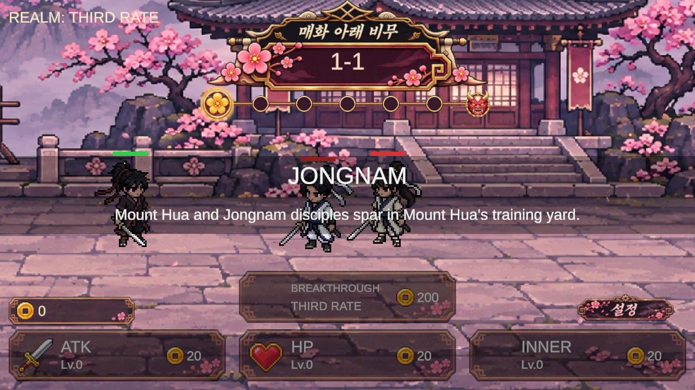
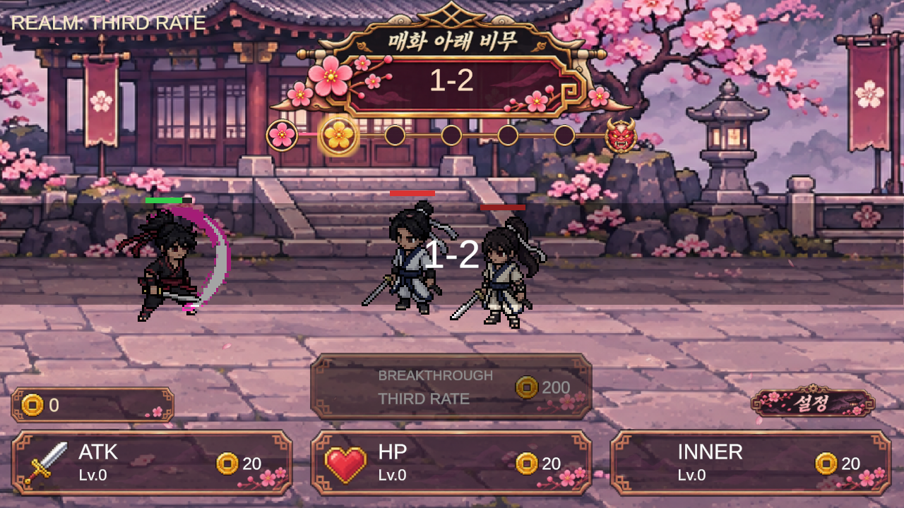
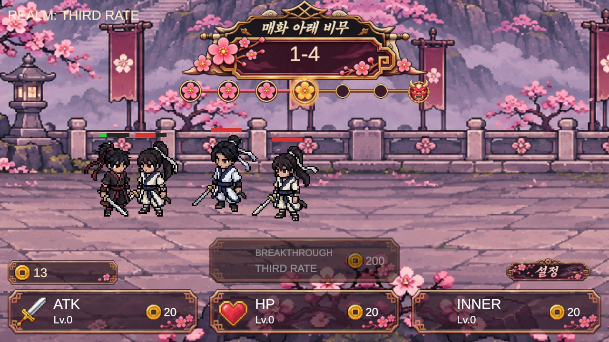

# 루프 증거: loop/20261118-141612 (묶음 stat_upgrade_m3)

- 판정: **통합 브랜치(`integration`)에 합침** — 관문 위반 0건, 합치기 전 전체 테스트 통과
- 합친 시각: 2026-11-18 14:26
- 병합 커밋: 태그 `loop-merged/20261118-141612` (`git show loop-merged/20261118-141612`)
- 작업 3건, 바뀐 파일 13개 (.meta 제외)
- 테스트 수: 490 → 501개. 합치기 전 실행: EditMode 634/634, PlayMode 78/78

이 문서는 루프 스크립트가 썼다. 테스트 결과와 관문은 스크립트가 직접 판정한 것이고, "완료 조건별 테스트"와 리뷰 의견은 교차 리뷰 에이전트의 판단이다. 가정과 화면은 사람이 본다.

## 사람이 볼 것

테스트로 판정하지 못한 것이다. 아래 화면 갈무리와 함께 본다.

- `051_stat_upgrade_view_inner`: 실행하고 10초 뒤 화면 아래쪽 금화 현판 밑에 버튼 세 개가 왼쪽부터 `ATK`, `HP`, `INNER` 순서로 겹치지 않고 보이고, 각각 `Lv.0`과 금화 아이콘 옆 `20`이 표시된다 (저장 데이터가 없는 새 게임 기준).
- `051_stat_upgrade_view_inner`: 같은 화면에서 `INNER` 버튼은 아이콘 자리가 비어 있고, 이름·단계·비용 글자 배치는 `ATK`·`HP` 버튼과 같다.
- `051_stat_upgrade_view_inner`: 같은 화면에서 금화가 0이라 세 버튼 모두 어둡다 (눌리지 않는지는 에디터에서 눌러 본다).
- `051_stat_upgrade_view_inner`: 에디터에서 금화를 모아 이류로 돌파한 뒤 다음 스테이지가 시작되면 제자 체력 바가 `110/110`이다.

## 에이전트가 스스로 정한 것 (가정)

사양과 작업 문서에 없어 에이전트가 정한 것 전부다. 마음에 들지 않으면 후속 작업으로 고친다.

- `049_stat_upgrade_inner_power`: 없음. 사양의 경지 인자와 보너스는 작업 문서에 따라 후속 작업 050에서 구현한다.

## 화면 갈무리

합치기 직전의 코드로 게임을 실행해 찍은 것이다 (플레이 모드 테스트, 파일 이름의 숫자는 실행 후 지난 게임 시간).

**game_001s.png**



**game_010s.png**



**game_030s.png**




## 작업 요약

| 작업 | 구현 | 리뷰 | 새 테스트 | 바뀐 화면 코드 |
| --- | --- | --- | --- | --- |
| `049_stat_upgrade_inner_power` | codex(시도 1) | claude (교차): 통과 | 5 | 0 |
| `050_stat_upgrade_realm_bonus` | codex(시도 1) | claude (교차): 통과 | 5 | 0 |
| `051_stat_upgrade_view_inner` | codex(시도 1) | claude (교차): 통과 | 1 | 2 |

## 관문 (스크립트 판정)

- 위반: 0건
- 확인 필요:
  - `Assets/Tests/EditMode/StatUpgrade/StatUpgradesTests.cs` — 있던 검사(Assert) 1줄을 지우거나 바꿈 (작업 049_stat_upgrade_inner_power)
    - 지워짐: `Assert.DoesNotThrow(() => upgrades = new StatUpgrades(new Wallet(), 10, 100, -1, -5));`
    - 새로 들어옴: `Assert.That(upgrades.GetMaxLevel(StatType.InnerPower), Is.EqualTo(int.MaxValue));`
    - 새로 들어옴: `Assert.That(upgrades.GetLevel(StatType.InnerPower), Is.EqualTo(0));`
    - 새로 들어옴: `Assert.That(upgrades.GetCost(StatType.InnerPower), Is.EqualTo(20));`
    - 새로 들어옴: `Assert.That(upgrades.GetLevel(StatType.InnerPower), Is.EqualTo(4));`
    - 새로 들어옴: `Assert.That(upgrades.GetCost(StatType.InnerPower), Is.EqualTo(40));`
    - 새로 들어옴: `Assert.DoesNotThrow(() => upgrades = new StatUpgrades(new Wallet(), 10, 100, -1, -5, -2));`

## 작업별 기록

### 049_stat_upgrade_inner_power

- 구현: codex(시도 1)
- 리뷰: claude (교차): 통과
- 바뀐 내용: 내공 강화 단계 복원, 비용과 구매 및 INNER 표시를 추가하고 관련 에딧 모드 테스트를 작성했다. Unity 테스트는 루프 판정을 기다린다.
- 리뷰 의견: 내공(InnerPower) 단계의 복원·비용·강화·알림과 INNER 표시가 작업 문서대로 Core에만 구현됐다. 완료 조건마다 숫자까지 맞게 확인하는 테스트가 있다. 기존 검사는 생성자 인자를 하나 더한 것 말고는 그대로이고 확인이 더해지기만 했다.
- 작업 문서 원본: `docs/history/049_stat_upgrade_inner_power.md`

| 완료 조건 | 대응하는 테스트 | 판정 |
| --- | --- | --- |
| `Assets/Tests/EditMode/StatUpgrade/StatUpgradesTests.cs`, `StatUpgradeTextTests.cs`, `StatUpgradesInnerPowerTests.cs`에 아래 조건마다 테스트가 하나 이상 있고 모두 통과한다. | 아래 조건별 테스트로 확인했다. 통과 여부는 루프 실행 결과를 따른다 | 있음 |
| 새로 만들면(`new StatUpgrades(wallet, 10, 100)`) `GetLevel(InnerPower)`는 0, `GetCost(InnerPower)`는 20, `IsMaxLevel(InnerPower)`는 `false`다. | StatUpgradesTests.New_Default_InitialState (AllStats에 InnerPower 포함) | 있음 |
| `GetMaxLevel(InnerPower)`는 `int.MaxValue`다. | StatUpgradesTests.GetMaxLevel_EachStat_ReturnsLimit | 있음 |
| 금화 1000에서 `TryUpgrade(Attack)`을 1번 부른 뒤 `GetLevel(InnerPower)`는 0, `GetCost(InnerPower)`는 20이다. | StatUpgradesTests.TryUpgrade_Attack_OtherStatsUnchanged | 있음 |
| 금화 20에서 `CanUpgrade(InnerPower)`는 `true`이고, 부른 뒤 금화는 20, `GetLevel(InnerPower)`는 0, `Upgraded`와 `BalanceChanged`는 0번 온다. | StatUpgradesTests.CanUpgrade_GoldEqualsCost_TrueForAllWithoutChange | 있음 |
| 금화 19에서 `CanUpgrade(InnerPower)`는 `false`이고, 부른 뒤 금화는 19, `GetLevel(InnerPower)`는 0, `Upgraded`와 `BalanceChanged`는 0번 온다. | StatUpgradesTests.CanUpgrade_GoldBelowCost_FalseForAllWithoutChange | 있음 |
| `new StatUpgrades(wallet, 10, 100, 3, 2, 4)`의 `GetLevel(InnerPower)`는 4, `GetCost(InnerPower)`는 40이고, 만드는 동안 금화는 바뀌지 않고 알림은 0번 온다. | StatUpgradesTests.New_WithLevels_RestoresLevelsWithoutSpending | 있음 |
| `new StatUpgrades(wallet, 10, 100, -1, -5, -2)`의 `GetLevel(InnerPower)`는 0이고 예외가 없다. | StatUpgradesTests.New_NegativeLevels_ClampedToZeroWithoutException | 있음 |
| 금화 1000에서 `TryUpgrade(InnerPower)`를 3번 부르면 모두 `true`이고, 부르기 전의 `GetCost(InnerPower)`는 순서대로 20, 25, 30이다. | StatUpgradesInnerPowerTests.TryUpgrade_ThreeTimes_IncreasesOnlyInnerPowerAndSpendsCosts | 있음 |
| 위 3번 강화가 끝난 뒤 `GetLevel(InnerPower)`는 3, `GetCost(InnerPower)`는 35, 금화는 925다. | StatUpgradesInnerPowerTests.TryUpgrade_ThreeTimes_IncreasesOnlyInnerPowerAndSpendsCosts | 있음 |
| 위 3번 강화가 끝난 뒤 `Attack`은 10, `MaxHealth`는 100, `GetLevel(Attack)`과 `GetLevel(Health)`는 0이다. | StatUpgradesInnerPowerTests.TryUpgrade_ThreeTimes_IncreasesOnlyInnerPowerAndSpendsCosts | 있음 |
| 금화 1000에서 `TryUpgrade(InnerPower)`를 부르면 `Wallet.BalanceChanged`가 `Upgraded`보다 먼저 오고, `BalanceChanged`를 받는 시점의 `GetLevel(InnerPower)`는 0이다. | StatUpgradesInnerPowerTests.TryUpgrade_Events_ExposeOldThenNewLevel | 있음 |
| 금화 1000에서 `TryUpgrade(InnerPower)`를 부르면 `Upgraded`가 `StatType.InnerPower`를 담아 1번 오고, 받는 쪽에서 읽은 `GetLevel(InnerPower)`는 1, `GetCost(InnerPower)`는 25다. | StatUpgradesInnerPowerTests.TryUpgrade_Events_ExposeOldThenNewLevel | 있음 |
| 금화 19에서 `TryUpgrade(InnerPower)`는 `false`이고 단계 0, 금화 19, `Upgraded`와 `BalanceChanged`는 0번 온다. | StatUpgradesInnerPowerTests.TryUpgrade_InsufficientGold_DoesNotChangeOrNotify | 있음 |
| 금화 1000에서 `SetLocked(true)` 뒤 `CanUpgrade(InnerPower)`와 `TryUpgrade(InnerPower)`는 `false`이고 금화는 1000, `GetLevel(InnerPower)`는 0이다. | StatUpgradesInnerPowerTests.Upgrade_Locked_FailsWithoutChange | 있음 |
| `new StatUpgrades(wallet, 10, 100, 0, 0, int.MaxValue)`의 `GetLevel(InnerPower)`는 `int.MaxValue`, `IsMaxLevel(InnerPower)`는 `true`, `GetCost(InnerPower)`는 10737418255다. | StatUpgradesInnerPowerTests.Upgrade_MaxLevel_CostDoesNotOverflowAndCannotSpend | 있음 |
| 위처럼 만들고 금화가 `long.MaxValue`일 때 `TryUpgrade(InnerPower)`는 `false`이고 금화는 `long.MaxValue` 그대로다. | StatUpgradesInnerPowerTests.Upgrade_MaxLevel_CostDoesNotOverflowAndCannotSpend | 있음 |
| `(StatType)99`로 `GetLevel`, `GetMaxLevel`, `GetCost`, `IsMaxLevel`, `CanUpgrade`, `TryUpgrade`를 부르면 모두 `ArgumentOutOfRangeException`을 던지고, 그 뒤 금화와 세 능력치 단계(`InnerPower` 포함)는 그대로다. | StatUpgradesTests.UndefinedStat_EveryMethod_ThrowsOutOfRangeWithoutChange (AllStats에 InnerPower 포함) | 있음 |
| `StatUpgradeText.Name(InnerPower)`는 `"INNER"`다. | StatUpgradeTextTests.Name_DefinedStat_ReturnsEnglishAbbreviation(InnerPower, "INNER") | 있음 |
| `StatUpgradeText.ButtonLabel(InnerPower, 1, 25, false)`는 `"INNER\nLv.1\nG 25"`다. | StatUpgradeTextTests.ButtonLabel_Values_JoinsNameLevelCostWithNewline(InnerPower, 1, 25L, false, ...) | 있음 |
| 기존 테스트가 모두 통과한다. | 루프의 전체 테스트 실행 | 루프가 판정 |

리뷰 지적 (합친 뒤에도 남은 것):

- [note] 기계 검사가 지워졌다고 표시한 Assert.DoesNotThrow는 작업 문서 요구대로 생성자 인자에 -2만 더한 것이다(StatUpgradesTests.cs:341). 검사가 약해지지 않았고, 이어지는 AllStats 반복에서 내공까지 0인지 확인한다.
- [note] 화면 코드 StatUpgradeView.cs:27은 아직 Attack·Health 두 버튼만 쓴다. 화면은 이 작업의 '하지 말 것'에 들어 있어 051이 맡는다. SaveData에도 내공 칸을 만들지 않았다(작업 문서대로).
- [note] Upgrade_Locked_FailsWithoutChange는 잠긴 상태에서 알림이 오지 않는지는 확인하지 않는다. 완료 조건 15가 알림을 요구하지 않으므로 문제는 아니다.

새 테스트 5개: `StatUpgradesInnerPowerTests.TryUpgrade_Events_ExposeOldThenNewLevel`, `StatUpgradesInnerPowerTests.TryUpgrade_InsufficientGold_DoesNotChangeOrNotify`, `StatUpgradesInnerPowerTests.TryUpgrade_ThreeTimes_IncreasesOnlyInnerPowerAndSpendsCosts`, `StatUpgradesInnerPowerTests.Upgrade_Locked_FailsWithoutChange`, `StatUpgradesInnerPowerTests.Upgrade_MaxLevel_CostDoesNotOverflowAndCannotSpend`

관문 확인 필요:

- `Assets/Tests/EditMode/StatUpgrade/StatUpgradesTests.cs` — 있던 검사(Assert) 1줄을 지우거나 바꿈
    - 지워짐: `Assert.DoesNotThrow(() => upgrades = new StatUpgrades(new Wallet(), 10, 100, -1, -5));`
    - 새로 들어옴: `Assert.That(upgrades.GetMaxLevel(StatType.InnerPower), Is.EqualTo(int.MaxValue));`
    - 새로 들어옴: `Assert.That(upgrades.GetLevel(StatType.InnerPower), Is.EqualTo(0));`
    - 새로 들어옴: `Assert.That(upgrades.GetCost(StatType.InnerPower), Is.EqualTo(20));`
    - 새로 들어옴: `Assert.That(upgrades.GetLevel(StatType.InnerPower), Is.EqualTo(4));`
    - 새로 들어옴: `Assert.That(upgrades.GetCost(StatType.InnerPower), Is.EqualTo(40));`
    - 새로 들어옴: `Assert.DoesNotThrow(() => upgrades = new StatUpgrades(new Wallet(), 10, 100, -1, -5, -2));`

### 050_stat_upgrade_realm_bonus

- 구현: codex(시도 1)
- 리뷰: claude (교차): 통과
- 바뀐 내용: 최종 공격력과 최대 체력에 현재 경지 보너스를 적용하고 경지별 계산, 돌파, 알림 및 전투 연동 테스트를 추가했다. Unity 테스트는 루프 판정을 기다린다.
- 리뷰 의견: StatUpgrades가 realm 인자(기본값 null)를 받고, Attack·MaxHealth를 읽을 때마다 BonusPercent를 long 정수 계산으로 적용하도록 사양대로 구현했다. 완료 조건마다 숫자까지 확인하는 테스트가 새 파일에 있고, 하지 말 것으로 정한 범위(경지·전투·저장·화면 코드, 기존 테스트)는 건드리지 않았다.
- 작업 문서 원본: `docs/history/050_stat_upgrade_realm_bonus.md`

| 완료 조건 | 대응하는 테스트 | 판정 |
| --- | --- | --- |
| `Assets/Tests/EditMode/StatUpgrade/StatUpgradesRealmTests.cs`에 아래 조건마다 테스트가 하나 이상 있고 모두 통과한다. | StatUpgradesRealmTests 전체 (조건 2~16에 대응하는 테스트가 모두 있음, 통과 여부는 루프 실행 결과로 판정) | 있음 |
| 이류(`new RealmProgress(wallet, 1)`)로 만든 `new StatUpgrades(wallet, 10, 100, 0, 0, 0, realm)`의 `Attack`은 11, `MaxHealth`는 110이다. | StatUpgradesRealmTests.FinalStats_RealmAndLevels_ApplyBonus(1,0,0,0,11,110) | 있음 |
| 이류(`startLevel` 1)에서 단계 (1, 1, 0)으로 만들면 `Attack`은 13, `MaxHealth`는 132다. | StatUpgradesRealmTests.FinalStats_RealmAndLevels_ApplyBonus(1,1,1,0,13,132) | 있음 |
| 절정(`startLevel` 3)에서 단계 (1, 0, 0)으로 만들면 `Attack`은 15, `MaxHealth`는 130이다. | StatUpgradesRealmTests.FinalStats_RealmAndLevels_ApplyBonus(3,1,0,0,15,130) | 있음 |
| 초절정(`startLevel` 4)에서 단계 (3, 2, 5)로 만들면 `Attack`은 22, `MaxHealth`는 196이다. | StatUpgradesRealmTests.FinalStats_RealmAndLevels_ApplyBonus(4,3,2,5,22,196) | 있음 |
| 초절정(`startLevel` 4)에서 단계 (3, 2, 0)으로 만들어도 `Attack`은 22, `MaxHealth`는 196이다 (내공은 영향 없음). | StatUpgradesRealmTests.FinalStats_RealmAndLevels_ApplyBonus(4,3,2,0,22,196) | 있음 |
| 삼류(`startLevel` 0)에서 단계 (0, 0, 0)으로 만들면 `Attack`은 10, `MaxHealth`는 100이다. | StatUpgradesRealmTests.FinalStats_RealmAndLevels_ApplyBonus(0,0,0,0,10,100) | 있음 |
| `new StatUpgrades(wallet, 10, 100, 1, 1, 0, null)`은 예외 없이 만들어지고 `Attack`은 12, `MaxHealth`는 120이다. | StatUpgradesRealmTests.FinalStats_NullRealm_UsesZeroBonus | 있음 |
| 금화 200에서 `realm = new RealmProgress(wallet)`, `new StatUpgrades(wallet, 10, 100, 1, 1, 0, realm)`의 `Attack`은 12, `MaxHealth`는 120이다. | StatUpgradesRealmTests.Breakthrough_ExistingUpgrades_ReadNewBonusWithoutNotification | 있음 |
| 위 상태에서 `realm.TryBreakthrough()`가 `true`를 돌려준 뒤 `Attack`은 13, `MaxHealth`는 132, 금화는 0이다. | StatUpgradesRealmTests.Breakthrough_ExistingUpgrades_ReadNewBonusWithoutNotification | 있음 |
| 위 돌파 동안 `upgrades.Upgraded`는 0번 온다. | StatUpgradesRealmTests.Breakthrough_ExistingUpgrades_ReadNewBonusWithoutNotification | 있음 |
| 금화 1000에서 이류(`startLevel` 1)로 만든 `new StatUpgrades(wallet, 10, 100, 0, 0, 0, realm)`의 `MaxHealth`는 110이고, `TryUpgrade(Health)`는 `true`이며, `Upgraded`를 받는 쪽에서 읽은 `MaxHealth`는 132, 강화 뒤 금화는 980이다. | StatUpgradesRealmTests.HealthUpgrade_RealmBonus_NotificationSeesNewMaxHealth | 있음 |
| 바로 위처럼 만든 `upgrades`로 `new Battle(upgrades)`를 만들면 `DiscipleHealth`와 `DiscipleMaxHealth`는 110이다. | StatUpgradesRealmTests.Battle_RealmBonus_HealthUpgradeAddsFinalMaxHealthDifference | 있음 |
| 그 `Battle`에서 `upgrades.TryUpgrade(Health)` 뒤 `DiscipleHealth`와 `DiscipleMaxHealth`는 132다 (22 늘어남). | StatUpgradesRealmTests.Battle_RealmBonus_HealthUpgradeAddsFinalMaxHealthDifference | 있음 |
| 이어서 `TryUpgrade(Attack)`과 `TryUpgrade(InnerPower)`를 불러도 `DiscipleHealth`는 132 그대로다. | StatUpgradesRealmTests.Battle_RealmBonus_HealthUpgradeAddsFinalMaxHealthDifference | 있음 |
| 초절정(`startLevel` 4)에서 `new StatUpgrades(wallet, 10, 100, int.MaxValue, int.MaxValue, 0, realm)`은 예외 없이 만들어지고 `Attack`은 6012954225, `MaxHealth`는 60129542256이다. | StatUpgradesRealmTests.FinalStats_RealmAndLevels_ApplyBonus(4,int.MaxValue,int.MaxValue,0,6012954225,60129542256) | 있음 |
| 기존 테스트가 모두 통과한다. | 루프 전체 테스트 실행 | 루프가 판정 |

리뷰 지적 (합친 뒤에도 남은 것):

- [note] 조건 16의 '예외 없이 만들어진다'는 Assert.DoesNotThrow로 따로 감싸지 않았다. 다만 생성과 읽기에서 예외가 나면 테스트가 실패하므로 사실상 검사된다 (StatUpgradesRealmTests.cs:17-25).
- [note] 돌파로 MaxHealth가 오른 뒤 처음 체력을 강화하면, Battle의 _lastMaxHealth 차이에 돌파분까지 들어가 현재 체력이 더 많이 늘어난다 (Battle.cs:426-428). 전투 코드는 이 작업의 '하지 말 것'이고 사양도 이 처리를 전투 기능에 맡기므로 이 작업의 결함은 아니다. 후속 작업에서 확인할 만하다.

새 테스트 5개: `StatUpgradesRealmTests.Battle_RealmBonus_HealthUpgradeAddsFinalMaxHealthDifference`, `StatUpgradesRealmTests.Breakthrough_ExistingUpgrades_ReadNewBonusWithoutNotification`, `StatUpgradesRealmTests.FinalStats_NullRealm_UsesZeroBonus`, `StatUpgradesRealmTests.FinalStats_RealmAndLevels_ApplyBonus`, `StatUpgradesRealmTests.HealthUpgrade_RealmBonus_NotificationSeesNewMaxHealth`

### 051_stat_upgrade_view_inner

- 구현: codex(시도 1)
- 리뷰: claude (교차): 통과
- 바뀐 내용: INNER 강화 버튼과 선택적 아이콘 표시를 추가하고 GameRoot에서 내공 초기값과 경지를 연결했다. 플레이 모드 테스트를 추가했으며 Unity 테스트는 루프 판정을 기다린다.
- 리뷰 의견: INNER 버튼 추가, 아이콘이 없어도 그림 모드 유지, GameRoot에 내공 단계 0과 Realm 전달이 요구사항대로 구현됐다. 새 플레이 모드 테스트 하나가 [플레이 모드] 조건을 숫자까지 모두 검사한다. 하지 말 것 침범과 화면 코드 안의 계산은 없다.
- 작업 문서 원본: `docs/history/051_stat_upgrade_view_inner.md`

| 완료 조건 | 대응하는 테스트 | 판정 |
| --- | --- | --- |
| 화면 코드가 컴파일되고 기존 테스트(에딧 모드·플레이 모드, `GameBootTests` 포함)가 모두 통과한다. | 루프의 컴파일·전체 테스트 실행 | 루프가 판정 |
| Assets/Tests/PlayMode/StatUpgradeViewTests.cs`에 아래 [플레이 모드] 조건마다 테스트가 하나 이상 있고 모두 통과한다. | StatUpgradeViewTests.InnerPower_ArtworkAndPurchase_RefreshWithoutReactivatingMissingIcon (조건 3~8을 모두 검사) | 있음 |
| 금화 1000, `new StatUpgrades(wallet, 10, 100)`으로 `StatUpgradeView.Initialize`를 부르면 캔버스 아래에 `StatButton_Attack`, `StatButton_Health`, `StatButton_InnerPower`가 있다. | StatUpgradeViewTests.InnerPower_ArtworkAndPurchase_RefreshWithoutReactivatingMissingIcon | 있음 |
| 같은 상태에서 캔버스 아래에 `StatButton_AttackSpeed`는 없다. | StatUpgradeViewTests.InnerPower_ArtworkAndPurchase_RefreshWithoutReactivatingMissingIcon | 있음 |
| 같은 상태에서 `StatButton_InnerPower`의 `RectTransform.anchoredPosition`은 (432, 8)이다. | StatUpgradeViewTests.InnerPower_ArtworkAndPurchase_RefreshWithoutReactivatingMissingIcon | 있음 |
| 같은 상태에서 `StatButton_InnerPower`의 `Visual/Name` 글자는 `"INNER"`, `Visual/Level`은 `"Lv.0"`, `Visual/Cost`는 `"20"`이다. | StatUpgradeViewTests.InnerPower_ArtworkAndPurchase_RefreshWithoutReactivatingMissingIcon | 있음 |
| 같은 상태에서 `StatButton_InnerPower`의 `Visual/Icon`은 `Resources.Load<Sprite>("Art/UI/StatUpgrade/inner_power")`가 `null`이면 `activeSelf`가 `false`이고, `null`이 아니면 `activeSelf`가 `true`이며 `Image.sprite`가 그 그림이다. | StatUpgradeViewTests.InnerPower_ArtworkAndPurchase_RefreshWithoutReactivatingMissingIcon | 있음 |
| 같은 상태에서 `StatButton_InnerPower`의 `Button.onClick`을 부르면 `Visual/Level`은 `"Lv.1"`, `Visual/Cost`는 `"25"`, 금화는 980이다. | StatUpgradeViewTests.InnerPower_ArtworkAndPurchase_RefreshWithoutReactivatingMissingIcon | 있음 |
| 실행하고 10초 뒤 화면 아래쪽 금화 현판 밑에 버튼 세 개가 왼쪽부터 `ATK`, `HP`, `INNER` 순서로 겹치지 않고 보이고, 각각 `Lv.0`과 금화 아이콘 옆 `20`이 표시된다 (저장 데이터가 없는 새 게임 기준). | - | 사람 확인 |
| 같은 화면에서 `INNER` 버튼은 아이콘 자리가 비어 있고, 이름·단계·비용 글자 배치는 `ATK`·`HP` 버튼과 같다. | - | 사람 확인 |
| 같은 화면에서 금화가 0이라 세 버튼 모두 어둡다 (눌리지 않는지는 에디터에서 눌러 본다). | - | 사람 확인 |
| 에디터에서 금화를 모아 이류로 돌파한 뒤 다음 스테이지가 시작되면 제자 체력 바가 `110/110`이다. | - | 사람 확인 |

리뷰 지적 (합친 뒤에도 남은 것):

- [note] StatUpgradeButtonEffect는 숨겨진 아이콘도 anchoredPosition으로 계속 흔든다 (StatUpgradeButtonEffect.cs:73). 활성 상태는 건드리지 않아 문제는 없다. Refresh(StatUpgradeView.cs:230)도 색만 바꾸고 SetActive를 부르지 않아 숨긴 아이콘이 다시 켜지지 않는다. 새 테스트가 호버·잠금·구매 뒤에도 activeSelf를 다시 확인한다.
- [note] 아이콘 리소스 이름을 정하는 중첩 삼항식(StatUpgradeView.cs:104)은 Attack·Health가 아닌 값을 모두 inner_power로 보낸다. 지금은 StatType이 세 개뿐이라 동작은 맞다.

새 테스트 1개: `StatUpgradeViewTests.InnerPower_ArtworkAndPurchase_RefreshWithoutReactivatingMissingIcon`

## 확인하고 되돌리는 방법

```
git diff loop-merged/20261118-141612^1 loop-merged/20261118-141612            # 이 루프가 바꾼 것 전부
git merge --ff-only loop-merged/20261118-141612         # (main 에서) 이 루프까지만 올린다
git revert -m 1 loop-merged/20261118-141612             # (main 에 올린 뒤) 이 루프만 되돌린다
```
