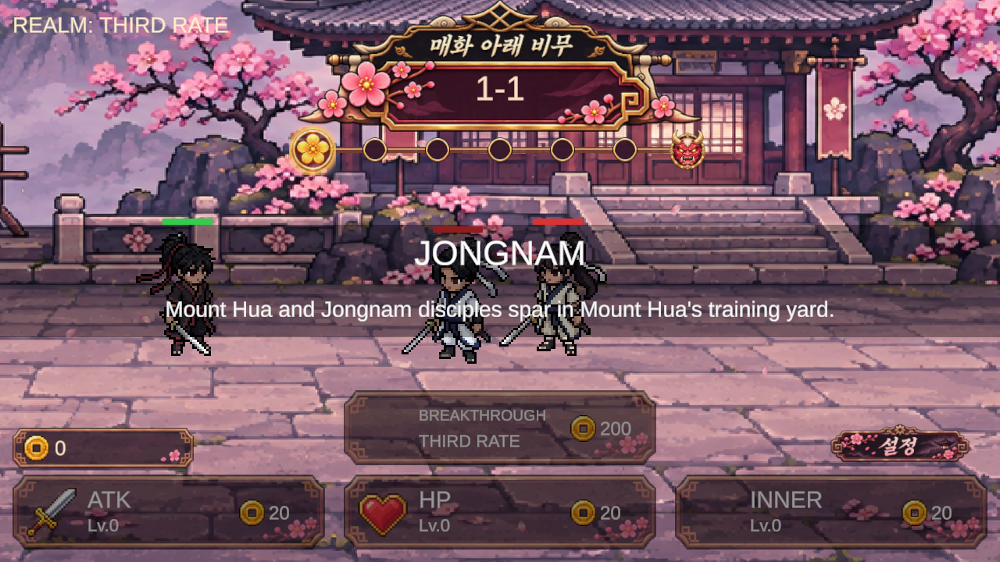
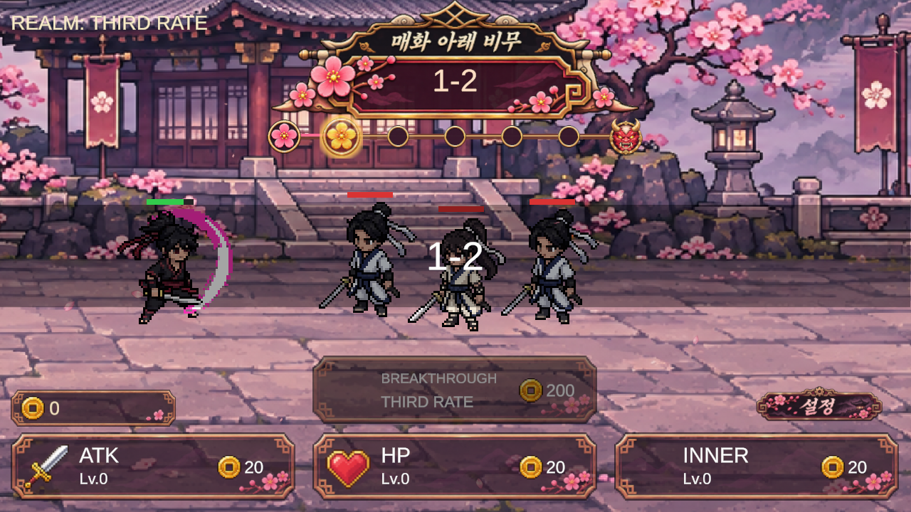
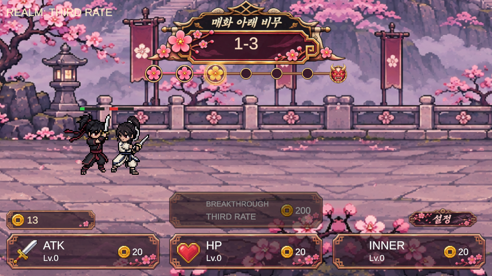

# 루프 증거: loop/20261119-181417 (묶음 combat_m3)

- 판정: **통합 브랜치(`integration`)에 합침** — 관문 위반 0건, 합치기 전 전체 테스트 통과
- 합친 시각: 2026-11-19 18:21
- 병합 커밋: 태그 `loop-merged/20261119-181417` (`git show loop-merged/20261119-181417`)
- 작업 2건, 바뀐 파일 5개 (.meta 제외)
- 테스트 수: 501 → 516개. 합치기 전 실행: EditMode 654/654, PlayMode 78/78
- 이 묶음에서 **보류로 남아 합쳐지지 않은 작업**: 054_battle_skill_attack.md

이 문서는 루프 스크립트가 썼다. 테스트 결과와 관문은 스크립트가 직접 판정한 것이고, "완료 조건별 테스트"와 리뷰 의견은 교차 리뷰 에이전트의 판단이다. 가정과 화면은 사람이 본다.

## 사람이 볼 것

테스트로 판정하지 못한 것이다. 아래 화면 갈무리와 함께 본다.

- 없음

## 에이전트가 스스로 정한 것 (가정)

사양과 작업 문서에 없어 에이전트가 정한 것 전부다. 마음에 들지 않으면 후속 작업으로 고친다.

- `052_battle_realm_health`: 전투 사양의 생성자에는 후속 작업 053의 `skillEnabled` 인자가 미리 포함되어 있다. 이번 작업은 명시된 중간 단계인 `Battle(StatUpgrades upgrades, RealmProgress realm = null)`까지만 구현하며 사양은 후속 작업을 위해 유지한다.
- `052_battle_realm_health`: 그 밖에 없음.
- `053_battle_skill_state`: 없음. 공개 연결 지점과 수치는 기존 사양에 따른다.

## 화면 갈무리

합치기 직전의 코드로 게임을 실행해 찍은 것이다 (플레이 모드 테스트, 파일 이름의 숫자는 실행 후 지난 게임 시간).

**game_001s.png**



**game_010s.png**



**game_030s.png**




## 작업 요약

| 작업 | 구현 | 리뷰 | 새 테스트 | 바뀐 화면 코드 |
| --- | --- | --- | --- | --- |
| `052_battle_realm_health` | codex(시도 1) | claude (교차): 통과 | 8 | 0 |
| `053_battle_skill_state` | codex(시도 1) | claude (교차): 통과 | 7 | 0 |

## 관문 (스크립트 판정)

- 위반: 0건
- 확인 필요: 없음

## 작업별 기록

### 052_battle_realm_health

- 구현: codex(시도 1)
- 리뷰: claude (교차): 통과
- 바뀐 내용: 경지 돌파 시 최대 체력 증가분을 제자의 현재 체력에 반영하고 상황별 에딧 모드 테스트를 추가했다. Unity 테스트 결과는 루프 판정을 기다린다.
- 리뷰 의견: Battle 생성자에 realm 인자를 선택으로 더했고, 돌파 알림을 받으면 체력 강화와 같은 처리로 늘어난 최대 체력을 현재 체력에 더한다. 사양대로 구현됐고, 완료 조건마다 숫자를 확인하는 테스트가 있다. 하지 말 것으로 정한 범위는 건드리지 않았다.
- 작업 문서 원본: `docs/history/052_battle_realm_health.md`

| 완료 조건 | 대응하는 테스트 | 판정 |
| --- | --- | --- |
| `Assets/Tests/EditMode/Combat/BattleRealmTests.cs`에 아래 조건마다 테스트가 하나 이상 있고 모두 통과한다. | BattleRealmTests (조건 2~9를 각각 다루는 테스트 8개) | 있음 |
| 경지 전투에서 `AddEnemy(Boss, 1, 1.0)` 뒤 1칸 진행하면 `DiscipleHealth`는 90이고, 이어서 `realm.TryBreakthrough()` 뒤 `DiscipleMaxHealth`는 110, `DiscipleHealth`는 100이다. | BattleRealmTests.Breakthrough_AfterDamage_IncreasesCurrentHealthByMaxDifference (TakeBossHit에서 90 확인) | 있음 |
| 바로 위 상태에서 `upgrades.TryUpgrade(StatType.Health)` 뒤 `DiscipleMaxHealth`는 132, `DiscipleHealth`는 122다. | BattleRealmTests.HealthUpgrade_AfterBreakthrough_UsesUpdatedMaxHealth | 있음 |
| 지갑을 `new Wallet(10000)`으로 한 경지 전투에서 `realm.TryBreakthrough()`를 4번 부르면 `DiscipleMaxHealth`는 140, `DiscipleHealth`는 140이다. | BattleRealmTests.Breakthrough_FourTimes_IncreasesHealthToFinalMaximum | 있음 |
| 경지 전투를 `new StatUpgrades(wallet, 10, 10, 0, 0, 0, realm)`로 만들고 `AddEnemy(Normal, 1, 0.8)`을 2번 부른 뒤 1칸 뒤 `IsDiscipleDefeated`는 `true`, `DiscipleHealth`는 0이고, 이어서 `realm.TryBreakthrough()` 뒤 `DiscipleHealth`는 0 그대로, `DiscipleMaxHealth`는 11이다. | BattleRealmTests.Breakthrough_WhileDefeated_LeavesCurrentHealthAtZero (DefeatDisciple에서 패배·0 확인) | 있음 |
| 바로 위 상태에서 이어서 `Reset()` 뒤 `DiscipleHealth`는 11이다. | BattleRealmTests.Reset_AfterDefeatAndBreakthrough_RestoresNewMaximum | 있음 |
| 경지 전투의 `upgrades`로 `new Battle(upgrades)`(realm 없이)를 만들고 `AddEnemy(Boss, 1, 1.0)` 뒤 1칸 진행한 뒤 `realm.TryBreakthrough()`를 부르면 `DiscipleHealth`는 90 그대로, `DiscipleMaxHealth`는 110이다. | BattleRealmTests.Breakthrough_WithoutRealmSubscription_LeavesCurrentHealthUnchanged | 있음 |
| 경지 전투에서 `SetPaused(true)` 뒤 `realm.TryBreakthrough()`를 부르면 `DiscipleHealth`는 110이다. | BattleRealmTests.Breakthrough_WhilePaused_IncreasesHealthWithoutBattleNotifications | 있음 |
| `new Battle(upgrades, null)`은 예외 없이 만들어지고 `DiscipleHealth`는 100이다. | BattleRealmTests.New_NullRealm_StartsWithFullHealth | 있음 |
| 기존 테스트가 모두 통과한다. | 루프의 전체 테스트 실행 | 루프가 판정 |

리뷰 지적 (합친 뒤에도 남은 것):

- [note] Battle.cs:55의 생성자 주석에서 upgrades 설명에 있던 '공격 간격'이 빠졌다. 공격 간격 고정 사양에 맞춘 정리로 보이며 문제는 없다.
- [note] BattleRealmTests.cs의 DefeatDisciple와 Breakthrough_WithoutRealmSubscription에서 SetUp이 만든 이전 Battle도 realm 알림을 계속 받고 있다. 새 Battle의 검사에는 영향이 없다.

새 테스트 8개: `BattleRealmTests.Breakthrough_AfterDamage_IncreasesCurrentHealthByMaxDifference`, `BattleRealmTests.Breakthrough_FourTimes_IncreasesHealthToFinalMaximum`, `BattleRealmTests.Breakthrough_WhileDefeated_LeavesCurrentHealthAtZero`, `BattleRealmTests.Breakthrough_WhilePaused_IncreasesHealthWithoutBattleNotifications`, `BattleRealmTests.Breakthrough_WithoutRealmSubscription_LeavesCurrentHealthUnchanged`, `BattleRealmTests.HealthUpgrade_AfterBreakthrough_UsesUpdatedMaxHealth`, `BattleRealmTests.New_NullRealm_StartsWithFullHealth`, `BattleRealmTests.Reset_AfterDefeatAndBreakthrough_RestoresNewMaximum`

### 053_battle_skill_state

- 구현: codex(시도 1)
- 리뷰: claude (교차): 통과
- 바뀐 내용: 스킬 활성화 상태와 피해 계산 및 관련 에딧 모드 테스트를 추가했다. 기존 공격 동작은 유지하며 Unity 테스트는 루프 판정을 기다린다.
- 리뷰 의견: Battle에 스킬 켜기 인자, 상수 넷, SkillEnabled·SkillCooldown·IsSkillReady·SkillDamage, CalculateSkillDamage가 사양과 작업 문서대로 들어갔습니다. 완료 조건마다 숫자까지 확인하는 테스트가 있고, 스킬 발동은 만들지 않아 전투 동작은 그대로입니다.
- 작업 문서 원본: `docs/history/053_battle_skill_state.md`

| 완료 조건 | 대응하는 테스트 | 판정 |
| --- | --- | --- |
| `Assets/Tests/EditMode/Combat/BattleSkillTests.cs`에 아래 조건마다 테스트가 하나 이상 있고 모두 통과한다. | BattleSkillTests 전체 (조건 2~9마다 대응 테스트가 있음, 통과 여부는 루프 실행 결과로 판정) | 있음 |
| `Battle.CalculateSkillDamage`는 (10, 0) → 20, (10, 1) → 21, (13, 2) → 28, (11, 0) → 22, (0, 5) → 0을 돌려준다. | BattleSkillTests.CalculateSkillDamage_ValidInputs_ReturnsTruncatedDamage (TestCase 5개) | 있음 |
| `Battle.CalculateSkillDamage(10, int.MaxValue)`는 예외 없이 2147483667을 돌려준다. | BattleSkillTests.CalculateSkillDamage_ValidInputs_ReturnsTruncatedDamage (10L, int.MaxValue, 2147483667L) | 있음 |
| `Battle.CalculateSkillDamage(-1, 0)`과 `Battle.CalculateSkillDamage(10, -1)`은 각각 `ArgumentOutOfRangeException`을 던진다. | BattleSkillTests.CalculateSkillDamage_NegativeInputs_Throw | 있음 |
| 스킬 전투를 새로 만들면 `SkillEnabled`는 `true`, `SkillCooldown`은 0, `IsSkillReady`는 `true`, `SkillDamage`는 20이다. | BattleSkillTests.New_EnabledSkill_IsReadyWithInitialDamage | 있음 |
| 기본 전투를 새로 만들면 `SkillEnabled`는 `false`, `SkillCooldown`은 0, `IsSkillReady`는 `false`다. | BattleSkillTests.New_DefaultSkill_IsDisabledButDamageIsAvailable | 있음 |
| 스킬 전투에서 `upgrades.TryUpgrade(StatType.InnerPower)` 뒤 `SkillDamage`는 21이다. | BattleSkillTests.SkillDamage_AfterUpgrades_ReflectsCurrentLevels | 있음 |
| 바로 위 상태에서 이어서 `upgrades.TryUpgrade(StatType.Attack)` 뒤 `SkillDamage`는 25다 (공격력 12 × 210% = 25.2 → 25). | BattleSkillTests.SkillDamage_AfterUpgrades_ReflectsCurrentLevels | 있음 |
| `Battle.SkillRange`는 2.0, `Battle.SkillCooldownSeconds`는 5.0, `Battle.SkillBasePercent`는 200, `Battle.SkillPercentPerInnerLevel`은 10이다. | BattleSkillTests.SkillConstants_Values_MatchSpec | 있음 |
| 기존 테스트가 모두 통과한다. | 루프 전체 테스트 실행 | 루프가 판정 |

리뷰 지적 (합친 뒤에도 남은 것):

- [note] 새 상수 넷(Battle.cs:33-36)과 새 속성 넷·CalculateSkillDamage(Battle.cs:106-124)에 XML 주석(/// <summary>)이 없다. 같은 파일의 다른 멤버는 주석에 '(임시)' 표시와 사양 근거를 달고 있어 스타일이 맞지 않는다. 동작에는 영향이 없다.
- [note] SkillCooldown 이 { get; private set; } 로 되어 있다(Battle.cs:107). 054 가 값을 정하려면 이렇게 해야 하고, 공개 모양은 사양의 { get; } 과 같다.

새 테스트 7개: `BattleSkillTests.CalculateSkillDamage_NegativeInputs_Throw`, `BattleSkillTests.CalculateSkillDamage_ValidInputs_ReturnsTruncatedDamage`, `BattleSkillTests.EnabledSkill_StepAndReset_DoNotActivateSkillYet`, `BattleSkillTests.New_DefaultSkill_IsDisabledButDamageIsAvailable`, `BattleSkillTests.New_EnabledSkill_IsReadyWithInitialDamage`, `BattleSkillTests.SkillConstants_Values_MatchSpec`, `BattleSkillTests.SkillDamage_AfterUpgrades_ReflectsCurrentLevels`

## 확인하고 되돌리는 방법

```
git diff loop-merged/20261119-181417^1 loop-merged/20261119-181417            # 이 루프가 바꾼 것 전부
git merge --ff-only loop-merged/20261119-181417         # (main 에서) 이 루프까지만 올린다
git revert -m 1 loop-merged/20261119-181417             # (main 에 올린 뒤) 이 루프만 되돌린다
```
