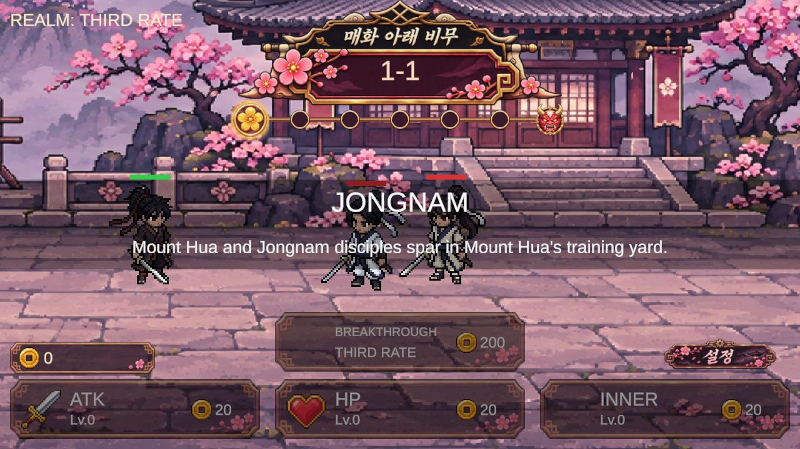
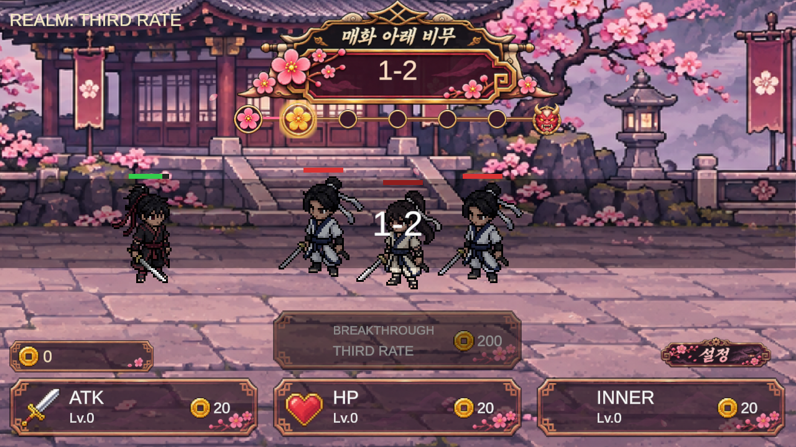
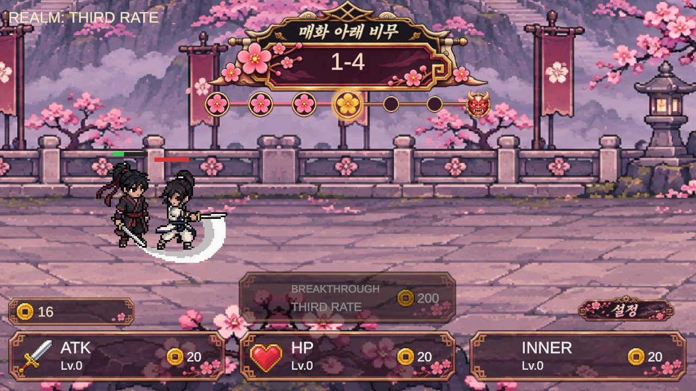

# 루프 증거: loop/20261119-183146 (묶음 combat_m3)

- 판정: **통합 브랜치(`integration`)에 합침** — 관문 위반 0건, 합치기 전 전체 테스트 통과
- 합친 시각: 2026-11-19 18:40
- 병합 커밋: 태그 `loop-merged/20261119-183146` (`git show loop-merged/20261119-183146`)
- 작업 2건, 바뀐 파일 10개 (.meta 제외)
- 테스트 수: 516 → 534개. 합치기 전 실행: EditMode 674/674, PlayMode 80/80

이 문서는 루프 스크립트가 썼다. 테스트 결과와 관문은 스크립트가 직접 판정한 것이고, "완료 조건별 테스트"와 리뷰 의견은 교차 리뷰 에이전트의 판단이다. 가정과 화면은 사람이 본다.

## 사람이 볼 것

테스트로 판정하지 못한 것이다. 아래 화면 갈무리와 함께 본다.

- `054_battle_skill_attack`: `EnabledSkill_StepAndReset_DoNotActivateSkillYet` 테스트는 스킬 활성화 상태의 첫 공격이 기본 공격이고 스킬 대기가 0이어야 한다고 검사한다. 이번 작업은 같은 상황에 스킬 피해와 5초 대기를 요구하면서 053의 테스트를 고치지 말라고 한다. 테스트 변경 허용 여부를 결정해야 한다.
- `055_combat_skill_view`: 에디터에서 게임을 시작해 제자가 첫 몬스터를 공격할 때 제자 앞쪽에 연분홍 띠가 잠깐 보였다 사라지는지, 그 뒤 약 5초마다 같은 띠가 보이는지 본다.
- `055_combat_skill_view`: 에디터에서 금화를 모아 이류로 돌파해, 그 자리에서 제자 체력 바가 늘어난 최대 체력에 맞게 차오르는지 본다 (체력이 가득일 때 돌파하면 계속 가득이다).

## 에이전트가 스스로 정한 것 (가정)

사양과 작업 문서에 없어 에이전트가 정한 것 전부다. 마음에 들지 않으면 후속 작업으로 고친다.

- `055_combat_skill_view`: 없음. 띠의 크기·색·시간과 위치는 작업 문서에 지정된 임시값을 사용했다.

## 화면 갈무리

합치기 직전의 코드로 게임을 실행해 찍은 것이다 (플레이 모드 테스트, 파일 이름의 숫자는 실행 후 지난 게임 시간).

**game_001s.png**



**game_010s.png**



**game_030s.png**




## 작업 요약

| 작업 | 구현 | 리뷰 | 새 테스트 | 바뀐 화면 코드 |
| --- | --- | --- | --- | --- |
| `054_battle_skill_attack` | codex(시도 1) | claude (교차): 통과 | 13 | 0 |
| `055_combat_skill_view` | codex(시도 1) | claude (교차): 통과 | 5 | 2 |

## 관문 (스크립트 판정)

- 위반: 0건
- 확인 필요:
  - `Assets/Tests/EditMode/Combat/BattleSkillTests.cs` — 있던 검사(Assert) 2줄을 지우거나 바꿈 (작업 054_battle_skill_attack)
    - 지워짐: `Assert.AreEqual(enemy.MaxHealth - 10, enemy.Health);`
    - 지워짐: `Assert.AreEqual(0.0, battle.SkillCooldown);`
    - 새로 들어옴: `Assert.AreEqual(enemy.MaxHealth - 20, enemy.Health);`
    - 새로 들어옴: `Assert.AreEqual(5.0, battle.SkillCooldown);`
    - 새로 들어옴: `Assert.AreEqual(80, boss.Health);`
    - 새로 들어옴: `Assert.AreEqual(90, battle.DiscipleHealth);`
    - 새로 들어옴: `Assert.AreEqual(5.0, battle.SkillCooldown, 1e-6);`
    - 새로 들어옴: `Assert.IsFalse(battle.IsSkillReady);`
    - 새로 들어옴: `Assert.AreEqual(1.0, battle.DiscipleAttackCooldown, 1e-6);`
    - 새로 들어옴: `Assert.AreEqual(70, boss.Health);`

## 작업별 기록

### 054_battle_skill_attack

- 구현: codex(시도 1)
- 리뷰: claude (교차): 통과
- 바뀐 내용: 공격 차례의 이십사수매화검법 발동, 재사용 대기 및 알림을 구현하고 완료 조건의 에딧 모드 테스트를 추가했다. Unity 테스트는 루프 판정을 기다린다.
- 리뷰 의견: 스킬 발동(대기 감소, 2.0 범위 피해, EnemyDamaged→SkillUsed 순서, 대기 설정, 알림 안 Reset 처리)이 사양과 요구사항대로 구현됐고, 완료 조건마다 칸 수와 기대값을 그대로 확인하는 테스트가 있다. 053 테스트 수정은 사람의 답변대로 기대값 두 개만 바꿨고 검사 수는 4개로 유지됐다.
- 작업 문서 원본: `docs/history/054_battle_skill_attack.md`

| 완료 조건 | 대응하는 테스트 | 판정 |
| --- | --- | --- |
| `Assets/Tests/EditMode/Combat/BattleSkillTests.cs`에 아래 조건마다 테스트가 하나 이상 있고 모두 통과한다. | BattleSkillTests 전체 (통과 여부는 루프 실행 결과) | 있음 |
| 스킬 전투에서 `AddEnemy(Boss, 1, 1.0)` 뒤 1칸 뒤 보스의 `Health`는 80이고 `DiscipleHealth`는 90이다. | BattleSkillTests.SkillAttack_Boss_CooldownsAndSubsequentTurns | 있음 |
| 바로 위 1칸에서 `EnemyDamaged` 1번 다음에 `SkillUsed` 1번이 이 순서로 온다. | BattleSkillTests.SkillAttack_Boss_CooldownsAndSubsequentTurns | 있음 |
| 바로 위 1칸 뒤 `SkillCooldown`은 5.0, `IsSkillReady`는 `false`, `DiscipleAttackCooldown`은 1.0이다. | BattleSkillTests.SkillAttack_Boss_CooldownsAndSubsequentTurns | 있음 |
| 이어서 51칸 뒤 보스의 `Health`는 70이고 `SkillUsed`는 1번 그대로, `SkillCooldown`은 4.0이다. | BattleSkillTests.SkillAttack_Boss_CooldownsAndSubsequentTurns | 있음 |
| 이어서 250칸 뒤 보스의 `Health`는 40이고 `IsSkillReady`는 `false`다. | BattleSkillTests.SkillAttack_Boss_CooldownsAndSubsequentTurns | 있음 |
| 이어서 251칸 뒤 보스의 `Health`는 20이고 `SkillUsed`는 모두 2번이다. | BattleSkillTests.SkillAttack_Boss_CooldownsAndSubsequentTurns | 있음 |
| 스킬 전투에서 `AddEnemy(Normal, 1, 0.8)`, `AddEnemy(Boss, 1, 1.9)`, `AddEnemy(Boss, 1, 2.5)` 뒤 1칸 뒤 세 적의 `Health`는 10, 80, 100이고 `EnemyDamaged`는 2번(`Index` 0, 1 순서), `SkillUsed`는 1번 온다. | BattleSkillTests.SkillAttack_AffectsAllEnemiesInRange_InOrder | 있음 |
| 스킬 전투에서 `AddEnemy(Boss, 1, 1.5)` 뒤 1칸 뒤 보스의 `Health`는 100, `SkillUsed`는 0번, `IsSkillReady`는 `true`다. | BattleSkillTests.SkillReady_OutsideAttackRange_WaitsForWindUp | 있음 |
| 바로 위에 이어서 4칸 뒤 `DisciplePosition`은 0.5, 24칸 뒤 보스의 `Health`는 100, 25칸 뒤 80이고 `SkillUsed`는 1번이다. | BattleSkillTests.SkillReady_OutsideAttackRange_WaitsForWindUp | 있음 |
| 스킬 전투에서 `AddEnemy(Normal, 1, 0.8)`과 `AddEnemy(Boss, 1, 8.0)` 뒤 1칸 뒤 일반 몬스터의 `Health`는 10이고, 51칸 뒤 `Enemies.Count`는 1이다. | BattleSkillTests.SkillCooldown_ExpiresDuringMovement_WaitsForNextAttack | 있음 |
| 바로 위에 이어서 106칸 뒤 `DisciplePosition`은 7.0, 126칸 뒤 보스의 `Health`는 100, 127칸 뒤 90이다. | BattleSkillTests.SkillCooldown_ExpiresDuringMovement_WaitsForNextAttack | 있음 |
| 바로 위에 이어서 251칸 뒤 `IsSkillReady`는 `true`이고 보스의 `Health`는 70, 276칸 뒤 70, 277칸 뒤 50이고 `SkillUsed`는 모두 2번이다 (스킬 준비가 끝나도 다음 공격 차례까지 기다린다). | BattleSkillTests.SkillCooldown_ExpiresDuringMovement_WaitsForNextAttack | 있음 |
| 기본 전투에서 `AddEnemy(Boss, 1, 1.0)` 뒤 251칸 뒤 보스의 `Health`는 40, `SkillUsed`는 0번, `SkillCooldown`은 0이다. | BattleSkillTests.DisabledSkill_UsesOnlyBasicAttacks | 있음 |
| 스킬 전투를 `new StatUpgrades(wallet, 15, 5)`로 만들고 `AddEnemy(Normal, 1, 0.8)` 뒤 1칸 뒤 `EnemyDamaged` → `SkillUsed` → `EnemyDefeated` → `DiscipleDefeated`가 이 순서로 1번씩 온다. | BattleSkillTests.SkillAttack_SimultaneousDefeat_NotifiesInOrder | 있음 |
| 바로 위 1칸에서 `EnemyDefeated`를 받는 시점에 읽은 `IsDiscipleDefeated`는 `true`다. | BattleSkillTests.SkillAttack_SimultaneousDefeat_NotifiesInOrder | 있음 |
| 스킬 전투에서 `AddEnemy(Boss, 1, 1.0)` 뒤 1칸 진행하고 `upgrades.TryUpgrade(StatType.InnerPower)`를 부르면 `SkillCooldown`은 5.0 그대로이고, 251칸 뒤 보스의 `Health`는 19다. | BattleSkillTests.InnerPowerUpgrade_PreservesCooldown_ChangesNextSkillDamage | 있음 |
| 스킬 전투에서 `AddEnemy(Boss, 1, 1.0)` 뒤 1칸 진행하고 `Reset()`을 부르면 `SkillCooldown`은 0, `IsSkillReady`는 `true`다. | BattleSkillTests.Reset_AfterSkill_EnablesImmediateSkillAgain | 있음 |
| 바로 위에 이어서 `AddEnemy(Boss, 1, 1.0)` 뒤 1칸 더 진행하면 새 보스의 `Health`는 80이다. | BattleSkillTests.Reset_AfterSkill_EnablesImmediateSkillAgain | 있음 |
| 스킬 전투에서 `AddEnemy(Boss, 1, 1.0)` 뒤 1칸 진행하고 `SetPaused(true)` 뒤 `Step()` 10번과 `Tick(0.1)`을 불러도 `SkillCooldown`은 5.0이다. | BattleSkillTests.SkillCooldown_PausedOrDefeated_DoesNotAdvance | 있음 |
| 스킬 전투를 `new StatUpgrades(wallet, 10, 5)`로 만들고 `AddEnemy(Normal, 1, 0.8)` 뒤 1칸 뒤 `IsDiscipleDefeated`는 `true`, `SkillCooldown`은 5.0이고, 이어서 `Step()` 10번 뒤에도 5.0이다. | BattleSkillTests.SkillCooldown_PausedOrDefeated_DoesNotAdvance | 있음 |
| 스킬 전투에서 적이 없을 때 50칸 뒤 `SkillCooldown`은 0, `IsSkillReady`는 `true`, `DisciplePosition`은 6.48이다. | BattleSkillTests.SkillBattle_NoEnemies_MovesAndRemainsReady | 있음 |
| 스킬 전투에서 `SkillUsed` 안에서 보스의 `Health`와 `SkillCooldown`을 읽게 하고 `AddEnemy(Boss, 1, 1.0)` 뒤 1칸 진행하면 읽은 값은 80과 0이다. | BattleSkillTests.SkillUsed_ObservesDamageBeforeCooldown | 있음 |
| 스킬 전투에서 `SkillUsed` 안에서 `Reset()`을 부르게 하고 `AddEnemy(Boss, 1, 1.0)` 뒤 1칸 진행하면 예외 없이 `SkillCooldown`은 0, `DiscipleAttackCooldown`은 0, `DiscipleHealth`는 100, `Enemies.Count`는 0이다. | BattleSkillTests.SkillUsed_Reset_StopsRemainingStep | 있음 |
| 바로 위 1칸에서 `ResetCompleted`는 1번, `DiscipleDamaged`는 0번 온다. | BattleSkillTests.SkillUsed_Reset_StopsRemainingStep | 있음 |
| 기존 테스트가 모두 통과한다. | 전체 테스트 실행 | 루프가 판정 |

리뷰 지적 (합친 뒤에도 남은 것):

- [note] 053 테스트에서 지워진 두 검사(MaxHealth-10, SkillCooldown 0.0)는 사람의 답변(## 답변)이 허용한 그대로 MaxHealth-20과 5.0으로 바뀌었다. Reset 뒤의 두 검사는 남아 있고 검사 수도 4개 그대로라 뜻이 약해지지 않았다 (Assets/Tests/EditMode/Combat/BattleSkillTests.cs:80-86).
- [note] 이름을 유지한 까닭을 적은 주석 '053에서는 스킬 발동이 아직 구현되지 않아 기존 이름을 유지한다.'가 조금 모호하다. 지금은 스킬이 발동하므로 이름이 내용과 맞지 않는다는 점을 더 분명히 적으면 좋겠다 (BattleSkillTests.cs:81). 사소한 지적이다.
- [note] 공격 차례 판정(hasTarget, 거리 1.0)과 스킬이 맞히는 범위(hits, 거리 2.0)를 나눠서, 1.0 밖·2.0 안에만 적이 있으면 스킬을 쓰지 않는다는 요구사항을 지켰다. SkillDamage는 한 번만 읽고, SkillUsed 다음에 _resetGeneration을 확인하는 것도 사양과 맞다 (Assets/Scripts/Core/Combat/Battle.cs:353-401). 금지된 폴더(StatUpgrade, Realm, Stage, Game)는 바뀌지 않았다.

새 테스트 13개: `BattleSkillTests.DisabledSkill_UsesOnlyBasicAttacks`, `BattleSkillTests.EnemyDamaged_ResetDuringSkill_StopsNotificationsAndAttack`, `BattleSkillTests.InnerPowerUpgrade_PreservesCooldown_ChangesNextSkillDamage`, `BattleSkillTests.Reset_AfterSkill_EnablesImmediateSkillAgain`, `BattleSkillTests.SkillAttack_AffectsAllEnemiesInRange_InOrder`, `BattleSkillTests.SkillAttack_Boss_CooldownsAndSubsequentTurns`, `BattleSkillTests.SkillAttack_SimultaneousDefeat_NotifiesInOrder`, `BattleSkillTests.SkillBattle_NoEnemies_MovesAndRemainsReady`, `BattleSkillTests.SkillCooldown_ExpiresDuringMovement_WaitsForNextAttack`, `BattleSkillTests.SkillCooldown_PausedOrDefeated_DoesNotAdvance`, `BattleSkillTests.SkillReady_OutsideAttackRange_WaitsForWindUp`, `BattleSkillTests.SkillUsed_ObservesDamageBeforeCooldown`, `BattleSkillTests.SkillUsed_Reset_StopsRemainingStep`

관문 확인 필요:

- `Assets/Tests/EditMode/Combat/BattleSkillTests.cs` — 있던 검사(Assert) 2줄을 지우거나 바꿈
    - 지워짐: `Assert.AreEqual(enemy.MaxHealth - 10, enemy.Health);`
    - 지워짐: `Assert.AreEqual(0.0, battle.SkillCooldown);`
    - 새로 들어옴: `Assert.AreEqual(enemy.MaxHealth - 20, enemy.Health);`
    - 새로 들어옴: `Assert.AreEqual(5.0, battle.SkillCooldown);`
    - 새로 들어옴: `Assert.AreEqual(80, boss.Health);`
    - 새로 들어옴: `Assert.AreEqual(90, battle.DiscipleHealth);`
    - 새로 들어옴: `Assert.AreEqual(5.0, battle.SkillCooldown, 1e-6);`
    - 새로 들어옴: `Assert.IsFalse(battle.IsSkillReady);`
    - 새로 들어옴: `Assert.AreEqual(1.0, battle.DiscipleAttackCooldown, 1e-6);`
    - 새로 들어옴: `Assert.AreEqual(70, boss.Health);`

### 055_combat_skill_view

- 구현: codex(시도 1)
- 리뷰: claude (교차): 통과
- 바뀐 내용: 스킬 검기 띠 표시와 경지·스킬을 켠 전투 조립을 구현하고 에딧 및 플레이 모드 테스트를 추가했다. Unity 테스트는 루프 판정을 기다린다.
- 리뷰 의견: CombatLayout 검기 띠 규칙, CombatView의 SkillUsed 구독·표시·소멸·초기화 숨김, GameRoot 한 줄 변경이 작업 문서와 사양대로 구현됐습니다. 완료 조건마다 숫자를 직접 확인하는 테스트가 있습니다. 하지 말 것 범위는 침범하지 않았고, 화면 코드에 계산도 들어가지 않았습니다.
- 작업 문서 원본: `docs/history/055_combat_skill_view.md`

| 완료 조건 | 대응하는 테스트 | 판정 |
| --- | --- | --- |
| Assets/Tests/EditMode/Combat/CombatLayoutTests.cs`에 아래 `CombatLayout` 조건마다 테스트가 하나 이상 있고 모두 통과한다. | CombatLayoutTests.SkillSlashAlpha_ElapsedTime_ClampsAndFades, SkillSlashAlpha_NaN_IsZero, SkillSlashSeconds_IsQuarterSecond | 있음 |
| CombatLayout.SkillSlashAlpha`는 0 → 0.6, 0.125 → 0.3, 0.25 → 0.0, 0.3 → 0.0을 돌려준다. | CombatLayoutTests.SkillSlashAlpha_ElapsedTime_ClampsAndFades (TestCase 0/0.125/0.25/0.3) | 있음 |
| CombatLayout.SkillSlashAlpha`는 −0.1 → 0.6, `double.NaN` → 0.0을 돌려준다. | CombatLayoutTests.SkillSlashAlpha_ElapsedTime_ClampsAndFades (TestCase -0.1), CombatLayoutTests.SkillSlashAlpha_NaN_IsZero | 있음 |
| CombatLayout.SkillSlashSeconds`는 0.25다. | CombatLayoutTests.SkillSlashSeconds_IsQuarterSecond | 있음 |
| Assets/Tests/PlayMode/Combat/CombatSkillTests.cs`에서 첫 씬을 불러온 뒤 `[Game]`의 `GameRoot.Battle.SkillEnabled`는 `true`다. | CombatSkillTests.FirstScene_SkillEnabledAndSlashInitiallyHidden | 있음 |
| 같은 테스트에서 `[Game]` 아래(자식의 자식 포함)에 `[SkillSlash]` 오브젝트가 있고, 그 `SpriteRenderer`는 처음에 보이지 않는다(`enabled`가 `false`이거나 오브젝트가 비활성). | CombatSkillTests.FirstScene_SkillEnabledAndSlashInitiallyHidden ([CombatView]/[SkillSlash] 찾기, !enabled \|\| !activeInHierarchy) | 있음 |
| 화면 코드가 컴파일되고 기존 테스트(`GameBootTests`, `CoreAssemblyTests.Core_DoesNotReferenceUnity`, 기존 전투 테스트 포함)가 모두 통과한다. | 루프의 컴파일·전체 테스트 실행 | 루프가 판정 |
| 에디터에서 게임을 시작해 제자가 첫 몬스터를 공격할 때 제자 앞쪽에 연분홍 띠가 잠깐 보였다 사라지는지, 그 뒤 약 5초마다 같은 띠가 보이는지 본다. | - | 사람 확인 |
| 에디터에서 금화를 모아 이류로 돌파해, 그 자리에서 제자 체력 바가 늘어난 최대 체력에 맞게 차오르는지 본다 (체력이 가득일 때 돌파하면 계속 가득이다). | - | 사람 확인 |

리뷰 지적 (합친 뒤에도 남은 것):

- [note] CombatView.cs:123의 크기(2×0.4)와 sortingOrder 20000이 상수 없이 직접 숫자로 들어갔습니다. 다른 표시는 HealthBarFillOrder 같은 상수를 씁니다. 동작에는 문제가 없습니다.
- [note] CombatLayout.cs:11에서 새 public 상수와 메서드가 기존 private 상수 EnemyOffsetStep보다 앞에 있고, 요약 주석이 없습니다. 정리 수준의 지적입니다.

새 테스트 5개: `CombatLayoutTests.SkillSlashAlpha_ElapsedTime_ClampsAndFades`, `CombatLayoutTests.SkillSlashAlpha_NaN_IsZero`, `CombatLayoutTests.SkillSlashSeconds_IsQuarterSecond`, `CombatSkillTests.FirstScene_SkillEnabledAndSlashInitiallyHidden`, `CombatSkillTests.SkillUsed_ShowsSlashAtAttackPosition_FadesAndResetHidesIt`

## 확인하고 되돌리는 방법

```
git diff loop-merged/20261119-183146^1 loop-merged/20261119-183146            # 이 루프가 바꾼 것 전부
git merge --ff-only loop-merged/20261119-183146         # (main 에서) 이 루프까지만 올린다
git revert -m 1 loop-merged/20261119-183146             # (main 에 올린 뒤) 이 루프만 되돌린다
```
