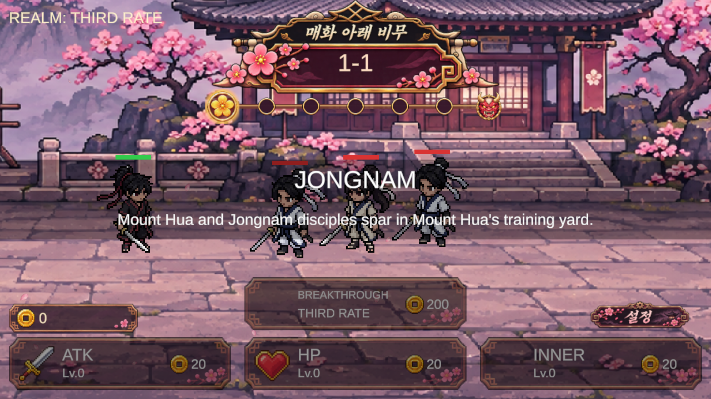
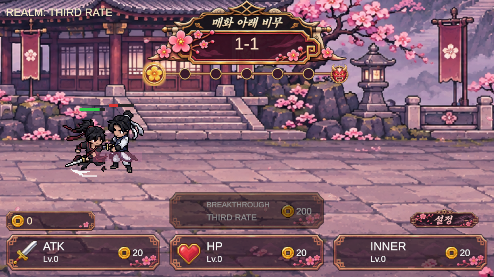
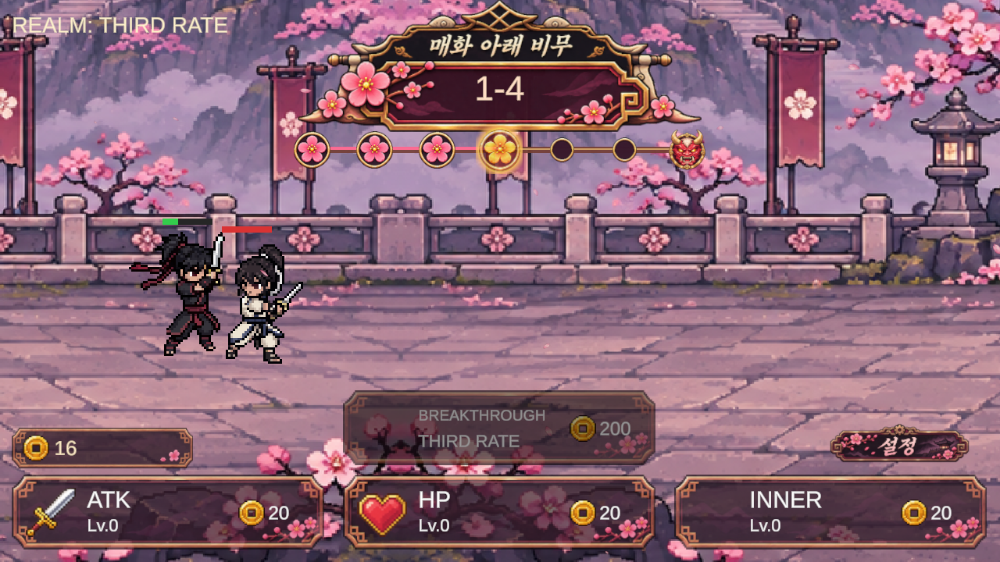

# 루프 증거: loop/20261119-190813 (묶음 save_m3)

- 판정: **통합 브랜치(`integration`)에 합침** — 관문 위반 0건, 합치기 전 전체 테스트 통과
- 합친 시각: 2026-11-19 19:16
- 병합 커밋: 태그 `loop-merged/20261119-190813` (`git show loop-merged/20261119-190813`)
- 작업 2건, 바뀐 파일 18개 (.meta 제외)
- 테스트 수: 534 → 540개. 합치기 전 실행: EditMode 684/684, PlayMode 80/80

이 문서는 루프 스크립트가 썼다. 테스트 결과와 관문은 스크립트가 직접 판정한 것이고, "완료 조건별 테스트"와 리뷰 의견은 교차 리뷰 에이전트의 판단이다. 가정과 화면은 사람이 본다.

## 사람이 볼 것

테스트로 판정하지 못한 것이다. 아래 화면 갈무리와 함께 본다.

- `057_save_realm_restore`: 에디터에서 플레이해 금화를 모아 돌파 한 번과 내공 강화 한 번을 한 뒤 끄고 다시 켜면, 경지 표시가 이류이고 `INNER` 단계가 1 로 그대로다.
- `057_save_realm_restore`: 2단계에서 쓴 판 1 저장(`attackSpeedLevel` 줄이 있는 `save.dat`)이 남아 있는 기기에서 처음 켜면 오류 창 없이 금화 0·1스테이지로 새로 시작한다.
- `057_save_realm_restore`: 에디터에서 금화를 모아 돌파와 내공 강화를 한 번씩 하고 다시 켜면 경지가 이류, INNER 단계가 1로 유지되는지 확인한다.
- `057_save_realm_restore`: 판 1 저장이 남은 기기에서 처음 켰을 때 오류 창 없이 금화 0·1스테이지로 시작하는지 확인한다.

## 에이전트가 스스로 정한 것 (가정)

사양과 작업 문서에 없어 에이전트가 정한 것 전부다. 마음에 들지 않으면 후속 작업으로 고친다.

- 없음

## 화면 갈무리

합치기 직전의 코드로 게임을 실행해 찍은 것이다 (플레이 모드 테스트, 파일 이름의 숫자는 실행 후 지난 게임 시간).

**game_001s.png**



**game_010s.png**



**game_030s.png**




## 작업 요약

| 작업 | 구현 | 리뷰 | 새 테스트 | 바뀐 화면 코드 |
| --- | --- | --- | --- | --- |
| `056_save_data_v2` | codex(시도 1) | claude (교차): 통과 | 2 | 1 |
| `057_save_realm_restore` | codex(시도 1) | claude (교차): 통과 | 4 | 1 |

## 관문 (스크립트 판정)

- 위반: 0건
- 확인 필요:
  - `Assets/Tests/EditMode/Save/AutoSaveTests.cs` — 있던 검사(Assert) 4줄을 지우거나 바꿈 (작업 056_save_data_v2)
    - 지워짐: `Assert.Throws<ArgumentNullException>(() => new AutoSave(null, wallet, upgrades, stage));`
    - 지워짐: `Assert.Throws<ArgumentNullException>(() => new AutoSave(store, null, upgrades, stage));`
    - 지워짐: `Assert.Throws<ArgumentNullException>(() => new AutoSave(store, wallet, null, stage));`
    - 지워짐: `Assert.Throws<ArgumentNullException>(() => new AutoSave(store, wallet, upgrades, null));`
    - 새로 들어옴: `Assert.Throws<ArgumentNullException>(() => new AutoSave(null, wallet, upgrades, realm, stage));`
    - 새로 들어옴: `Assert.Throws<ArgumentNullException>(() => new AutoSave(store, null, upgrades, realm, stage));`
    - 새로 들어옴: `Assert.Throws<ArgumentNullException>(() => new AutoSave(store, wallet, null, realm, stage));`
    - 새로 들어옴: `Assert.Throws<ArgumentNullException>(() => new AutoSave(store, wallet, upgrades, null, stage));`
    - 새로 들어옴: `Assert.Throws<ArgumentNullException>(() => new AutoSave(store, wallet, upgrades, realm, null));`
  - `Assets/Tests/EditMode/Save/SaveCodecTests.cs` — 있던 검사(Assert) 5줄을 지우거나 바꿈 (작업 056_save_data_v2)
    - 지워짐: `Assert.That(SaveCodec.Encode(new SaveData(1234, 3, 2, 10, 7, 5, 638000000000000000L)), Is.EqualTo(Standard));`
    - 지워짐: `Assert.That(result.Data.AttackSpeedLevel, Is.EqualTo(10));`
    - 지워짐: `Assert.That(result.Data.AttackSpeedLevel, Is.EqualTo(10));`
    - 지워짐: `Assert.That(result.Data.AttackSpeedLevel, Is.EqualTo(10));`
    - 지워짐: `Assert.That(result.Data.AttackSpeedLevel, Is.EqualTo(15));`
    - 새로 들어옴: `Assert.That(SaveCodec.Encode(new SaveData(1234, 3, 2, 4, 2, 7, 5, 638000000000000000L)), Is.EqualTo(Standard))`
    - 새로 들어옴: `Assert.That(result.Data.InnerPowerLevel, Is.EqualTo(4));`
    - 새로 들어옴: `Assert.That(result.Data.RealmLevel, Is.EqualTo(2));`
    - 새로 들어옴: `Assert.That(result.Data.InnerPowerLevel, Is.EqualTo(4));`
    - 새로 들어옴: `Assert.That(result.Data.RealmLevel, Is.EqualTo(2));`
    - 새로 들어옴: `Assert.That(result.Data.InnerPowerLevel, Is.EqualTo(4));`
    - 새로 들어옴: `Assert.That(result.Data.RealmLevel, Is.EqualTo(2));`
    - 새로 들어옴: `Assert.That(result.Data.InnerPowerLevel, Is.EqualTo(-3));`
  - `Assets/Tests/EditMode/Save/SaveDataTests.cs` — 있던 검사(Assert) 7줄을 지우거나 바꿈 (작업 056_save_data_v2)
    - 지워짐: `public void CurrentVersion_IsOne() => Assert.That(SaveData.CurrentVersion, Is.EqualTo(1));`
    - 지워짐: `Assert.That(data.AttackSpeedLevel, Is.EqualTo(10));`
    - 지워짐: `Assert.That(data.AttackSpeedLevel, Is.EqualTo(15));`
    - 지워짐: `Assert.That(data.AttackSpeedLevel, Is.EqualTo(0));`
    - 지워짐: `Assert.Throws<ArgumentNullException>(() => SaveData.Capture(null, upgrades, stage, 0));`
    - 지워짐: `Assert.Throws<ArgumentNullException>(() => SaveData.Capture(wallet, null, stage, 0));`
    - 지워짐: `Assert.Throws<ArgumentNullException>(() => SaveData.Capture(wallet, upgrades, null, 0));`
    - 새로 들어옴: `public void CurrentVersion_IsOne() => Assert.That(SaveData.CurrentVersion, Is.EqualTo(2));`
    - 새로 들어옴: `Assert.That(data.InnerPowerLevel, Is.EqualTo(4));`
    - 새로 들어옴: `Assert.That(data.RealmLevel, Is.EqualTo(2));`
    - 새로 들어옴: `Assert.That(data.InnerPowerLevel, Is.EqualTo(-3));`
    - 새로 들어옴: `Assert.That(data.RealmLevel, Is.EqualTo(7));`
    - 새로 들어옴: `Assert.That(realm.Current, Is.EqualTo(RealmLevel.Transcendent));`
    - 새로 들어옴: `Assert.That(upgrades.GetLevel(StatType.InnerPower), Is.Zero);`
    - 새로 들어옴: `Assert.That(data.InnerPowerLevel, Is.EqualTo(3));`
  - `Assets/Tests/EditMode/Save/SaveLoadResultTests.cs` — 있던 검사(Assert) 1줄을 지우거나 바꿈 (작업 056_save_data_v2)
    - 지워짐: `Assert.Throws<ArgumentException>(() => new SaveLoadResult(SaveLoadStatus.Empty, new SaveData(0, 0, 0, 0, 1, 0,`
    - 새로 들어옴: `Assert.Throws<ArgumentException>(() => new SaveLoadResult(SaveLoadStatus.Empty, new SaveData(0, 0, 0, 0, 0, 1,`
  - `Assets/Tests/PlayMode/Save/FileSaveStoreTests.cs` — 있던 검사(Assert) 1줄을 지우거나 바꿈 (작업 056_save_data_v2)
    - 지워짐: `Assert.That(result.Data.AttackSpeedLevel, Is.EqualTo(10));`
    - 새로 들어옴: `Assert.That(result.Data.InnerPowerLevel, Is.EqualTo(4));`
    - 새로 들어옴: `Assert.That(result.Data.RealmLevel, Is.EqualTo(2));`

## 작업별 기록

### 056_save_data_v2

- 구현: codex(시도 1)
- 리뷰: claude (교차): 통과
- 바뀐 내용: 저장 데이터와 코덱을 판 2의 내공·경지 형식으로 변경하고 자동 저장 및 관련 테스트를 갱신했습니다. Unity 테스트는 루프 판정을 기다립니다.
- 리뷰 의견: SaveData·SaveCodec·AutoSave 가 판 2(내공·경지 칸, 경지 인자)로 요구사항대로 바뀌었고, GameRoot 는 new AutoSave 한 줄만 고쳤다. 지워진 검사는 모두 판 2 값으로 바꾸거나 늘린 것이라 뜻이 약해지지 않았다. 새 테스트 둘(판 1 거부, 판 2 의 옛 칸 무시)도 조건대로 검사한다.
- 작업 문서 원본: `docs/history/056_save_data_v2.md`

| 완료 조건 | 대응하는 테스트 | 판정 |
| --- | --- | --- |
| `Assets/Tests/EditMode/Save/SaveDataTests.cs`, `SaveCodecTests.cs`, `SaveLoadResultTests.cs`, `AutoSaveTests.cs` 에 아래 조건마다 테스트가 하나 이상 있고 모두 통과한다. | 아래 조건별 테스트 (통과 여부는 루프 실행 결과) | 있음 |
| `SaveData.CurrentVersion` 은 2 이다. | SaveDataTests.CurrentVersion_IsOne | 있음 |
| `new SaveData(1234, 3, 2, 4, 2, 7, 5, 638000000000000000)` 을 `SaveCodec.Encode` 하면 `"version=2\ngold=1234\nattackLevel=3\nhealthLevel=2\ninnerPowerLevel=4\nrealmLevel=2\nstageNumber=7\nseenIntroStage=5\nsavedAtUtcTicks=638000000000000000\n"` 이다. | SaveCodecTests.Encode_StandardData_ProducesExactText | 있음 |
| 위 글자를 `Decode` 하면 `Status` 가 `Loaded`, `HasSaveData` 가 `true` 이고, `Data` 의 여덟 값(`Gold`, `AttackLevel`, `HealthLevel`, `InnerPowerLevel`, `RealmLevel`, `StageNumber`, `SeenIntroStage`, `SavedAtUtcTicks`)이 1234, 3, 2, 4, 2, 7, 5, 638000000000000000 이다. | SaveCodecTests.Decode_StandardText_LoadsAllValues | 있음 |
| 위 글자의 `\n` 을 모두 `\r\n` 으로 바꾼 글자를 `Decode` 하면 `Loaded` 이고 `InnerPowerLevel` 4, `RealmLevel` 2 이다. | SaveCodecTests.Decode_Crlf_LoadsAllValues | 있음 |
| 위 글자에서 `version=2` 줄을 뺀 글자는 `Corrupt` 이다. | SaveCodecTests.Decode_MissingOrInvalidField_IsCorrupt("version=2\n", "") | 있음 |
| 위 글자의 `version=2` 를 `version=abc` 로 바꾼 글자는 `Corrupt` 이다. | SaveCodecTests.Decode_MissingOrInvalidField_IsCorrupt("version=2", "version=abc") | 있음 |
| 위 글자의 `version=2` 를 `version=1`, `version=3`, `version=0` 으로 바꾼 글자는 모두 `UnsupportedVersion`, `Data` `null`, `HasSaveData` `false` 이다. | SaveCodecTests.Decode_UnknownVersion_IsUnsupported("1"/"3"/"0") | 있음 |
| `"version=1\n"` 한 줄짜리 글자는 `UnsupportedVersion`, `Data` `null`, `HasSaveData` `false` 이다. | SaveCodecTests.Decode_UnknownVersionAlone_IsUnsupported | 있음 |
| 위 글자에서 `gold`, `innerPowerLevel`, `realmLevel`, `savedAtUtcTicks` 줄을 하나씩 뺀 글자 넷은 모두 `Corrupt` 이다. | SaveCodecTests.Decode_MissingOrInvalidField_IsCorrupt (gold/innerPowerLevel/realmLevel/savedAtUtcTicks 줄 제거 TestCase) | 있음 |
| 위 글자의 `realmLevel=2` 를 `realmLevel=2a` 로 바꾼 글자는 `Corrupt` 이다. | SaveCodecTests.Decode_MissingOrInvalidField_IsCorrupt("realmLevel=2", "realmLevel=2a") | 있음 |
| 2단계 판 1 의 글자 `"version=1\ngold=1234\nattackLevel=3\nhealthLevel=2\nattackSpeedLevel=10\nstageNumber=7\nseenIntroStage=5\nsavedAtUtcTicks=638000000000000000\n"` 를 `Decode` 하면 `UnsupportedVersion`, `Data` `null`, `HasSaveData` `false` 이다. | SaveCodecTests.Decode_VersionOneSave_IsUnsupported | 있음 |
| 판 2 표준 글자 끝에 `attackSpeedLevel=10\n` 을 붙인 글자를 `Decode` 하면 `Loaded` 이고 여덟 값이 1234, 3, 2, 4, 2, 7, 5, 638000000000000000 이다. | SaveCodecTests.Decode_VersionTwoWithOldField_IgnoresIt | 있음 |
| `new SaveData(-5, 0, 0, -3, 7, 0, 9, 0)` 을 `Encode` 한 뒤 `Decode` 하면 `Loaded` 이고 `Gold` -5, `InnerPowerLevel` -3, `RealmLevel` 7, `StageNumber` 0, `SeenIntroStage` 9 가 그대로다. | SaveCodecTests.RoundTrip_OutOfRangeValues_ArePreserved | 있음 |
| 그 값으로 `new Wallet(-5)`, `new RealmProgress(wallet, 7)`, `new StatUpgrades(wallet, 10, 100, 0, 0, -3, realm)`, `new StageProgress(wallet, upgrades, battle, random, 0, 9)` 를 만들면 `Balance` 0, `realm.Current` `RealmLevel.Transcendent`, `GetLevel(StatType.InnerPower)` 0, `StageNumber` 1, `SeenIntroStage` 5 이다. | SaveDataTests.Restore_OutOfRangeValues_FeatureConstructorsClamp | 있음 |
| 지금 문화권을 `de-DE` 로 바꾼 채 `new SaveData(1234567, 0, 0, 0, 0, 1, 0, -1)` 을 `Encode` 하면 `gold=1234567` 줄과 `savedAtUtcTicks=-1` 줄이 들어 있고, 그 글자를 `Decode` 하면 `Loaded` 에 `Gold` 1234567, `SavedAtUtcTicks` -1 이다. | SaveCodecTests.RoundTrip_GermanCulture_UsesInvariantNumbers | 있음 |
| `SaveCodec.Encode(null)` 은 `ArgumentNullException` 이다. | SaveCodecTests.Encode_Null_Throws | 있음 |
| `SaveData.Capture` 에 `wallet`, `upgrades`, `realm`, `stage` 를 하나씩 `null` 로 넣으면 각각 `ArgumentNullException` 이다. | SaveDataTests.Capture_NullDependencies_ThrowsArgumentNull | 있음 |
| `new Wallet(500)`, `new RealmProgress(wallet, 2)`, 단계 `(2, 1, 3)` 이고 그 경지 객체를 받은 `StatUpgrades`, `startStage: 4`, `seenIntroStage: 3` 인 스테이지 객체(`Begin` 전)를 `SaveData.Capture(wallet, upgrades, realm, stage, 100)` 하면 여덟 값이 500, 2, 1, 3, 2, 4, 3, 100 이다. | SaveDataTests.Capture_BeforeBegin_CopiesValuesWithoutChangesOrEvents | 있음 |
| 위 `Capture` 뒤 지갑 500, 단계 2·1·3, 경지 `RealmLevel.FirstRate`, 스테이지 번호 4·본 소개 3, `HasBegun` `false` 가 그대로이고 `BalanceChanged`, `Upgraded`, `BrokeThrough`, `StageStarted` 가 하나도 가지 않는다. | SaveDataTests.Capture_BeforeBegin_CopiesValuesWithoutChangesOrEvents | 있음 |
| `AutoSave` 생성자에 `store`, `wallet`, `upgrades`, `realm`, `stage` 를 하나씩 `null` 로 넣으면 각각 `ArgumentNullException` 이다. | AutoSaveTests.Constructor_NullDependency_ThrowsArgumentNull | 있음 |
| `new SaveLoadResult(SaveLoadStatus.Empty, new SaveData(0, 0, 0, 0, 0, 1, 0, 0))` 은 `ArgumentException` 이다. | SaveLoadResultTests.Constructor_EmptyWithData_ThrowsArgumentException | 있음 |
| GameRoot` 와 플레이 모드 테스트(`SaveViewTests`, `SettingsViewTests`, `FileSaveStoreTests`)가 바뀐 생성자로 컴파일된다. | 컴파일 판정 | 루프가 판정 |
| 기존 테스트가 모두 통과한다. | 전체 테스트 실행 | 루프가 판정 |

리뷰 지적 (합친 뒤에도 남은 것):

- [note] 작업 문서가 이름을 그대로 두라고 해서 SaveDataTests.CurrentVersion_IsOne 이 이제 2 를 검사하는데, 이름과 내용이 어긋난다 (Assets/Tests/EditMode/Save/SaveDataTests.cs:15). 나중에 이름 정리를 검토하면 된다.
- [note] 테스트 준비 코드 여러 곳이 using 없이 PlumSword.Core.Realm.RealmProgress 를 전체 이름으로 쓴다 (AutoSaveRetryTests.cs:26, LeaveGameTests.cs:25, OfflineRewardClaimTests.cs:29, SaveViewTests.cs:40, SettingsViewTests.cs:42). 동작에는 문제없는 표기 차이다.

새 테스트 2개: `SaveCodecTests.Decode_VersionOneSave_IsUnsupported`, `SaveCodecTests.Decode_VersionTwoWithOldField_IgnoresIt`

관문 확인 필요:

- `Assets/Tests/EditMode/Save/AutoSaveTests.cs` — 있던 검사(Assert) 4줄을 지우거나 바꿈
    - 지워짐: `Assert.Throws<ArgumentNullException>(() => new AutoSave(null, wallet, upgrades, stage));`
    - 지워짐: `Assert.Throws<ArgumentNullException>(() => new AutoSave(store, null, upgrades, stage));`
    - 지워짐: `Assert.Throws<ArgumentNullException>(() => new AutoSave(store, wallet, null, stage));`
    - 지워짐: `Assert.Throws<ArgumentNullException>(() => new AutoSave(store, wallet, upgrades, null));`
    - 새로 들어옴: `Assert.Throws<ArgumentNullException>(() => new AutoSave(null, wallet, upgrades, realm, stage));`
    - 새로 들어옴: `Assert.Throws<ArgumentNullException>(() => new AutoSave(store, null, upgrades, realm, stage));`
    - 새로 들어옴: `Assert.Throws<ArgumentNullException>(() => new AutoSave(store, wallet, null, realm, stage));`
    - 새로 들어옴: `Assert.Throws<ArgumentNullException>(() => new AutoSave(store, wallet, upgrades, null, stage));`
    - 새로 들어옴: `Assert.Throws<ArgumentNullException>(() => new AutoSave(store, wallet, upgrades, realm, null));`
- `Assets/Tests/EditMode/Save/SaveCodecTests.cs` — 있던 검사(Assert) 5줄을 지우거나 바꿈
    - 지워짐: `Assert.That(SaveCodec.Encode(new SaveData(1234, 3, 2, 10, 7, 5, 638000000000000000L)), Is.EqualTo(Standard));`
    - 지워짐: `Assert.That(result.Data.AttackSpeedLevel, Is.EqualTo(10));`
    - 지워짐: `Assert.That(result.Data.AttackSpeedLevel, Is.EqualTo(10));`
    - 지워짐: `Assert.That(result.Data.AttackSpeedLevel, Is.EqualTo(10));`
    - 지워짐: `Assert.That(result.Data.AttackSpeedLevel, Is.EqualTo(15));`
    - 새로 들어옴: `Assert.That(SaveCodec.Encode(new SaveData(1234, 3, 2, 4, 2, 7, 5, 638000000000000000L)), Is.EqualTo(Standard))`
    - 새로 들어옴: `Assert.That(result.Data.InnerPowerLevel, Is.EqualTo(4));`
    - 새로 들어옴: `Assert.That(result.Data.RealmLevel, Is.EqualTo(2));`
    - 새로 들어옴: `Assert.That(result.Data.InnerPowerLevel, Is.EqualTo(4));`
    - 새로 들어옴: `Assert.That(result.Data.RealmLevel, Is.EqualTo(2));`
    - 새로 들어옴: `Assert.That(result.Data.InnerPowerLevel, Is.EqualTo(4));`
    - 새로 들어옴: `Assert.That(result.Data.RealmLevel, Is.EqualTo(2));`
    - 새로 들어옴: `Assert.That(result.Data.InnerPowerLevel, Is.EqualTo(-3));`
- `Assets/Tests/EditMode/Save/SaveDataTests.cs` — 있던 검사(Assert) 7줄을 지우거나 바꿈
    - 지워짐: `public void CurrentVersion_IsOne() => Assert.That(SaveData.CurrentVersion, Is.EqualTo(1));`
    - 지워짐: `Assert.That(data.AttackSpeedLevel, Is.EqualTo(10));`
    - 지워짐: `Assert.That(data.AttackSpeedLevel, Is.EqualTo(15));`
    - 지워짐: `Assert.That(data.AttackSpeedLevel, Is.EqualTo(0));`
    - 지워짐: `Assert.Throws<ArgumentNullException>(() => SaveData.Capture(null, upgrades, stage, 0));`
    - 지워짐: `Assert.Throws<ArgumentNullException>(() => SaveData.Capture(wallet, null, stage, 0));`
    - 지워짐: `Assert.Throws<ArgumentNullException>(() => SaveData.Capture(wallet, upgrades, null, 0));`
    - 새로 들어옴: `public void CurrentVersion_IsOne() => Assert.That(SaveData.CurrentVersion, Is.EqualTo(2));`
    - 새로 들어옴: `Assert.That(data.InnerPowerLevel, Is.EqualTo(4));`
    - 새로 들어옴: `Assert.That(data.RealmLevel, Is.EqualTo(2));`
    - 새로 들어옴: `Assert.That(data.InnerPowerLevel, Is.EqualTo(-3));`
    - 새로 들어옴: `Assert.That(data.RealmLevel, Is.EqualTo(7));`
    - 새로 들어옴: `Assert.That(realm.Current, Is.EqualTo(RealmLevel.Transcendent));`
    - 새로 들어옴: `Assert.That(upgrades.GetLevel(StatType.InnerPower), Is.Zero);`
    - 새로 들어옴: `Assert.That(data.InnerPowerLevel, Is.EqualTo(3));`
- `Assets/Tests/EditMode/Save/SaveLoadResultTests.cs` — 있던 검사(Assert) 1줄을 지우거나 바꿈
    - 지워짐: `Assert.Throws<ArgumentException>(() => new SaveLoadResult(SaveLoadStatus.Empty, new SaveData(0, 0, 0, 0, 1, 0,`
    - 새로 들어옴: `Assert.Throws<ArgumentException>(() => new SaveLoadResult(SaveLoadStatus.Empty, new SaveData(0, 0, 0, 0, 0, 1,`
- `Assets/Tests/PlayMode/Save/FileSaveStoreTests.cs` — 있던 검사(Assert) 1줄을 지우거나 바꿈
    - 지워짐: `Assert.That(result.Data.AttackSpeedLevel, Is.EqualTo(10));`
    - 새로 들어옴: `Assert.That(result.Data.InnerPowerLevel, Is.EqualTo(4));`
    - 새로 들어옴: `Assert.That(result.Data.RealmLevel, Is.EqualTo(2));`

### 057_save_realm_restore

- 구현: codex(시도 1)
- 리뷰: claude (교차): 통과
- 바뀐 내용: GameRoot에서 저장된 경지와 내공 단계를 복원하고 자동 저장 및 복원 에딧 모드 테스트를 추가했다.
- 리뷰 의견: GameRoot 는 작업 문서가 정한 두 곳(경지 생성 줄, 내공 인자)만 바뀌었습니다. 새 테스트들은 완료 조건의 상황과 숫자를 그대로 검사합니다. 하지 말 것 침범, 화면 코드의 계산, 기존 테스트 약화는 없습니다.
- 작업 문서 원본: `docs/history/057_save_realm_restore.md`

| 완료 조건 | 대응하는 테스트 | 판정 |
| --- | --- | --- |
| `Assets/Tests/EditMode/Save/AutoSaveRealmTests.cs` 와 `Assets/Tests/EditMode/Save/SaveDataTests.cs` 에 아래 [컴파일]·[사람 확인] 이 아닌 조건마다 테스트가 하나 이상 있고 모두 통과한다. | AutoSaveRealmTests 3개, SaveDataTests.Restore_RealmAndUpgradeLevels_AppliesRealmBonus (조건 2~9 모두 대응. 통과 여부는 루프 실행 결과) | 있음 |
| `new Wallet(1000)` 으로 만든 `AutoSave` 에서 `realm.TryBreakthrough()` 는 `true` 이고 그 뒤 금화 800, `realm.Current` `RealmLevel.SecondRate` 이다. | AutoSaveRealmTests.Breakthrough_FlushStoresRealmAndGold | 있음 |
| 위 돌파 뒤 `IsDirty` 가 `true` 이고 쓴 횟수는 0 이다. | AutoSaveRealmTests.Breakthrough_FlushStoresRealmAndGold | 있음 |
| 위에 이어 `Flush(100)` 은 `true`, 쓴 횟수 1 이고, 마지막 글자를 `Decode` 하면 `RealmLevel` 1, `Gold` 800, `SavedAtUtcTicks` 100 이다. | AutoSaveRealmTests.Breakthrough_FlushStoresRealmAndGold | 있음 |
| `new Wallet(100)` 으로 만든 `AutoSave` 에서 `upgrades.TryUpgrade(StatType.InnerPower)` 는 `true` 이고 그 뒤 금화 80, 내공 단계 1 이다. | AutoSaveRealmTests.InnerPowerUpgrade_FlushStoresLevelAndGold | 있음 |
| 위 내공 강화 뒤 `Flush(100)` 은 `true`, 쓴 횟수 1 이고 마지막 글자를 `Decode` 하면 `InnerPowerLevel` 1, `Gold` 80 이다. | AutoSaveRealmTests.InnerPowerUpgrade_FlushStoresLevelAndGold | 있음 |
| `new Wallet(100)` 으로 만든 `AutoSave` 에서 `realm.TryBreakthrough()` 는 `false` (비용 200 부족)이고 `IsDirty` 는 `false` 다. | AutoSaveRealmTests.Breakthrough_InsufficientGold_DoesNotWrite | 있음 |
| 위 실패한 돌파 뒤 `Flush(100)` 은 `false`, 쓴 횟수 0 이다. | AutoSaveRealmTests.Breakthrough_InsufficientGold_DoesNotWrite | 있음 |
| `new Wallet(1234)`, `new RealmProgress(wallet, 2)`, `new StatUpgrades(wallet, 10, 100, 3, 2, 4, realm)` 을 만들면 `Balance` 1234, `realm.Current` `RealmLevel.FirstRate`, `GetLevel` 이 공격력 3·체력 2·내공 4, `Attack` 19 (`(10 + 2 × 3) × 120 / 100 = 19.2` 내림), `MaxHealth` 168 (`(100 + 20 × 2) × 120 / 100`) 이다. | SaveDataTests.Restore_RealmAndUpgradeLevels_AppliesRealmBonus (SaveData(1234,3,2,4,2,…) 값을 생성자 인자로 넘기므로 조건의 값과 같음) | 있음 |
| GameRoot` 가 `new RealmProgress(Wallet, data != null ? data.RealmLevel : 0)` 과 내공 인자 `data != null ? data.InnerPowerLevel : 0` 으로 컴파일되고, 플레이 모드 `GameBootTests`·`GameRootSaveTests` 를 포함한 기존 테스트가 모두 통과한다. | 루프 컴파일·전체 테스트 실행 | 루프가 판정 |
| 에디터에서 플레이해 금화를 모아 돌파 한 번과 내공 강화 한 번을 한 뒤 끄고 다시 켜면, 경지 표시가 이류이고 `INNER` 단계가 1 로 그대로다. | - | 사람 확인 |
| 2단계에서 쓴 판 1 저장(`attackSpeedLevel` 줄이 있는 `save.dat`)이 남아 있는 기기에서 처음 켜면 오류 창 없이 금화 0·1스테이지로 새로 시작한다. | - | 사람 확인 |
| 기존 테스트가 모두 통과한다. | 루프 전체 테스트 실행 | 루프가 판정 |

리뷰 지적 (합친 뒤에도 남은 것):

- [note] docs/spec/save.md:320 에서 '지금 코드가 내공에 넣는 0 과 new RealmProgress(Wallet) 를 저장 값으로 바꾼다' 문장을 구현 후 상태('저장이 없으면 경지와 내공 단계는 0 이다')로 고쳤습니다. 뜻은 사양과 같고, 구현이 끝난 뒤 문서를 현재 상태에 맞춘 것입니다.

새 테스트 4개: `AutoSaveRealmTests.Breakthrough_FlushStoresRealmAndGold`, `AutoSaveRealmTests.Breakthrough_InsufficientGold_DoesNotWrite`, `AutoSaveRealmTests.InnerPowerUpgrade_FlushStoresLevelAndGold`, `SaveDataTests.Restore_RealmAndUpgradeLevels_AppliesRealmBonus`

## 확인하고 되돌리는 방법

```
git diff loop-merged/20261119-190813^1 loop-merged/20261119-190813            # 이 루프가 바꾼 것 전부
git merge --ff-only loop-merged/20261119-190813         # (main 에서) 이 루프까지만 올린다
git revert -m 1 loop-merged/20261119-190813             # (main 에 올린 뒤) 이 루프만 되돌린다
```
