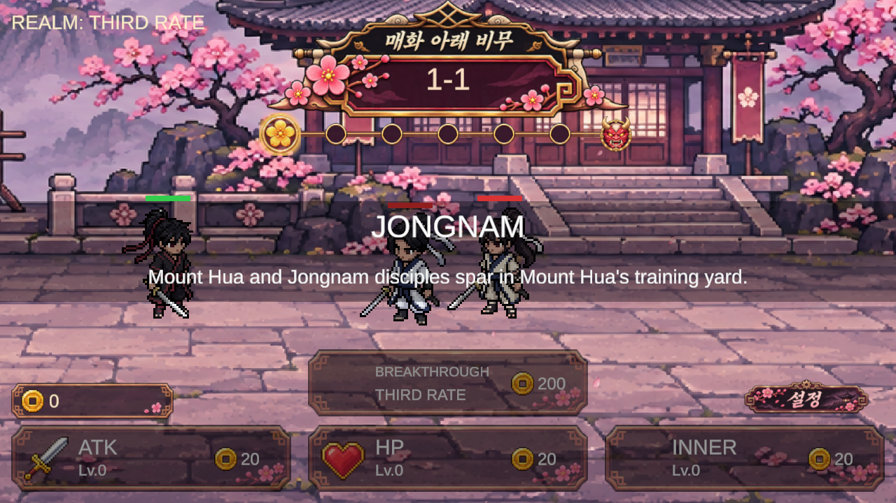
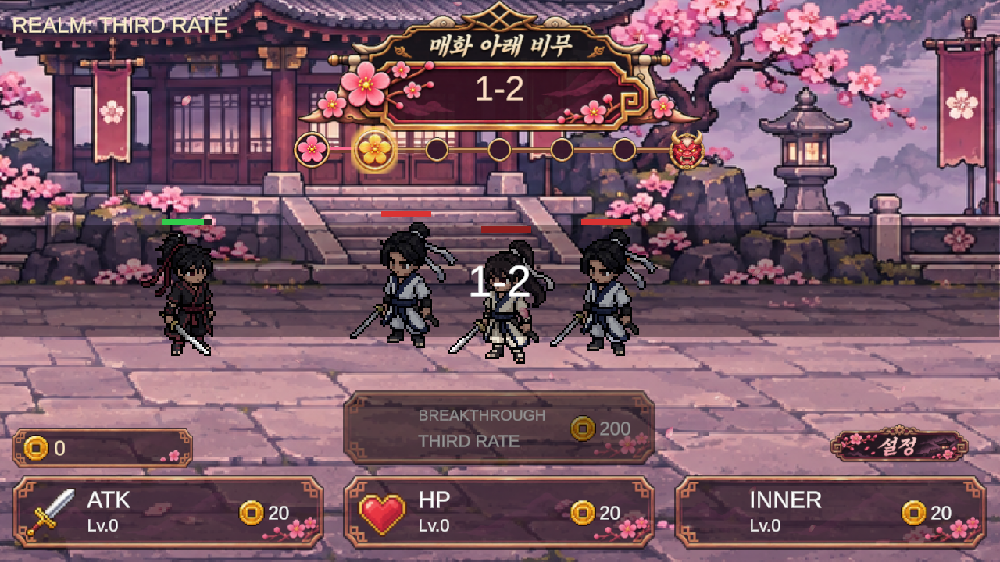
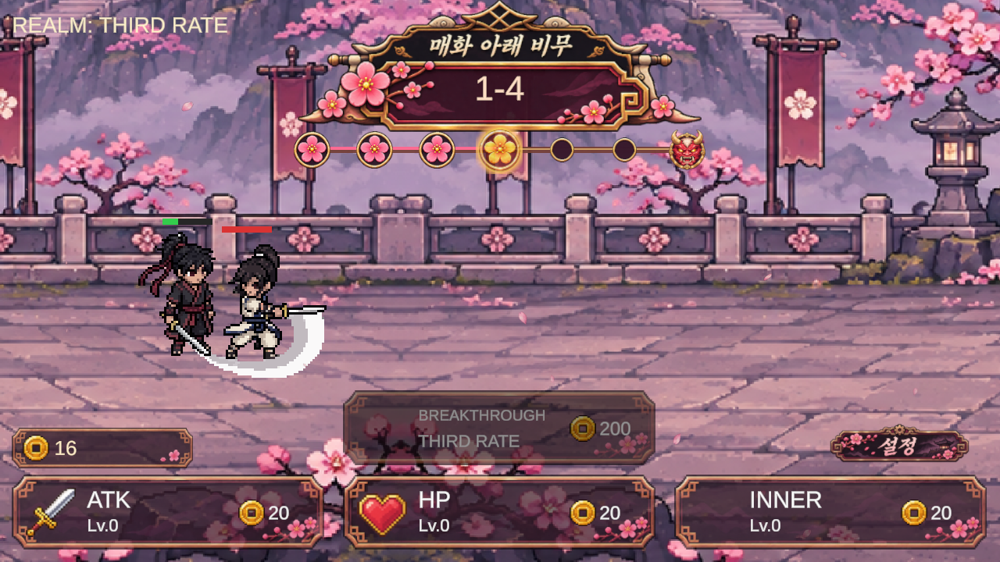

# 루프 증거: loop/20261120-175740 (묶음 realm_fx)

- 판정: **통합 브랜치(`integration`)에 합침** — 관문 위반 0건, 합치기 전 전체 테스트 통과
- 합친 시각: 2026-11-20 20:32
- 병합 커밋: 태그 `loop-merged/20261120-175740` (`git show loop-merged/20261120-175740`)
- 작업 5건, 바뀐 파일 14개 (.meta 제외)
- 테스트 수: 540 → 579개. 합치기 전 실행: EditMode 783/783, PlayMode 80/80

이 문서는 루프 스크립트가 썼다. 테스트 결과와 관문은 스크립트가 직접 판정한 것이고, "완료 조건별 테스트"와 리뷰 의견은 교차 리뷰 에이전트의 판단이다. 가정과 화면은 사람이 본다.

## 사람이 볼 것

테스트로 판정하지 못한 것이다. 아래 화면 갈무리와 함께 본다.

- `058_breakthrough_style_timing`: 없음 (이 작업은 순수 C# 로직이라 모든 완료 조건을 에딧 모드 테스트로 판정했다. 화면 연출은 061·062 에서 확인한다).
- `060_realm_aura_plum`: 완료 조건에 `[사람 확인]` 항목은 없다.
- `060_realm_aura_plum`: 새 색(매화 분홍)과 기운·꽃잎의 움직임이 화면에서 보기 좋은지는 화면 코드(061·062)가 붙은 뒤 사람이 확인해야 한다.
- `061_realm_aura_layers_view`: 실행하고 10초 뒤 화면에서 제자 주변에 오오라·기운·꽃잎이 보이지 않는다 (삼류).
- `061_realm_aura_layers_view`: 에디터에서 금화를 200 이상 모아 돌파해 본다: 0.5초 뒤 연분홍 기본 빛과 세로 기운 2줄이 나타나고 기본 빛이 커졌다가 돌아오며, 제자가 기운 앞에 그려지고 걸어가도 발밑을 따라간다. 꽃잎은 아직 없다.
- `061_realm_aura_layers_view`: 에디터에서 일류·절정·초절정까지 돌파해 본다: 꽃잎이 2·3·5장 제자 앞으로 떠오르고, 기운이 2·3·4줄이며, 색이 점점 진한 매화 분홍이다.
- `061_realm_aura_layers_view`: 대체 기운(0.5 × 2.0 유닛)과 대체 꽃잎(약 0.14 유닛)의 크기가 화면에서 적당한지.
- `062_breakthrough_effect_view`: 실행하고 10초 뒤 화면의 밝기와 색이 이번 변경 전 갈무리와 같다 (돌파 전 평소 화면. 전역 광원·블룸이 평소 화면을 바꾸지 않는다).
- `062_breakthrough_effect_view`: 에디터에서 금화 200 이상으로 첫 돌파를 해 본다: 금화가 200 줄고 왼쪽 위가 `REALM: SECOND RATE` 가 된다. 0.5초 동안 배경과 적이 조금 어두워지며 분홍 꽃잎 12장이 제자에게 모인 뒤 바깥으로 흩어지고, 연분홍 오오라와 기운 2줄이 나타난다. 고리·기둥·번쩍임은 없다. 전투는 멈추지 않는다.
- `062_breakthrough_effect_view`: 에디터에서 일류 → 절정 돌파를 해 본다: 바닥 고리가 퍼지고 빛기둥이 솟으며, 화면이 2 픽셀 흔들리고 제자 주변의 바닥·배경이 분홍으로 밝아지며 기둥이 번져 보인다. 1.8초 뒤 블룸과 어둡게가 사라지고 화면이 원래 밝기로 돌아온다.
- `062_breakthrough_effect_view`: 에디터에서 절정 → 초절정 돌파를 해 본다: 흰 번쩍임과 충격파가 더해지고 꽃잎 36장이 터지며 3 픽셀 흔들린다. 그 뒤 상시 오오라는 기운 4줄과 떠오르는 꽃잎 5장이다.
- `062_breakthrough_effect_view`: 에디터에서 연출 중에 다시 돌파해 본다: 새 경지의 연출이 처음부터 나온다. 저장된 절정으로 이어하면 연출 없이 절정 오오라만 보인다.
- `062_breakthrough_effect_view`: 추가: 블룸이 실제로 보이는지 (프로젝트의 URP 2D 렌더러·카메라 설정에서 후처리가 동작하는지는 실행해야 안다). 어둡게 가림막·점광원이 씬의 기존 전역 광원과 섞여 의도한 밝기인지.
- `062_breakthrough_effect_view`: 추가: 일류 돌파(고리만, 기둥 없음)도 한 번 보면 좋다.

## 에이전트가 스스로 정한 것 (가정)

사양과 작업 문서에 없어 에이전트가 정한 것 전부다. 마음에 들지 않으면 후속 작업으로 고친다.

- `058_breakthrough_style_timing`: 모든 수치(상수, 경지별 표)는 작업 문서·사양의 임시값을 그대로 썼다.
- `058_breakthrough_style_timing`: 공식 안의 숫자(0.4, 0.5, 0.8, 1.5, 2.5)는 `BreakthroughEffect` 안의 비공개 상수(`GatherLightRatio`, `BloomRatio`, `FlashPeakAlpha`, `DimMaskInner`, `DimMaskWidth`)로 두었다. 공개 연결 지점은 바뀌지 않는다.
- `058_breakthrough_style_timing`: `DimMask` 는 양의 무한대일 때 바로 1 을 돌려준다 (공식으로 계산해도 1 이지만 명시적으로 처리). 음의 무한대는 공식대로 0 이다.
- `058_breakthrough_style_timing`: `RealmAura.Color` 의 현재 코드 값이 사양의 새 매화 색과 다르지만, 060 의 범위라 건드리지 않았다.
- `059_breakthrough_parts`: 공식 속 숫자(고리·기둥 시작 비율 0.3, 꽃잎 기본 속도 3, 꽃잎 중력 1.5)는 비공개 상수로 두었다. 사양 연결 지점에 없는 이름이라 공개하지 않았다.
- `059_breakthrough_parts`: 꽃잎 알파의 1.3 은 `TotalSeconds − BurstSeconds`, 모으기 반지름의 3 은 `GatherRadius` 로 썼다 (값은 같다).
- `060_realm_aura_plum`: 수치는 모두 작업 문서·사양의 임시값을 그대로 썼다. 새로 정한 수치는 없다.
- `060_realm_aura_plum`: `Wisp`·`FloatingPetal` 의 경지 검사는 `BreakthroughEffect.Style(realm)` 이 정의되지 않은 경지에 던지는 `ArgumentOutOfRangeException` 에 맡겼다 (요구된 검사 순서와 같다).
- `060_realm_aura_plum`: `BurstColor` 의 이류·일류·절정은 `Color(realm)` 을 불러 RGB 를 가져온다 (값을 따로 적지 않음). `Color` 가 바뀌면 함께 바뀐다.
- `060_realm_aura_plum`: 연결 지점 모양은 사양과 같다.
- `061_realm_aura_layers_view`: 이 작업이 읽는 리소스 경로와 없을 때 보여 주는 것:
- `061_realm_aura_layers_view`: `Resources/Art/Effects/aura_<second_rate|first_rate|peak|transcendent>`: 없으면 64×64 원형 그러데이션을 2.4 × 3.0 유닛으로 그린다 (기존과 같음).
- `061_realm_aura_layers_view`: `Resources/Art/Effects/aura_wisp`: 없으면 8×32 세로 물방울.
- `061_realm_aura_layers_view`: `Resources/Art/Effects/petal`: 없으면 3×3 십자.
- `061_realm_aura_layers_view`: 지금 `Assets/Resources/Art/Effects/` 에는 이 그림들이 없으므로 셋 다 대체 그림이 보인다.
- `061_realm_aura_layers_view`: 기본 빛은 "지금의 동작 유지"에 따라 기존대로 했다: 그림이 있으면 흰색에 알파 1, 1.5배로 그리고, 대체 텍스처는 Bilinear 필터를 쓴다. 사양 일반 규칙의 "대체 그림은 Point" 와는 다르다.
- `061_realm_aura_layers_view`: 기운 그림 스프라이트는 PPU 64 로 만든다 (칸 높이 1 유닛). 이렇게 하면 배율 `3 × Scale` 로 높이 3.0 × Scale 유닛이 되고 비율도 유지된다. 기운 그림 애니메이션은 `Time.time × 10` 으로 프레임을 고르고, 줄마다 따로 시작하지 않는다.
- `061_realm_aura_layers_view`: 꽃잎 크기는 `1.5 × EffectPoint.Scale` 로 그린다 (지금 Scale 은 항상 1). 꽃잎 그림 칸은 PPU 32 (8 픽셀 = 0.25 유닛).
- `061_realm_aura_layers_view`: 그림이 있을 때 기운과 꽃잎은 흰색에 알파만 곱한다. 대체 그림일 때는 `RealmAura.Color` 의 RGB 에 알파를 곱한다.
- `061_realm_aura_layers_view`: 직전 경지를 계산할 때 0 아래로 내려가지 않게 막았다 (삼류로 돌파하는 일은 없다).
- `061_realm_aura_layers_view`: `effectRealm` 은 062 가 읽을 필드라 지금은 값을 넣기만 한다 (컴파일 경고 CS0414 가 날 수 있음).
- `062_breakthrough_effect_view`: 읽는 리소스 경로: `Art/Effects/breakthrough_ring`(칸 160×48), `Art/Effects/breakthrough_pillar`(칸 64×192), `Art/Effects/breakthrough_shockwave`(칸 192×64). 없으면 대체 텍스처(고리·충격파: 64×16 타원 테두리, 기둥: 16×64 세로 기둥, PPU 32 Point)를 `RealmAura.BurstColor(r)` 색으로 그린다. 크기가 틀리면 `Debug.LogWarning` 한 번(`Initialize` 때 한 번만 읽음) 후 대체 그림. 그림 시트의 PPU 는 32 로 잘랐고, 크기 맞춤은 스프라이트 크기(유닛)로 나눠 배율을 정했다.
- `062_breakthrough_effect_view`: 꽃잎은 061 의 꽃잎 그림·대체 텍스처를 그대로 쓴다. 061 상시 꽃잎과 같게, 그림이 있으면 흰색(색 입히지 않음, "그림은 색을 입히지 않는다" 공통 규칙), 대체 그림일 때만 `RealmAura.Color(r)` RGB.
- `062_breakthrough_effect_view`: **전역 광원**: 실제 게임 씬(`SampleScene`)에는 이미 전역 `Light2D` 가 있어 만들지 않는다. 장면에 켜진 전역 광원이 없으면 `[RealmAuraView]/GlobalLight2D` 를 만들지만 **꺼 둔 채로** 두고, 연출이 시작될 때 다른 켜진 전역 광원이 없을 때만 켜며 연출이 끝나면 끈다. 이유: `[Game]` 은 `DontDestroyOnLoad` 라서, 플레이 모드 테스트처럼 빈 씬에서 조립된 뒤 `SampleScene` 을 불러오면 늘 켜 둔 전역 광원이 씬의 전역 광원과 겹쳐 URP 가 `More than one global light` 오류 로그를 남겼다(처음 구현에서 플레이 모드 테스트 다수가 이것으로 실패). 점광원도 연출이 아닐 때는 꺼 두므로 평소 화면에는 영향이 없다.
- `062_breakthrough_effect_view`: `Light2D` 의 대상 정렬 레이어는 URP 17.6 의 공개 속성 `targetSortingLayers` 에 `SortingLayer.layers` 의 id 를 넣어 정했다 (리플렉션 없음).
- `062_breakthrough_effect_view`: 장면의 전역 광원 찾기는 `FindObjectsByType<Light2D>()`(Unity 6.6 의 인자 없는 형태)에서 `isActiveAndEnabled && lightType == Global` 인 것을 찾는다.
- `062_breakthrough_effect_view`: 점광원은 연출이 아닐 때 세기 0 에 더해 컴포넌트도 끈다 (같은 결과, 그리는 비용만 줄임).
- `062_breakthrough_effect_view`: 번쩍임은 `HasFlash` 이고 `Camera.main` 이 있으면 연출 내내 켜 두고 알파 `FlashAlpha(r, t)`(대부분 0)로 그린다. 위치 z 는 0.
- `062_breakthrough_effect_view`: 고리·기둥·충격파는 폭(가로) 또는 높이가 0 이하이면 숨긴다 (기둥 높이 0 인 경지는 `HasPillar` 가 거짓이라 실제로는 폭 조건만 쓰인다).
- `062_breakthrough_effect_view`: `Camera.main` 에 `UniversalAdditionalCameraData` 가 없으면 `TryGetComponent` 로 건너뛴다 (`GetUniversalAdditionalCameraData()` 는 컴포넌트를 새로 붙이므로 쓰지 않았다). 연출 중에 `RealmAuraView` 가 지워지면 `OnDestroy` 에서 후처리 값을 되돌린다.
- `062_breakthrough_effect_view`: 블룸 수치(문턱 0.8, 흩어짐 0.7)는 작업 문서의 임시값 그대로다.
- `062_breakthrough_effect_view`: 발 위치는 061 의 오오라 가운데 계산과 같은 `(DisciplePosition − 2.25, −1.5)`.

## 화면 갈무리

합치기 직전의 코드로 게임을 실행해 찍은 것이다 (플레이 모드 테스트, 파일 이름의 숫자는 실행 후 지난 게임 시간).

**game_001s.png**



**game_010s.png**



**game_030s.png**




## 작업 요약

| 작업 | 구현 | 리뷰 | 새 테스트 | 바뀐 화면 코드 |
| --- | --- | --- | --- | --- |
| `058_breakthrough_style_timing` | claude(시도 1) | claude (같은 에이전트): 통과 | 18 | 0 |
| `059_breakthrough_parts` | claude(시도 1) | claude (같은 에이전트): 통과 | 11 | 0 |
| `060_realm_aura_plum` | claude(시도 1~2) | claude (같은 에이전트): 통과 | 10 | 0 |
| `061_realm_aura_layers_view` | claude(시도 1) | claude (같은 에이전트): 통과 | 0 | 1 |
| `062_breakthrough_effect_view` | claude(시도 1) | claude (같은 에이전트): 통과 | 0 | 2 |

## 관문 (스크립트 판정)

- 위반: 0건
- 확인 필요:
  - 어셈블리 정의 변경 (작업 문서의 관문 예외로 허용됨): M `Assets/Scripts/Game/PlumSword.Game.asmdef`

## 작업별 기록

### 058_breakthrough_style_timing

- 구현: claude(시도 1)
- 리뷰: claude (같은 에이전트): 통과
- 바뀐 내용: PlumSword.Core.Realm 에 EffectPoint, BreakthroughStyle 구조체와 BreakthroughEffect 정적 클래스(상수 8개, Style 표, IsPlaying, ShowsNewAura, DimAlpha, DimMask, LightIntensity, BloomIntensity, FlashAlpha, ShakePixels)를 사양 공식대로 추가했다. 시간 인자는 NaN 예외, 음수 0, 양의 무한대는 끝난 뒤로 처리하고, 정의되지 않은 경지는 Style 에서 예외를 던진다. BreakthroughEffectTests 에 완료 조건별 에딧 모드 테스트를 썼고 EditMode 729/729, PlayMode 80/80 통과. 사양 변경 없음.
- 리뷰 의견: EffectPoint, BreakthroughStyle, BreakthroughEffect(상수, Style, 시간 함수)가 작업 문서 공식과 사양 연결 지점대로 구현돼 있습니다. 완료 조건마다 숫자까지 확인하는 에딧 모드 테스트가 있습니다. 하지 말 것 범위와 화면 코드는 건드리지 않았습니다.
- 작업 문서 원본: `docs/history/058_breakthrough_style_timing.md`

| 완료 조건 | 대응하는 테스트 | 판정 |
| --- | --- | --- |
| `Assets/Tests/EditMode/Realm/BreakthroughEffectTests.cs` 에 아래 조건마다 테스트가 하나 이상 있고 모두 통과한다. 실수는 오차 1e-9 안에서 비교한다. | BreakthroughEffectTests 전체 (Tolerance = 1e-9 사용) | 있음 |
| `Style(SecondRate)`, `Style(FirstRate)`, `Style(Peak)`, `Style(Transcendent)` 는 요구사항 표의 12칸 값을 그대로 돌려준다 (네 경지 × 12칸 전부 검사). | BreakthroughEffectTests.Style_AuraLevels_ReturnTableValues | 있음 |
| `Style(ThirdRate)` 는 네 `Has…` 가 `false` 이고 숫자 8칸이 모두 0 이다. | BreakthroughEffectTests.Style_ThirdRate_IsAllFalseAndZero | 있음 |
| `Style((RealmLevel)99)` 는 `ArgumentOutOfRangeException` 을 던진다. | BreakthroughEffectTests.Style_InvalidLevel_Throws | 있음 |
| `IsPlaying` 은 1.79 → `true`, 1.8 → `false`, −1 → `true`, `double.PositiveInfinity` → `false` 다. | BreakthroughEffectTests.IsPlaying_Time_ReturnsExpected | 있음 |
| `ShowsNewAura` 는 0.49 → `false`, 0.5 → `true` 다. | BreakthroughEffectTests.ShowsNewAura_Time_ReturnsExpected | 있음 |
| `DimAlpha(SecondRate, t)` 는 −1 → 0, 0.25 → 0.125, 1.0 → 0.25, 1.55 → 0.125, 1.8 → 0, `double.PositiveInfinity` → 0 이다. | BreakthroughEffectTests.DimAlpha_SecondRate_ReturnsExpected | 있음 |
| `DimAlpha(Transcendent, 1.0)` 은 0.6 이다. | BreakthroughEffectTests.DimAlpha_TranscendentHold_ReturnsPeak | 있음 |
| `DimMask` 는 −1 → 0, 1.5 → 0, 2.75 → 0.5, 4 → 1, 10 → 1 이다. | BreakthroughEffectTests.DimMask_Distance_ReturnsExpected | 있음 |
| `DimMask(double.NaN)` 은 `ArgumentOutOfRangeException` 을 던진다. | BreakthroughEffectTests.DimMask_NaN_Throws | 있음 |
| `LightIntensity(Transcendent, t)` 는 0 → 0, 0.25 → 0.6, 0.5 → 3.0, 0.9 → 1.5, 1.3 → 0 이다. | BreakthroughEffectTests.LightIntensity_Transcendent_ReturnsExpected | 있음 |
| `LightIntensity(SecondRate, 0.5)` 는 1.0 이다. | BreakthroughEffectTests.LightIntensity_SecondRateAtBurst_ReturnsPeak | 있음 |
| `BloomIntensity(Transcendent, 0.9)` 는 0.75 다. | BreakthroughEffectTests.BloomIntensity_Transcendent_IsHalfOfLight | 있음 |
| `FlashAlpha(Transcendent, t)` 는 0.4 → 0, 0.5 → 0.8, 0.575 → 0.4, 0.65 → 0 이다. | BreakthroughEffectTests.FlashAlpha_Transcendent_ReturnsExpected | 있음 |
| `FlashAlpha(Peak, 0.5)` 는 0 이다. | BreakthroughEffectTests.FlashAlpha_PeakWithoutFlash_IsZero | 있음 |
| `ShakePixels` 는 (`FirstRate`, 0.6) → 1, (`Transcendent`, 0.79) → 3, (`Transcendent`, 0.8) → 0, (`Transcendent`, 0.4) → 0, (`SecondRate`, 0.6) → 0 이다. | BreakthroughEffectTests.ShakePixels_Time_ReturnsExpected | 있음 |
| `IsPlaying`, `ShowsNewAura`, `DimAlpha`, `LightIntensity`, `BloomIntensity`, `FlashAlpha`, `ShakePixels` 에 시간 `double.NaN` 을 주면 각각 `ArgumentOutOfRangeException` 을 던진다. | BreakthroughEffectTests.TimeFunctions_NaN_Throw | 있음 |
| `DimAlpha`, `LightIntensity`, `BloomIntensity`, `FlashAlpha`, `ShakePixels` 에 `(RealmLevel)99` 와 시간 0 을 주면 각각 `ArgumentOutOfRangeException` 을 던진다. | BreakthroughEffectTests.RealmFunctions_InvalidLevel_Throw | 있음 |
| `new EffectPoint(1, 2, 3, 4)` 의 `X`, `Y`, `Scale`, `Alpha` 는 1, 2, 3, 4 이고, `new EffectPoint(-1, double.NaN, -2, 5)` 도 예외 없이 만들어진다. | BreakthroughEffectTests.EffectPoint_Constructor_StoresValuesWithoutValidation | 있음 |
| 기존 테스트가 모두 통과한다. | 루프 전체 테스트 실행 | 루프가 판정 |

리뷰 지적 (합친 뒤에도 남은 것):

- [note] 공식 안의 숫자(0.4, 0.5, 0.8, 1.5, 2.5)를 비공개 상수로 둔 것은 보고서 가정에 적혀 있고, 공개 연결 지점은 사양(docs/spec/realm.md:285-304)과 같습니다 (Assets/Scripts/Core/Realm/BreakthroughEffect.cs:18-24).
- [note] DimMask 의 양의 무한대 분기는 공식 결과와 같은 값을 돌려주므로 동작 차이가 없습니다 (Assets/Scripts/Core/Realm/BreakthroughEffect.cs:69).

새 테스트 18개: `BreakthroughEffectTests.BloomIntensity_Transcendent_IsHalfOfLight`, `BreakthroughEffectTests.DimAlpha_SecondRate_ReturnsExpected`, `BreakthroughEffectTests.DimAlpha_TranscendentHold_ReturnsPeak`, `BreakthroughEffectTests.DimMask_Distance_ReturnsExpected`, `BreakthroughEffectTests.DimMask_NaN_Throws`, `BreakthroughEffectTests.EffectPoint_Constructor_StoresValuesWithoutValidation`, `BreakthroughEffectTests.FlashAlpha_PeakWithoutFlash_IsZero`, `BreakthroughEffectTests.FlashAlpha_Transcendent_ReturnsExpected`, `BreakthroughEffectTests.IsPlaying_Time_ReturnsExpected`, `BreakthroughEffectTests.LightIntensity_SecondRateAtBurst_ReturnsPeak`, `BreakthroughEffectTests.LightIntensity_Transcendent_ReturnsExpected`, `BreakthroughEffectTests.RealmFunctions_InvalidLevel_Throw`, `BreakthroughEffectTests.ShakePixels_Time_ReturnsExpected`, `BreakthroughEffectTests.ShowsNewAura_Time_ReturnsExpected`, `BreakthroughEffectTests.Style_AuraLevels_ReturnTableValues`, `BreakthroughEffectTests.Style_InvalidLevel_Throws`, `BreakthroughEffectTests.Style_ThirdRate_IsAllFalseAndZero`, `BreakthroughEffectTests.TimeFunctions_NaN_Throw`

### 059_breakthrough_parts

- 구현: claude(시도 1)
- 리뷰: claude (같은 에이전트): 통과
- 바뀐 내용: BreakthroughEffect 에 BurstFade, RingRadius, PillarWidthAt, ShockwaveRadius, ShockwaveAlpha, BurstPetal 을 더했다 (058 의 Normalize·Style 검사 재사용). BreakthroughEffectTests 에 완료 조건별 에딧 모드 테스트를 더했다. EditMode 761/761, PlayMode 80/80 통과. 사양 연결 지점은 이미 같은 모양이라 고치지 않았다.
- 리뷰 의견: 공개 메서드 6개가 사양의 공식과 구간 경계대로 구현됐다. 058 의 비공개 도우미 Normalize 와 Style 을 그대로 써서 시간·경지를 검사한다. 완료 조건마다 Assert 로 기대 숫자를 확인하는 에딧 모드 테스트가 더해졌고, 058 의 코드와 테스트는 줄이 더해지기만 했다.
- 작업 문서 원본: `docs/history/059_breakthrough_parts.md`

| 완료 조건 | 대응하는 테스트 | 판정 |
| --- | --- | --- |
| `Assets/Tests/EditMode/Realm/BreakthroughEffectTests.cs` (058 이 만듦) 에 아래 조건마다 테스트가 하나 이상 더해지고 모두 통과한다. 058 의 테스트는 지우거나 고치지 않는다. 실수는 오차 1e-9 안에서 비교하고, `EffectPoint` 는 (X, Y, Scale, Alpha) 순서로 적는다. | diff 확인: 테스트 파일은 줄이 더해지기만 했다. 실수 비교는 Within(Tolerance)를 쓰고, EffectPoint 는 X·Y·Scale·Alpha 를 각각 검사한다. | 있음 |
| `BurstFade` 는 0.4 → 0, 0.5 → 1, 0.9 → 0.5, 1.3 → 0 이다. | BreakthroughEffectTests.BurstFade_Time_ReturnsExpected | 있음 |
| `RingRadius(FirstRate, t)` 는 0.4 → 0, 0.5 → 0.45, 0.9 → 0.975, 1.3 → 0 이다. | BreakthroughEffectTests.RingRadius_FirstRate_ReturnsExpected | 있음 |
| `RingRadius(SecondRate, 0.9)` 는 0 이다. | BreakthroughEffectTests.RingRadius_SecondRateWithoutRing_IsZero | 있음 |
| `PillarWidthAt` 은 0.4 → 0, 0.5 → 1.2, 0.9 → 0.78, 1.3 → 0 이다. | BreakthroughEffectTests.PillarWidthAt_Time_ReturnsExpected | 있음 |
| `ShockwaveRadius(Transcendent, t)` 는 0.5 → 0, 0.7 → 2.5, 0.9 → 0 이다. | BreakthroughEffectTests.ShockwaveRadius_Transcendent_ReturnsExpected | 있음 |
| `ShockwaveAlpha(Transcendent, t)` 는 0.5 → 1, 0.7 → 0.5, 0.9 → 0 이다. | BreakthroughEffectTests.ShockwaveAlpha_Transcendent_ReturnsExpected | 있음 |
| `ShockwaveRadius(Peak, 0.7)` 과 `ShockwaveAlpha(Peak, 0.7)` 은 0 이다. | BreakthroughEffectTests.Shockwave_PeakWithoutShockwave_IsZero | 있음 |
| `BurstPetal(SecondRate, 0, t)` 는 0 → (3, 0, 1, 0), 0.25 → (1.5, 0, 1, 0.5), 1.0 → (1.5, −0.375, 1, 0.6153846153846154), 1.8 → (0, 0, 0, 0) 이다. | BreakthroughEffectTests.BurstPetal_SecondRate_ReturnsExpected (index 0 인 TestCase 4개) | 있음 |
| `BurstPetal(SecondRate, 3, 1.0)` 은 (0, 2.25, 1, 0.6153846153846154) 다. | BreakthroughEffectTests.BurstPetal_SecondRate_ReturnsExpected (TestCase 3, 1.0) | 있음 |
| `BurstPetal(SecondRate, 12, 0)`, `BurstPetal(SecondRate, -1, 0)`, `BurstPetal(ThirdRate, 0, 0)` 은 각각 `ArgumentOutOfRangeException` 을 던진다. | BreakthroughEffectTests.BurstPetal_IndexOutOfRange_Throws | 있음 |
| `BurstFade`, `RingRadius`, `PillarWidthAt`, `ShockwaveRadius`, `ShockwaveAlpha`, `BurstPetal` 에 시간 `double.NaN` 을 주면 각각 `ArgumentOutOfRangeException` 을 던진다. | BreakthroughEffectTests.PartFunctions_NaN_Throw | 있음 |
| `RingRadius`, `ShockwaveRadius`, `ShockwaveAlpha`, `BurstPetal` 에 `(RealmLevel)99` 와 시간 0 을 주면 각각 `ArgumentOutOfRangeException` 을 던진다. | BreakthroughEffectTests.PartFunctions_InvalidLevel_Throw | 있음 |
| `BurstFade(-1)` 은 0 이고 `BurstFade(double.PositiveInfinity)` 는 0 이다. | BreakthroughEffectTests.BurstFade_Time_ReturnsExpected (TestCase -1, PositiveInfinity) | 있음 |
| 기존 테스트가 모두 통과한다. | 루프의 전체 테스트 실행 | 루프가 판정 |

리뷰 지적 (합친 뒤에도 남은 것):

- [note] 공식 속 숫자 0.3·3·1.5를 비공개 상수로 둔 것(BreakthroughEffect.cs:26-29)은 사양 '시간표와 공식'의 값과 같고 보고서의 가정에 적혀 있다. 연결 지점의 선언(docs/spec/realm.md:305-312)과 메서드 모양도 같다.

새 테스트 11개: `BreakthroughEffectTests.BurstFade_Time_ReturnsExpected`, `BreakthroughEffectTests.BurstPetal_IndexOutOfRange_Throws`, `BreakthroughEffectTests.BurstPetal_SecondRate_ReturnsExpected`, `BreakthroughEffectTests.PartFunctions_InvalidLevel_Throw`, `BreakthroughEffectTests.PartFunctions_NaN_Throw`, `BreakthroughEffectTests.PillarWidthAt_Time_ReturnsExpected`, `BreakthroughEffectTests.RingRadius_FirstRate_ReturnsExpected`, `BreakthroughEffectTests.RingRadius_SecondRateWithoutRing_IsZero`, `BreakthroughEffectTests.ShockwaveAlpha_Transcendent_ReturnsExpected`, `BreakthroughEffectTests.ShockwaveRadius_Transcendent_ReturnsExpected`, `BreakthroughEffectTests.Shockwave_PeakWithoutShockwave_IsZero`

### 060_realm_aura_plum

- 구현: claude(시도 1~2)
- 리뷰: claude (같은 에이전트): 통과
- 바뀐 내용: RealmAura.Color 를 매화 분홍 계열로 바꾸고 BurstColor, Wisp, FloatingPetal 을 더했다 (Core, 순수 C#). 기존 Aura_ValidLevel_ReturnsPresenceAndColor 는 색 값만 교체, 새 함수 테스트 추가. 관문 위반(검사 없는 테스트 6개)을 고침: 도우미 AssertPoint 를 없애고 각 테스트 본문에 Assert 를 직접 씀. 에딧 모드 783개 모두 통과.
- 리뷰 의견: Color 값 교체, BurstColor·Wisp·FloatingPetal 추가가 요구사항의 공식과 검사 순서(경지 → seconds → index)대로 RealmAura.cs 에 들어가 있다. 완료 조건마다 기대값을 1e-9 오차로 직접 확인하는 테스트가 있고, 기존 테스트는 TestCase 의 색 값만 바뀌었으며 하지 말 것 범위도 건드리지 않았다.
- 작업 문서 원본: `docs/history/060_realm_aura_plum.md`

| 완료 조건 | 대응하는 테스트 | 판정 |
| --- | --- | --- |
| `Assets/Tests/EditMode/Realm/RealmAuraTests.cs` 에 아래 조건마다 테스트가 하나 이상 있고 모두 통과한다. 실수는 오차 1e-9 안에서 비교하고, `EffectPoint` 는 (X, Y, Scale, Alpha) 순서로 적는다. | RealmAuraTests 전체 (새 테스트 모두 Within(1e-9) 로 X·Y·Scale·Alpha 를 검사) | 있음 |
| `RealmAura.Color` 는 `SecondRate` → (1.00, 0.72, 0.82, 0.35), `FirstRate` → (1.00, 0.55, 0.75, 0.40), `Peak` → (0.95, 0.35, 0.65, 0.45), `Transcendent` → (1.00, 0.40, 0.70, 0.50), `ThirdRate` → (0, 0, 0, 0) 을 돌려준다 (기존 `Aura_ValidLevel_ReturnsPresenceAndColor` 의 값 교체). | RealmAuraTests.Aura_ValidLevel_ReturnsPresenceAndColor | 있음 |
| `RealmAura.BurstColor` 는 `SecondRate` → (1.00, 0.72, 0.82, 1.00), `FirstRate` → (1.00, 0.55, 0.75, 1.00), `Peak` → (0.95, 0.35, 0.65, 1.00), `Transcendent` → (1.00, 0.95, 0.97, 1.00), `ThirdRate` → (0, 0, 0, 0) 을 돌려준다. | RealmAuraTests.BurstColor_ValidLevel_ReturnsColor | 있음 |
| `RealmAura.BurstColor((RealmLevel)99)` 는 `ArgumentOutOfRangeException` 을 던진다. | RealmAuraTests.BurstColor_InvalidLevel_Throws | 있음 |
| `Wisp(SecondRate, 0, 0)` 은 (−0.225, 0, 1, 0.525) 다. | RealmAuraTests.Wisp_SecondRateFirstAtZero_ReturnsExpectedPoint | 있음 |
| `Wisp(SecondRate, 1, 0)` 은 (0.225, 0, 1, 0.7) 이다. | RealmAuraTests.Wisp_SecondRateSecondAtZero_ReturnsExpectedPoint | 있음 |
| `Wisp(SecondRate, 0, 0.3)` 은 (−0.105, 0, 1.1299038105676658, `0.7 × (0.75 + 0.25 × Math.Sin(2π × 0.3 / 1.6))` = 0.68667891…) 다. | RealmAuraTests.Wisp_SecondRateFirstAtPointThree_ReturnsExpectedPoint | 있음 |
| `Wisp(SecondRate, 2, 0)`, `Wisp(SecondRate, -1, 0)`, `Wisp(ThirdRate, 0, 0)`, `Wisp(SecondRate, 0, double.NaN)`, `Wisp(SecondRate, 0, double.PositiveInfinity)`, `Wisp((RealmLevel)99, 0, 0)` 은 각각 `ArgumentOutOfRangeException` 을 던진다. | RealmAuraTests.Wisp_InvalidInput_Throws (TestCase 6건) | 있음 |
| `FloatingPetal(FirstRate, 0, 0)` 은 (0, −1.05, 1, 0) 이다. | RealmAuraTests.FloatingPetal_FirstRateFirstAtZero_ReturnsExpectedPoint | 있음 |
| `FloatingPetal(FirstRate, 0, 1.5)` 는 (−0.8, 0.15, 1, 1) 이다. | RealmAuraTests.FloatingPetal_FirstRateFirstAtOneAndHalf_ReturnsExpectedPoint | 있음 |
| `FloatingPetal(FirstRate, 1, 0)` 은 (`0.8 × Math.Sin(1.5π + 1)` = −0.43224184…, 0.15, 1, 1) 이다. | RealmAuraTests.FloatingPetal_FirstRateSecondAtZero_ReturnsExpectedPoint | 있음 |
| `FloatingPetal(SecondRate, 0, 0)`, `FloatingPetal(FirstRate, 2, 0)`, `FloatingPetal(FirstRate, 0, double.NaN)`, `FloatingPetal((RealmLevel)99, 0, 0)` 은 각각 `ArgumentOutOfRangeException` 을 던진다. | RealmAuraTests.FloatingPetal_InvalidInput_Throws (TestCase 4건) | 있음 |
| 기존 테스트가 모두 통과한다 (`Aura_ValidLevel_ReturnsPresenceAndColor` 는 이름 그대로, 값만 바뀐 채). | 루프의 에딧 모드 전체 실행 (diff 상 기존 테스트는 TestCase 의 색 값 네 줄만 바뀜) | 루프가 판정 |

리뷰 지적 (합친 뒤에도 남은 것):

- [note] Wisp·FloatingPetal 은 경지 검사를 BreakthroughEffect.Style(realm) 이 정의되지 않은 값에 던지는 예외(BreakthroughEffect.cs:46)에 맡긴다. 그래도 요구된 검사 순서(경지 → seconds → index)는 지켜진다 (RealmAura.cs:48, 59, 68-75). 보고서의 가정에도 적혀 있다.
- [note] 작업 폴더에 RealmAuraTests.cs 의 스테이징된 변경이 남아 있다 (HEAD 25da913 기준). 리뷰는 지정된 diff(4dd2d7d)로 했다.

새 테스트 10개: `RealmAuraTests.BurstColor_InvalidLevel_Throws`, `RealmAuraTests.BurstColor_ValidLevel_ReturnsColor`, `RealmAuraTests.FloatingPetal_FirstRateFirstAtOneAndHalf_ReturnsExpectedPoint`, `RealmAuraTests.FloatingPetal_FirstRateFirstAtZero_ReturnsExpectedPoint`, `RealmAuraTests.FloatingPetal_FirstRateSecondAtZero_ReturnsExpectedPoint`, `RealmAuraTests.FloatingPetal_InvalidInput_Throws`, `RealmAuraTests.Wisp_InvalidInput_Throws`, `RealmAuraTests.Wisp_SecondRateFirstAtPointThree_ReturnsExpectedPoint`, `RealmAuraTests.Wisp_SecondRateFirstAtZero_ReturnsExpectedPoint`, `RealmAuraTests.Wisp_SecondRateSecondAtZero_ReturnsExpectedPoint`

### 061_realm_aura_layers_view

- 구현: claude(시도 1)
- 리뷰: claude (같은 에이전트): 통과
- 바뀐 내용: RealmAuraView 에 [DefaultExecutionOrder(100)] 을 붙이고, 상시 오오라를 기본 빛(9990)·기운(9991, 최대 4)·꽃잎(10002, 최대 5) 세 층으로 그렸다. 돌파 연출 시간 t 와 직전·새 경지를 비공개 필드로 기억한다. 보여 줄 경지는 ShowsNewAura(t) 로 바꾸고, 기본 빛 크기는 t≥0.5 부터 BurstScale(t−0.5) 이다. 기운 그림 aura_wisp(32×64, 10fps)와 꽃잎 그림 petal(8×8)이 없으면 실행 중에 만든 대체 텍스처를 쓴다. 전체 테스트 통과 (EditMode 783, PlayMode 80).
- 리뷰 의견: RealmAuraView 가 상시 오오라를 기본 빛(9990)·기운(9991)·꽃잎(10002) 세 층으로 그리고, 1.8초 시간표에 따라 보여 줄 경지를 바꾼다. 요구사항과 사양의 "상시 오오라" 절대로 구현돼 있다. 위치·배율·알파·개수는 Core(RealmAura, BreakthroughEffect)의 값을 그대로 쓰고, 화면 코드에서 직접 계산하는 것은 대체 텍스처의 픽셀 공식뿐이다. 하지 말 것 범위도 건드리지 않았다.
- 작업 문서 원본: `docs/history/061_realm_aura_layers_view.md`

| 완료 조건 | 대응하는 테스트 | 판정 |
| --- | --- | --- |
| 화면 코드가 컴파일되고 기존 테스트가 모두 통과한다 (플레이 모드 `GameBootTests` 포함: 게임을 켜서 `[Game]` 이 조립되는 동안 오류 로그가 없다). | 루프의 전체 테스트 실행 | 루프가 판정 |
| RealmAuraView` 에 `[DefaultExecutionOrder(100)]` 이 붙어 있다. | RealmAuraView.cs:9 를 코드에서 직접 확인함 | 루프가 판정 |
| RealmAuraView` 는 기운 그림을 `Resources.Load<Texture2D>("Art/Effects/aura_wisp")`, 꽃잎 그림을 `Resources.Load<Texture2D>("Art/Effects/petal")` 로 읽고, `null` 이면 실행 중에 만든 대체 텍스처를 쓴다. | LoadWispSprites·LoadPetalSprites 를 코드에서 직접 확인함 | 루프가 판정 |
| 기운과 꽃잎의 위치·배율·알파는 `RealmAura.Wisp`, `RealmAura.FloatingPetal` 의 결과를 그대로 쓰고, 개수는 `BreakthroughEffect.Style(...).AuraWisps`·`AuraPetals` 다. | UpdateDisplay·UpdateWisps·UpdatePetals 를 코드에서 직접 확인함 | 루프가 판정 |
| 실행하고 10초 뒤 화면에서 제자 주변에 오오라·기운·꽃잎이 보이지 않는다 (삼류). | - | 사람 확인 |
| 에디터에서 금화를 200 이상 모아 돌파해 본다: 0.5초 뒤 연분홍 기본 빛과 세로 기운 2줄이 나타나고 기본 빛이 커졌다가 돌아오며, 제자가 기운 앞에 그려지고 걸어가도 발밑을 따라간다. 꽃잎은 아직 없다. | - | 사람 확인 |
| 에디터에서 일류·절정·초절정까지 돌파해 본다: 꽃잎이 2·3·5장 제자 앞으로 떠오르고, 기운이 2·3·4줄이며, 색이 점점 진한 매화 분홍이다. | - | 사람 확인 |

리뷰 지적 (합친 뒤에도 남은 것):

- [note] 기본 빛의 대체 텍스처는 기존대로 Bilinear 필터다 (RealmAuraView.cs EnsureFallback). 사양의 일반 규칙("대체 그림은 Point, 어둡게 가림막만 Bilinear")과는 다르다. 다만 작업 문서가 "지금의 그림/대체 동작을 유지"하라고 했고, 보고서의 가정에도 적혀 있다.
- [note] 기운 그림이 있을 때는 가로·세로를 모두 3×Scale 로 키운다. 사양은 Scale 을 세로 배율이라고 하면서 "비율 유지"라고도 해서, 구현처럼 읽을 수도 있다. 그림 대체일 때는 세로에만 Scale 을 곱한다. 지금은 그림 파일이 없어서 대체 그림만 보인다.
- [note] effectRealm 은 값을 넣기만 하고 읽는 곳이 없다 (062 가 쓸 예정). 그래서 CS0414 경고가 날 수 있다.

### 062_breakthrough_effect_view

- 구현: claude(시도 1)
- 리뷰: claude (같은 에이전트): 통과
- 바뀐 내용: PlumSword.Game.asmdef 에 URP Core/Universal 런타임 참조 두 줄 추가. RealmAuraView 에 돌파 연출 부품(어둡게·점광원·블룸 Volume·고리·기둥·충격파·돌파 꽃잎·번쩍임·카메라 흔들림)과 카메라 후처리 기억/복원을 더했다. 값은 모두 BreakthroughEffect/RealmAura 결과를 그대로 쓴다. 전역 광원이 없을 때 만든 전역 Light2D 는 연출 중에만 켠다 (DontDestroyOnLoad 인 [Game] 이 씬을 불러올 때 URP 전역 광원 중복 오류를 내던 문제). realm.md 에 반영. 유니티 테스트 EditMode 783/783, PlayMode 80/80 통과.
- 리뷰 의견: asmdef 에 참조 두 줄만 더했고, RealmAuraView 에 어둡게·점광원·블룸·고리·기둥·충격파·돌파 꽃잎·번쩍임·흔들림이 요구사항대로 들어갔다. 크기·알파·세기는 BreakthroughEffect·RealmAura 값을 그대로 쓰고, 화면 코드에서 하는 계산은 대체 텍스처 픽셀 공식뿐이다. 사양과 다른 점은 전역 광원 하나이며, 이유와 함께 보고서와 사양에 적혀 있다.
- 작업 문서 원본: `docs/history/062_breakthrough_effect_view.md`

| 완료 조건 | 대응하는 테스트 | 판정 |
| --- | --- | --- |
| 화면 코드가 컴파일되고 기존 테스트가 모두 통과한다 (플레이 모드 `GameBootTests` 포함: 게임을 켜서 `[Game]` 이 조립되는 동안 오류 로그가 없다). | 루프의 전체 테스트 실행 | 루프가 판정 |
| PlumSword.Game.asmdef` 의 `references` 에 `Unity.RenderPipelines.Core.Runtime` 과 `Unity.RenderPipelines.Universal.Runtime` 이 더해졌고, 그 밖의 칸은 바뀌지 않았다. | diff 확인: references 끝에 두 줄만 더해짐 | 루프가 판정 |
| RealmAuraView` 는 고리·기둥·충격파 그림을 `Resources.Load<Texture2D>("Art/Effects/breakthrough_ring")`, `"Art/Effects/breakthrough_pillar"`, `"Art/Effects/breakthrough_shockwave"` 로 읽고, `null` 이면 실행 중에 만든 대체 텍스처를 쓴다. | 코드 확인: LoadPartSheet 와 UpdateSheetPart 의 fallback 분기 | 루프가 판정 |
| 부품의 크기·알파·세기와 흔들림 픽셀은 `BreakthroughEffect` 의 `DimAlpha`, `DimMask`, `LightIntensity`, `BloomIntensity`, `FlashAlpha`, `ShakePixels`, `BurstFade`, `RingRadius`, `PillarWidthAt`, `ShockwaveRadius`, `ShockwaveAlpha`, `BurstPetal` 결과를 그대로 쓴다. | 코드 확인: UpdateBreakthroughParts, UpdateBurstPetals, ApplyShake, CreateBreakthroughParts | 루프가 판정 |
| 실행하고 10초 뒤 화면의 밝기와 색이 이번 변경 전 갈무리와 같다 (돌파 전 평소 화면. 전역 광원·블룸이 평소 화면을 바꾸지 않는다). | 사람 확인 | 사람 확인 |
| 에디터에서 금화 200 이상으로 첫 돌파를 해 본다: 금화가 200 줄고 왼쪽 위가 `REALM: SECOND RATE` 가 된다. 0.5초 동안 배경과 적이 조금 어두워지며 분홍 꽃잎 12장이 제자에게 모인 뒤 바깥으로 흩어지고, 연분홍 오오라와 기운 2줄이 나타난다. 고리·기둥·번쩍임은 없다. 전투는 멈추지 않는다. | 사람 확인 | 사람 확인 |
| 에디터에서 일류 → 절정 돌파를 해 본다: 바닥 고리가 퍼지고 빛기둥이 솟으며, 화면이 2 픽셀 흔들리고 제자 주변의 바닥·배경이 분홍으로 밝아지며 기둥이 번져 보인다. 1.8초 뒤 블룸과 어둡게가 사라지고 화면이 원래 밝기로 돌아온다. | 사람 확인 | 사람 확인 |
| 에디터에서 절정 → 초절정 돌파를 해 본다: 흰 번쩍임과 충격파가 더해지고 꽃잎 36장이 터지며 3 픽셀 흔들린다. 그 뒤 상시 오오라는 기운 4줄과 떠오르는 꽃잎 5장이다. | 사람 확인 | 사람 확인 |
| 에디터에서 연출 중에 다시 돌파해 본다: 새 경지의 연출이 처음부터 나온다. 저장된 절정으로 이어하면 연출 없이 절정 오오라만 보인다. | 사람 확인 | 사람 확인 |

리뷰 지적 (합친 뒤에도 남은 것):

- [note] 전역 광원은 작업 문서처럼 '장면에 없으면 Initialize 때 만들어 늘 켜 두기'가 아니다. 꺼 둔 채로 만들어 두고, 연출 중이면서 켜진 다른 전역 광원이 없을 때만 켠다 (RealmAuraView.cs CreateLights, OnBrokeThrough, HideBreakthroughParts). 이유는 [Game] 이 DontDestroyOnLoad 로 씬을 넘어 살아 있어서 늘 켜 두면 'More than one global light' 오류가 나기 때문이다. 이 이유는 보고서 가정과 docs/spec/realm.md 410줄에 적혀 있다. 평소 화면을 바꾸지 않는다는 완료 조건 5와도 맞아서 허용할 만하다.
- [note] 돌파 꽃잎은 꽃잎 그림이 있으면 흰색으로, 대체 그림일 때만 RealmAura.Color(r) 로 칠한다 (RealmAuraView.cs UpdateBurstPetals). 사양 399줄의 '그림은 색을 입히지 않는다'와 061 의 상시 꽃잎 동작에 맞고, 가정에 적혀 있다.
- [note] 번쩍임의 위치 z 를 0 으로 두었고, 부품 그림 시트의 PPU 를 32 로 정했다. 둘 다 보고서 가정에 적혀 있다. 크기 맞춤은 스프라이트 크기로 나눈 배율로 하므로 PPU 값이 결과 크기에 영향을 주지 않는다.

관문 확인 필요:

- 어셈블리 정의 변경 (작업 문서의 관문 예외로 허용됨): M `Assets/Scripts/Game/PlumSword.Game.asmdef`

## 확인하고 되돌리는 방법

```
git diff loop-merged/20261120-175740^1 loop-merged/20261120-175740            # 이 루프가 바꾼 것 전부
git merge --ff-only loop-merged/20261120-175740         # (main 에서) 이 루프까지만 올린다
git revert -m 1 loop-merged/20261120-175740             # (main 에 올린 뒤) 이 루프만 되돌린다
```
