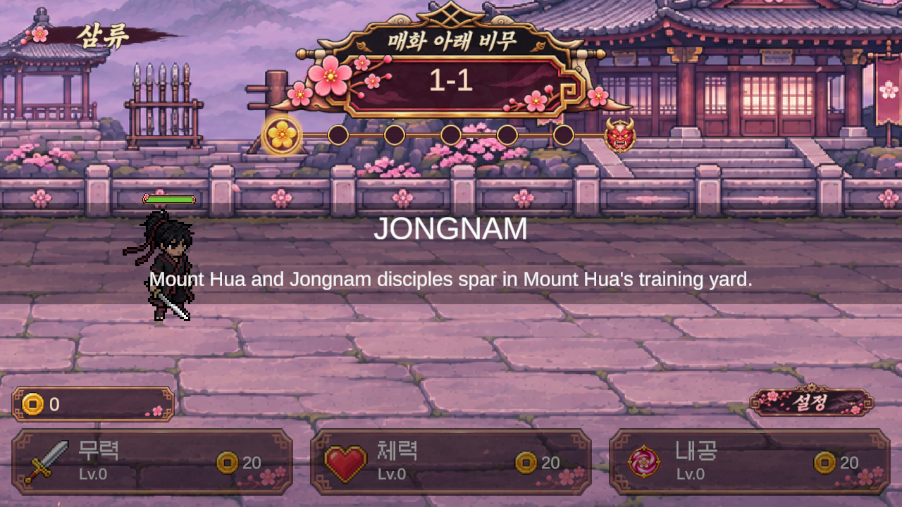
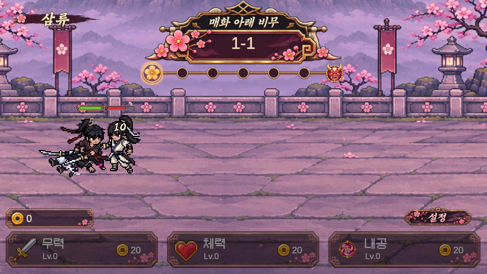
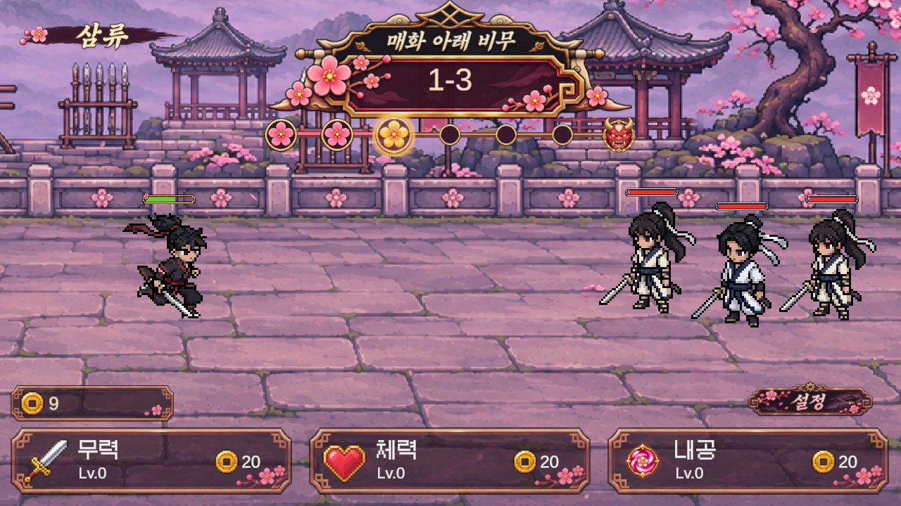

# 루프 증거: loop/20261122-035241 (묶음 stage45_final)

- 판정: **통합 브랜치(`integration`)에 합침** — 관문 위반 0건, 합치기 전 전체 테스트 통과
- 합친 시각: 2026-11-22 04:18
- 병합 커밋: 태그 `loop-merged/20261122-035241` (`git show loop-merged/20261122-035241`)
- 작업 5건, 바뀐 파일 23개 (.meta 제외)
- 테스트 수: 604 → 629개. 합치기 전 실행: EditMode 793/793, PlayMode 142/142

이 문서는 루프 스크립트가 썼다. 테스트 결과와 관문은 스크립트가 직접 판정한 것이고, "완료 조건별 테스트"와 리뷰 의견은 교차 리뷰 에이전트의 판단이다. 가정과 화면은 사람이 본다.

## 사람이 볼 것

테스트로 판정하지 못한 것이다. 아래 화면 갈무리와 함께 본다.

- `065_stage_view_final`: 실행하고 10초 뒤 화면 위쪽의 진행 표시에 `1-1` 같은 번호와 매화 표식 6개·보스 표식이 겹치지 않고 보인다.
- `066_boss_health_frame`: 에디터에서 1스테이지 보스 구간(종남 장로)까지 진행하면 화면 위쪽에 종남 보스 체력 틀이 보이고 붉은 체력 바가 틀의 게이지 칸 안에 어긋남 없이 들어가며, 보스 이름이 틀 위에 가려지지 않고 보인다.
- `067_combat_tianmo_final`: 에디터에서 5스테이지까지 진행하면 최종 보스가 발이 땅에 붙은 채 대기하고, 세 번째 공격마다 검기가 날아가는 기술 동작이 기본 캐릭터와 겹쳐 두 번 그려지지 않는다.

## 에이전트가 스스로 정한 것 (가정)

사양과 작업 문서에 없어 에이전트가 정한 것 전부다. 마음에 들지 않으면 후속 작업으로 고친다.

- `063_stage_final_label`: 없음. 공개 연결 지점과 동작은 기존 사양과 같다.
- `064_stage_final_progress`: 없음. 기존 사양과 공개 연결 지점은 변경하지 않았다.
- `065_stage_view_final`: `SubstagePreview.SetMarkersVisible`이 표식 오브젝트의 활성 상태를 바꾸고 `StageView`가 화면 갱신마다 보스 여부를 전달한다. 다른 기능의 공개 연결 지점은 바뀌지 않았다.
- `066_boss_health_frame`: 틀 다섯 장은 `StageView.Initialize`에서 불러온다. 이후 같은 뷰에서는 다시 불러오지 않는다.
- `066_boss_health_frame`: 기존 `PlaceTopCenter`의 피벗은 위쪽이므로 보스 틀과 보스 체력 바는 가운데 피벗으로 바꿔 지정된 anchoredPosition이 실제 중심이 되게 한다. 일반 구간은 기존 피벗을 유지한다.
- `066_boss_health_frame`: 공개 연결 지점 변경 없음.
- `067_combat_tianmo_final`: 추가 가정 없음. 공격·기술 피해 프레임과 이동 속도는 작업 문서의 임시값을 사용했다.

## 화면 갈무리

합치기 직전의 코드로 게임을 실행해 찍은 것이다 (플레이 모드 테스트, 파일 이름의 숫자는 실행 후 지난 게임 시간).

**game_001s.png**



**game_010s.png**



**game_030s.png**




## 작업 요약

| 작업 | 구현 | 리뷰 | 새 테스트 | 바뀐 화면 코드 |
| --- | --- | --- | --- | --- |
| `063_stage_final_label` | codex(시도 1) | claude (교차): 통과 | 4 | 0 |
| `064_stage_final_progress` | codex(시도 1) | claude (교차): 통과 | 7 | 1 |
| `065_stage_view_final` | codex(시도 1) | claude (교차): 통과 | 4 | 3 |
| `066_boss_health_frame` | codex(시도 1) | claude (교차): 통과 | 4 | 1 |
| `067_combat_tianmo_final` | codex(시도 1) | claude (교차): 통과 | 6 | 2 |

## 관문 (스크립트 판정)

- 위반: 0건
- 확인 필요: 없음

## 작업별 기록

### 063_stage_final_label

- 구현: codex(시도 1)
- 리뷰: claude (교차): 통과
- 바뀐 내용: 최종 스테이지 상수와 구간 번호 표시 및 범위 검사를 추가하고 완료 조건별 에딧 모드 테스트를 작성했다. Unity 테스트는 루프 판정을 기다린다.
- 리뷰 의견: StageLayout.FinalDisplayStage(5)와 StageText.SubstageLabel이 사양의 연결 지점대로 구현됐다. 범위 검사가 FINAL 판단보다 먼저 오고 숫자는 InvariantCulture로 만든다. 완료 조건마다 Assert로 정확한 값이나 예외를 확인하는 테스트가 있다. 기존 테스트는 고치지 않았다.
- 작업 문서 원본: `docs/history/063_stage_final_label.md`

| 완료 조건 | 대응하는 테스트 | 판정 |
| --- | --- | --- |
| `Assets/Tests/EditMode/Stage/StageTextTests.cs`와 `StageLayoutTests.cs`에 아래 조건마다 테스트가 하나 이상 있고 모두 통과한다. | StageLayoutTests.FinalDisplayStage_IsFive, StageTextTests.SubstageLabel_ValidInputs_ReturnsLabel / SubstageLabel_CurrentCultureIsTurkish_UsesInvariantNumbers / SubstageLabel_InvalidInput_Throws (통과 여부는 루프 실행 결과) | 있음 |
| `StageLayout.FinalDisplayStage`는 5다. | StageLayoutTests.FinalDisplayStage_IsFive | 있음 |
| `StageText.SubstageLabel(5, 7)`은 `"FINAL"`이다. | StageTextTests.SubstageLabel_ValidInputs_ReturnsLabel(5, 7, "FINAL") | 있음 |
| `StageText.SubstageLabel(5, 1)`은 `"FINAL"`이다. | StageTextTests.SubstageLabel_ValidInputs_ReturnsLabel(5, 1, "FINAL") | 있음 |
| `StageText.SubstageLabel(4, 7)`은 `"4-7"`이다. | StageTextTests.SubstageLabel_ValidInputs_ReturnsLabel(4, 7, "4-7") | 있음 |
| `StageText.SubstageLabel(1, 1)`은 `"1-1"`이다. | StageTextTests.SubstageLabel_ValidInputs_ReturnsLabel(1, 1, "1-1") | 있음 |
| 현재 문화권을 `tr-TR`로 바꾼 상태에서도 `StageText.SubstageLabel(3, 6)`은 `"3-6"`이다 (테스트 끝에 문화권을 되돌린다). | StageTextTests.SubstageLabel_CurrentCultureIsTurkish_UsesInvariantNumbers (finally에서 문화권 복원) | 있음 |
| `StageText.SubstageLabel(0, 1)`과 `(6, 1)`은 각각 `ArgumentOutOfRangeException`을 던진다. | StageTextTests.SubstageLabel_InvalidInput_Throws(0,1)/(6,1) | 있음 |
| `StageText.SubstageLabel(1, 0)`과 `(1, 8)`은 각각 `ArgumentOutOfRangeException`을 던진다. | StageTextTests.SubstageLabel_InvalidInput_Throws(1,0)/(1,8) | 있음 |
| `StageText.SubstageLabel(5, 0)`과 `(5, 8)`도 각각 `ArgumentOutOfRangeException`을 던진다. | StageTextTests.SubstageLabel_InvalidInput_Throws(5,0)/(5,8) | 있음 |
| 기존 테스트가 모두 통과한다. | 루프 전체 테스트 실행 | 루프가 판정 |

리뷰 지적 (합친 뒤에도 남은 것):

- [note] 변경에 텍스처 .meta 14개가 들어 있다(Assets/Resources/Art/UI/OfflineReward/*, RealmStatus/*, boss_health_frame_1~5). 구현한 에이전트가 고친 것이 아니라, 테스트를 돌릴 때 유니티가 기존 Assets/Editor/PixelArtTextureImporter.cs 규칙으로 다시 가져오면서 바뀐 것으로 보인다. OfflineReward·RealmStatus는 Trilinear와 밉맵 켬, boss_health_frame은 Point와 밉맵 끔으로 바뀌어 가져오기 규칙에 맞게 바로잡혔다. 보고서의 바뀐 파일에는 빠져 있다. '에셋 파일을 바꾸지 않는다'를 글자 그대로 읽으면 걸리지만 내용상 해는 없다. 사람이 main에 올릴 때 알고 있으면 된다.

새 테스트 4개: `StageLayoutTests.FinalDisplayStage_IsFive`, `StageTextTests.SubstageLabel_CurrentCultureIsTurkish_UsesInvariantNumbers`, `StageTextTests.SubstageLabel_InvalidInput_Throws`, `StageTextTests.SubstageLabel_ValidInputs_ReturnsLabel`

### 064_stage_final_progress

- 구현: codex(시도 1)
- 리뷰: claude (교차): 통과
- 바뀐 내용: 5스테이지를 최종 보스 구간으로 바로 배치하고 4스테이지 일반 상대의 쓰러짐 대기를 수정했다. 완료 조건을 검증하는 에딧 모드 테스트와 지정된 플레이 모드 테스트 케이스를 반영했다.
- 리뷰 의견: PlaceStage가 화면상 5스테이지에서 SubstageNumber를 7로 두고 기존 보스 배치 경로(PlaceSubstage의 보스 분기)만 타서 난수를 뽑지 않으며, 완료 조건마다 숫자까지 확인하는 에딧 모드 테스트가 있다. StageView 수정은 요구된 한 줄뿐이고, 플레이 모드 테스트 세 개도 케이스 데이터만 요구대로 바꿨다.
- 작업 문서 원본: `docs/history/064_stage_final_progress.md`

| 완료 조건 | 대응하는 테스트 | 판정 |
| --- | --- | --- |
| `Assets/Tests/EditMode/Stage/StageProgressFinalTests.cs`에 아래 조건(마지막 두 개 제외)마다 테스트가 하나 이상 있고 모두 통과한다. | StageProgressFinalTests (7개 테스트가 조건 2~18을 모두 다룸) | 있음 |
| 공격력 1000·최대 체력 10000, 시작 번호 5로 `Begin()` 하면 `SubstageNumber`는 7이다. | StageProgressFinalTests.Begin_FifthStage_PlacesOnlyFinalBossAndStartsSubstageIntro | 있음 |
| 위 상황에서 `IsBossActive`는 참이고 `Battle.Enemies`는 보스 1명뿐이다. | StageProgressFinalTests.Begin_FifthStage_PlacesOnlyFinalBossAndStartsSubstageIntro | 있음 |
| 위 상황에서 그 보스의 최대 체력은 220, 공격력은 26이다. | StageProgressFinalTests.Begin_FifthStage_PlacesOnlyFinalBossAndStartsSubstageIntro | 있음 |
| 위 상황에서 보스 위치는 `Battle.DisciplePosition + 24`다. | StageProgressFinalTests.Begin_FifthStage_PlacesOnlyFinalBossAndStartsSubstageIntro | 있음 |
| 위 상황에서 `DefeatedNormalCount`는 0, `BarRatio`는 1.0, `Phase`는 `SubstageIntro`, 받은 `StageStarted` 번호는 [5]이다. | StageProgressFinalTests.Begin_FifthStage_PlacesOnlyFinalBossAndStartsSubstageIntro | 있음 |
| 시작 번호 10으로 `Begin()` 하면 보스 1명의 최대 체력은 370, 공격력은 46이다. | StageProgressFinalTests.TenthStage_BossUsesTotalStageStatsAndReward | 있음 |
| 시작 번호 10에서 그 보스를 제자가 혼자 이기면 금화가 140 는다. | StageProgressFinalTests.TenthStage_BossUsesTotalStageStatsAndReward | 있음 |
| 시작 번호 5에서 보스를 제자가 혼자 이기면 금화가 90 늘고 받은 `StageCleared` 번호는 [5]이다. | StageProgressFinalTests.FifthStage_BossDefeated_AdvancesToNextRound | 있음 |
| 그 뒤 `Tick(1.0)`을 하면 `StageNumber` 6, `DisplayStageNumber` 1, `SubstageNumber` 1이고 일반 상대 2명이 배치되어 있다. | StageProgressFinalTests.FifthStage_BossDefeated_AdvancesToNextRound | 있음 |
| 공격력 1·최대 체력 1, 시작 번호 5에서 제자가 쓰러지면 받은 `StageFailed` 번호는 [5]이다. | StageProgressFinalTests.FifthStage_DiscipleDefeated_RetriesWithFreshBossWithoutThemeIntro | 있음 |
| 그 뒤 `Tick(1.0)`을 하면 `StageNumber` 5, `SubstageNumber` 7이고, 적은 최대 체력·현재 체력이 220인 보스 1명뿐이며, `Phase`는 `SubstageIntro`(테마 소개 없음)이다. | StageProgressFinalTests.FifthStage_DiscipleDefeated_RetriesWithFreshBossWithoutThemeIntro | 있음 |
| 시작 번호 4로 `Begin()` 하면 `SubstageNumber` 1이고 일반 상대 2명이 있다. | StageProgressFinalTests.FourthStage_SixNormalSubstages_ProgressToBoss | 있음 |
| 시작 번호 4에서 일반 구간 세 개를 마치면(`Tick`으로 소개·페이드를 넘기며) `BarRatio`는 0.5다. | StageProgressFinalTests.FourthStage_SixNormalSubstages_ProgressToBoss | 있음 |
| 시작 번호 4에서 일반 구간 여섯 개를 마치면 `SubstageNumber` 7이고 보스 1명이 있다. | StageProgressFinalTests.FourthStage_SixNormalSubstages_ProgressToBoss | 있음 |
| 시작 번호 5·본 소개 번호 4로 `Begin()` 하면 `Phase`는 `Intro`이고 적은 처음부터 보스 1명뿐이다. | StageProgressFinalTests.FifthStage_UnseenTheme_ShowsBothIntrosWithBossAlreadyPlaced | 있음 |
| 위 상황에서 `Tick(3.0)` 뒤 `Phase`는 `SubstageIntro`이고, 이어서 `Tick(1.2)` 뒤 `Playing`이다. | StageProgressFinalTests.FifthStage_UnseenTheme_ShowsBothIntrosWithBossAlreadyPlaced | 있음 |
| 시작 번호 5의 `Begin()`은 무리 난수를 뽑지 않는다 (`Next` 호출 수를 세는 난수로 확인: 0회). | StageProgressFinalTests.Begin_FifthStage_DoesNotRollGroupRandom | 있음 |
| TianmoSpriteTests.LastNormalOpponent_StageFourWaitsForDownBeforeFade`(시작 번호 4로 고친 것)가 통과한다: 마지막 일반 상대를 처치하면 0.5초 뒤 `FadeAlpha` 0이고 1.5초 뒤 0보다 크다. | TianmoSpriteTests.LastNormalOpponent_StageFourWaitsForDownBeforeFade (생성자 인자 4,4로만 바뀌고 본문과 기대값은 그대로) | 있음 |
| 기존 테스트가 모두 통과한다 (`StageHudTests`의 두 테스트는 위 요구사항대로 케이스 데이터만 바꾼 상태로). | 루프의 전체 테스트 실행 | 루프가 판정 |

리뷰 지적 (합친 뒤에도 남은 것):

- [note] StageProgress.cs:266-268은 요구사항에 적힌 AddEnemy 호출을 따로 쓰지 않고 SubstageNumber를 7로 둔 뒤 PlaceSubstage의 보스 분기(StageProgress.cs:274-277)를 그대로 쓴다. 같은 AddEnemy 인자로 보스 한 명만 배치하고 SubstagePositions는 부르지 않으므로 결과는 같다.
- [note] CountingRandom(StageProgressFinalTests.cs:153)은 Next(int,int)만 센다. 지금은 SubstagePositions가 그 오버로드만 쓰므로 충분하다.

새 테스트 7개: `StageProgressFinalTests.Begin_FifthStage_DoesNotRollGroupRandom`, `StageProgressFinalTests.Begin_FifthStage_PlacesOnlyFinalBossAndStartsSubstageIntro`, `StageProgressFinalTests.FifthStage_BossDefeated_AdvancesToNextRound`, `StageProgressFinalTests.FifthStage_DiscipleDefeated_RetriesWithFreshBossWithoutThemeIntro`, `StageProgressFinalTests.FifthStage_UnseenTheme_ShowsBothIntrosWithBossAlreadyPlaced`, `StageProgressFinalTests.FourthStage_SixNormalSubstages_ProgressToBoss`, `StageProgressFinalTests.TenthStage_BossUsesTotalStageStatsAndReward`

### 065_stage_view_final

- 구현: codex(시도 1)
- 리뷰: claude (교차): 통과
- 바뀐 내용: 스테이지 번호에 FINAL 형식을 적용하고 보스 구간 표식을 숨겼다. 최종 보스 쓰러짐 대기와 플레이 모드 검증을 추가했다.
- 리뷰 의견: The number label now goes through StageText.SubstageLabel in three places, the markers are hidden during boss sections via SetMarkersVisible(!bossActive), and the final boss down-sheet wait branch is in place, all as the requirements say. Each completion condition has a test that checks the expected values directly.
- 작업 문서 원본: `docs/history/065_stage_view_final.md`

| 완료 조건 | 대응하는 테스트 | 판정 |
| --- | --- | --- |
| Assets/Tests/PlayMode/Stage/StageFinalHudTests.cs`에 아래 [플레이 모드] 조건(마지막 하나 제외)마다 테스트가 하나 이상 있고 모두 통과한다. | StageFinalHudTests (FinalStage_BeginsWithFinalBossHud, NormalAndBossStages_UpdateMarkersAndBossHud, FinalBoss_WithDownSheet_WaitsBeforeFade, FinalBoss_WithoutDownSheet_FadesImmediately) | 있음 |
| 시작 번호 5로 `Begin()` 하면 `SubstagePreview/SubstageNumber` 글자는 `"FINAL"`이다. | StageFinalHudTests.FinalStage_BeginsWithFinalBossHud | 있음 |
| 위 상황에서 `SubstageIntroBanner/SubstageNumber` 글자는 `"FINAL"`이다. | StageFinalHudTests.FinalStage_BeginsWithFinalBossHud | 있음 |
| 위 상황에서 `SubstagePreview`는 활성이고 `Marker1`~`Marker6`와 `BossMarker`는 모두 비활성이다. | StageFinalHudTests.FinalStage_BeginsWithFinalBossHud | 있음 |
| 위 상황에서 `BossName`은 활성이고 글자는 `"HEAVENLY DEMON"`이다. | StageFinalHudTests.FinalStage_BeginsWithFinalBossHud | 있음 |
| 위 상황에서 `StageBar/Fill`의 `anchorMax.x`는 1이다. | StageFinalHudTests.FinalStage_BeginsWithFinalBossHud | 있음 |
| 시작 번호 1·2·3·4·9 각각에서 `Begin()` 직후(일반 구간) `Marker1`~`Marker6`와 `BossMarker`는 모두 활성이다. | StageFinalHudTests.NormalAndBossStages_UpdateMarkersAndBossHud(1,2,3,4,9) | 있음 |
| 시작 번호 1·2·3·4·9 각각에서 여섯 구간을 마쳐 보스 구간이 되면 `Marker1`~`Marker6`와 `BossMarker`는 모두 비활성이고 `SubstagePreview`는 활성이다. | StageFinalHudTests.NormalAndBossStages_UpdateMarkersAndBossHud | 있음 |
| 위 보스 구간에서 `SubstagePreview/SubstageNumber` 글자는 `"{n}-7"`(n은 화면상 스테이지 번호: 1·2·3·4·4)이고 `BossName`과 `StageBar`는 활성이다. | StageFinalHudTests.NormalAndBossStages_UpdateMarkersAndBossHud | 있음 |
| 시작 번호 5에서 최종 보스를 처치하면(`tianmo_final_boss_down` 시트가 있을 때) 1.5초 뒤 `FadeAlpha`는 0이다. | StageFinalHudTests.FinalBoss_WithDownSheet_WaitsBeforeFade | 있음 |
| 위 상황에서 2.5초 뒤 `FadeAlpha`는 0보다 크다. | StageFinalHudTests.FinalBoss_WithDownSheet_WaitsBeforeFade | 있음 |
| FinalBossDownPath`를 없는 경로로 바꾸고 시작 번호 5에서 최종 보스를 처치하면 0.5초 뒤 `FadeAlpha`는 0보다 크다. | StageFinalHudTests.FinalBoss_WithoutDownSheet_FadesImmediately | 있음 |
| 기존 `StageHudTests.ProgressHud_ChangesFromProgressToBossHealth`가 표식 비활성 검사를 더한 채 시작 번호 1·2·3·4·9·7 모두 통과한다. | StageHudTests.ProgressHud_ChangesFromProgressToBossHealth (Marker1~6·BossMarker activeSelf false 검사 추가) | 있음 |
| 화면 코드가 컴파일되고 기존 테스트가 모두 통과한다. | 루프 판정 | 루프가 판정 |
| 실행하고 10초 뒤 화면 위쪽의 진행 표시에 `1-1` 같은 번호와 매화 표식 6개·보스 표식이 겹치지 않고 보인다. | 사람 확인 | 사람 확인 |

리뷰 지적 (합친 뒤에도 남은 것):

- [note] Assets/Scripts/Game/Stage/StageView.cs:48 — the requirements ask for FinalBossDownPath to be a non-readonly static field, so it is one. That matches the request. The trade-off is that the value can be changed at runtime, but only the tests use it.
- [note] The implementing agent says it did not run the Unity tests itself, so whether they pass is up to the loop's test run.

새 테스트 4개: `StageFinalHudTests.FinalBoss_WithDownSheet_WaitsBeforeFade`, `StageFinalHudTests.FinalBoss_WithoutDownSheet_FadesImmediately`, `StageFinalHudTests.FinalStage_BeginsWithFinalBossHud`, `StageFinalHudTests.NormalAndBossStages_UpdateMarkersAndBossHud`

### 066_boss_health_frame

- 구현: codex(시도 1)
- 리뷰: claude (교차): 통과
- 바뀐 내용: 스테이지별 보스 체력 틀과 게이지 위치 및 그림 누락 시 대체 표시를 구현하고 플레이 모드 테스트를 추가했다. Unity 테스트 판정은 루프 스크립트가 수행한다.
- 리뷰 의견: StageView가 보스 구간에 스테이지별 체력 틀을 불러와 표시하고, 체력 바를 게이지 칸 계산대로 맞추며, 틀이 없으면 180×7 대체 바를 쓴다. 모든 [플레이 모드] 조건을 BossHealthFrameTests가 수치까지 검사한다. 하지 말 것 침범과 기존 테스트 변경은 없다.
- 작업 문서 원본: `docs/history/066_boss_health_frame.md`

| 완료 조건 | 대응하는 테스트 | 판정 |
| --- | --- | --- |
| Assets/Tests/PlayMode/Stage/BossHealthFrameTests.cs`에 아래 [플레이 모드] 조건마다 테스트가 하나 이상 있고 모두 통과한다. | BossHealthFrameTests 전체 (조건 2~13에 대응하는 테스트 존재 확인, 통과 여부는 루프 실행 결과) | 있음 |
| 시작 번호 1·2·3·4·5 각각에서 보스 구간이 되면 `BossHealthFrame`은 활성이다. | BossHealthFrameTests.BossStage_ShowsMatchingFrame(1~5) | 있음 |
| 위 상황에서 `BossHealthFrame`의 `Image.sprite.name`은 `boss_health_frame_{n}`(n = 시작 번호)이다. | BossHealthFrameTests.BossStage_ShowsMatchingFrame(1~5) | 있음 |
| 위 상황에서 `BossHealthFrame`의 `raycastTarget`은 거짓이다. | BossHealthFrameTests.BossStage_ShowsMatchingFrame(1~5) | 있음 |
| 위 상황에서 `BossHealthFrame`의 크기는 300×100, 중심은 (0, −126)이다 (오차 0.1). | BossHealthFrameTests.BossStage_ShowsMatchingFrame(1~5) (CheckRect: anchoredPosition·sizeDelta·가운데 피벗) | 있음 |
| 시작 번호 1의 보스 구간에서 `StageBar`의 크기는 약 215.6×8.3, 중심은 약 (13.7, −127.4)이다 (오차 0.1). | BossHealthFrameTests.BossStage_ShowsMatchingFrame(1) | 있음 |
| 시작 번호 5의 보스 구간에서 `StageBar`의 크기는 약 193.1×11.0이다 (오차 0.1). | BossHealthFrameTests.BossStage_ShowsMatchingFrame(5) | 있음 |
| 시작 번호 1의 보스 구간에서 형제 순서는 `StageBar` < `BossHealthFrame` < `BossName`이다. | BossHealthFrameTests.BossStage_ShowsMatchingFrame(1) | 있음 |
| 시작 번호 1의 일반 구간(`Begin()` 직후)에서 `BossHealthFrame`은 비활성이다. | BossHealthFrameTests.NormalStage_HidesFrameAndBar | 있음 |
| 위 일반 구간에서 `StageBar`는 기존처럼 비활성이다. | BossHealthFrameTests.NormalStage_HidesFrameAndBar | 있음 |
| 시작 번호 1에서 보스를 이겨 다음 큰 스테이지(2스테이지 1구간)가 배치되면 `BossHealthFrame`은 비활성이다. | BossHealthFrameTests.BossDefeated_NextStageHidesFrame | 있음 |
| BossHealthFramePath`를 없는 경로로 바꾸고 시작 번호 1의 보스 구간이 되면 `BossHealthFrame`은 없거나 비활성이다. | BossHealthFrameTests.MissingFrame_UsesFallbackBar | 있음 |
| 위 상황에서 `StageBar`의 크기는 180×7, 중심은 (0, −126)이다. | BossHealthFrameTests.MissingFrame_UsesFallbackBar | 있음 |
| 화면 코드가 컴파일되고 기존 테스트가 모두 통과한다. | 루프의 컴파일·전체 테스트 실행 | 루프가 판정 |
| 에디터에서 1스테이지 보스 구간(종남 장로)까지 진행하면 화면 위쪽에 종남 보스 체력 틀이 보이고 붉은 체력 바가 틀의 게이지 칸 안에 어긋남 없이 들어가며, 보스 이름이 틀 위에 가려지지 않고 보인다. | 사람 확인 | 사람 확인 |

리뷰 지적 (합친 뒤에도 남은 것):

- [note] 대체 바(180×7)의 피벗이 위쪽 가운데에서 가운데로 바뀌었다 (Assets/Scripts/Game/Stage/StageView.cs:481). 그래서 화면에서 바가 예전보다 3.5 UI 단위 위로 올라가, 보스 이름 칸(−111~−125)과 조금 겹칠 수 있다. 사양과 완료 조건 13의 '중심 (0, −126)'과는 맞고, 보고서 가정에도 적혀 있다.
- [note] 보스 구간의 바 배치 조건에서 `usePreview`가 빠졌다 (StageView.cs:475). 그래서 SubstagePreview 그림이 없는 환경에서도 보스 바가 게이지 칸이나 (0, −126)으로 옮겨진다. 이전에는 이 환경에서 종남 머리판 아래 위치를 유지했다. 사양은 틀 표시에 SubstagePreview를 조건으로 두지 않으므로 문제로 보지 않는다.
- [note] CreateBossHealthFrame이 BossName을 SetAsLastSibling으로 옮긴다 (StageView.cs:260). 그 뒤에 만들어지는 SubstagePreview, 소개 패널, 배너는 여전히 보스 이름보다 위에 그려지므로 기존 순서 규칙은 지켜진다.

새 테스트 4개: `BossHealthFrameTests.BossDefeated_NextStageHidesFrame`, `BossHealthFrameTests.BossStage_ShowsMatchingFrame`, `BossHealthFrameTests.MissingFrame_UsesFallbackBar`, `BossHealthFrameTests.NormalStage_HidesFrameAndBar`

### 067_combat_tianmo_final

- 구현: codex(시도 1)
- 리뷰: claude (교차): 통과
- 바뀐 내용: 천마 일반 상대를 4스테이지에 연결하고 5스테이지 최종 보스의 애니메이션과 대체 표시를 적용했다. 관련 플레이 모드 테스트를 추가했으며 Unity 실행은 루프 판정을 기다린다.
- 리뷰 의견: 4스테이지 일반 상대 분기 변경, TryLoadTianmoFinalBoss 추가, FinalDisplayStage 보스 연결이 요구사항대로 들어갔다. 쓰러짐 재생은 이미 Down.Length를 쓰고, 기술 재생은 기존 흐름대로 몸 스프라이트를 바꾼다. 플레이 모드 조건마다 본문 검사가 기대값까지 확인하는 테스트가 있다.
- 작업 문서 원본: `docs/history/067_combat_tianmo_final.md`

| 완료 조건 | 대응하는 테스트 | 판정 |
| --- | --- | --- |
| Assets/Tests/PlayMode/Combat/TianmoFinalBossSpriteTests.cs`(와 고친 `TianmoSpriteTests`)에 아래 [플레이 모드] 조건마다 테스트가 하나 이상 있고 모두 통과한다. | TianmoFinalBossSpriteTests 전체 + TianmoSpriteTests.StageFourAndNextRound_UseBothSpritesAndPlayDown | 있음 |
| 시작 번호 4·9 각각에 일반 상대 두 명을 넣으면 인덱스 짝수는 `tianmo_swordsman_`, 홀수는 `tianmo_guard_`로 시작하는 몸 스프라이트다 (고친 `StageFourAndNextRound_UseBothSpritesAndPlayDown`). | TianmoSpriteTests.StageFourAndNextRound_UseBothSpritesAndPlayDown, TianmoFinalBossSpriteTests.StageFourNormals_UseSwordsmanThenGuard | 있음 |
| 시작 번호 5에 일반 상대를 직접 넣으면 몸 스프라이트 이름이 `tianmo_`로 시작하지 않는다 (대체 표시). | TianmoFinalBossSpriteTests.FinalStage_UsesBossSpritesAndNormalFallback | 있음 |
| Art/Enemies/tianmo_final_boss_idle`·`walk`·`attack`·`down` 텍스처는 각각 2600×104이다. | TianmoFinalBossSpriteTests.Sheets_HaveExpectedDimensionsAndImportSettings | 있음 |
| Art/Enemies/tianmo_final_boss_skill` 텍스처는 1300×400이다. | TianmoFinalBossSpriteTests.Sheets_HaveExpectedDimensionsAndImportSettings | 있음 |
| 위 다섯 텍스처는 모두 `FilterMode.Point`이고 `mipmapCount`는 1이다. | TianmoFinalBossSpriteTests.Sheets_HaveExpectedDimensionsAndImportSettings | 있음 |
| 시작 번호 5·10 각각에 보스를 넣으면 몸 스프라이트 이름은 `tianmo_final_boss_idle_00`으로 시작한다. | TianmoFinalBossSpriteTests.FinalStage_UsesBossSpritesAndNormalFallback | 있음 |
| 위 보스의 몸 스프라이트 `pixelsPerUnit`은 32이고 표시 배율(`localScale.x`의 절댓값)은 1.5이다. | TianmoFinalBossSpriteTests.FinalStage_UsesBossSpritesAndNormalFallback | 있음 |
| 시작 번호 5의 보스가 세 번째 공격을 하는 동안 몸 스프라이트 이름은 `tianmo_final_boss_skill_`로 시작한다. | TianmoFinalBossSpriteTests.ThirdAttack_UsesSkillAndDealsDamageOnce | 있음 |
| 그 세 번째 공격에서 제자 체력은 보스 공격력만큼 정확히 한 번 준다. | TianmoFinalBossSpriteTests.ThirdAttack_UsesSkillAndDealsDamageOnce (DiscipleHealth == before - Enemy.Attack, 피해 알림 1회) | 있음 |
| 시작 번호 5의 보스가 쓰러지면(전투 일시정지 상태로 확인) 몸 스프라이트가 `tianmo_final_boss_down_00`으로 시작한다. | TianmoFinalBossSpriteTests.DefeatedBoss_PlaysAllDownFramesWhilePaused | 있음 |
| 위 상황에서 약 1.9초 뒤 몸 스프라이트는 `tianmo_final_boss_down_24`이다. | TianmoFinalBossSpriteTests.DefeatedBoss_PlaysAllDownFramesWhilePaused | 있음 |
| TianmoFinalBossSkillPath`를 없는 경로로 바꾸면 시작 번호 5 보스의 세 번째 공격 중 몸 스프라이트 이름은 `tianmo_final_boss_attack_`으로 시작한다. | TianmoFinalBossSpriteTests.MissingSheets_UseAttackOrBossFallback | 있음 |
| TianmoFinalBossPrefix`를 없는 경로로 바꾸면 시작 번호 5 보스의 몸 스프라이트 이름은 `tianmo_`로 시작하지 않는다 (보스 대체 표시). | TianmoFinalBossSpriteTests.MissingSheets_UseAttackOrBossFallback | 있음 |
| 화면 코드가 컴파일되고 기존 테스트(`TianmoBossSpriteTests`, `StageBackgroundTests`, `CoreAssemblyTests.Core_DoesNotReferenceUnity` 포함)가 모두 통과한다. | 루프의 컴파일·전체 테스트 실행 | 루프가 판정 |
| 에디터에서 5스테이지까지 진행하면 최종 보스가 발이 땅에 붙은 채 대기하고, 세 번째 공격마다 검기가 날아가는 기술 동작이 기본 캐릭터와 겹쳐 두 번 그려지지 않는다. | 에디터에서 직접 확인 | 사람 확인 |

리뷰 지적 (합친 뒤에도 남은 것):

- [note] StageView는 쓰러짐 대기에 JongnamSprites.DownDuration(17프레임 × 0.075초 = 1.275초)을 쓴다 (Assets/Scripts/Game/Stage/StageView.cs:384-405). 최종 보스 쓰러짐은 25프레임(1.875초)이라, 5스테이지에서는 쓰러짐이 끝나기 전에 페이드가 시작될 수 있다. 다만 Stage 폴더는 이 작업의 하지 말 것이고 페이드 대기는 064·065의 범위다. 사람이 확인할 때 함께 보면 된다.
- [note] StageFourNormals_UseSwordsmanThenGuard는 고친 TianmoSpriteTests의 검사와 거의 같은 내용을 한 번 더 검사한다. 문제는 아니다.

새 테스트 6개: `TianmoFinalBossSpriteTests.DefeatedBoss_PlaysAllDownFramesWhilePaused`, `TianmoFinalBossSpriteTests.FinalStage_UsesBossSpritesAndNormalFallback`, `TianmoFinalBossSpriteTests.MissingSheets_UseAttackOrBossFallback`, `TianmoFinalBossSpriteTests.Sheets_HaveExpectedDimensionsAndImportSettings`, `TianmoFinalBossSpriteTests.StageFourNormals_UseSwordsmanThenGuard`, `TianmoFinalBossSpriteTests.ThirdAttack_UsesSkillAndDealsDamageOnce`

## 확인하고 되돌리는 방법

```
git diff loop-merged/20261122-035241^1 loop-merged/20261122-035241            # 이 루프가 바꾼 것 전부
git merge --ff-only loop-merged/20261122-035241         # (main 에서) 이 루프까지만 올린다
git revert -m 1 loop-merged/20261122-035241             # (main 에 올린 뒤) 이 루프만 되돌린다
```
