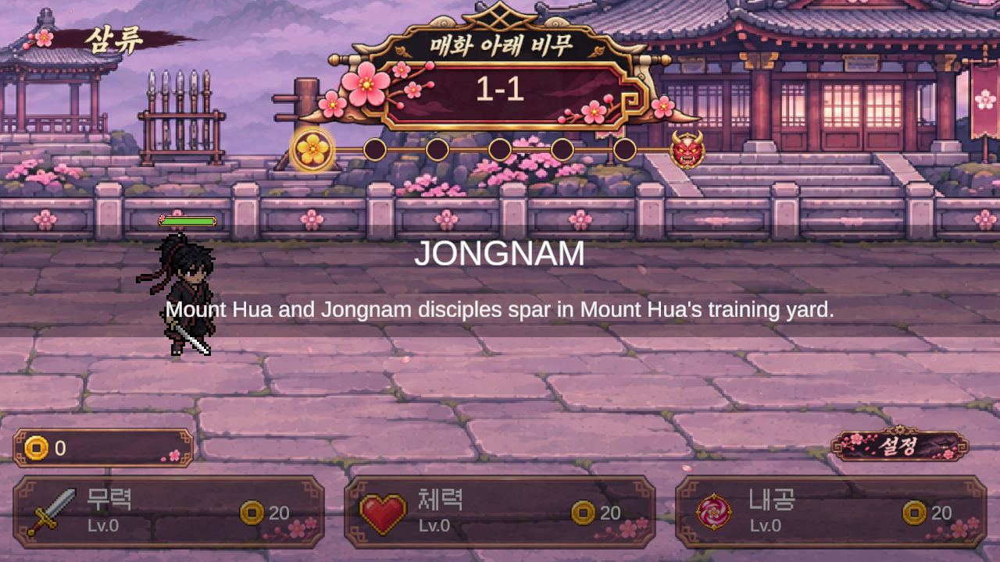
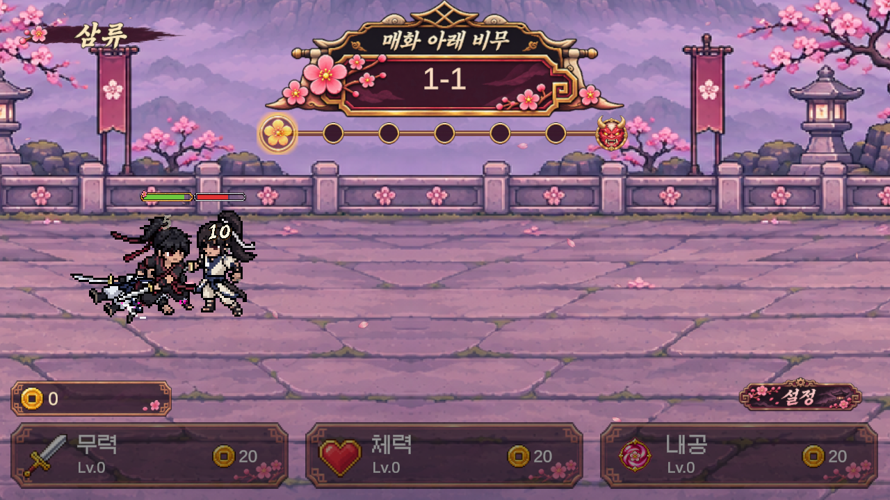
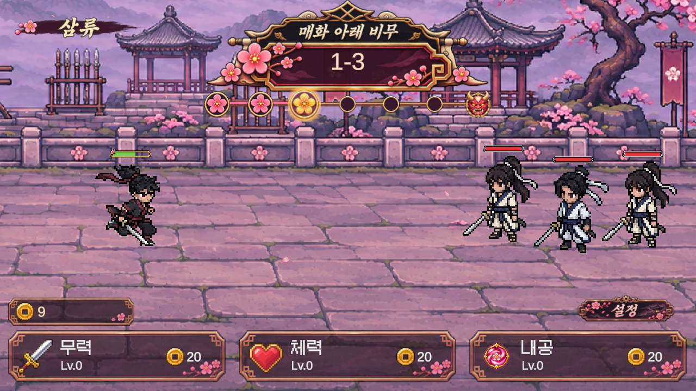

# 루프 증거: loop/20261122-050216 (묶음 audio)

- 판정: **통합 브랜치(`integration`)에 합침** — 관문 위반 0건, 합치기 전 전체 테스트 통과
- 합친 시각: 2026-11-22 05:48
- 병합 커밋: 태그 `loop-merged/20261122-050216` (`git show loop-merged/20261122-050216`)
- 작업 5건, 바뀐 파일 24개 (.meta 제외)
- 테스트 수: 629 → 689개. 합치기 전 실행: EditMode 884/884, PlayMode 142/142
- 이 묶음에서 **보류로 남아 합쳐지지 않은 작업**: 073_audio_view.md

이 문서는 루프 스크립트가 썼다. 테스트 결과와 관문은 스크립트가 직접 판정한 것이고, "완료 조건별 테스트"와 리뷰 의견은 교차 리뷰 에이전트의 판단이다. 가정과 화면은 사람이 본다.

## 사람이 볼 것

테스트로 판정하지 못한 것이다. 아래 화면 갈무리와 함께 본다.

- 없음

## 에이전트가 스스로 정한 것 (가정)

사양과 작업 문서에 없어 에이전트가 정한 것 전부다. 마음에 들지 않으면 후속 작업으로 고친다.

- `068_audio_catalog_rules`: 없음. 사양의 공개 연결 지점과 임시 수치를 그대로 사용했다.
- `069_music_fader`: 없음. 공개 연결 지점은 사양과 같다.
- `070_sfx_queue_voice_pool`: 없음. 공개 연결 지점과 동작은 기존 사양을 따르므로 사양 변경은 없다.
- `071_sfx_triggers`: 없음. 공개 연결 지점과 동작은 기존 오디오 사양을 따른다.
- `072_ui_sound_watch`: 없음. 공개 연결 지점과 동작은 기존 사양을 따른다.

## 화면 갈무리

합치기 직전의 코드로 게임을 실행해 찍은 것이다 (플레이 모드 테스트, 파일 이름의 숫자는 실행 후 지난 게임 시간).

**game_001s.png**



**game_010s.png**



**game_030s.png**




## 작업 요약

| 작업 | 구현 | 리뷰 | 새 테스트 | 바뀐 화면 코드 |
| --- | --- | --- | --- | --- |
| `068_audio_catalog_rules` | codex(시도 1~2) | claude (교차): 통과 | 12 | 0 |
| `069_music_fader` | codex(시도 1~2) | claude (교차): 통과 | 7 | 0 |
| `070_sfx_queue_voice_pool` | codex(시도 1~2) | claude (교차): 통과 | 16 | 0 |
| `071_sfx_triggers` | codex(시도 1~2) | claude (교차): 통과 | 12 | 0 |
| `072_ui_sound_watch` | codex(시도 1) | claude (교차): 통과 | 13 | 0 |

## 관문 (스크립트 판정)

- 위반: 0건
- 확인 필요: 없음

## 작업별 기록

### 068_audio_catalog_rules

- 구현: codex(시도 1~2)
- 리뷰: claude (교차): 통과
- 바뀐 내용: 소리 목록, 곡 선택 및 음량 계산과 에딧 모드 테스트를 구현했다. WAV 18개 존재 검사를 테스트 본문에 직접 배치해 관문 지적을 수정했다. Unity 테스트는 루프 판정을 기다린다.
- 리뷰 의견: 열거형, AudioCatalog 표, MusicRules, AudioMix가 사양의 연결 지점과 임시값 그대로 Core에 순수 C#으로 구현됐습니다. 완료 조건마다 숫자까지 확인하는 테스트가 있고, 하지 말 것 범위나 다른 기능 코드는 건드리지 않았습니다.
- 작업 문서 원본: `docs/history/068_audio_catalog_rules.md`

| 완료 조건 | 대응하는 테스트 | 판정 |
| --- | --- | --- |
| `Assets/Tests/EditMode/Audio/AudioCatalogTests.cs`, `Assets/Tests/EditMode/Audio/MusicRulesTests.cs`, `Assets/Tests/EditMode/Audio/AudioMixTests.cs`에 아래 조건마다 테스트가 하나 이상 있고 모두 통과한다. | 세 파일 모두 있음 (AudioCatalogTests, MusicRulesTests, AudioMixTests). 각 조건의 테스트는 아래 행에 적었고, 통과 여부는 루프가 실행해 판정함 | 있음 |
| (사양 1) `AudioCatalog.MusicPath`: `Title` → `"Audio/Music/title"`, `BattleNormal` → `"Audio/Music/battle_normal"`, `BattleBoss` → `"Audio/Music/battle_boss"`, `BattleFinalBoss` → `"Audio/Music/battle_final_boss"`, `None` → `null`이고, `(MusicTrack)99` → `ArgumentOutOfRangeException`. | AudioCatalogTests.MusicPath_AllTracks_ReturnsSpecifiedPaths, AudioCatalogTests.InvalidIds_AllCatalogMethods_Throw(99/-1) | 있음 |
| (사양 2) `AudioCatalog.SfxPath`가 14종 모두 요구사항 표의 경로를 돌려주고(예: `SfxId.StageTransition` → `"Audio/SFX/stage_transition"`), `(SfxId)99` → `ArgumentOutOfRangeException`. | AudioCatalogTests.SfxPath_AllSounds_ReturnsSpecifiedPaths, AudioCatalogTests.InvalidIds_AllCatalogMethods_Throw | 있음 |
| (사양 3) 곡 4개와 효과음 14개의 경로마다 프로젝트 폴더 기준 `Assets/Resources/<경로>.wav` 파일이 있다 (`System.IO.File.Exists`가 18개 모두 `true`). | AudioCatalogTests.Paths_AllSounds_HaveWavFiles | 있음 |
| (사양 4) `MusicBaseVolume`은 4곡 0.6, `None` 0.0이고, `SfxBaseVolume`은 `SwordSwing`·`AttackHit`·`EnemyDefeated` 0.6, 나머지 11종 1.0이고, `IsSfxEnabled`는 14종 모두 `true`이며 `(SfxId)99` → `ArgumentOutOfRangeException`. | AudioCatalogTests.VolumesAndEnabled_AllSounds_MatchSpec, AudioCatalogTests.InvalidIds_AllCatalogMethods_Throw | 있음 |
| (사양 5) `MusicRules.TrackFor`: `(true, 3, true)` → `Title`, `(false, 1, false)` → `BattleNormal`, `(false, 4, true)` → `BattleBoss`, `(false, 5, true)` → `BattleFinalBoss`, `(false, 5, false)` → `BattleNormal`이고, `(false, 0, false)`와 `(true, 6, false)` → `ArgumentOutOfRangeException`. | MusicRulesTests.TrackFor_ValidState_ReturnsExpectedTrack, MusicRulesTests.TrackFor_InvalidStage_ThrowsEvenOnStartScreen | 있음 |
| (사양 12) `AudioMix.MusicVolume`: `(BattleNormal, 0.8, 1.0)` → 0.48, `(BattleBoss, 0.8, 0.25)` → 0.12, `(Title, 0.0, 1.0)` → 0, `(None, 1.0, 1.0)` → 0, `(Title, 1.5, 2.0)` → 0.6, `(Title, double.NaN, 1.0)` → 0 (오차 1e-9). | AudioMixTests.MusicVolume_ScalesAndClamps | 있음 |
| (사양 13) `AudioMix.SfxVolume`: `(AttackHit, 0.8)` → 0.48, `(BossAppear, 0.8)` → 0.8, `(UiConfirm, 0.0)` → 0이고, `ShouldPlaySfx(0.0)` → `false`, `ShouldPlaySfx(0.01)` → `true`, `ShouldPlaySfx(double.NaN)` → `false`. | AudioMixTests.SfxVolume_ScalesAndClamps, AudioMixTests.ShouldPlaySfx_UsesPositiveScale | 있음 |
| (사양 14) `AudioMix.ShouldPauseAll`: `(false, true)` → `false`이고 `(true, true)`, `(false, false)`, `(true, false)` → `true`. | AudioMixTests.ShouldPauseAll_PauseOrFocusLost | 있음 |
| 기존 테스트가 모두 통과한다. | 루프의 전체 테스트 실행 | 루프가 판정 |

리뷰 지적 (합친 뒤에도 남은 것):

- [note] 곡 경로와 기본 배율은 AudioCatalog.cs:43-58의 switch와 MusicBaseVolume 식에 나뉘어 있고, 효과음 표(SfxEntry 배열)에는 함께 모여 있지 않습니다. 요구사항이 한 곳에 모으라고 한 것은 효과음 값뿐이라 문제는 아닙니다.
- [note] MusicRules.cs:10은 1~5 검사의 상한으로 StageLayout.FinalDisplayStage를 씁니다. 지금은 5로 사양과 같지만, 나중에 그 상수가 바뀌면 상한도 함께 바뀝니다.

새 테스트 12개: `AudioCatalogTests.InvalidIds_AllCatalogMethods_Throw`, `AudioCatalogTests.MusicPath_AllTracks_ReturnsSpecifiedPaths`, `AudioCatalogTests.Paths_AllSounds_HaveWavFiles`, `AudioCatalogTests.SfxPath_AllSounds_ReturnsSpecifiedPaths`, `AudioCatalogTests.VolumesAndEnabled_AllSounds_MatchSpec`, `AudioMixTests.MusicVolume_ScalesAndClamps`, `AudioMixTests.SfxVolume_ScalesAndClamps`, `AudioMixTests.ShouldPauseAll_PauseOrFocusLost`, `AudioMixTests.ShouldPlaySfx_UsesPositiveScale`, `AudioMixTests.Volume_InvalidIds_ThrowsEvenAtZeroScale`, `MusicRulesTests.TrackFor_InvalidStage_ThrowsEvenOnStartScreen`, `MusicRulesTests.TrackFor_ValidState_ReturnsExpectedTrack`

### 069_music_fader

- 구현: codex(시도 1~2)
- 리뷰: claude (교차): 통과
- 바뀐 내용: 무음 중 재요청 테스트의 상태 검사를 본문에 명시해 관문이 인식하도록 수정했다. Unity 테스트와 관문 판정은 루프에 맡긴다.
- 리뷰 의견: MusicFader가 사양의 연결 지점과 요구사항대로 구현됐다. 완료 조건 6~11은 에딧 모드 테스트가 상황과 기대 숫자(오차 1e-9)를 직접 검사한다. Core 에는 UnityEngine 의존이 없고 하지 말 것도 건드리지 않았다.
- 작업 문서 원본: `docs/history/069_music_fader.md`

| 완료 조건 | 대응하는 테스트 | 판정 |
| --- | --- | --- |
| `Assets/Tests/EditMode/Audio/MusicFaderTests.cs`에 아래 조건마다 테스트가 하나 이상 있고 모두 통과한다. | MusicFaderTests (조건 2~7마다 테스트가 하나 이상 있다) | 있음 |
| (사양 6) `new MusicFader()`는 `Current`·`Previous`가 `None`이고 두 비율이 0이며, `new MusicFader(0)`, `new MusicFader(-1)`, `new MusicFader(double.NaN)` → `ArgumentOutOfRangeException`. | MusicFaderTests.Constructor_InitialStateAndInvalidDurations_AreChecked | 있음 |
| (사양 7) 새 `MusicFader`에 `Request(Title)` → `true`, `Current` `Title`, `CurrentWeight` 0이고, 이어서 `Tick(0.5)` → `CurrentWeight` 0.5, `Tick(0.6)` → 1.0이며, 다시 `Request(Title)` → `false`이고 `CurrentWeight` 1.0 그대로다. | MusicFaderTests.Request_FirstTrackAndSameTrack_FadesAndKeepsState | 있음 |
| (사양 8) 7에 이어 `Request(BattleNormal)` → `true`, `Previous` `Title`·`PreviousWeight` 1.0, `Current` `BattleNormal`·`CurrentWeight` 0.0이고, `Tick(0.25)` → `CurrentWeight` 0.25, `PreviousWeight` 0.75. | MusicFaderTests.Request_SecondTrack_CrossfadesBothTracks | 있음 |
| (사양 9) 8에 이어 `Request(BattleBoss)` → `Previous` `BattleNormal`·`PreviousWeight` 0.25(`Title` 버림), `Current` `BattleBoss`·`CurrentWeight` 0.0이고, `Tick(0.25)` → `CurrentWeight` 0.25, `Previous` `None`, `PreviousWeight` 0. | MusicFaderTests.Request_DuringCrossfade_DiscardsOldPrevious | 있음 |
| (사양 10) `Title`이 `CurrentWeight` 1.0일 때 `Request(None)` → `true`, `Previous` `Title`·1.0, `Current` `None`·0이고, `Tick(1.0)` → `Previous` `None`이며 `CurrentWeight`는 0 그대로. | MusicFaderTests.Request_None_FadesOutWithoutFadingIn | 있음 |
| (사양 11) `Tick(-0.1)`, `Tick(double.NaN)`, `Tick(double.PositiveInfinity)` → `ArgumentOutOfRangeException`이고 비율은 그대로이며, `Tick(0)` → 상태 그대로이고, `Request((MusicTrack)99)` → `ArgumentOutOfRangeException`. | MusicFaderTests.InvalidInputsAndZeroTick_LeaveStateUnchanged | 있음 |
| 기존 테스트가 모두 통과한다. | 루프의 전체 테스트 실행 | 루프가 판정 |

리뷰 지적 (합친 뒤에도 남은 것):

- [note] 조건 3에서 Tick(0.6) 뒤 CurrentWeight 1.0을 따로 검사하지 않는다. Request(Title)→false 다음의 AssertState에서 1.0을 함께 확인하므로 실질적으로는 검사된다 (Assets/Tests/EditMode/Audio/MusicFaderTests.cs:28-30).
- [note] Request 는 정의되지 않은 값을 AudioCatalog.MusicPath 의 예외로 걸러 낸다. 068의 공개 동작을 그대로 쓰는 것이라 문제는 없지만, MusicPath 가 바뀌면 MusicFader 의 검사도 따라 바뀐다 (Assets/Scripts/Core/Audio/MusicFader.cs:24-25).
- [note] docs/spec/audio.md:36 에 추가한 설명은 '현재 곡이 None 인 동안 새 곡을 요청하면 이전 곡은 그대로 둔다'는 동작이다. 이것은 연결 지점 절(239~240줄)과 작업 문서 요구사항에 이미 있는 내용을 다시 적은 것이라 사양과 어긋나지 않는다.

새 테스트 7개: `MusicFaderTests.Constructor_InitialStateAndInvalidDurations_AreChecked`, `MusicFaderTests.InvalidInputsAndZeroTick_LeaveStateUnchanged`, `MusicFaderTests.Request_AfterNone_PreservesFadingPreviousAndUsesCustomDuration`, `MusicFaderTests.Request_DuringCrossfade_DiscardsOldPrevious`, `MusicFaderTests.Request_FirstTrackAndSameTrack_FadesAndKeepsState`, `MusicFaderTests.Request_None_FadesOutWithoutFadingIn`, `MusicFaderTests.Request_SecondTrack_CrossfadesBothTracks`

### 070_sfx_queue_voice_pool

- 구현: codex(시도 1~2)
- 리뷰: claude (교차): 통과
- 바뀐 내용: 효과음 큐와 재생기 풀을 구현하고 완료 조건 테스트를 추가했다. 목록 검사를 Assert.That으로 변경해 관문 인식 문제를 수정했다. Unity 테스트와 관문 판정은 루프에서 수행한다.
- 리뷰 의견: SfxQueue와 SfxVoicePool이 사양의 연결 지점 모양과 Drain 순서(합치기 → 스킬이 대신 → 버튼음 빼기 → 꺼진 소리 → 간격 → 번호 순)대로 구현됐습니다. 완료 조건마다 숫자까지 확인하는 에딧 모드 테스트가 있습니다. Core의 UnityEngine 의존, 하지 말 것 침범, 테스트 약화는 없습니다.
- 작업 문서 원본: `docs/history/070_sfx_queue_voice_pool.md`

| 완료 조건 | 대응하는 테스트 | 판정 |
| --- | --- | --- |
| `Assets/Tests/EditMode/Audio/SfxQueueTests.cs`, `Assets/Tests/EditMode/Audio/SfxVoicePoolTests.cs`에 아래 조건마다 테스트가 하나 이상 있고 모두 통과한다. | 두 파일에 조건 2~15의 테스트가 모두 있다 (통과 여부는 루프 실행 결과) | 있음 |
| (사양 15) 새 `SfxQueue()`에 `Request(EnemyDefeated)` 세 번 → `Drain(1.0)` → `[EnemyDefeated]`이고, 이어서 요청 없이 `Drain(1.01)` → 빈 목록, `HasPending` `false`. | SfxQueueTests.DuplicateRequests_DrainOnceAndClear | 있음 |
| (사양 16) 15에 이어 `Request(EnemyDefeated)`, `Request(AttackHit)` → `Drain(1.04)` → `[AttackHit]`(`EnemyDefeated`는 간격으로 빠짐)이고, 다시 `Request(EnemyDefeated)` → `Drain(1.06)` → `[EnemyDefeated]`. | SfxQueueTests.Interval_SuppressesOnlyRecentIdWithoutUpdatingTime | 있음 |
| (사양 17) `SwordSwing`, `AttackHit`, `PlumSwordSkill`을 요청하고 `Drain` → `[PlumSwordSkill]`이고, `SwordSwing`, `AttackHit`만 요청하고 `Drain` → `[SwordSwing, AttackHit]`. | SfxQueueTests.Skill_ReplacesAttackSounds | 있음 |
| (사양 18) `UiConfirm`+`UpgradeSuccess` → `[UpgradeSuccess]`, `UpgradeUnavailable`+`UpgradeSuccess` → `[UpgradeSuccess]`, `UiConfirm`+`WindowOpenClose` → `[WindowOpenClose]`, `UiConfirm`+`OfflineReward` → `[OfflineReward]`, `UiConfirm`만 → `[UiConfirm]` (각각 새 큐에서). | SfxQueueTests.SpecificSound_ReplacesButtonSound (TestCase 4개), SfxQueueTests.ButtonAlone_IsReturned | 있음 |
| (사양 19) `BossDefeated`, `AttackHit` 순으로 요청하고 `Drain` → `[AttackHit, BossDefeated]`. | SfxQueueTests.Requests_ReturnInIdOrder | 있음 |
| (사양 20) `new SfxQueue(0.05, id => id != SfxId.AttackHit)`에 `AttackHit`, `SwordSwing`을 요청하고 `Drain` → `[SwordSwing]`. | SfxQueueTests.DisabledSound_IsFiltered | 있음 |
| (사양 21) `Request((SfxId)99)`, `Drain(double.NaN)`, `new SfxQueue(-0.01)` → 각각 `ArgumentOutOfRangeException`이다. | SfxQueueTests.InvalidArguments_ThrowAndPreservePending | 있음 |
| (사양 21) 요청이 있는 큐에서 `Drain(double.NaN)`이 예외를 던진 뒤에도 `HasPending`은 `true`다. | SfxQueueTests.InvalidArguments_ThrowAndPreservePending | 있음 |
| (사양 21) `new SfxQueue(0)`에서 `UiConfirm`을 요청해 `Drain(1.0)`, 다시 요청해 `Drain(1.0)` → 두 번 다 `[UiConfirm]`. | SfxQueueTests.ZeroInterval_AllowsSameTime | 있음 |
| (사양 22) `Drain(5.0)`으로 `UiConfirm`을 꺼낸 뒤 `Request(UiConfirm)` → `Drain(4.0)` → `[UiConfirm]`. | SfxQueueTests.TimeMovesBackwards_RequestIsReturned | 있음 |
| (사양 38) `new SfxVoicePool(0)` → `ArgumentOutOfRangeException`이고, `new SfxVoicePool().Count` → 8. | SfxVoicePoolTests.Constructor_ValidatesCountAndDefaultsToEight | 있음 |
| (사양 39) `new SfxVoicePool(2)`에서 `Acquire(0, 1)` → 0, `Acquire(0.1, 1)` → 1, `Acquire(0.2, 1)` → 0, `Acquire(0.3, 1)` → 1, `Acquire(2.0, 1)` → 0. | SfxVoicePoolTests.Acquire_UsesFreeThenOldestVoice | 있음 |
| (사양 40) `new SfxVoicePool()`(8개)에서 `Acquire(0, 1)` 여덟 번 → 0~7 차례로, 아홉 번째 `Acquire(0.5, 1)` → 0. | SfxVoicePoolTests.Acquire_TiedStartsChooseLowestIndex | 있음 |
| (사양 41) `Acquire(double.NaN, 1)`, `Acquire(0, -1)`, `Acquire(0, double.PositiveInfinity)` → 각각 `ArgumentOutOfRangeException`. | SfxVoicePoolTests.InvalidArguments_ThrowWithoutChangingState | 있음 |
| 기존 테스트가 모두 통과한다. | 루프의 전체 테스트 실행 | 루프가 판정 |

리뷰 지적 (합친 뒤에도 남은 것):

- [note] Assets/Tests/EditMode/Audio/SfxQueueTests.cs:21 Interval 테스트는 사양 15에 '이어서' 하지 않고 따로 시작합니다. 중간의 Drain(1.01)이 없지만, 그 호출은 요청이 없어 상태를 바꾸지 않으므로 확인하는 뜻은 같습니다.
- [note] Assets/Scripts/Core/Audio/SfxQueue.cs:38 HashSet을 차례로 돌린 뒤 result.Sort()로 SfxId 정수 순으로 정렬합니다. 돌려주는 순서는 사양대로 정해집니다.

새 테스트 16개: `SfxQueueTests.ButtonAlone_IsReturned`, `SfxQueueTests.DisabledSound_IsFiltered`, `SfxQueueTests.DisabledSpecificSound_StillReplacesButtonBeforeFiltering`, `SfxQueueTests.DuplicateRequests_DrainOnceAndClear`, `SfxQueueTests.Interval_SuppressesOnlyRecentIdWithoutUpdatingTime`, `SfxQueueTests.InvalidArguments_ThrowAndPreservePending`, `SfxQueueTests.Requests_ReturnInIdOrder`, `SfxQueueTests.Skill_ReplacesAttackSounds`, `SfxQueueTests.SpecificSound_ReplacesButtonSound`, `SfxQueueTests.TimeMovesBackwards_RequestIsReturned`, `SfxQueueTests.ZeroInterval_AllowsSameTime`, `SfxVoicePoolTests.Acquire_TiedStartsChooseLowestIndex`, `SfxVoicePoolTests.Acquire_UsesFreeThenOldestVoice`, `SfxVoicePoolTests.Constructor_ValidatesCountAndDefaultsToEight`, `SfxVoicePoolTests.EmptyVoices_AreAvailableAtNegativeTimeAndZeroLengthEndsImmediately`, `SfxVoicePoolTests.InvalidArguments_ThrowWithoutChangingState`

### 071_sfx_triggers

- 구현: codex(시도 1~2)
- 리뷰: claude (교차): 통과
- 바뀐 내용: 효과음 트리거 테스트의 열거형 목록 검사를 NUnit 멤버 검사로 수정해 컴파일 오류를 바로잡았다. Unity 테스트 실행과 판정은 루프 스크립트를 기다린다.
- 리뷰 의견: SfxTriggers는 사양의 연결 지점과 구독 규칙을 그대로 구현했습니다. null 검사를 모두 끝낸 뒤 구독하고, 페이드 판정과 두 번째 Dispose 무시도 사양대로입니다. 완료 조건마다 실제 Core 객체로 그 진행의 Drain 결과를 검사하는 테스트가 있고, 다른 기능의 코드나 기존 테스트는 고치지 않았습니다.
- 작업 문서 원본: `docs/history/071_sfx_triggers.md`

| 완료 조건 | 대응하는 테스트 | 판정 |
| --- | --- | --- |
| `Assets/Tests/EditMode/Audio/SfxTriggersTests.cs`에 아래 조건마다 테스트가 하나 이상 있고 모두 통과한다. | SfxTriggersTests 전체 (통과 여부는 루프 실행 결과로 판단) | 있음 |
| (사양 23) `SfxTriggers` 생성자의 다섯 인자(`queue`, `battle`, `stage`, `upgrades`, `realm`) 중 어느 하나만 `null`이어도 `ArgumentNullException`이다 (다섯 경우 모두 검사). | SfxTriggersTests.Constructor_NullArguments_ThrowsWithoutSubscribing | 있음 |
| (사양 24) `battle.AddEnemy(EnemyKind.Boss, 1, 제자 좌표 + 0.5)` 뒤 `Drain` → `[BossAppear]`이다. | SfxTriggersTests.EnemyAdded_OnlyBossRequestsAppear(Boss,true) | 있음 |
| (사양 24) `battle.AddEnemy(EnemyKind.Normal, 1, 제자 좌표 + 0.5)` 뒤 `Drain` → 빈 목록이다. | SfxTriggersTests.EnemyAdded_OnlyBossRequestsAppear(Normal,false) | 있음 |
| (사양 25) 스킬이 꺼진 `Battle`(`skillEnabled: false`)에 일반 적 하나를 제자 앞 0.5에 두고 첫 `EnemyDamaged`가 올 때까지 `Step` → 그 진행의 `Drain` → `[SwordSwing, AttackHit]`이다. | SfxTriggersTests.NormalAttack_RequestsSwingAndHit | 있음 |
| (사양 26) 스킬이 켜진 `Battle`(`skillEnabled: true`)에 일반 적 하나를 제자 앞 0.5에 두고 첫 `SkillUsed`가 올 때까지 `Step` → 그 진행의 `Drain` 결과에 `PlumSwordSkill`이 있고 `SwordSwing`, `AttackHit`이 없다. | SfxTriggersTests.SkillAttack_ReplacesSwingAndHit | 있음 |
| (사양 27) 일반 적이 쓰러진 진행의 `Drain` 결과에 `EnemyDefeated`가 있다. | SfxTriggersTests.EnemyDefeated_OnlyNormalRequestsDefeat(Normal,true) | 있음 |
| (사양 27) 보스가 쓰러진 진행의 `Drain` 결과에 `EnemyDefeated`가 없다. | SfxTriggersTests.EnemyDefeated_OnlyNormalRequestsDefeat(Boss,false) | 있음 |
| (사양 28) `StageProgress`로 1스테이지 1구간의 무리를 모두 쓰러뜨려 `Phase`가 `FadingOut`이 된 진행의 `Drain` 결과에 `StageTransition`과 `EnemyDefeated`가 있다. | SfxTriggersTests.NormalGroupCleared_RequestsTransitionAndDefeat | 있음 |
| (사양 29) `StageProgress`가 배치한 보스를 제자가 혼자 이긴 진행(`StageCleared`가 온 진행)의 `Drain` 결과에 `BossDefeated`가 있고 `StageTransition`이 없다. | SfxTriggersTests.StageBossCleared_RequestsBossDefeatWithoutTransition | 있음 |
| (사양 29) 일반 구간(시작 스테이지 1)에서 제자가 쓰러진 진행(`StageFailed`가 온 진행)의 `Drain` 결과에 `PlayerDefeated`가 있고 `StageTransition`이 없다. | SfxTriggersTests.DiscipleDefeated_RequestsPlayerDefeatWithoutTransition(1) | 있음 |
| (사양 29) 보스 구간(시작 스테이지 5의 최종 보스)에서 제자가 쓰러진 진행의 `Drain` 결과에 `PlayerDefeated`가 있고 `StageTransition`이 없다. | SfxTriggersTests.DiscipleDefeated_RequestsPlayerDefeatWithoutTransition(5) | 있음 |
| (사양 29) 보스와 제자가 같은 칸에 쓰러진 진행의 `Drain` 결과에 `BossDefeated`가 없고 `PlayerDefeated`가 있다. | SfxTriggersTests.BossAndDiscipleDefeatedTogether_RequestsOnlyPlayerOutcome | 있음 |
| (사양 30) 금화가 충분한 지갑에서 `StatUpgrades.TryUpgrade` 성공 뒤 `Drain` → `[UpgradeSuccess]`이다. | SfxTriggersTests.Upgrade_OnlySuccessRequestsSound(1000000,true) | 있음 |
| (사양 30) 금화 0인 지갑에서 `TryUpgrade` 실패 뒤 `Drain` → 빈 목록이다. | SfxTriggersTests.Upgrade_OnlySuccessRequestsSound(0,false) | 있음 |
| (사양 30) `RealmProgress`가 돌파(`BrokeThrough`)하면 그 뒤 `Drain` 결과에 `RealmBreakthrough`가 있다. | SfxTriggersTests.Breakthrough_RequestsSound | 있음 |
| (사양 31) `Dispose` 뒤에는 보스 추가(24의 알림)와 강화 성공(30의 알림)이 와도 `Drain` → 빈 목록이다. | SfxTriggersTests.Dispose_TwiceUnsubscribesWithoutThrowing | 있음 |
| (사양 31) `Dispose`를 두 번 불러도 예외가 없다. | SfxTriggersTests.Dispose_TwiceUnsubscribesWithoutThrowing | 있음 |
| 기존 테스트가 모두 통과한다. | 루프 전체 테스트 실행 | 루프가 판정 |

리뷰 지적 (합친 뒤에도 남은 것):

- [note] DiscipleDefeated_RequestsPlayerDefeatWithoutTransition(5)는 제자가 쓰러질 때 최종 보스가 배치돼 있었는지(stage.Boss != null)를 따로 확인하지 않습니다. 시작 스테이지 5에서는 Begin이 최종 보스를 배치한다는 기존 동작에 기대고 있습니다 (Assets/Tests/EditMode/Audio/SfxTriggersTests.cs:144).
- [note] 보고서를 보면 구현 에이전트는 수정 뒤 Unity 테스트를 직접 돌리지 않았습니다. 통과 여부는 루프의 테스트 실행 결과로 확인해야 합니다.

새 테스트 12개: `SfxTriggersTests.BossAndDiscipleDefeatedTogether_RequestsOnlyPlayerOutcome`, `SfxTriggersTests.Breakthrough_RequestsSound`, `SfxTriggersTests.Constructor_NullArguments_ThrowsWithoutSubscribing`, `SfxTriggersTests.DiscipleDefeated_RequestsPlayerDefeatWithoutTransition`, `SfxTriggersTests.Dispose_TwiceUnsubscribesWithoutThrowing`, `SfxTriggersTests.EnemyAdded_OnlyBossRequestsAppear`, `SfxTriggersTests.EnemyDefeated_OnlyNormalRequestsDefeat`, `SfxTriggersTests.NormalAttack_RequestsSwingAndHit`, `SfxTriggersTests.NormalGroupCleared_RequestsTransitionAndDefeat`, `SfxTriggersTests.SkillAttack_ReplacesSwingAndHit`, `SfxTriggersTests.StageBossCleared_RequestsBossDefeatWithoutTransition`, `SfxTriggersTests.Upgrade_OnlySuccessRequestsSound`

### 072_ui_sound_watch

- 구현: codex(시도 1)
- 리뷰: claude (교차): 통과
- 바뀐 내용: 창 상태와 버튼 입력을 효과음 요청으로 변환하는 UiSoundWatch 및 에딧 모드 테스트를 추가했다. Unity 테스트는 루프 판정을 기다린다.
- 리뷰 의견: UiSoundWatch 가 사양의 연결 지점대로 구현되었고, Core 에서 UnityEngine 을 쓰지 않는다. 완료 조건마다 순서와 값까지 확인하는 에딧 모드 테스트가 있으며, 하지 말 것 침범이나 사양에 없는 임시 동작은 없다.
- 작업 문서 원본: `docs/history/072_ui_sound_watch.md`

| 완료 조건 | 대응하는 테스트 | 판정 |
| --- | --- | --- |
| `Assets/Tests/EditMode/Audio/UiSoundWatchTests.cs`에 아래 조건마다 테스트가 하나 이상 있고 모두 통과한다. | UiSoundWatchTests 전체 (조건 2~13 각각 대응 테스트 확인) | 있음 |
| (사양 32) `new UiSoundWatch(null)` → `ArgumentNullException`이다. | UiSoundWatchTests.Constructor_NullQueue_Throws | 있음 |
| (사양 33) 새 감시에서 `UpdateWindows(true, false, false, false)` → `Drain` → `[WindowOpenClose]`이고, 같은 값으로 다시 → 빈 목록이고, `UpdateWindows(false, false, false, false)` → `[WindowOpenClose]`이다. | UiSoundWatchTests.Settings_OpeningAndClosingMakeSoundOnlyOnChange | 있음 |
| (사양 34) `rewardWindowShowing`만 `false` → `true`로 바꾸면 `[WindowOpenClose]`이고, 이어서 `true` → `false`로 바꾸면 빈 목록이다. | UiSoundWatchTests.RewardWindow_OpeningMakesSoundClosingDoesNot | 있음 |
| (사양 34) `errorWindowShowing`만 `false` → `true`로 바꾸면 `[WindowOpenClose]`이다. | UiSoundWatchTests.ErrorWindow_OnlyOpeningMakesSound | 있음 |
| (사양 34) 새 감시의 첫 호출이 `UpdateWindows(false, true, false, false)`여도 `[WindowOpenClose]`이다. | UiSoundWatchTests.FirstUpdate_AlreadyShowingRewardWindowMakesSound | 있음 |
| (사양 35) `rewardPaid`가 `false` → `true`면 `[OfflineReward]`이고, 이어서 계속 `true`면 빈 목록이다. | UiSoundWatchTests.RewardPaid_OnlyRisingEdgeMakesSound | 있음 |
| (사양 35) 보상 창이 떠 있던(`(false, true, false, false)`) 다음 프레임에 `UpdateWindows(false, false, false, true)`(창이 사라지고 보상 받음) → `[OfflineReward]`이다. | UiSoundWatchTests.RewardPaid_WhenWindowCloses_OnlyRewardSound | 있음 |
| (사양 36) `PressStarted(true, true)` → `Drain` → 빈 목록이고, 이어서 `PressEnded()` → `Drain` → `[UiConfirm]`이다. | UiSoundWatchTests.InteractableButton_SoundsOnReleaseOnly | 있음 |
| (사양 36) `PressStarted(true, false)`, `PressEnded()` → `Drain` → `[UpgradeUnavailable]`이다. | UiSoundWatchTests.DisabledButton_SoundsUnavailableOnRelease | 있음 |
| (사양 36) `PressStarted(false, true)`, `PressEnded()` → `Drain` → 빈 목록이다. | UiSoundWatchTests.NonButtonPress_ClearsPreviousPress | 있음 |
| (사양 36) 누르기 시작 없이 `PressEnded()` → `Drain` → 빈 목록이다. | UiSoundWatchTests.ReleaseWithoutPress_DoesNothing | 있음 |
| (사양 37) 같은 프레임에 `PressStarted(true, true)`, `PressEnded()`, `UpdateWindows(true, false, false, false)` → `Drain` → `[WindowOpenClose]`이다. | UiSoundWatchTests.WindowAndButtonSameFrame_QueueReturnsWindowSound | 있음 |
| 기존 테스트가 모두 통과한다. | 루프 전체 테스트 실행 | 루프가 판정 |

리뷰 지적 (합친 뒤에도 남은 것):

- [note] 조건 11 테스트(UiSoundWatchTests.cs NonButtonPress_ClearsPreviousPress)는 PressStarted(true, true)를 먼저 부른 뒤 PressStarted(false, true)를 부른다. 조건에 적힌 호출 순서를 포함하면서 기억을 지우는 것까지 확인하므로 조건보다 강한 검사다. 다만 앞선 누름이 없는 상태에서 PressStarted(false, true)만 부르는 경우는 따로 검사하지 않는다.
- [note] 테스트 몇 곳에서 한 줄에 문장을 여럿 쓴다(예: `var queue = ...; var watch = ...;`). 동작에는 영향이 없는 모양 문제다.

새 테스트 13개: `UiSoundWatchTests.Constructor_NullQueue_Throws`, `UiSoundWatchTests.DisabledButton_SoundsUnavailableOnRelease`, `UiSoundWatchTests.ErrorWindow_OnlyOpeningMakesSound`, `UiSoundWatchTests.FirstUpdate_AlreadyShowingRewardWindowMakesSound`, `UiSoundWatchTests.InteractableButton_SoundsOnReleaseOnly`, `UiSoundWatchTests.LaterPress_OverwritesRememberedSound`, `UiSoundWatchTests.NonButtonPress_ClearsPreviousPress`, `UiSoundWatchTests.ReleaseWithoutPress_DoesNothing`, `UiSoundWatchTests.RewardPaid_OnlyRisingEdgeMakesSound`, `UiSoundWatchTests.RewardPaid_WhenWindowCloses_OnlyRewardSound`, `UiSoundWatchTests.RewardWindow_OpeningMakesSoundClosingDoesNot`, `UiSoundWatchTests.Settings_OpeningAndClosingMakeSoundOnlyOnChange`, `UiSoundWatchTests.WindowAndButtonSameFrame_QueueReturnsWindowSound`

## 확인하고 되돌리는 방법

```
git diff loop-merged/20261122-050216^1 loop-merged/20261122-050216            # 이 루프가 바꾼 것 전부
git merge --ff-only loop-merged/20261122-050216         # (main 에서) 이 루프까지만 올린다
git revert -m 1 loop-merged/20261122-050216             # (main 에 올린 뒤) 이 루프만 되돌린다
```
