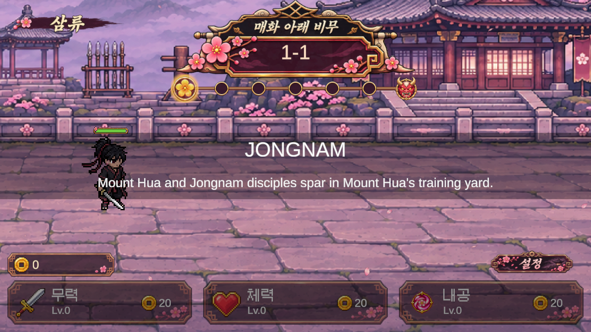
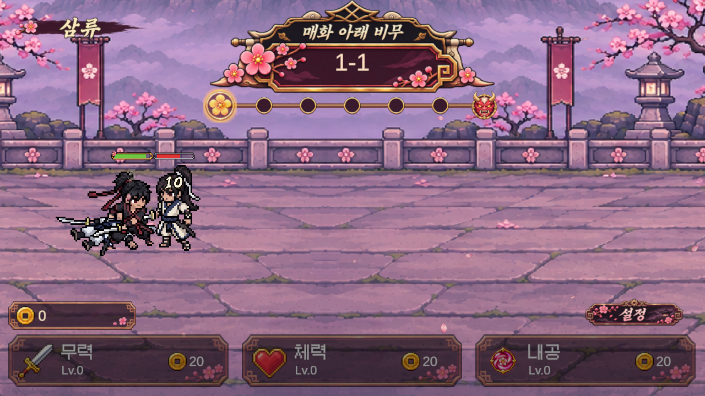
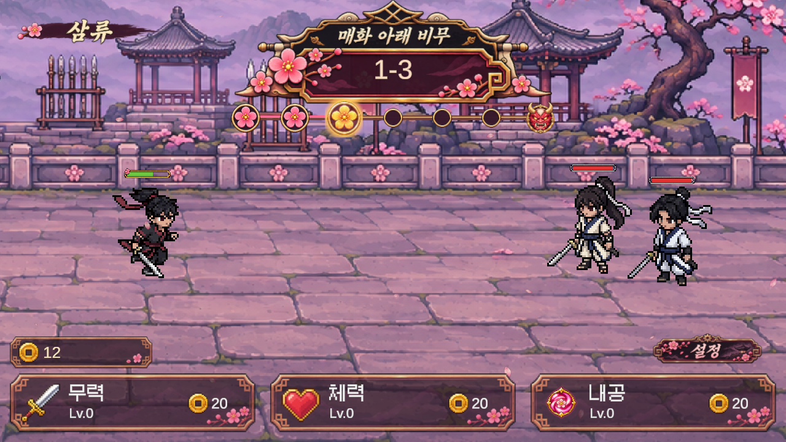

# 루프 증거: loop/20261122-065407 (묶음 audio)

- 판정: **통합 브랜치(`integration`)에 합침** — 관문 위반 0건, 합치기 전 전체 테스트 통과
- 합친 시각: 2026-11-22 06:59
- 병합 커밋: 태그 `loop-merged/20261122-065407` (`git show loop-merged/20261122-065407`)
- 작업 1건, 바뀐 파일 6개 (.meta 제외)
- 테스트 수: 689 → 695개. 합치기 전 실행: EditMode 884/884, PlayMode 148/148

이 문서는 루프 스크립트가 썼다. 테스트 결과와 관문은 스크립트가 직접 판정한 것이고, "완료 조건별 테스트"와 리뷰 의견은 교차 리뷰 에이전트의 판단이다. 가정과 화면은 사람이 본다.

## 사람이 볼 것

테스트로 판정하지 못한 것이다. 아래 화면 갈무리와 함께 본다.

- `073_audio_view`: 에디터에서 게임을 실행해 들어 본다: 시작 화면에서 제목곡이 1초에 걸쳐 커지고, 시작 버튼을 누르면 일반 전투곡으로 교차 페이드되며, 공격·적 처치·강화 버튼·설정 창 열고 닫기 때 효과음이 난다. 설정 창 음량 슬라이더를 0으로 내리면 곡·효과음이 각각 들리지 않는다. (화면 갈무리로는 알 수 없다)
- `073_audio_view`: 에디터에서 시작 화면 제목곡의 1초 페이드인과 시작 버튼 이후 일반 전투곡 교차 페이드, 공격·적 처치·강화 버튼·설정 창 열고 닫기 효과음을 듣는다. 설정 창의 각 음량 슬라이더를 0으로 내리면 해당 곡과 효과음이 들리지 않는지도 확인한다.

## 에이전트가 스스로 정한 것 (가정)

사양과 작업 문서에 없어 에이전트가 정한 것 전부다. 마음에 들지 않으면 후속 작업으로 고친다.

- `073_audio_view`: 보스는 작업 문서의 예시대로 제자보다 10만큼 멀리 배치한다. 테스트 동안 기존 공유 루트는 비활성화해 원래 카메라 참조와 전투 상태를 보존하고, 테스트 루트는 현재 씬의 카메라를 사용한다.

## 화면 갈무리

합치기 직전의 코드로 게임을 실행해 찍은 것이다 (플레이 모드 테스트, 파일 이름의 숫자는 실행 후 지난 게임 시간).

**game_001s.png**



**game_010s.png**



**game_030s.png**




## 작업 요약

| 작업 | 구현 | 리뷰 | 새 테스트 | 바뀐 화면 코드 |
| --- | --- | --- | --- | --- |
| `073_audio_view` | codex(시도 1) | claude (교차): 통과 | 6 | 3 |

## 관문 (스크립트 판정)

- 위반: 0건
- 확인 필요: 없음

## 작업별 기록

### 073_audio_view

- 구현: codex(시도 1)
- 리뷰: claude (교차): 통과
- 바뀐 내용: 기존 오디오 화면 연결과 플레이 모드 테스트를 유지하고 변경 사항을 확인했습니다. Unity 전체 테스트와 GameBootTests 판정은 루프에서 수행합니다.
- 리뷰 의견: AudioClipCache와 AudioView는 요구사항과 사양의 연결 지점대로 구현됐습니다. 곡 선택, 교차 페이드, 음량, 효과음 대기열, 재생기 선택은 모두 Core 클래스를 호출하고, GameRoot에는 속성 한 줄과 조립 네 줄만 더해졌습니다. [플레이 모드] 조건마다 그 상황과 기대값을 직접 검사하는 테스트가 있습니다.
- 작업 문서 원본: `docs/history/073_audio_view.md`

| 완료 조건 | 대응하는 테스트 | 판정 |
| --- | --- | --- |
| PlumSword.Game`의 새 화면 코드와 `GameRoot` 변경이 컴파일되고 기존 테스트가 모두 통과한다. | 루프의 컴파일과 전체 테스트 실행 | 루프가 판정 |
| Assets/Tests/PlayMode/Audio/AudioViewTests.cs`에 아래 [플레이 모드] 조건마다 테스트가 하나 이상 있고 모두 통과한다. | AudioViewTests의 6개 테스트 (조건 3~9에 대응하고, 통과 여부는 루프 실행 결과로 본다) | 있음 |
| 사양 42) 부팅 뒤 `[Game]`의 자식 중 `[AudioView]`라는 이름의 오브젝트가 정확히 하나 있고 `GameRoot.Audio`가 그 오브젝트의 `AudioView`다. | AudioViewTests.Boot_AssemblesOneAudioView | 있음 |
| 사양 42) 부팅 뒤 몇 프레임 뒤 `GameRoot.Audio.CurrentTrack`이 `BattleNormal`, `CurrentMusicSource.clip.name`이 `"battle_normal"`, `CurrentMusicSource.loop`가 `true`다. | AudioViewTests.Boot_PlaysNormalBattleTrack | 있음 |
| 사양 43) `GameRoot.Battle.AddEnemy(EnemyKind.Boss, 1, GameRoot.Battle.DisciplePosition + 10)` 뒤 다음 프레임에 `GameRoot.Audio.SfxSources` 중 하나의 `clip.name`이 `"boss_appear"`다. | AudioViewTests.BossAdded_PlaysAppearanceClip | 있음 |
| 사양 44) 부팅 뒤 실제 시간 1.5초 이상 기다린 뒤 `GameRoot.Volume.SetBgm(0)` → 다음 프레임 `CurrentMusicSource.volume`이 0(오차 1e-3)이고 `clip`은 그 전과 같은 객체다. | AudioViewTests.BgmVolume_ChangesWithoutReplacingClip | 있음 |
| 사양 44) 이어서 `SetBgm(100)` → 다음 프레임 `CurrentMusicSource.volume`이 0.6(오차 1e-3)이다. | AudioViewTests.BgmVolume_ChangesWithoutReplacingClip | 있음 |
| 사양 45) `new AudioClipCache().Load("Audio/SFX/__missing__")`를 같은 캐시로 두 번 부르면 두 번 다 `null`이고 경고 로그가 정확히 한 번이다 (`LogAssert`). | AudioViewTests.MissingClip_WarnsOnlyOnce | 있음 |
| 사양 45) `new AudioClipCache().Load(null)` → `null`이고 로그가 없다. | AudioViewTests.NullPath_ReturnsNullWithoutLogging | 있음 |
| 사양 46) 기존 테스트 `GameBootTests`가 오류 로그 없이 통과한다 (`[AudioView]` 조립 중 예외나 오류 로그가 없다). | 루프의 전체 플레이 모드 테스트 실행 (GameBootTests) | 루프가 판정 |
| 에디터에서 게임을 실행해 들어 본다: 시작 화면에서 제목곡이 1초에 걸쳐 커지고, 시작 버튼을 누르면 일반 전투곡으로 교차 페이드되며, 공격·적 처치·강화 버튼·설정 창 열고 닫기 때 효과음이 난다. 설정 창 음량 슬라이더를 0으로 내리면 곡·효과음이 각각 들리지 않는다. (화면 갈무리로는 알 수 없다) | - | 사람 확인 |

리뷰 지적 (합친 뒤에도 남은 것):

- [note] 테스트는 남아 있던 공유 [Game] 루트를 SetActive(false)로 끄고 테스트마다 새 GameRoot를 만듭니다 (Assets/Tests/PlayMode/Audio/AudioViewTests.cs:20-44). 작업 문서는 GameObject.Find로 찾은 공유 루트를 쓰라고 했지만, 보스 상태가 다른 테스트에 남지 않게 하려는 정리 방식이고 앞선 답변에서도 받아들였습니다.
- [note] AudioView.UpdateMusic의 곡 전환 처리(Assets/Scripts/Game/Audio/AudioView.cs:86-117)는 MusicFader.Request가 Previous를 바꾸는 방식(Current가 None이 아닐 때만 바꿈)과 맞습니다. 다만 페이드 중에 곡을 또 바꾸는 경우를 검사하는 플레이 모드 테스트는 없습니다. 이 경우는 완료 조건에 없습니다.

새 테스트 6개: `AudioViewTests.BgmVolume_ChangesWithoutReplacingClip`, `AudioViewTests.Boot_AssemblesOneAudioView`, `AudioViewTests.Boot_PlaysNormalBattleTrack`, `AudioViewTests.BossAdded_PlaysAppearanceClip`, `AudioViewTests.MissingClip_WarnsOnlyOnce`, `AudioViewTests.NullPath_ReturnsNullWithoutLogging`

## 확인하고 되돌리는 방법

```
git diff loop-merged/20261122-065407^1 loop-merged/20261122-065407            # 이 루프가 바꾼 것 전부
git merge --ff-only loop-merged/20261122-065407         # (main 에서) 이 루프까지만 올린다
git revert -m 1 loop-merged/20261122-065407             # (main 에 올린 뒤) 이 루프만 되돌린다
```
