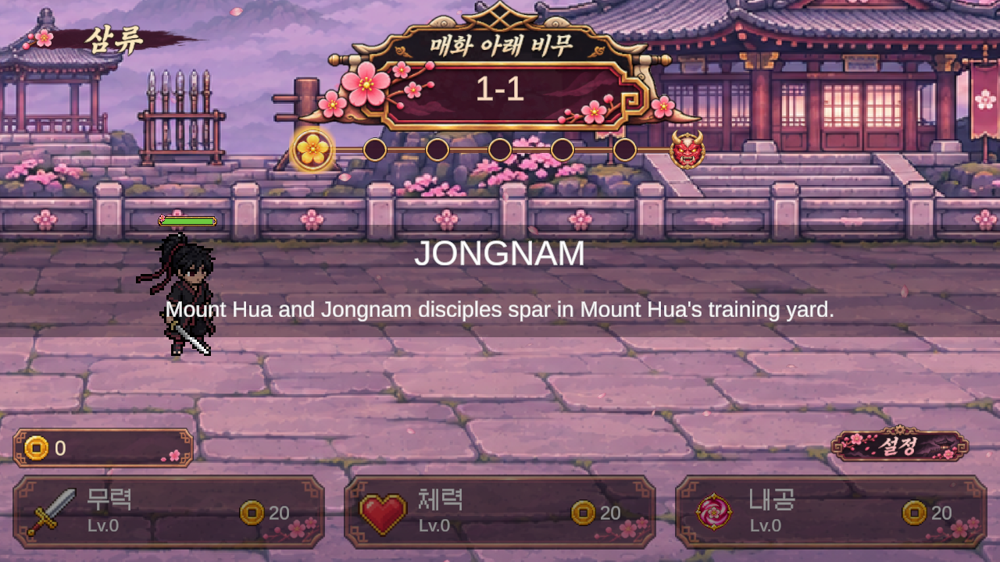
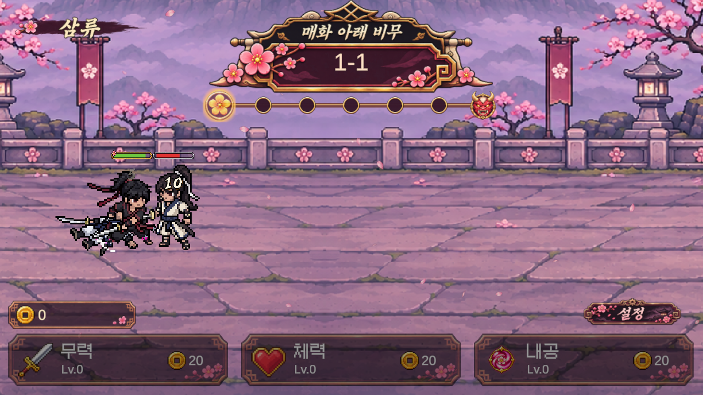
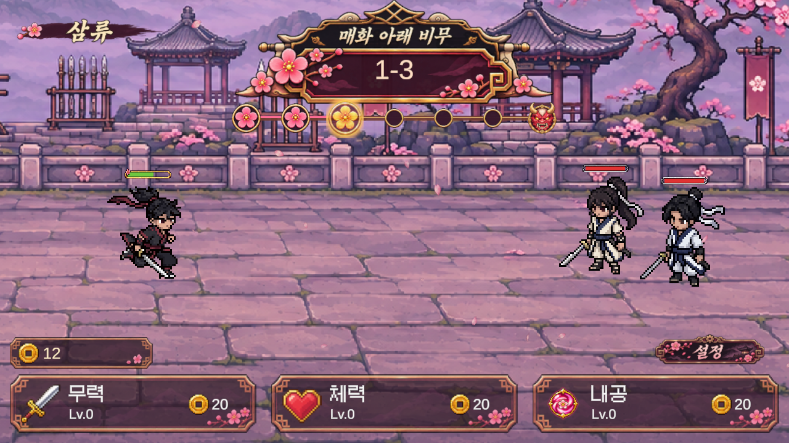

# 루프 증거: loop/20261122-091339 (묶음 flow_test)

- 판정: **통합 브랜치(`integration`)에 합침** — 관문 위반 0건, 합치기 전 전체 테스트 통과
- 합친 시각: 2026-11-22 09:36
- 병합 커밋: 태그 `loop-merged/20261122-091339` (`git show loop-merged/20261122-091339`)
- 작업 3건, 바뀐 파일 11개 (.meta 제외)
- 테스트 수: 695 → 701개. 합치기 전 실행: EditMode 884/884, PlayMode 154/154
- 이 묶음에서 **보류로 남아 합쳐지지 않은 작업**: 077_flow_offline_reward.md

이 문서는 루프 스크립트가 썼다. 테스트 결과와 관문은 스크립트가 직접 판정한 것이고, "완료 조건별 테스트"와 리뷰 의견은 교차 리뷰 에이전트의 판단이다. 가정과 화면은 사람이 본다.

## 사람이 볼 것

테스트로 판정하지 못한 것이다. 아래 화면 갈무리와 함께 본다.

- 없음

## 에이전트가 스스로 정한 것 (가정)

사양과 작업 문서에 없어 에이전트가 정한 것 전부다. 마음에 들지 않으면 후속 작업으로 고친다.

- `074_flow_test_hooks`: 흐름 테스트의 재생성 루트는 다음 테스트의 씬 교체를 견디도록 자체 카메라를 사용한다. 외부 메인 카메라 태그는 재생성 후 복구한다.
- `075_flow_full_round`: 없음. 시간 배율은 작업 문서의 임시값 20을 사용했다.
- `076_flow_save_reload`: 재생성 도우미가 기다리는 프레임 동안 전투가 진행되지 않도록 저장 직전에 시간 배율을 0으로 두고 복원 상태 검사 후 20으로 되돌렸다. 저장과 기존 루트 비활성화는 같은 프레임에 수행한다.
- `076_flow_save_reload`: 스테이지 사양에 따라 다시 시작한 첫 구간의 1.2초 소개 중에는 전투가 정지하므로, 소개가 끝난 `Playing` 상태에서 전투 재개를 검사한다.
- `076_flow_save_reload`: 사양과 공개 연결 지점의 변경은 없다.

## 화면 갈무리

합치기 직전의 코드로 게임을 실행해 찍은 것이다 (플레이 모드 테스트, 파일 이름의 숫자는 실행 후 지난 게임 시간).

**game_001s.png**



**game_010s.png**



**game_030s.png**




## 작업 요약

| 작업 | 구현 | 리뷰 | 새 테스트 | 바뀐 화면 코드 |
| --- | --- | --- | --- | --- |
| `074_flow_test_hooks` | codex(시도 1~2) | claude (교차): 통과 | 4 | 2 |
| `075_flow_full_round` | codex(시도 1) | claude (교차): 통과 | 1 | 0 |
| `076_flow_save_reload` | codex(시도 1~2) | claude (교차): 통과 | 1 | 0 |

## 관문 (스크립트 판정)

- 위반: 0건
- 확인 필요:
  - `docs/dev/architecture.md` 가 바뀜 (작업이 요구한 변경인지 본다)

## 작업별 기록

### 074_flow_test_hooks

- 구현: codex(시도 1~2)
- 리뷰: claude (교차): 통과
- 바뀐 내용: 배치 저장소 주입과 흐름 테스트 도우미를 구현하고, 씬 재로드 시 파괴된 카메라 참조가 남지 않도록 수정했다. Unity 테스트는 루프 판정을 기다린다.
- 리뷰 의견: GameRoot 에는 요구한 BatchSaveStore·RecreateAs 두 가지만 더해졌고, 배치 모드가 아닐 때의 동작은 그대로다. GameFlow 도우미와 GameFlowTests 가 완료 조건의 상황과 숫자를 모두 Assert 로 확인한다. 요구사항에 없던 카메라 태그 처리가 하나 더해졌지만, 처음 켠 게임과 같은 상태(루트가 자기 카메라를 가짐)를 맞추려는 테스트 도우미 안의 처리이고 문서와 가정에 적혀 있어 문제 삼지 않는다.
- 작업 문서 원본: `docs/history/074_flow_test_hooks.md`

| 완료 조건 | 대응하는 테스트 | 판정 |
| --- | --- | --- |
| Assets/Tests/PlayMode/Flow/GameFlowTests.cs` 에 아래 조건마다 테스트가 하나 이상 있고 모두 통과한다. | GameFlowTests 전체 (조건 2~11 이 아래 테스트에 모두 들어 있음, 통과 여부는 루프 실행 결과) | 있음 |
| 저장 글자 `SaveCodec.Encode(new SaveData(500, 3, 2, 1, 1, 3, 3, DateTime.UtcNow.Ticks, 5))` 를 쓴 `MemorySaveStore` 로 `Relaunch(store, StartEntry.Launch)` 하면 새 루트의 `LoadResult.Status` 는 `Loaded` 다. | GameFlowTests.Relaunch_WithSavedGame_RestoresAndFlushesState | 있음 |
| 같은 상황에서 새 루트의 `Wallet.Balance` 는 500 이다. | GameFlowTests.Relaunch_WithSavedGame_RestoresAndFlushesState | 있음 |
| 같은 상황에서 새 루트의 공격력·체력·내공 단계는 3, 2, 1 이다. | GameFlowTests.Relaunch_WithSavedGame_RestoresAndFlushesState | 있음 |
| 같은 상황에서 새 루트의 `Realm.Current` 는 `RealmLevel.SecondRate`, `Realm.Kills` 는 5 다. | GameFlowTests.Relaunch_WithSavedGame_RestoresAndFlushesState | 있음 |
| 같은 상황에서 새 루트의 `StageProgress.StageNumber` 는 3 이고 `HasBegun` 은 `true` 다. | GameFlowTests.Relaunch_WithSavedGame_RestoresAndFlushesState | 있음 |
| 같은 상황에서 새 루트의 `OfflineReward.HasReward` 는 `false` 다 (저장 시각이 방금이므로). | GameFlowTests.Relaunch_WithSavedGame_RestoresAndFlushesState | 있음 |
| 같은 상황에서 `Relaunch` 가 끝난 뒤 `SaveCodec.Decode(store.Text).Data.StageNumber` 는 3 이다 (새 루트의 자동 저장이 같은 저장소에 썼다). | GameFlowTests.Relaunch_WithSavedGame_RestoresAndFlushesState | 있음 |
| Relaunch` 뒤 켜져 있는 `GameRoot` 는 하나뿐이고, 이전 루트 오브젝트는 지워졌다. | GameFlowTests.Relaunch_WithSavedGame_RestoresAndFlushesState (FindObjectsByType<GameRoot> 개수 1, oldObject == null) | 있음 |
| 3스테이지 저장으로 다시 켠 뒤 `ResetToFreshLaunch()` 를 하면 `Entry` 는 `Launch`, `LoadResult.Status` 는 `Empty`, `StageProgress.StageNumber` 는 1, `GameRoot.BatchSaveStore` 는 `null` 이다. | GameFlowTests.ResetToFreshLaunch_AfterSavedGame_StartsFresh | 있음 |
| 처음 켠 게임에서 `PowerUp(root, 10)` 을 하면 공격력과 체력 단계는 각각 10 이고, `Wallet.Balance` 는 시작 때와 같다. | GameFlowTests.PowerUp_TenLevels_UpgradesWithoutSpendingStartingGold | 있음 |
| 화면 코드가 컴파일되고 기존 테스트가 모두 통과한다 (`BatchSaveStore` 가 `null` 일 때 배치 모드 시작이 지금과 같으므로 `GameRootSaveTests`·`GameRootOfflineRewardTests`·`GameRootStartMenuTests` 가 그대로 통과한다). | - | 루프가 판정 |

리뷰 지적 (합친 뒤에도 남은 것):

- [note] Assets/Tests/PlayMode/Flow/GameFlow.cs:27-54 — 요구사항에 없던 처리가 있다. Relaunch 가 재생성하는 동안 씬의 MainCamera 태그를 잠시 Untagged 로 바꿔, 새 루트가 GameRoot.cs:280 의 Camera.main 대신 자기 카메라를 만들게 한다. 처음 켠 게임과 같은 상태를 맞추고, 다음 SetUp 의 씬 교체 때 카메라가 파괴되지 않게 하려는 것이다. 게임 코드가 아니라 테스트 도우미 안의 처리이고 보고서의 가정과 architecture.md 에 적혀 있다. 검사하는 테스트는 ResetToFreshLaunch_AfterSceneReload_KeepsRootCameraAlive 다.
- [note] docs/dev/architecture.md:55 — 요구한 한 줄(Flow 폴더, GameFlow 사용, TearDown 에서 ResetToFreshLaunch)에 카메라 태그 설명 한 문장이 더 붙었다. 작업이 요구한 변경의 범위 안이다.
- [note] Assets/Scripts/Game/AssemblyInfo.cs:3 — 주석이 Core 처럼 어셈블리의 성격까지 적지는 않고, 이유 한 줄만 적었다. 요구사항(이유를 적은 주석)은 채운다.

새 테스트 4개: `GameFlowTests.PowerUp_TenLevels_UpgradesWithoutSpendingStartingGold`, `GameFlowTests.Relaunch_WithSavedGame_RestoresAndFlushesState`, `GameFlowTests.ResetToFreshLaunch_AfterSavedGame_StartsFresh`, `GameFlowTests.ResetToFreshLaunch_AfterSceneReload_KeepsRootCameraAlive`

관문 확인 필요:

- `docs/dev/architecture.md` 가 바뀜 (작업이 요구한 변경인지 본다)

### 075_flow_full_round

- 구현: codex(시도 1)
- 리뷰: claude (교차): 통과
- 바뀐 내용: 새 게임부터 천마 처치와 2회차 진입까지의 플레이 모드 흐름 및 정리 검사를 추가했다. Unity 테스트는 루프 스크립트의 판정을 기다린다.
- 리뷰 의견: 테스트 파일 하나만 추가됐고, 작업 문서의 흐름(빈 저장소로 Launch, 이벤트 구독, PowerUp 200, timeScale 20, 180초 대기, 3프레임 뒤 검사)과 완료 조건의 숫자를 모두 Assert로 직접 확인한다. 게임 코드, GameFlow 도우미, 씬·어셈블리 정의는 건드리지 않았다.
- 작업 문서 원본: `docs/history/075_flow_full_round.md`

| 완료 조건 | 대응하는 테스트 | 판정 |
| --- | --- | --- |
| Assets/Tests/PlayMode/Flow/FullRoundFlowTests.cs` 에 아래 조건마다 검사가 있고 모두 통과한다. | FullRoundFlowTests.FreshLaunch_ClearFirstRound_EntersSecondRoundAndSaves + TearDown | 있음 |
| 빈 저장소로 `Launch` 하면 `LoadResult.Status` 는 `Empty`, `StageProgress.StageNumber` 는 1, `RoundNumber` 는 1 이다. | FullRoundFlowTests.FreshLaunch_ClearFirstRound_EntersSecondRoundAndSaves (36~38줄) | 있음 |
| PowerUp(root, 200)` 뒤 `StatUpgrades.Attack` 은 410, `StatUpgrades.MaxHealth` 는 4100 이다. | FullRoundFlowTests.FreshLaunch_ClearFirstRound_EntersSecondRoundAndSaves (45~46줄) | 있음 |
| Time.timeScale` 20 에서 실제 시간 180초 안에 `StageProgress.StageNumber` 가 6 이 된다. | FullRoundFlowTests.FreshLaunch_ClearFirstRound_EntersSecondRoundAndSaves (49~54줄, GameFlow.WaitUntil 180초, 실패 시 상태 메시지) | 있음 |
| 그때 `RoundNumber` 는 2, `DisplayStageNumber` 는 1, `SubstageNumber` 는 1 이다. | FullRoundFlowTests.FreshLaunch_ClearFirstRound_EntersSecondRoundAndSaves (57~59줄) | 있음 |
| 그때까지 모은 `StageCleared` 번호는 차례대로 [1, 2, 3, 4, 5] 다. | FullRoundFlowTests.FreshLaunch_ClearFirstRound_EntersSecondRoundAndSaves (60줄) | 있음 |
| 그때까지 `StageFailed` 는 한 번도 오지 않았다. | FullRoundFlowTests.FreshLaunch_ClearFirstRound_EntersSecondRoundAndSaves (61줄) | 있음 |
| 그때 `Realm.Current` 는 `RealmLevel.SecondRate` 다. | FullRoundFlowTests.FreshLaunch_ClearFirstRound_EntersSecondRoundAndSaves (62줄) | 있음 |
| 그때 `Wallet.Balance` 는 3단계 직후 기록한 값보다 974 이상 1286 이하만큼 많다. | FullRoundFlowTests.FreshLaunch_ClearFirstRound_EntersSecondRoundAndSaves (47줄 기록, 63줄 Is.InRange(974, 1286)) | 있음 |
| 3프레임 뒤 `SaveCodec.Decode(store.Text).Data.StageNumber` 는 6 이다 (자동 저장이 다음 회차 진입을 저장했다). | FullRoundFlowTests.FreshLaunch_ClearFirstRound_EntersSecondRoundAndSaves (55줄 3프레임 대기, 64~66줄) | 있음 |
| 테스트가 끝난 뒤 TearDown 의 `ResetToFreshLaunch()` 로 `StageProgress.StageNumber` 는 1, `Time.timeScale` 은 1 이다 (다음 테스트를 위한 정리. 같은 파일의 두 번째 테스트나 TearDown 안의 `Assert` 로 확인한다). | FullRoundFlowTests.TearDown (25~27줄) | 있음 |
| 기존 테스트가 모두 통과한다. | 루프가 판정 | 루프가 판정 |

리뷰 지적 (합친 뒤에도 남은 것):

- [note] 61줄의 실패 검사는 이 테스트가 시작될 때 구독한 이벤트만 셉니다. 루트는 TearDown에서 새로 만들어지므로 구독을 풀지 않아도 문제는 없습니다 (Assets/Tests/PlayMode/Flow/FullRoundFlowTests.cs:42-43).

새 테스트 1개: `FullRoundFlowTests.FreshLaunch_ClearFirstRound_EntersSecondRoundAndSaves`

### 076_flow_save_reload

- 구현: codex(시도 1~2)
- 리뷰: claude (교차): 통과
- 바뀐 내용: 저장 후 재시작 테스트에서 구간 소개가 끝난 뒤 전투 재개를 확인하고 4스테이지 제한 시간에 소개 대기를 포함했다. Unity 테스트는 루프 판정을 기다린다.
- 리뷰 의견: 테스트 파일 하나만 추가됐고, 테스트 하나 안에서 저장·재시작·복원·재진행을 이어서 검사한다. 완료 조건마다 기대값(200·200·1, 스테이지 3, 구간 1, 스테이지 4)을 Assert로 확인하고, 게임 코드와 하지 말 것 범위는 건드리지 않았다.
- 작업 문서 원본: `docs/history/076_flow_save_reload.md`

| 완료 조건 | 대응하는 테스트 | 판정 |
| --- | --- | --- |
| Assets/Tests/PlayMode/Flow/SaveReloadFlowTests.cs` 에 아래 조건마다 검사가 있고 모두 통과한다. | SaveReloadFlowTests.SaveAndRelaunch_AfterStageThree_RestoresAndContinues | 있음 |
| 진행해서 `StageProgress.StageNumber` 가 3 이 된 뒤 `AutoSave.SaveNow(DateTime.UtcNow.Ticks)` 는 `true` 다. | SaveReloadFlowTests.SaveAndRelaunch_AfterStageThree_RestoresAndContinues (42·49줄) | 있음 |
| 다시 켠 새 루트의 `LoadResult.Status` 는 `Loaded` 다. | SaveReloadFlowTests.SaveAndRelaunch_AfterStageThree_RestoresAndContinues (64줄) | 있음 |
| 새 루트의 `Wallet.Balance` 는 끄기 직전 기록한 금화와 같다. | SaveReloadFlowTests.SaveAndRelaunch_AfterStageThree_RestoresAndContinues (65줄) | 있음 |
| 새 루트의 공격력·체력·내공 단계는 끄기 직전 기록한 값(200, 200, 1)과 같다. | SaveReloadFlowTests.SaveAndRelaunch_AfterStageThree_RestoresAndContinues (66~71줄) | 있음 |
| 새 루트의 `Realm.Current` 와 `Realm.Kills` 는 끄기 직전 기록한 값과 같다. | SaveReloadFlowTests.SaveAndRelaunch_AfterStageThree_RestoresAndContinues (72~73줄) | 있음 |
| 새 루트의 `StageProgress.StageNumber` 는 끄기 직전 기록한 값(3)과 같고 `SubstageNumber` 는 1 이다. | SaveReloadFlowTests.SaveAndRelaunch_AfterStageThree_RestoresAndContinues (74~76줄) | 있음 |
| 새 루트의 `StageProgress.SeenIntroStage` 는 끄기 직전 기록한 값과 같다. | SaveReloadFlowTests.SaveAndRelaunch_AfterStageThree_RestoresAndContinues (77줄) | 있음 |
| 새 루트의 `StageProgress.HasBegun` 은 `true`, `Battle.Paused` 는 `false` 다. | SaveReloadFlowTests.SaveAndRelaunch_AfterStageThree_RestoresAndContinues (78줄 HasBegun, 87~89줄 구간 소개가 끝난 뒤 Paused) | 있음 |
| 새 루트의 `Battle.DiscipleHealth` 는 `Battle.DiscipleMaxHealth` 와 같다 (불러오면 체력이 가득 찬다). | SaveReloadFlowTests.SaveAndRelaunch_AfterStageThree_RestoresAndContinues (79줄) | 있음 |
| 새 루트의 `OfflineReward` 는 `null` 이 아니고 `HasReward` 는 `false` 이며, `[OfflineRewardView]` 자식이 없다. | SaveReloadFlowTests.SaveAndRelaunch_AfterStageThree_RestoresAndContinues (80~82줄) | 있음 |
| 다시 켠 뒤 `Time.timeScale` 20 에서 실제 시간 120초 안에 `StageProgress.StageNumber` 가 4 가 된다. | SaveReloadFlowTests.SaveAndRelaunch_AfterStageThree_RestoresAndContinues (84~93줄, 소개 대기와 진행 대기를 합쳐 120초 안) | 있음 |
| 기존 테스트가 모두 통과한다. | 루프가 판정 | 루프가 판정 |

리뷰 지적 (합친 뒤에도 남은 것):

- [note] Battle.Paused 를 재시작 직후가 아니라 구간 소개(1.2초)가 끝나 Phase 가 Playing 이 된 뒤에 검사한다 (SaveReloadFlowTests.cs:87-89). stage.md 21줄에 따르면 구간이 시작할 때마다 1.2초 동안 전투가 멈추므로, 사양과 맞는 해석이고 보고서의 가정에도 적혀 있다.
- [note] 재시작하는 프레임 동안 진행을 막으려고 저장 직전에 Time.timeScale 을 0으로 둔다 (SaveReloadFlowTests.cs:47). 작업 문서에 없는 테스트 쪽 결정이지만 보고서 가정에 적혀 있고, Relaunch 도우미는 프레임 단위로 기다리므로 영향이 없다.

새 테스트 1개: `SaveReloadFlowTests.SaveAndRelaunch_AfterStageThree_RestoresAndContinues`

## 확인하고 되돌리는 방법

```
git diff loop-merged/20261122-091339^1 loop-merged/20261122-091339            # 이 루프가 바꾼 것 전부
git merge --ff-only loop-merged/20261122-091339         # (main 에서) 이 루프까지만 올린다
git revert -m 1 loop-merged/20261122-091339             # (main 에 올린 뒤) 이 루프만 되돌린다
```
