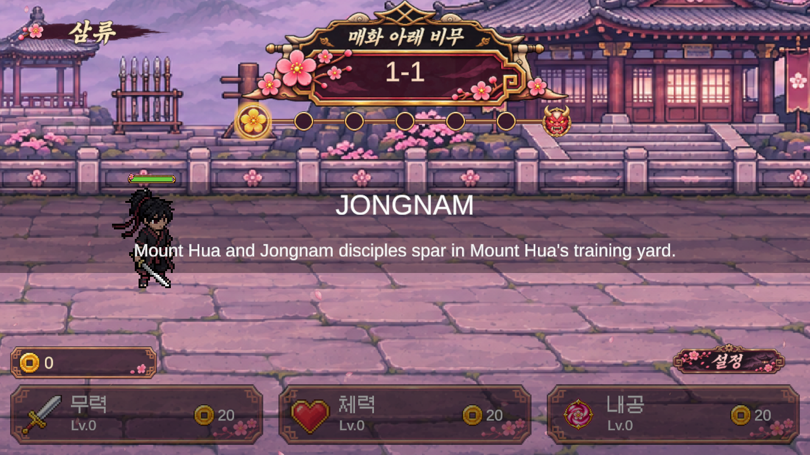
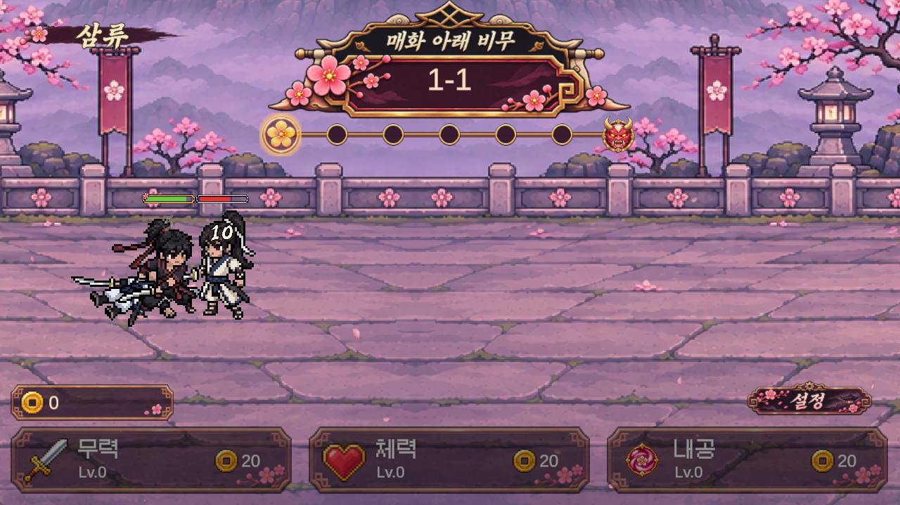
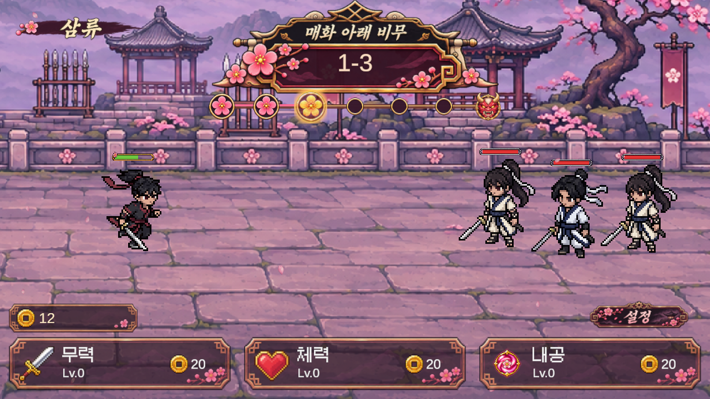

# 루프 증거: loop/20261122-094424 (묶음 flow_test)

- 판정: **통합 브랜치(`integration`)에 합침** — 관문 위반 0건, 합치기 전 전체 테스트 통과
- 합친 시각: 2026-11-22 09:50
- 병합 커밋: 태그 `loop-merged/20261122-094424` (`git show loop-merged/20261122-094424`)
- 작업 1건, 바뀐 파일 2개 (.meta 제외)
- 테스트 수: 701 → 702개. 합치기 전 실행: EditMode 884/884, PlayMode 155/155

이 문서는 루프 스크립트가 썼다. 테스트 결과와 관문은 스크립트가 직접 판정한 것이고, "완료 조건별 테스트"와 리뷰 의견은 교차 리뷰 에이전트의 판단이다. 가정과 화면은 사람이 본다.

## 사람이 볼 것

테스트로 판정하지 못한 것이다. 아래 화면 갈무리와 함께 본다.

- `077_flow_offline_reward`: 작업 문서는 수령 3프레임 뒤 `Battle.Paused`가 거짓이라고 요구하지만 `docs/spec/stage.md`는 시작 시 1.2초간 구간 소개와 전투 정지를 요구한다. `StageProgress.Begin()`은 구간 소개에서 전투를 다시 멈춘다. 어떤 조건을 우선할지 결정해야 한다.

## 에이전트가 스스로 정한 것 (가정)

사양과 작업 문서에 없어 에이전트가 정한 것 전부다. 마음에 들지 않으면 후속 작업으로 고친다.

- 없음

## 화면 갈무리

합치기 직전의 코드로 게임을 실행해 찍은 것이다 (플레이 모드 테스트, 파일 이름의 숫자는 실행 후 지난 게임 시간).

**game_001s.png**



**game_010s.png**



**game_030s.png**




## 작업 요약

| 작업 | 구현 | 리뷰 | 새 테스트 | 바뀐 화면 코드 |
| --- | --- | --- | --- | --- |
| `077_flow_offline_reward` | codex(시도 1) | claude (교차): 통과 | 1 | 0 |

## 관문 (스크립트 판정)

- 위반: 0건
- 확인 필요: 없음

## 작업별 기록

### 077_flow_offline_reward

- 구현: codex(시도 1)
- 리뷰: claude (교차): 통과
- 바뀐 내용: 오프라인 보상 수령과 저장, 중복 지급 방지 및 재실행 흐름 테스트를 완성하고 구간 소개 이후 전투 재개를 검사합니다.
- 리뷰 의견: 테스트 파일 하나와 .meta만 추가했고, 사람의 답변대로 받기 3프레임 뒤에는 SubstageIntro를, Playing이 된 뒤에는 전투 재개를 검사한다. 모든 완료 조건을 숫자까지 Assert로 직접 확인하며 게임 코드와 GameFlow 도우미는 건드리지 않았다.
- 작업 문서 원본: `docs/history/077_flow_offline_reward.md`

| 완료 조건 | 대응하는 테스트 | 판정 |
| --- | --- | --- |
| Assets/Tests/PlayMode/Flow/OfflineRewardFlowTests.cs` 에 아래 조건마다 검사가 있고 모두 통과한다. | OfflineRewardFlowTests.OneHourOffline_ClaimOnceAndRelaunch_ContinuesWithoutAnotherReward | 있음 |
| 한 시간 전 저장으로 켜면 `OfflineReward.HasReward` 는 `true`, `OfflineReward.KillCount` 는 360, `OfflineReward.Gold` 는 4320 이다. | OfflineRewardFlowTests.OneHourOffline_ClaimOnceAndRelaunch_ContinuesWithoutAnotherReward (HasReward True, KillCount 360, Gold 4320) | 있음 |
| 받기 전에는 `Wallet.Balance` 가 100 이다. | OfflineRewardFlowTests.OneHourOffline_ClaimOnceAndRelaunch_ContinuesWithoutAnotherReward ("수령 전 보유 금화" 100) | 있음 |
| 받기 전에는 `Battle.Paused` 가 `true`, `StageProgress.HasBegun` 이 `false`, `AutoSave.Enabled` 가 `false` 다. | OfflineRewardFlowTests.OneHourOffline_ClaimOnceAndRelaunch_ContinuesWithoutAnotherReward (세 가지 Assert) | 있음 |
| 받기 전에는 `UiCanvas` 아래에 `OfflineRewardOverlay/OfflineRewardWindow/ClaimButton` 이 있다. | OfflineRewardFlowTests.OneHourOffline_ClaimOnceAndRelaunch_ContinuesWithoutAnotherReward ("수령 버튼 존재", Button 컴포넌트 확인) | 있음 |
| 받기를 누른 뒤 `Wallet.Balance` 는 4420 이다. | OfflineRewardFlowTests.OneHourOffline_ClaimOnceAndRelaunch_ContinuesWithoutAnotherReward ("수령 후 보유 금화" 4420) | 있음 |
| 받기를 누른 뒤 `OfflineRewardClaim.State` 는 `OfflineRewardClaimState.Done`, `HasPaid` 는 `true` 다. | OfflineRewardFlowTests.OneHourOffline_ClaimOnceAndRelaunch_ContinuesWithoutAnotherReward (State Done, HasPaid True) | 있음 |
| 받기를 누른 뒤 `SaveCodec.Decode(store.Text).Data.Gold` 는 4420 이고 `SavedAtUtcTicks` 는 누르기 직전 기록한 시각 이상이다. | OfflineRewardFlowTests.OneHourOffline_ClaimOnceAndRelaunch_ContinuesWithoutAnotherReward (saved.Gold 4420, SavedAtUtcTicks >= beforeClaim) | 있음 |
| 받기를 누르고 3프레임 뒤 `OfflineRewardOverlay` 는 없고, `StageProgress.HasBegun` 은 `true`, `StageProgress.StageNumber` 는 2, `StageProgress.Phase` 는 `StagePhase.SubstageIntro` 다. | OfflineRewardFlowTests.OneHourOffline_ClaimOnceAndRelaunch_ContinuesWithoutAnotherReward (창 닫힘, HasBegun, StageNumber 2, SubstageIntro) | 있음 |
| 그 뒤 실제 시간 10초 안에 `StageProgress.Phase` 가 `StagePhase.Playing` 이 되고, 그때 `Battle.Paused` 는 `false` 다. | OfflineRewardFlowTests.OneHourOffline_ClaimOnceAndRelaunch_ContinuesWithoutAnotherReward (GameFlow.WaitUntil Playing 10f, 이어서 Paused False) | 있음 |
| 받은 뒤 `TryClaim` 을 한 번 더 부르면 `true` 를 돌려주고 `Wallet.Balance` 는 그 직전 값과 같다 (다시 주지 않는다). | OfflineRewardFlowTests.OneHourOffline_ClaimOnceAndRelaunch_ContinuesWithoutAnotherReward (TryClaim True, balanceBeforeRetry와 같음) | 있음 |
| 받은 뒤 다시 켜면 새 루트의 `OfflineReward.HasReward` 는 `false` 이고 `[OfflineRewardView]` 자식이 없다. | OfflineRewardFlowTests.OneHourOffline_ClaimOnceAndRelaunch_ContinuesWithoutAnotherReward (새 루트 HasReward False, root.transform.Find("[OfflineRewardView]") Null) | 있음 |
| 받은 뒤 다시 켜면 새 루트의 `Wallet.Balance` 는 다시 켜기 직전 저장된 금화와 같고 4420 이상이다. | OfflineRewardFlowTests.OneHourOffline_ClaimOnceAndRelaunch_ContinuesWithoutAnotherReward (savedGoldBeforeRelaunch와 같음, >= 4420) | 있음 |
| 기존 테스트가 모두 통과한다. | 루프 전체 테스트 실행 | 루프가 판정 |

리뷰 지적 (합친 뒤에도 남은 것):

- [note] 보고서가 두 번 붙어 있다 (보류 전 시도 1의 보고서와 답변 뒤의 보고서). 마지막 보고서가 현재 코드와 맞으므로 문제는 아니다. tasks/doing/077_flow_offline_reward.md

새 테스트 1개: `OfflineRewardFlowTests.OneHourOffline_ClaimOnceAndRelaunch_ContinuesWithoutAnotherReward`

## 확인하고 되돌리는 방법

```
git diff loop-merged/20261122-094424^1 loop-merged/20261122-094424            # 이 루프가 바꾼 것 전부
git merge --ff-only loop-merged/20261122-094424         # (main 에서) 이 루프까지만 올린다
git revert -m 1 loop-merged/20261122-094424             # (main 에 올린 뒤) 이 루프만 되돌린다
```
