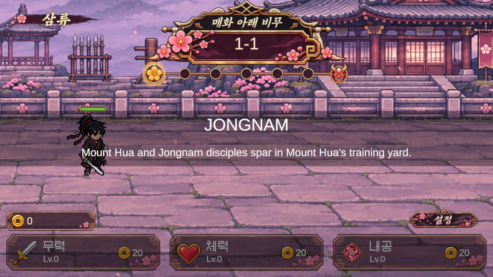
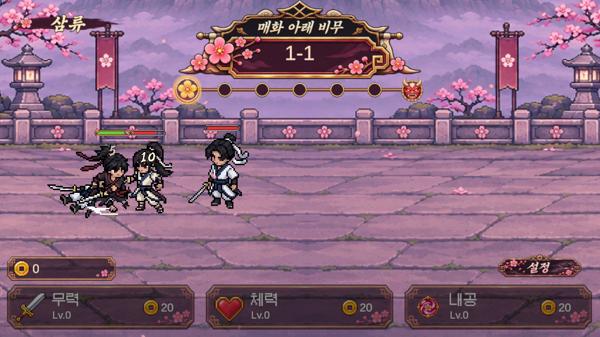
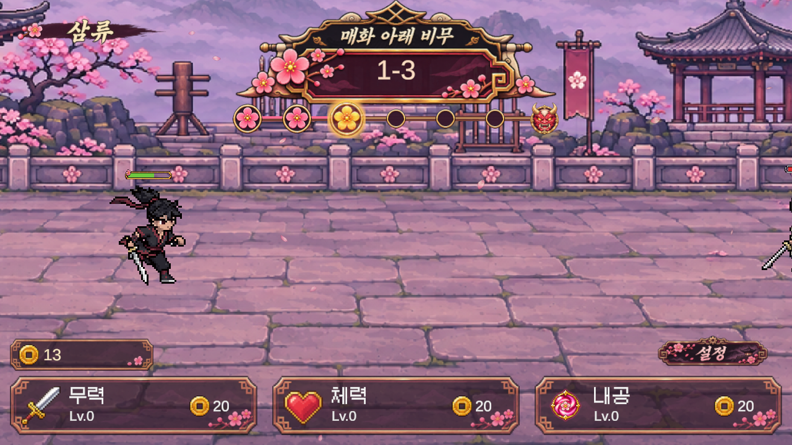

# 루프 증거: loop/20261122-131718 (묶음 skill_hits)

- 판정: **통합 브랜치(`integration`)에 합침** — 관문 위반 0건, 합치기 전 전체 테스트 통과
- 합친 시각: 2026-11-22 13:39
- 병합 커밋: 태그 `loop-merged/20261122-131718` (`git show loop-merged/20261122-131718`)
- 작업 3건, 바뀐 파일 15개 (.meta 제외)
- 테스트 수: 702 → 720개. 합치기 전 실행: EditMode 897/897, PlayMode 160/160

이 문서는 루프 스크립트가 썼다. 테스트 결과와 관문은 스크립트가 직접 판정한 것이고, "완료 조건별 테스트"와 리뷰 의견은 교차 리뷰 에이전트의 판단이다. 가정과 화면은 사람이 본다.

## 사람이 볼 것

테스트로 판정하지 못한 것이다. 아래 화면 갈무리와 함께 본다.

- `080_combat_skill_view`: 게임을 실행해 스킬이 나갈 때 제자의 발이 대기·달리기 때와 같은 높이에 있고 떠오르지 않는다. 에디터에서 스킬 발동 순간을 멈춰 보며 확인한다.
- `080_combat_skill_view`: 스킬이 나가는 동안 제자가 앞으로 이동하지 않고, 검격마다 적 위에 매화색 숫자가 하나씩 떠오른다. 에디터에서 재생하며 확인한다.
- `080_combat_skill_view`: 게임을 실행해 스킬이 나갈 때 제자의 발이 대기·달리기 때와 같은 높이에 있고 떠오르지 않는지 에디터에서 발동 순간을 멈춰 확인한다.
- `080_combat_skill_view`: 스킬이 나가는 동안 제자가 앞으로 이동하지 않고, 검격마다 적 위에 매화색 숫자가 하나씩 떠오르는지 에디터에서 재생하며 확인한다.

## 에이전트가 스스로 정한 것 (가정)

사양과 작업 문서에 없어 에이전트가 정한 것 전부다. 마음에 들지 않으면 후속 작업으로 고친다.

- 없음

## 화면 갈무리

합치기 직전의 코드로 게임을 실행해 찍은 것이다 (플레이 모드 테스트, 파일 이름의 숫자는 실행 후 지난 게임 시간).

**game_001s.png**



**game_010s.png**



**game_030s.png**




## 작업 요약

| 작업 | 구현 | 리뷰 | 새 테스트 | 바뀐 화면 코드 |
| --- | --- | --- | --- | --- |
| `078_battle_skill_hits` | codex(시도 1) | claude (교차): 통과 | 10 | 0 |
| `079_sfx_skill_hits` | codex(시도 1) | claude (교차): 통과 | 3 | 0 |
| `080_combat_skill_view` | codex(시도 1~2) | claude (교차): 통과 | 5 | 2 |

## 관문 (스크립트 판정)

- 위반: 0건
- 확인 필요:
  - `Assets/Tests/EditMode/Combat/BattleSkillTests.cs` — 있던 검사(Assert) 14줄을 지우거나 바꿈 (작업 078_battle_skill_hits)
    - 지워짐: `Assert.AreEqual(enemy.MaxHealth - 20, enemy.Health);`
    - 지워짐: `Assert.AreEqual(80, boss.Health);`
    - 지워짐: `Assert.AreEqual(70, boss.Health);`
    - 지워짐: `Assert.AreEqual(20, boss.Health);`
    - 지워짐: `Assert.AreEqual(10, first.Health);`
    - 지워짐: `Assert.AreEqual(80, second.Health);`
    - 지워짐: `Assert.AreEqual(110, boss.Health);`
    - 지워짐: `Assert.AreEqual(10, normal.Health);`
    - 새로 들어옴: `Assert.AreEqual(enemy.MaxHealth - 1, enemy.Health);`
    - 새로 들어옴: `Assert.AreEqual(99, boss.Health);`
    - 새로 들어옴: `Assert.AreEqual(80, boss.Health);`
    - 새로 들어옴: `Assert.AreEqual(39, boss.Health);`
    - 새로 들어옴: `Assert.AreEqual(29, first.Health);`
    - 새로 들어옴: `Assert.AreEqual(99, second.Health);`
    - 새로 들어옴: `Assert.AreEqual(129, boss.Health);`
    - 새로 들어옴: `Assert.AreEqual(29, normal.Health);`
  - `Assets/Tests/PlayMode/Combat/CombatSkillTests.cs` — 있던 검사(Assert) 2줄을 지우거나 바꿈 (작업 080_combat_skill_view)
    - 지워짐: `Assert.That(body.sprite.name, Is.EqualTo("disciple_skill_00"));`
    - 지워짐: `Assert.That(body.sprite.name, Is.Not.EqualTo("disciple_skill_00"));`
    - 새로 들어옴: `Assert.That(body.sprite.name, Is.EqualTo("disciple_skill_02"));`
    - 새로 들어옴: `Assert.That(body.sprite.name, Is.Not.EqualTo("disciple_skill_02"));`

## 작업별 기록

### 078_battle_skill_hits

- 구현: codex(시도 1)
- 리뷰: claude (교차): 통과
- 바뀐 내용: 스킬 피해를 고정 일정의 13타로 분배하고 활성 중 제자 이동과 공격을 중지했다. 관련 에딧 모드 테스트와 전투 사양을 갱신했다.
- 리뷰 의견: 스킬 13타 분할, 발동 칸 저장 피해, 63칸 활성·정지, 초기화·멈춤·강화 처리가 요구사항대로 Battle.cs에 구현됐습니다. 새 테스트가 완료 조건의 상황과 숫자를 그대로 검사하고, 기존 테스트의 기대값 변경은 요구사항에 적힌 목록과 정확히 같습니다.
- 작업 문서 원본: `docs/history/078_battle_skill_hits.md`

| 완료 조건 | 대응하는 테스트 | 판정 |
| --- | --- | --- |
| `Assets/Tests/EditMode/Combat/BattleSkillHitTests.cs`에 아래 조건마다 테스트가 하나 이상 있고 모두 통과한다. "스킬 전투"는 `new Battle(new StatUpgrades(new Wallet(1000), 10, 100), null, true)`이고, "n칸 뒤"는 처음부터 `Step()`을 n번 부른 뒤다. | BattleSkillHitTests 전체 (CreateBattle이 정의와 같음, 2~20번 조건별 테스트 존재) | 있음 |
| `Battle.CalculateSkillHitDamage(20, i)`는 i가 0~11이면 1이고, `(20, 12)`는 8이다. | BattleSkillHitTests.HitDamage_DistributesTotalAndRejectsInvalidInputs | 있음 |
| `Battle.CalculateSkillHitDamage(26, 0)`은 2이고 `(26, 12)`는 2다. | BattleSkillHitTests.HitDamage_DistributesTotalAndRejectsInvalidInputs | 있음 |
| `Battle.CalculateSkillHitDamage(12, 0)`은 0이고 `(12, 12)`는 12다. | BattleSkillHitTests.HitDamage_DistributesTotalAndRejectsInvalidInputs | 있음 |
| `Battle.CalculateSkillHitDamage(-1, 0)`, `(20, -1)`, `(20, 13)`은 각각 `ArgumentOutOfRangeException`을 던진다. | BattleSkillHitTests.HitDamage_DistributesTotalAndRejectsInvalidInputs | 있음 |
| `Battle.SkillHitSteps`는 {0, 3, 5, 9, 13, 19, 23, 28, 36, 38, 42, 44, 46}이고, `SkillHitCount`는 13, `SkillActiveSteps`는 63이다. | BattleSkillHitTests.HitSchedule_ExposesExpectedSteps | 있음 |
| 스킬 전투에서 `AddEnemy(Boss, 2, 1.0)`(체력 130, 움직이지 않음) 뒤 1칸 뒤 보스 `Health`는 129이고 3칸 뒤에도 129다. | BattleSkillHitTests.Skill_ScheduledHitsAndEnd_MatchSteps | 있음 |
| 같은 상황에서 4칸 뒤 보스 `Health`는 128이고 10칸 뒤 126이다. | BattleSkillHitTests.Skill_ScheduledHitsAndEnd_MatchSteps | 있음 |
| 같은 상황에서 47칸 뒤 보스 `Health`는 110이다 (13타 합 20). | BattleSkillHitTests.Skill_ScheduledHitsAndEnd_MatchSteps | 있음 |
| 같은 상황에서 63칸 뒤 보스 `Health`는 110이고 `IsSkillActive`는 `true`다. | BattleSkillHitTests.Skill_ScheduledHitsAndEnd_MatchSteps | 있음 |
| 같은 상황에서 64칸 뒤 보스 `Health`는 100(기본 공격)이고 `IsSkillActive`는 `false`다. | BattleSkillHitTests.Skill_ScheduledHitsAndEnd_MatchSteps | 있음 |
| 스킬 전투를 새로 만들면 `IsSkillActive`는 `false`다. 기본 전투(`skillEnabled` false)에서 `AddEnemy(Boss, 2, 1.0)` 뒤 64칸 동안 `IsSkillActive`는 한 번도 `true`가 아니다. | BattleSkillHitTests.DisabledSkill_NeverActivates | 있음 |
| 스킬 전투에서 보스와 일반 몬스터 순서로 `AddEnemy(Boss, 2, 1.0)`, `AddEnemy(Normal, 1, 2.6)` 뒤 47칸 뒤 보스 `Health`는 110이고 일반 몬스터 `Health`는 18이다 (일반 몬스터는 30번째 칸부터 범위 2.0에 들어와 36·38·42·44·46번째 칸의 5타만 맞는다). | BattleSkillHitTests.Skill_UsesCurrentPositionsForEachHit | 있음 |
| 공격력 200 스킬 전투(`new StatUpgrades(new Wallet(1000), 200, 100)`)에서 `AddEnemy(Normal, 1, 0.8)` 뒤 1칸 뒤 `Enemies.Count`는 0이다. | BattleSkillHitTests.Skill_EmptyFieldRemainsStationaryUntilEnd | 있음 |
| 같은 상황에서 63칸 뒤 `DisciplePosition`은 0이고 `EnemyDamaged`는 모두 1번이다 (남은 타는 빗나가고 제자는 전진하지 않는다). | BattleSkillHitTests.Skill_EmptyFieldRemainsStationaryUntilEnd | 있음 |
| 같은 상황에서 64칸 뒤 `DisciplePosition`은 0.1296이다. | BattleSkillHitTests.Skill_EmptyFieldRemainsStationaryUntilEnd | 있음 |
| 스킬 전투에서 `AddEnemy(Boss, 2, 1.0)` 뒤 47칸 동안 받은 모든 `EnemyDamaged` 안에서 읽은 `IsSkillActive`는 `true`이고, 64칸째의 `EnemyDamaged` 안에서 읽은 값은 `false`다. | BattleSkillHitTests.DamageNotifications_ExposeSkillState | 있음 |
| 스킬 전투에서 `AddEnemy(Boss, 2, 1.0)` 뒤 1칸 진행하고 `SetPaused(true)` 후 `Step()`을 10번 부르면 보스 `Health`는 129이고 `IsSkillActive`는 `true`다. | BattleSkillHitTests.PausedSkill_DoesNotAdvance | 있음 |
| 스킬 전투에서 `AddEnemy(Boss, 2, 1.0)` 뒤 10칸 진행하고 `Reset()`을 부르면 `IsSkillActive`는 `false`다. | BattleSkillHitTests.Reset_DiscardsActiveSkill | 있음 |
| 스킬 전투에서 `AddEnemy(Boss, 2, 1.0)` 뒤 1칸 진행하고 `upgrades.TryUpgrade(StatType.Attack)`을 불러도 47칸 뒤 보스 `Health`는 110이다. | BattleSkillHitTests.UpgradeDuringSkill_DoesNotChangeStoredDamage | 있음 |
| `BattleSkillTests`의 기존 테스트가 요구사항에 적은 값으로 모두 통과한다. | BattleSkillTests 차이를 요구사항의 변경 목록과 한 줄씩 대조함 (지정된 값만 바뀌었고 어서트 수와 테스트 이름은 그대로) | 있음 |
| 기존 테스트가 모두 통과한다. | 루프 테스트 실행 | 루프가 판정 |

리뷰 지적 (합친 뒤에도 남은 것):

- [note] 기계 검사가 짚은 BattleSkillTests.cs 기대값 변경 14줄(지워진 8줄, 새로 들어온 8줄)은 요구사항 35~44줄의 목록과 정확히 같습니다. 그 밖의 어서트는 그대로라 검사가 약해지지 않았습니다.
- [note] Battle.cs:206의 한 줄 조건(`IsSkillActive && ++_skillStep >= SkillActiveSteps`)과 ApplySkillHit(Battle.cs:456~)의 중괄호 없는 foreach는 이 파일의 기존 스타일과 다릅니다. 동작에는 문제가 없습니다.
- [note] docs/spec/combat.md 완료 조건 초안 49~57번이 원래의 자세한 문장에서 줄인 문장으로 바뀌었습니다(예: 51~53번). 숫자는 테스트와 맞습니다.

새 테스트 10개: `BattleSkillHitTests.DamageNotifications_ExposeSkillState`, `BattleSkillHitTests.DisabledSkill_NeverActivates`, `BattleSkillHitTests.HitDamage_DistributesTotalAndRejectsInvalidInputs`, `BattleSkillHitTests.HitSchedule_ExposesExpectedSteps`, `BattleSkillHitTests.PausedSkill_DoesNotAdvance`, `BattleSkillHitTests.Reset_DiscardsActiveSkill`, `BattleSkillHitTests.Skill_EmptyFieldRemainsStationaryUntilEnd`, `BattleSkillHitTests.Skill_ScheduledHitsAndEnd_MatchSteps`, `BattleSkillHitTests.Skill_UsesCurrentPositionsForEachHit`, `BattleSkillHitTests.UpgradeDuringSkill_DoesNotChangeStoredDamage`

관문 확인 필요:

- `Assets/Tests/EditMode/Combat/BattleSkillTests.cs` — 있던 검사(Assert) 14줄을 지우거나 바꿈
    - 지워짐: `Assert.AreEqual(enemy.MaxHealth - 20, enemy.Health);`
    - 지워짐: `Assert.AreEqual(80, boss.Health);`
    - 지워짐: `Assert.AreEqual(70, boss.Health);`
    - 지워짐: `Assert.AreEqual(20, boss.Health);`
    - 지워짐: `Assert.AreEqual(10, first.Health);`
    - 지워짐: `Assert.AreEqual(80, second.Health);`
    - 지워짐: `Assert.AreEqual(110, boss.Health);`
    - 지워짐: `Assert.AreEqual(10, normal.Health);`
    - 새로 들어옴: `Assert.AreEqual(enemy.MaxHealth - 1, enemy.Health);`
    - 새로 들어옴: `Assert.AreEqual(99, boss.Health);`
    - 새로 들어옴: `Assert.AreEqual(80, boss.Health);`
    - 새로 들어옴: `Assert.AreEqual(39, boss.Health);`
    - 새로 들어옴: `Assert.AreEqual(29, first.Health);`
    - 새로 들어옴: `Assert.AreEqual(99, second.Health);`
    - 새로 들어옴: `Assert.AreEqual(129, boss.Health);`
    - 새로 들어옴: `Assert.AreEqual(29, normal.Health);`

### 079_sfx_skill_hits

- 구현: codex(시도 1)
- 리뷰: claude (교차): 통과
- 바뀐 내용: 스킬 활성 중 피해의 휘두름·타격음 요청을 생략하고 종료 후 기본 공격을 검증하는 테스트와 소리 사양을 추가했다. Unity 테스트는 루프 판정을 기다린다.
- 리뷰 의견: SfxTriggers.OnEnemyDamaged가 battle.IsSkillActive가 참일 때 아무것도 요청하지 않도록 바뀌었다. 새 테스트 세 개가 첫 칸, 이어지는 62칸(후속 12타 확인 포함), 64번째 칸의 기본 공격을 작업 문서의 상황 그대로 검사한다. 기존 테스트, Combat 내부, SfxQueue, 화면 코드는 건드리지 않았다.
- 작업 문서 원본: `docs/history/079_sfx_skill_hits.md`

| 완료 조건 | 대응하는 테스트 | 판정 |
| --- | --- | --- |
| `Assets/Tests/EditMode/Audio/SfxTriggersTests.cs`에 아래 조건마다 테스트가 하나 이상 있고 모두 통과한다. 기존 도우미 `Create`, `Drain`을 쓴다. | SfxTriggersTests.SkillFirstHit_RequestsSkillWithoutSwingOrHit, SkillRemainingSteps_RequestNoSwingOrHit, AttackAfterSkill_RequestsSwingAndHit (모두 Create/Drain 사용) | 있음 |
| `Create(attack: 10, skill: true)` 뒤 `battle.AddEnemy(EnemyKind.Boss, 2, battle.DisciplePosition + 1.0)`를 두고 `battle.Step()` 1번 뒤 `Drain()` 결과에 `PlumSwordSkill`이 있고 `SwordSwing`, `AttackHit`은 없다. | SfxTriggersTests.SkillFirstHit_RequestsSkillWithoutSwingOrHit | 있음 |
| 같은 상황에서 이어서 `battle.Step()`과 `Drain()`을 62번 번갈아 부르는 동안 어느 결과에도 `SwordSwing`, `AttackHit`이 없다. | SfxTriggersTests.SkillRemainingSteps_RequestNoSwingOrHit (62번 반복하며 매번 검사하고, 후속 EnemyDamaged가 12번 왔는지도 확인) | 있음 |
| 같은 상황에서 이어서 `battle.Step()` 1번(처음부터 64번째 칸, 스킬이 끝난 뒤의 기본 공격) 뒤 `Drain()` 결과에 `SwordSwing`과 `AttackHit`이 있다. | SfxTriggersTests.AttackAfterSkill_RequestsSwingAndHit (63칸 진행 뒤 64번째 칸 검사) | 있음 |
| 기존 테스트 `SkillAttack_ReplacesSwingAndHit`과 스킬이 꺼진 전투의 휘두름·타격 테스트가 그대로 통과한다. | SfxTriggersTests.SkillAttack_ReplacesSwingAndHit, NormalAttack_RequestsSwingAndHit (diff에서 바뀌지 않음을 확인, 통과 여부는 루프 실행 결과) | 루프가 판정 |
| 기존 테스트가 모두 통과한다. | 루프의 전체 테스트 실행 | 루프가 판정 |

리뷰 지적 (합친 뒤에도 남은 것):

- [note] Battle.cs:427-429에서 IsSkillActive=true를 먼저 정한 뒤 ApplySkillHit(EnemyDamaged)를 부르므로, 첫 타의 휘두름·타격음도 SfxQueue의 '대신하기' 규칙이 아니라 이번 검사로 빠진다. 작업 문서의 의도와 맞는다.

새 테스트 3개: `SfxTriggersTests.AttackAfterSkill_RequestsSwingAndHit`, `SfxTriggersTests.SkillFirstHit_RequestsSkillWithoutSwingOrHit`, `SfxTriggersTests.SkillRemainingSteps_RequestNoSwingOrHit`

### 080_combat_skill_view

- 구현: codex(시도 1~2)
- 리뷰: claude (교차): 통과
- 바뀐 내용: 피해 숫자 색상 테스트 두 개에서 텍스처 이름을 직접 검증하도록 수정했다. Unity 테스트와 관문 재검사는 루프 스크립트가 수행한다.
- 리뷰 의견: 발 기준점 (58, 18), 프레임 2~31 재생, 스킬 중 기본 공격 동작 제외, 매화색 피해 숫자와 아이보리 대체가 요구사항대로 들어갔다. 플레이 모드 테스트가 각 완료 조건의 상황과 기대값을 직접 검사한다. 기존 테스트는 작업 문서가 지시한 값만 바뀌었고 Assert 수는 그대로다.
- 작업 문서 원본: `docs/history/080_combat_skill_view.md`

| 완료 조건 | 대응하는 테스트 | 판정 |
| --- | --- | --- |
| 화면 코드가 컴파일되고 기존 테스트가 모두 통과한다 (`CombatSkillTests`는 요구사항에 적은 값으로). | 루프의 컴파일·전체 테스트 판정 (CombatSkillTests.SkillUsed_PlaysApprovedAnimation_PausesAndResetStopsIt의 값은 요구사항대로 00→02로 바뀜) | 루프가 판정 |
| Assets/Tests/PlayMode/Combat/CombatSkillHitViewTests.cs`에 아래 조건마다 테스트가 하나 이상 있고 모두 통과한다. 쓰는 법은 `docs/dev/architecture.md` "테스트" 절을 따르고, 기존 `CombatSkillTests`처럼 `CombatView`를 직접 만든다. | CombatSkillHitViewTests (5개 테스트가 조건 3~7을 하나씩 맡고, 모두 CombatView를 AddComponent로 직접 만든다) | 있음 |
| DiscipleSprites`로 자른 스킬 프레임 0~31의 `pivot`은 모두 (58, 18)px이다. | CombatSkillHitViewTests.SkillFrames_AllUseFootPivot | 있음 |
| 스킬이 켜진 전투(공격력 10, 체력 100)에 `AddEnemy(Boss, 2, 1.0)`을 두고 `battle.Step()` 1번 뒤, `[DamageNumber]` 가운데 보스 쪽 숫자의 글자 스프라이트 텍스처 이름은 `damage_numbers_plum`이다. | CombatSkillHitViewTests.SkillHit_EnemyDamageUsesPlumDigits | 있음 |
| 스킬이 꺼진 전투에 `AddEnemy(Normal, 1, 0.8)`을 두고 `battle.Step()` 1번 뒤, 적 쪽 피해 숫자의 글자 스프라이트 텍스처 이름은 `damage_numbers`다. | CombatSkillHitViewTests.BasicHit_EnemyDamageUsesIvoryDigits | 있음 |
| 스킬이 켜진 전투에 `AddEnemy(Boss, 2, 1.0)`을 두고 `battle.Step()` 1번 뒤 제자 몸 스프라이트 이름은 `disciple_skill_02`다. | CombatSkillHitViewTests.SkillAnimation_StartsAtFrameTwo | 있음 |
| 같은 상황에서 실제 시간 1.4초 뒤 제자 몸 스프라이트 이름은 `disciple_skill_`로 시작하지 않는다 (스킬 재생이 1.25초에 끝난다). | CombatSkillHitViewTests.SkillAnimation_EndsAfterOneAndQuarterSeconds | 있음 |
| 게임을 실행해 스킬이 나갈 때 제자의 발이 대기·달리기 때와 같은 높이에 있고 떠오르지 않는다. 에디터에서 스킬 발동 순간을 멈춰 보며 확인한다. | - | 사람 확인 |
| 스킬이 나가는 동안 제자가 앞으로 이동하지 않고, 검격마다 적 위에 매화색 숫자가 하나씩 떠오른다. 에디터에서 재생하며 확인한다. | - | 사람 확인 |

리뷰 지적 (합친 뒤에도 남은 것):

- [note] CombatSkillHitViewTests.cs:55의 GetEnemyDamageTexture는 `view.transform.Find("[DamageNumber]")`로 처음 찾은 숫자만 본다. 적 쪽 숫자라고 직접 확인하지는 않는다. 다만 Battle.Step이 제자 공격(Battle.cs:397~452)을 적 공격(477~)보다 먼저 처리하므로, 처음 생기는 숫자는 적 쪽 숫자다. 그래서 지금은 올바르게 검사한다.
- [note] docs/spec/combat.md 스킬 항목의 대체 문구가 '기존 기본 공격과 아래 임시 검기 띠로 대체'에서 '아래 임시 검기 띠로 대체'로 바뀌었다. 요구사항(IsSkillActive 중의 EnemyDamaged는 attacked로 세지 않음)에서 자연스럽게 나오는 변화라 문제 삼지 않는다. 다만 보고서의 가정에는 적혀 있지 않다.

새 테스트 5개: `CombatSkillHitViewTests.BasicHit_EnemyDamageUsesIvoryDigits`, `CombatSkillHitViewTests.SkillAnimation_EndsAfterOneAndQuarterSeconds`, `CombatSkillHitViewTests.SkillAnimation_StartsAtFrameTwo`, `CombatSkillHitViewTests.SkillFrames_AllUseFootPivot`, `CombatSkillHitViewTests.SkillHit_EnemyDamageUsesPlumDigits`

관문 확인 필요:

- `Assets/Tests/PlayMode/Combat/CombatSkillTests.cs` — 있던 검사(Assert) 2줄을 지우거나 바꿈
    - 지워짐: `Assert.That(body.sprite.name, Is.EqualTo("disciple_skill_00"));`
    - 지워짐: `Assert.That(body.sprite.name, Is.Not.EqualTo("disciple_skill_00"));`
    - 새로 들어옴: `Assert.That(body.sprite.name, Is.EqualTo("disciple_skill_02"));`
    - 새로 들어옴: `Assert.That(body.sprite.name, Is.Not.EqualTo("disciple_skill_02"));`

## 확인하고 되돌리는 방법

```
git diff loop-merged/20261122-131718^1 loop-merged/20261122-131718            # 이 루프가 바꾼 것 전부
git merge --ff-only loop-merged/20261122-131718         # (main 에서) 이 루프까지만 올린다
git revert -m 1 loop-merged/20261122-131718             # (main 에 올린 뒤) 이 루프만 되돌린다
```
