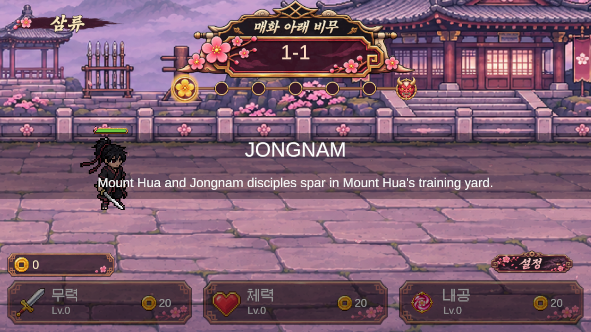
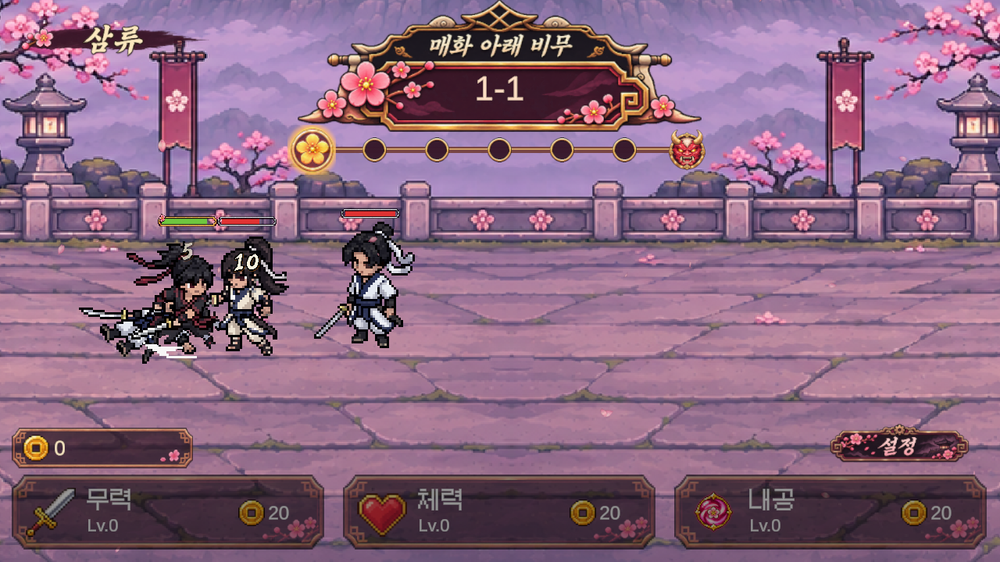
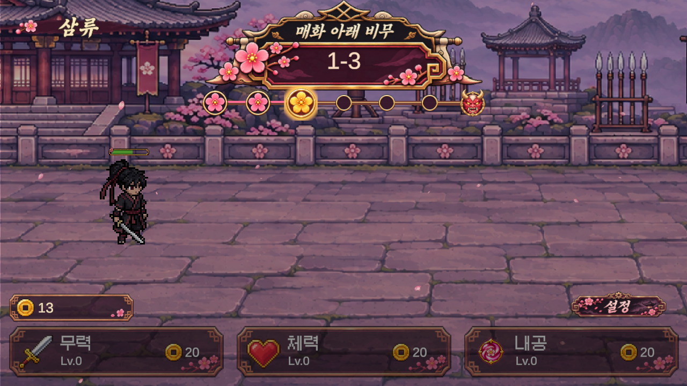

# 루프 증거: loop/20261122-133943 (묶음 clear_wait)

- 판정: **통합 브랜치(`integration`)에 합침** — 관문 위반 0건, 합치기 전 전체 테스트 통과
- 합친 시각: 2026-11-22 13:57
- 병합 커밋: 태그 `loop-merged/20261122-133943` (`git show loop-merged/20261122-133943`)
- 작업 3건, 바뀐 파일 13개 (.meta 제외)
- 테스트 수: 720 → 745개. 합치기 전 실행: EditMode 920/920, PlayMode 164/164

이 문서는 루프 스크립트가 썼다. 테스트 결과와 관문은 스크립트가 직접 판정한 것이고, "완료 조건별 테스트"와 리뷰 의견은 교차 리뷰 에이전트의 판단이다. 가정과 화면은 사람이 본다.

## 사람이 볼 것

테스트로 판정하지 못한 것이다. 아래 화면 갈무리와 함께 본다.

- `083_clear_wait_view`: 게임을 실행해 구간의 마지막 적을 쓰러뜨리면, 약 1.5초 동안 제자가 공격 자세가 아닌 대기 동작으로 서 있고 피해 숫자가 사라진 뒤 화면이 어두워진다. 에디터에서 재생하며 확인한다.
- `083_clear_wait_view`: 5스테이지 최종 보스를 이기면 쓰러짐 그림이 끝까지 재생된 뒤 화면이 어두워진다. 에디터에서 확인한다.
- `083_clear_wait_view`: 게임을 실행해 구간의 마지막 적을 쓰러뜨리면, 약 1.5초 동안 제자가 공격 자세가 아닌 대기 동작으로 서 있고 피해 숫자가 사라진 뒤 화면이 어두워지는지 에디터에서 확인한다.
- `083_clear_wait_view`: 5스테이지 최종 보스를 이기면 쓰러짐 그림이 끝까지 재생된 뒤 화면이 어두워지는지 에디터에서 확인한다.

## 에이전트가 스스로 정한 것 (가정)

사양과 작업 문서에 없어 에이전트가 정한 것 전부다. 마음에 들지 않으면 후속 작업으로 고친다.

- `082_stage_clear_wait`: 없음. 공개 연결 지점은 작업 문서에 지정된 형태를 따랐다.

## 화면 갈무리

합치기 직전의 코드로 게임을 실행해 찍은 것이다 (플레이 모드 테스트, 파일 이름의 숫자는 실행 후 지난 게임 시간).

**game_001s.png**



**game_010s.png**



**game_030s.png**




## 작업 요약

| 작업 | 구현 | 리뷰 | 새 테스트 | 바뀐 화면 코드 |
| --- | --- | --- | --- | --- |
| `081_battle_hold_position` | codex(시도 1) | claude (교차): 통과 | 11 | 0 |
| `082_stage_clear_wait` | codex(시도 1) | claude (교차): 통과 | 10 | 0 |
| `083_clear_wait_view` | codex(시도 1) | claude (교차): 통과 | 4 | 2 |

## 관문 (스크립트 판정)

- 위반: 0건
- 확인 필요: 없음

## 작업별 기록

### 081_battle_hold_position

- 구현: codex(시도 1)
- 리뷰: claude (교차): 통과
- 바뀐 내용: 전투에 독립적인 제자리 유지 상태와 설정 API를 추가하고 초기화 및 전투 사양을 반영했다. 완료 조건과 스킬 상호작용을 검증하는 에딧 모드 테스트를 작성했으며 Unity 테스트는 루프 판정을 기다린다.
- 리뷰 의견: `IsHoldingPosition`와 `SetHoldPosition`을 추가했고, 이 값이 참이면 `Step`에서 제자 이동만 건너뛴다(스킬 조건과 OR, 서로 독립). `Reset`에서 값을 해제하는 것도 코드로 확인했다. 완료 조건마다 숫자까지 확인하는 테스트가 있고, 사양 문서도 같이 갱신됐다.
- 작업 문서 원본: `docs/history/081_battle_hold_position.md`

| 완료 조건 | 대응하는 테스트 | 판정 |
| --- | --- | --- |
| `Assets/Tests/EditMode/Combat/BattleHoldPositionTests.cs`에 아래 조건마다 테스트가 하나 이상 있고 모두 통과한다. "기본 전투"는 `new Battle(new StatUpgrades(new Wallet(1000), 10, 100))`이다. | BattleHoldPositionTests (SetUp이 기본 전투를 만든다, 조건 2~9에 테스트가 하나씩 있다. 통과 여부는 루프 실행 결과로 본다) | 있음 |
| 기본 전투를 새로 만들면 `IsHoldingPosition`은 `false`다. | BattleHoldPositionTests.New_HoldPosition_IsFalse | 있음 |
| 기본 전투에서 `SetHoldPosition(true)` 뒤 적 없이 `Step()`을 10번 부르면 `DisciplePosition`은 0이다. | BattleHoldPositionTests.Step_HoldingWithoutEnemies_DoesNotAdvance | 있음 |
| 이어서 `SetHoldPosition(false)` 뒤 `Step()`을 10번 부르면 `DisciplePosition`은 1.296이다. | BattleHoldPositionTests.Step_AfterReleasingHold_Advances | 있음 |
| 기본 전투에서 `AddEnemy(Boss, 2, 5.0)`을 두고 `SetHoldPosition(true)` 뒤 `Step()`을 50번 부르면 `DisciplePosition`은 0이고 보스 `Health`는 130이다. | BattleHoldPositionTests.Step_HoldingWithDistantBoss_DoesNotApproachOrAttack | 있음 |
| 기본 전투에서 `AddEnemy(Boss, 2, 1.0)`을 두고 `SetHoldPosition(true)` 뒤 `Step()` 1번이면 보스 `Health`는 120이다 (제자리에서도 범위 안 적은 공격한다). | BattleHoldPositionTests.Step_HoldingWithBossInRange_DiscipleAttacks | 있음 |
| 같은 상황에서 `DiscipleHealth`는 86이다 (적도 평소처럼 공격한다). | BattleHoldPositionTests.Step_HoldingWithBossInRange_EnemyAttacks | 있음 |
| 기본 전투에서 `SetHoldPosition(true)` 뒤 `Reset()`을 부르면 `IsHoldingPosition`은 `false`다. | BattleHoldPositionTests.Reset_Holding_ClearsHold | 있음 |
| 기본 전투에서 `SetPaused(true)` 상태로 `SetHoldPosition(true)`를 부르면 `IsHoldingPosition`은 `true`다. | BattleHoldPositionTests.SetHoldPosition_Paused_ChangesHold | 있음 |
| 기존 테스트가 모두 통과한다. | 루프 전체 테스트 실행 | 루프가 판정 |

리뷰 지적 (합친 뒤에도 남은 것):

- [note] 보고서의 테스트 결과에는 Unity 테스트를 직접 돌리지 않았다고 적혀 있다. 새 테스트의 기대값(1.296, 130, 120, 86)은 실제 실행에서 확인해야 하며, 이 판정은 루프의 테스트 통과에 의존한다.
- [note] 멈춤·패배 상태에서도 값이 바뀌고 스킬과 제자리 유지가 서로 독립이라는 추가 테스트도 있다 (BattleHoldPositionTests.cs:102, :113). 하지 말 것은 침범하지 않았다: SetPaused·스킬·공격 규칙, Stage/Game 코드를 건드리지 않았다.

새 테스트 11개: `BattleHoldPositionTests.New_HoldPosition_IsFalse`, `BattleHoldPositionTests.Reset_Holding_ClearsHold`, `BattleHoldPositionTests.SetHoldPosition_Defeated_ChangesHold`, `BattleHoldPositionTests.SetHoldPosition_Paused_ChangesHold`, `BattleHoldPositionTests.Step_AfterReleasingHold_Advances`, `BattleHoldPositionTests.Step_HoldingWithBossInRange_DiscipleAttacks`, `BattleHoldPositionTests.Step_HoldingWithBossInRange_EnemyAttacks`, `BattleHoldPositionTests.Step_HoldingWithDistantBoss_DoesNotApproachOrAttack`, `BattleHoldPositionTests.Step_HoldingWithoutEnemies_DoesNotAdvance`, `BattleHoldPositionTests.Step_Holding_EnemyApproachesAndNoWindUpIsAdded`, `BattleHoldPositionTests.Step_SkillAndHold_BlockMovementIndependently`

### 082_stage_clear_wait

- 구현: codex(시도 1)
- 리뷰: claude (교차): 통과
- 바뀐 내용: 스테이지 성공 뒤 선택적인 결판 대기와 페이드 시간 이월을 구현하고 사양과 에딧 모드 테스트를 추가했다. Unity 테스트는 루프 판정을 기다린다.
- 리뷰 의견: ClearWait 단계, 생성자 인자 검사, 대기가 끝난 뒤 남는 시간을 페이드로 넘기는 처리, 가려진 순간의 제자리 유지 해제가 작업 문서대로 구현됐다. 완료 조건마다 숫자까지 확인하는 에딧 모드 테스트가 있다. 전투 코드와 화면 코드는 건드리지 않았고, 사양 문서도 같이 고쳤다.
- 작업 문서 원본: `docs/history/082_stage_clear_wait.md`

| 완료 조건 | 대응하는 테스트 | 판정 |
| --- | --- | --- |
| `Assets/Tests/EditMode/Stage/StageProgressClearWaitTests.cs`에 아래 조건마다 테스트가 하나 이상 있고 모두 통과한다. | StageProgressClearWaitTests 전체 (통과 여부는 루프 실행 결과) | 있음 |
| 공통 준비: `wallet = new Wallet(0)`, `upgrades = new StatUpgrades(wallet, 1000, 10000)`, `battle = new Battle(upgrades)`, `stage = new StageProgress(wallet, upgrades, battle, new MinRandom(), 2, 5, 1.5)`. `Begin()` 뒤 `Tick(1.2)`로 구간 소개를 끝내고, "결판까지"는 `Phase`가 `Playing`이 아닐 때까지 `battle.Step()`을 부르는 것(최대 5000번)이다. `MinRandom`은 기존 `Assets/Tests/EditMode/Stage/MinRandom.cs`(구간마다 2명)다. | StageProgressClearWaitTests.SetUp / FightToDecision | 있음 |
| 생성자에 `clearWaitSeconds`로 −0.1, `double.NaN`, `double.PositiveInfinity`를 주면 각각 `ArgumentOutOfRangeException`을 던진다. | StageProgressClearWaitTests.Constructor_InvalidWait_Throws (TestCase 3개) | 있음 |
| 인자를 주지 않은 `StageProgress`의 `ClearWaitSeconds`는 0이고, `StageProgress.DefaultClearWaitSeconds`는 1.5다. | StageProgressClearWaitTests.Constructor_DefaultWait_IsZeroAndGameDefaultIsOneAndHalf | 있음 |
| 공통 준비 뒤 결판까지 진행하면 `Phase`는 `ClearWait`이다. | StageProgressClearWaitTests.LastNormalDefeated_WaitsWithRewardsAndBattleRunning | 있음 |
| 그때 `FadeAlpha`는 0이다. | StageProgressClearWaitTests.LastNormalDefeated_WaitsWithRewardsAndBattleRunning | 있음 |
| 그때 `battle.Paused`는 `false`다. | StageProgressClearWaitTests.LastNormalDefeated_WaitsWithRewardsAndBattleRunning | 있음 |
| 그때 `battle.IsHoldingPosition`은 `true`다. | StageProgressClearWaitTests.LastNormalDefeated_WaitsWithRewardsAndBattleRunning | 있음 |
| 그때 `upgrades.Locked`는 `true`다. | StageProgressClearWaitTests.LastNormalDefeated_WaitsWithRewardsAndBattleRunning | 있음 |
| 그때 `wallet` 잔액은 24다 (2스테이지 일반 상대 12 × 2). | StageProgressClearWaitTests.LastNormalDefeated_WaitsWithRewardsAndBattleRunning | 있음 |
| 결판 뒤 `Tick(1.4)`이면 `Phase`는 `ClearWait` 그대로다. | StageProgressClearWaitTests.Tick_WaitThenRemainder_StartsFadeAndNotifies | 있음 |
| 결판 뒤 `Tick(1.4)`, `Tick(0.2)`이면 `Phase`는 `FadingOut`이고 `FadeAlpha`는 0.2(오차 1e-6)이다. | StageProgressClearWaitTests.Tick_WaitThenRemainder_StartsFadeAndNotifies | 있음 |
| 같은 상황에서 `battle.Paused`는 `true`다. | StageProgressClearWaitTests.Tick_WaitThenRemainder_StartsFadeAndNotifies | 있음 |
| 결판 뒤 `ClearWait`에서 `FadingOut`으로 바뀌는 `Tick` 안에서 `Changed`가 1번 이상 온다. | StageProgressClearWaitTests.Tick_WaitThenRemainder_StartsFadeAndNotifies (Tick(1.4)는 Changed 없이 return 하므로 셈은 Tick(0.2)에서 온 것) | 있음 |
| 결판 뒤 `Tick(1.6)`, `Tick(0.4)`이면 `SubstageNumber`는 2이고 `Phase`는 `FadingIn`이다. | StageProgressClearWaitTests.Tick_FadeReachesReplacement_ReleasesHold | 있음 |
| 같은 상황에서 `battle.IsHoldingPosition`은 `false`다. | StageProgressClearWaitTests.Tick_FadeReachesReplacement_ReleasesHold | 있음 |
| 결판 뒤 `ClearWait`에서 `battle.AddEnemy(EnemyKind.Normal, 2, battle.DisciplePosition + 0.8)`을 두고 그 적이 쓰러질 때까지 `battle.Step()`을 부르면 잔액은 24 그대로이고 `Phase`는 `ClearWait`이다. | StageProgressClearWaitTests.ClearWait_ExtraEnemyDefeated_IsIgnored | 있음 |
| 공통 준비에서 구간 6개를 모두 이기고(구간마다 결판까지 진행 → `Tick(1.5)` → `Tick(1.0)` → `Tick(1.2)`) 보스까지 결판을 내면 `Phase`는 `ClearWait`이다. | StageProgressClearWaitTests.BossDefeated_WaitsNotifiesAndReplacesStage | 있음 |
| 같은 상황에서 `StageCleared`는 1번, 값 2로 왔고, 그 알림 안에서 읽은 `Phase`는 `ClearWait`이다. | StageProgressClearWaitTests.BossDefeated_WaitsNotifiesAndReplacesStage | 있음 |
| 같은 상황에서 잔액은 204다 (일반 12 × 12 + 보스 60). | StageProgressClearWaitTests.BossDefeated_WaitsNotifiesAndReplacesStage | 있음 |
| 이어서 `Tick(1.5)`, `Tick(0.5)`이면 `StageNumber`는 3이고 `SubstageNumber`는 1이다. | StageProgressClearWaitTests.BossDefeated_WaitsNotifiesAndReplacesStage | 있음 |
| 같은 상황에서 `battle.IsHoldingPosition`은 `false`다. | StageProgressClearWaitTests.BossDefeated_WaitsNotifiesAndReplacesStage | 있음 |
| `clearWaitSeconds`를 주지 않은 `StageProgress`(나머지는 공통 준비와 같음)에서 결판까지 진행하면 `Phase`는 `FadingOut`이고 `battle.Paused`는 `true`다. | StageProgressClearWaitTests.DefaultWait_LastNormalDefeated_FadesImmediately | 있음 |
| 공통 준비를 `new StatUpgrades(wallet, 1, 1)`로 바꿔 제자가 쓰러질 때까지 진행하면 `Phase`는 `FadingOut`이고 `StageFailed`가 1번 온다 (실패는 기다리지 않는다). | StageProgressClearWaitTests.DiscipleDefeated_FadesImmediatelyAndNotifiesFailure | 있음 |
| 기존 테스트가 모두 통과한다. | 루프 전체 테스트 실행 | 루프가 판정 |

리뷰 지적 (합친 뒤에도 남은 것):

- [note] 기존 BeginTransition 의 XML 주석은 이제 실패 전환에서만 쓰이는데 그 점이 주석에 드러나지 않는다. BeginSuccessTransition 에는 주석이 없다 (Assets/Scripts/Core/Stage/StageProgress.cs:345-371). Tick 의 요약 주석도 ClearWait 를 언급하지 않는다 (StageProgress.cs:167-171). 동작에는 문제가 없다.

새 테스트 10개: `StageProgressClearWaitTests.BossDefeated_WaitsNotifiesAndReplacesStage`, `StageProgressClearWaitTests.ClearWait_ExtraEnemyDefeated_IsIgnored`, `StageProgressClearWaitTests.Constructor_DefaultWait_IsZeroAndGameDefaultIsOneAndHalf`, `StageProgressClearWaitTests.Constructor_InvalidWait_Throws`, `StageProgressClearWaitTests.DefaultWait_LastNormalDefeated_FadesImmediately`, `StageProgressClearWaitTests.DiscipleDefeated_FadesImmediatelyAndNotifiesFailure`, `StageProgressClearWaitTests.LastNormalDefeated_WaitsWithRewardsAndBattleRunning`, `StageProgressClearWaitTests.Tick_FadeReachesReplacement_ReleasesHold`, `StageProgressClearWaitTests.Tick_LargeRemainder_ContinuesThroughBothFades`, `StageProgressClearWaitTests.Tick_WaitThenRemainder_StartsFadeAndNotifies`

### 083_clear_wait_view

- 구현: codex(시도 1)
- 리뷰: claude (교차): 통과
- 바뀐 내용: 게임의 결판 뒤 대기 1.5초를 적용하고 쓰러짐 대기에서 경과 시간을 제외했다. 플레이 모드 테스트와 스테이지 사양을 갱신했다.
- 리뷰 의견: GameRoot가 DefaultClearWaitSeconds(1.5)를 넘기고, StageView는 ClearWait→FadingOut 성공 전환에서 쓰러짐 대기를 max(0, 쓰러짐 시간 − ClearWaitSeconds)로 정한다. 요구사항과 플레이 모드 완료 조건을 본문의 Assert로 확인했다. 하지 말 것 침범과 화면 코드의 계산은 없다.
- 작업 문서 원본: `docs/history/083_clear_wait_view.md`

| 완료 조건 | 대응하는 테스트 | 판정 |
| --- | --- | --- |
| 화면 코드가 컴파일되고 기존 테스트가 모두 통과한다. 플레이 모드 흐름 테스트(`Assets/Tests/PlayMode/Flow/`)도 포함이다. 흐름 테스트가 시간 제한에 걸리면 제한값을 바꾸지 말고 보고서에 적어 blocked로 보고한다. | 루프의 컴파일·전체 테스트 실행 | 루프가 판정 |
| Assets/Tests/PlayMode/Stage/StageClearWaitViewTests.cs`에 아래 조건마다 테스트가 하나 이상 있고 모두 통과한다. | StageClearWaitViewTests (조건 3·4·5마다 테스트가 하나씩 있고, 최종 보스 남은 대기 테스트가 하나 더 있다) | 있음 |
| 첫 씬을 불러와 `[Game]`의 `GameRoot.StageProgress.ClearWaitSeconds`는 1.5다. | StageClearWaitViewTests.FirstScene_GameRoot_UsesDefaultClearWait | 있음 |
| StageView`를 `new StageProgress(wallet, new StatUpgrades(wallet, 1000, 10000), battle, new System.Random(1), 2, 5, 1.5)`로 직접 만들고, 구간 소개를 `Tick`으로 끝낸 뒤 결판까지 `battle.Step()`을 부른다. 그 뒤 실제 시간 1.2초가 지났을 때 `Phase`는 `ClearWait`이고 `FadeAlpha`는 0이다. | StageClearWaitViewTests.ClearWait_AfterOnePointTwoSeconds_HasNoFade | 있음 |
| 같은 상황에서 실제 시간 2.0초가 지났을 때 `Phase`는 `ClearWait`이 아니다. | StageClearWaitViewTests.ClearWait_AfterTwoSeconds_HasEnded | 있음 |
| 게임을 실행해 구간의 마지막 적을 쓰러뜨리면, 약 1.5초 동안 제자가 공격 자세가 아닌 대기 동작으로 서 있고 피해 숫자가 사라진 뒤 화면이 어두워진다. 에디터에서 재생하며 확인한다. | - | 사람 확인 |
| 5스테이지 최종 보스를 이기면 쓰러짐 그림이 끝까지 재생된 뒤 화면이 어두워진다. 에디터에서 확인한다. | - | 사람 확인 |

리뷰 지적 (합친 뒤에도 남은 것):

- [note] FinalBoss_ClearWait_OnlyWaitsForRemainingDefeatAnimation(StageClearWaitViewTests.cs:70)은 1.7초에 FadingOut이고 알파가 약 0인지, 2.2초에 알파가 0보다 큰지 본다. 그래서 0.375초 남은 대기를 구별해 낸다. 빼기가 없으면 2.2초에도 알파가 0이라 이 테스트는 실패한다. 완료 조건 밖의 추가 검사다.
- [note] 사양 문구(docs/spec/stage.md:76)는 작업 문서의 문장을 그대로 옮기지 않았다. 대신 시트가 없을 때와 실패할 때의 동작을 덧붙여 같은 뜻으로 적었다. 코드(StageView.cs:381-412)와 맞는다.

새 테스트 4개: `StageClearWaitViewTests.ClearWait_AfterOnePointTwoSeconds_HasNoFade`, `StageClearWaitViewTests.ClearWait_AfterTwoSeconds_HasEnded`, `StageClearWaitViewTests.FinalBoss_ClearWait_OnlyWaitsForRemainingDefeatAnimation`, `StageClearWaitViewTests.FirstScene_GameRoot_UsesDefaultClearWait`

## 확인하고 되돌리는 방법

```
git diff loop-merged/20261122-133943^1 loop-merged/20261122-133943            # 이 루프가 바꾼 것 전부
git merge --ff-only loop-merged/20261122-133943         # (main 에서) 이 루프까지만 올린다
git revert -m 1 loop-merged/20261122-133943             # (main 에 올린 뒤) 이 루프만 되돌린다
```
