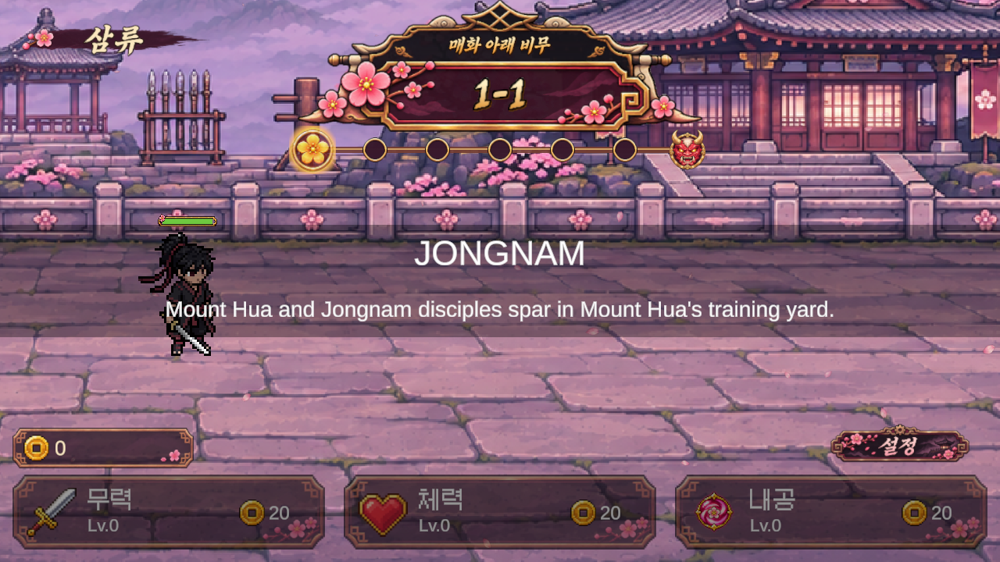
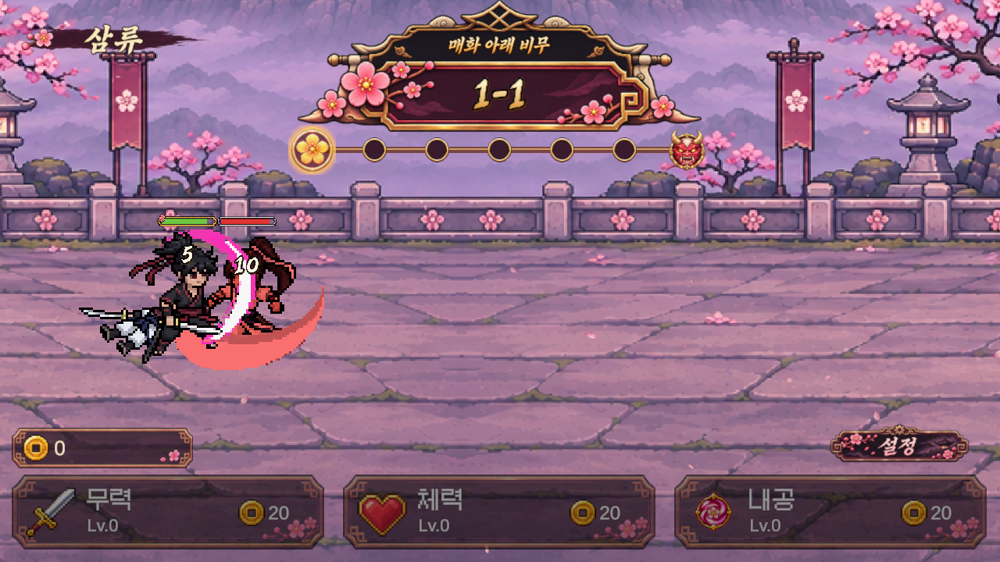
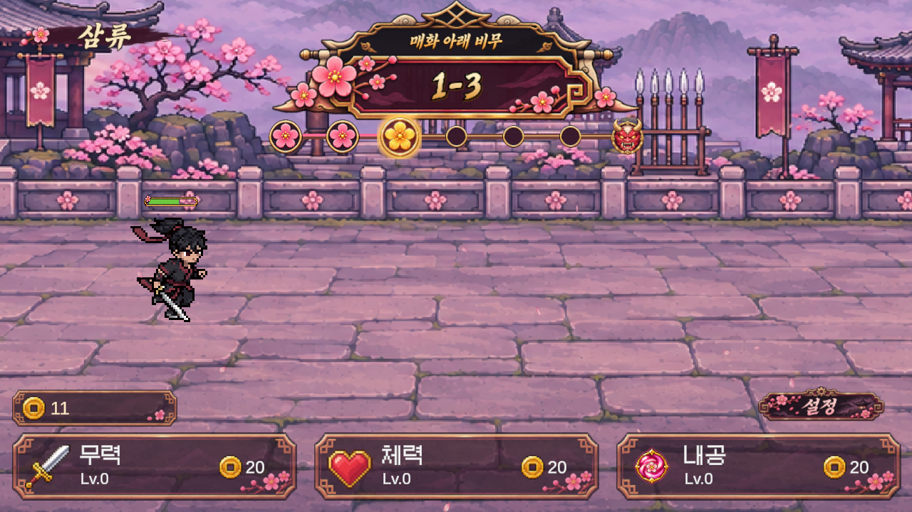

# 루프 증거: loop/20261122-135729 (묶음 stage_hud)

- 판정: **통합 브랜치(`integration`)에 합침** — 관문 위반 0건, 합치기 전 전체 테스트 통과
- 합친 시각: 2026-11-22 14:19
- 병합 커밋: 태그 `loop-merged/20261122-135729` (`git show loop-merged/20261122-135729`)
- 작업 3건, 바뀐 파일 17개 (.meta 제외)
- 테스트 수: 745 → 764개. 합치기 전 실행: EditMode 945/945, PlayMode 172/172

이 문서는 루프 스크립트가 썼다. 테스트 결과와 관문은 스크립트가 직접 판정한 것이고, "완료 조건별 테스트"와 리뷰 의견은 교차 리뷰 에이전트의 판단이다. 가정과 화면은 사람이 본다.

## 사람이 볼 것

테스트로 판정하지 못한 것이다. 아래 화면 갈무리와 함께 본다.

- `085_stage_label_view`: 게임을 실행하고 10초 뒤 화면 위쪽 제목판에 "매화 아래 비무" 그림 제목과 금빛 `1-1`이 보이고, 번호가 안쪽 칸의 세로 가운데에 있다.
- `085_stage_label_view`: 구간이 바뀔 때 가운데 번호 패의 금빛 번호가 패 안쪽 칸의 가운데에 있다. 에디터에서 재생하며 확인한다.
- `085_stage_label_view`: 게임을 실행하고 10초 뒤 화면 위쪽 제목판에 "매화 아래 비무" 그림 제목과 금빛 `1-1`이 보이고, 번호가 안쪽 칸의 세로 가운데에 있는지 확인한다.
- `085_stage_label_view`: 구간이 바뀔 때 가운데 번호 패의 금빛 번호가 패 안쪽 칸의 가운데에 있는지 에디터 재생으로 확인한다.
- `086_boss_hud_cleanup`: 보스 구간에서 보스 체력 틀이 위쪽 진행 표시 바로 아래에 붙어 있고, 틀 위에 영문 이름이나 분홍 줄이 보이지 않는다. 에디터에서 1스테이지 보스까지 진행해 확인한다.
- `086_boss_hud_cleanup`: 에디터에서 1스테이지 보스까지 진행해 보스 체력 틀이 위쪽 진행 표시 바로 아래에 붙어 있고, 틀 위에 영문 이름이나 분홍 줄이 보이지 않는지 확인한다.

## 에이전트가 스스로 정한 것 (가정)

사양과 작업 문서에 없어 에이전트가 정한 것 전부다. 마음에 들지 않으면 후속 작업으로 고친다.

- `084_stage_label_art`: 여러 인자가 동시에 유효하지 않으면 먼저 검사한 인자의 예외를 반환한다. 글자 배열과 배율은 인덱스보다 먼저 검사한다.
- `085_stage_label_view`: 번호 시트에서 잘라낸 스프라이트는 화면 인스턴스 사이에 공유하고 번호가 같으면 자식 이미지를 다시 만들지 않는다. 공개 연결 지점은 변경하지 않았다.

## 화면 갈무리

합치기 직전의 코드로 게임을 실행해 찍은 것이다 (플레이 모드 테스트, 파일 이름의 숫자는 실행 후 지난 게임 시간).

**game_001s.png**



**game_010s.png**



**game_030s.png**




## 작업 요약

| 작업 | 구현 | 리뷰 | 새 테스트 | 바뀐 화면 코드 |
| --- | --- | --- | --- | --- |
| `084_stage_label_art` | codex(시도 1) | claude (교차): 통과 | 11 | 0 |
| `085_stage_label_view` | codex(시도 1) | claude (교차): 통과 | 3 | 3 |
| `086_boss_hud_cleanup` | codex(시도 1~2) | claude (교차): 통과 | 5 | 2 |

## 관문 (스크립트 판정)

- 위반: 0건
- 확인 필요:
  - `Assets/Tests/PlayMode/Stage/StageFinalHudTests.cs` — 있던 검사(Assert) 2줄을 지우거나 바꿈 (작업 086_boss_hud_cleanup)
    - 지워짐: `Assert.That(bossName.gameObject.activeSelf, Is.True);`
    - 지워짐: `Assert.That(canvas.transform.Find("BossName").gameObject.activeSelf, Is.True);`
    - 새로 들어옴: `Assert.That(bossName.gameObject.activeSelf, Is.False);`
    - 새로 들어옴: `Assert.That(canvas.transform.Find("BossName").gameObject.activeSelf, Is.False);`
  - `Assets/Tests/PlayMode/Stage/StageHudTests.cs` — 있던 검사(Assert) 1줄을 지우거나 바꿈 (작업 086_boss_hud_cleanup)
    - 지워짐: `Assert.That(bossName.activeSelf, Is.True);`
    - 새로 들어옴: `Assert.That(bossName.activeSelf, Is.False);`

## 작업별 기록

### 084_stage_label_art

- 구현: codex(시도 1)
- 리뷰: claude (교차): 통과
- 바뀐 내용: 스테이지 그림 글자 경로, 선택 및 번호 배치 계산과 에딧 모드 테스트를 추가하고 사양을 갱신했습니다. Unity 테스트는 루프 판정을 기다립니다.
- 리뷰 의견: StageLabelArt가 작업 문서의 경로 상수, 범위 검사, 글자 좌표, 너비, 가운데 정렬 계산을 그대로 구현했다. 1~16번 완료 조건은 모두 기대 숫자와 예외를 확인하는 에딧 모드 테스트가 있다. 화면 코드, StageText, 그림 파일은 바뀌지 않았고 UnityEngine도 쓰지 않는다.
- 작업 문서 원본: `docs/history/084_stage_label_art.md`

| 완료 조건 | 대응하는 테스트 | 판정 |
| --- | --- | --- |
| `Assets/Tests/EditMode/Stage/StageLabelArtTests.cs`에 아래 조건마다 테스트가 하나 이상 있고 모두 통과한다. | StageLabelArtTests 전체 (2~16번 조건에 대응하는 테스트를 확인함, 통과 여부는 루프 실행 결과) | 있음 |
| `StageLabelArt.TitlePath(1)`은 `"Art/UI/Substage/Label/title_1"`이고 `BossNamePath(5)`는 `"Art/UI/Substage/Label/boss_name_5"`다. | StageLabelArtTests.Paths_ValidStages_ReturnInvariantPaths | 있음 |
| `TitlePath(0)`, `TitlePath(6)`, `BossNamePath(0)`은 각각 `ArgumentOutOfRangeException`을 던진다. | StageLabelArtTests.Paths_InvalidStages_Throw | 있음 |
| `UsesBossName(1, 1)`과 `UsesBossName(4, 6)`은 `false`다. | StageLabelArtTests.UsesBossName_ValidStageAndSubstage_SelectsArt (1,1,false)/(4,6,false) | 있음 |
| `UsesBossName(1, 7)`, `UsesBossName(4, 7)`, `UsesBossName(5, 7)`은 `true`다. | StageLabelArtTests.UsesBossName_ValidStageAndSubstage_SelectsArt (1,7)/(4,7)/(5,7) | 있음 |
| `UsesBossName(0, 1)`, `UsesBossName(1, 0)`, `UsesBossName(1, 8)`은 각각 `ArgumentOutOfRangeException`을 던진다. | StageLabelArtTests.UsesBossName_InvalidInput_Throws | 있음 |
| `NumberGlyphs(1, 1)`은 {1, 10, 1}이고 `NumberGlyphs(4, 6)`은 {4, 10, 6}이다. | StageLabelArtTests.NumberGlyphs_NormalSubstages_ReturnFreshArrays | 있음 |
| `NumberGlyphs(5, 7)`, `NumberGlyphs(1, 7)`, `NumberGlyphs(0, 1)`은 각각 `ArgumentOutOfRangeException`을 던진다. | StageLabelArtTests.NumberGlyphs_InvalidOrBossInput_Throws | 있음 |
| `GlyphLeft(0)`은 20, `GlyphWidth(0)`은 185, `GlyphLeft(10)`은 1962, `GlyphWidth(10)`은 150이다. | StageLabelArtTests.GlyphMetrics_AllGlyphs_ReturnSheetCoordinates (0~10 전체 값 확인) | 있음 |
| `GlyphLeft(11)`과 `GlyphWidth(-1)`은 각각 `ArgumentOutOfRangeException`을 던진다. | StageLabelArtTests.GlyphMetrics_AllGlyphs_ReturnSheetCoordinates | 있음 |
| `LabelWidth({1, 10, 1}, 1.0)`은 418이고 `LabelWidth({4, 10, 6}, 0.5)`는 233.5다. | StageLabelArtTests.LabelWidth_ValidGlyphs_AppliesOverlapAndScale | 있음 |
| `LabelWidth(new int[0], 1.0)`은 0이다. | StageLabelArtTests.LabelWidth_ValidGlyphs_AppliesOverlapAndScale | 있음 |
| `LabelWidth(null, 1.0)`은 `ArgumentNullException`을, `LabelWidth({1}, 0)`은 `ArgumentOutOfRangeException`을 던진다. | StageLabelArtTests.LabelWidth_InvalidInputs_Throw | 있음 |
| `GlyphCenterX({1, 10, 1}, i, 1.0)`은 i = 0, 1, 2에서 −133, 0, 133이다 (오차 1e-9). | StageLabelArtTests.GlyphCenterX_ValidGlyphs_CentersTheWholeLabel | 있음 |
| `GlyphCenterX({4, 10, 6}, i, 1.0)`은 i = 0, 1, 2에서 −143, 4.5, 147.5다 (오차 1e-9). | StageLabelArtTests.GlyphCenterX_ValidGlyphs_CentersTheWholeLabel | 있음 |
| `GlyphCenterX({1, 10, 1}, 3, 1.0)`은 `ArgumentOutOfRangeException`을 던진다. | StageLabelArtTests.GlyphCenterX_InvalidInputs_Throw | 있음 |
| 기존 테스트가 모두 통과한다. | 루프의 전체 테스트 실행 | 루프가 판정 |

리뷰 지적 (합친 뒤에도 남은 것):

- [note] 새 .meta 파일(StageLabelArt.cs.meta, StageLabelArtTests.cs.meta)에는 fileFormatVersion과 guid만 있다. 기존 StageText.cs.meta와 같은 형식이라 문제는 아니다.
- [note] 보고서에 적힌 가정(여러 인자가 동시에 틀리면 글자 배열·배율을 인덱스보다 먼저 검사함)은 사양과 어긋나지 않는다. 작업 문서의 '인자 검사는 LabelWidth와 같다'와도 맞는다 (StageLabelArt.cs:70-72).

새 테스트 11개: `StageLabelArtTests.GlyphCenterX_InvalidInputs_Throw`, `StageLabelArtTests.GlyphCenterX_ValidGlyphs_CentersTheWholeLabel`, `StageLabelArtTests.GlyphMetrics_AllGlyphs_ReturnSheetCoordinates`, `StageLabelArtTests.LabelWidth_InvalidInputs_Throw`, `StageLabelArtTests.LabelWidth_ValidGlyphs_AppliesOverlapAndScale`, `StageLabelArtTests.NumberGlyphs_InvalidOrBossInput_Throws`, `StageLabelArtTests.NumberGlyphs_NormalSubstages_ReturnFreshArrays`, `StageLabelArtTests.Paths_InvalidStages_Throw`, `StageLabelArtTests.Paths_ValidStages_ReturnInvariantPaths`, `StageLabelArtTests.UsesBossName_InvalidInput_Throws`, `StageLabelArtTests.UsesBossName_ValidStageAndSubstage_SelectsArt`

### 085_stage_label_view

- 구현: codex(시도 1)
- 리뷰: claude (교차): 통과
- 바뀐 내용: 스테이지 진행 표시와 구간 시작 패에 제목·번호·보스 이름 그림을 연결하고 플레이 모드 테스트와 사양을 추가했다. Unity 테스트는 루프 판정을 기다린다.
- 리뷰 의견: 진행 표시와 구간 시작 패의 그림 글자 모드(제목·번호·보스 이름, 대체 판단, 좌표·배율)가 요구사항대로 구현됐다. 새 플레이 모드 테스트 세 개가 완료 조건의 스프라이트 이름, 활성 상태, 자식 순서, y 좌표를 직접 검사한다. Core, 그림 파일, 씬은 바뀌지 않았다.
- 작업 문서 원본: `docs/history/085_stage_label_view.md`

| 완료 조건 | 대응하는 테스트 | 판정 |
| --- | --- | --- |
| 화면 코드가 컴파일되고 기존 테스트가 모두 통과한다 (`StageHudTests`, `StageFinalHudTests`의 `SubstageNumber` 글자 검사 포함). | 루프의 컴파일·전체 테스트 | 루프가 판정 |
| Assets/Tests/PlayMode/Stage/StageLabelViewTests.cs`에 아래 조건마다 테스트가 하나 이상 있고 모두 통과한다. 기존 `StageHudTests`처럼 캔버스와 `StageView`를 직접 만들고 `new StageProgress(wallet, new StatUpgrades(wallet, 1000, 10000), new Battle(upgrades), new System.Random(1), 시작 번호)`로 시작한다. | StageLabelViewTests.Begin (캔버스·StageView를 직접 만들고 지정된 생성자로 시작) | 있음 |
| 시작 번호 2로 `Begin()` 뒤 `SubstagePreview/Header`의 스프라이트 이름은 `header_blank`다. | StageLabelViewTests.StageTwo_DisplaysHeaderTitleAndCenteredNumberArt | 있음 |
| 같은 상황에서 `SubstagePreview/StageTitle`이 활성이고 스프라이트 이름은 `title_2`다. | StageLabelViewTests.StageTwo_DisplaysHeaderTitleAndCenteredNumberArt | 있음 |
| 같은 상황에서 `SubstagePreview/SubstageNumberArt`가 활성이고 자식 이름이 차례로 `"2"`, `"-"`, `"1"`이다. | StageLabelViewTests.StageTwo_DisplaysHeaderTitleAndCenteredNumberArt | 있음 |
| 같은 상황에서 `SubstagePreview/SubstageNumberArt`의 `anchoredPosition.y`는 −61(오차 0.1)이다. | StageLabelViewTests.StageTwo_DisplaysHeaderTitleAndCenteredNumberArt | 있음 |
| 같은 상황에서 `SubstagePreview/SubstageNumber`(TMP)는 비활성이다. | StageLabelViewTests.StageTwo_DisplaysHeaderTitleAndCenteredNumberArt | 있음 |
| 같은 상황에서 `SubstageIntroBanner/SubstageNumberArt`의 자식 이름이 차례로 `"2"`, `"-"`, `"1"`이다. | StageLabelViewTests.StageTwo_DisplaysHeaderTitleAndCenteredNumberArt | 있음 |
| 시작 번호 5로 `Begin()` 뒤 `SubstagePreview/BossNameArt`가 활성이고 스프라이트 이름은 `boss_name_5`다. | StageLabelViewTests.StageFive_DisplaysFinalBossArtAndTitle | 있음 |
| 같은 상황에서 `SubstagePreview/SubstageNumberArt`는 비활성이다. | StageLabelViewTests.StageFive_DisplaysFinalBossArtAndTitle | 있음 |
| 같은 상황에서 `SubstageIntroBanner/BossNameArt`의 스프라이트 이름은 `boss_name_5`다. | StageLabelViewTests.StageFive_DisplaysFinalBossArtAndTitle | 있음 |
| 같은 상황에서 `SubstagePreview/StageTitle`의 스프라이트 이름은 `title_5`다. | StageLabelViewTests.StageFive_DisplaysFinalBossArtAndTitle | 있음 |
| 시작 번호 3에서 여섯 구간을 이겨 보스 구간에 들어가면(`StageHudTests`의 진행 방식) `SubstagePreview/BossNameArt`의 스프라이트 이름은 `boss_name_3`이다. | StageLabelViewTests.StageThree_AfterSixSubstages_DisplaysBossName | 있음 |
| 게임을 실행하고 10초 뒤 화면 위쪽 제목판에 "매화 아래 비무" 그림 제목과 금빛 `1-1`이 보이고, 번호가 안쪽 칸의 세로 가운데에 있다. | 사람 확인 | 사람 확인 |
| 구간이 바뀔 때 가운데 번호 패의 금빛 번호가 패 안쪽 칸의 가운데에 있다. 에디터에서 재생하며 확인한다. | 사람 확인 | 사람 확인 |

리뷰 지적 (합친 뒤에도 남은 것):

- [note] StageLabelImages.cs:9-10 잘라낸 번호 글자 스프라이트를 static으로 캐시해 화면 인스턴스끼리 나눠 쓴다. 보고서의 가정에 적혀 있고 동작에는 문제가 없다. 다만 Sprite.Create로 만든 스프라이트는 해제하지 않는다(11장이라 영향이 작다).
- [note] StageLabelImages.cs:78 SetNumber는 stage·substage가 같으면 바로 돌아간다. 같은 번호로 다시 들어오는 경우(예: 같은 구간 재시도)에는 그림을 다시 만들지 않는다. 표시 결과는 같아서 문제는 없다.

새 테스트 3개: `StageLabelViewTests.StageFive_DisplaysFinalBossArtAndTitle`, `StageLabelViewTests.StageThree_AfterSixSubstages_DisplaysBossName`, `StageLabelViewTests.StageTwo_DisplaysHeaderTitleAndCenteredNumberArt`

### 086_boss_hud_cleanup

- 구현: codex(시도 1~2)
- 리뷰: claude (교차): 통과
- 바뀐 내용: 보스 HUD 정리와 사양 갱신을 유지하고 일반·보스 구간 진행 선 테스트에 직접 검사를 추가했다. Unity 테스트와 관문 판정은 루프가 수행한다.
- 리뷰 의견: 요구사항대로 BossName TMP를 늘 숨기면서 글자 갱신은 유지했다. 보스 구간에서는 진행 선 세 요소를 표식과 함께 숨기고, 틀·게이지·대체 바의 y를 −112로 옮겼다. 새 플레이 모드 테스트가 각 완료 조건의 상황과 기대값을 직접 검사한다. 기존 테스트에서 바뀐 기대값은 작업 문서가 지정한 값과 정확히 같고, 어서트 수도 줄지 않았다.
- 작업 문서 원본: `docs/history/086_boss_hud_cleanup.md`

| 완료 조건 | 대응하는 테스트 | 판정 |
| --- | --- | --- |
| 화면 코드가 컴파일되고 기존 테스트가 모두 통과한다 (위 기존 테스트는 요구사항에 적은 값으로). | 루프 전체 테스트 실행 | 루프가 판정 |
| Assets/Tests/PlayMode/Stage/BossHudCleanupTests.cs`에 아래 조건마다 테스트가 하나 이상 있고 모두 통과한다. 기존 `BossHealthFrameTests`처럼 `StageView`를 직접 만들어 보스 구간까지 진행한다. | BossHudCleanupTests (Begin/AdvanceToBoss가 BossHealthFrameTests와 같은 방식으로 StageView를 만들고 진행함) | 있음 |
| 시작 번호 1로 보스 구간에 들어가면 `SubstagePreview/Track`, `SubstagePreview/TrackHighlight`, `SubstagePreview/Progress`가 모두 비활성이다. | BossHudCleanupTests.BossStage_HidesTrack | 있음 |
| 시작 번호 1로 `Begin()` 직후(일반 1구간) `SubstagePreview/Track`, `TrackHighlight`, `Progress`는 모두 활성이다. | BossHudCleanupTests.NormalStage_ShowsTrack | 있음 |
| 시작 번호 1로 보스 구간에 들어가면 `BossName`은 비활성이다. | BossHudCleanupTests.BossStage_HidesBossNameText | 있음 |
| 시작 번호 3으로 보스 구간에 들어가면 `BossHealthFrame`의 `anchoredPosition`은 (0, −112)(오차 0.1)이다. | BossHudCleanupTests.ThirdStageBoss_FrameIsBelowProgressHeader | 있음 |
| 보스 구간에서 보스 체력 틀이 위쪽 진행 표시 바로 아래에 붙어 있고, 틀 위에 영문 이름이나 분홍 줄이 보이지 않는다. 에디터에서 1스테이지 보스까지 진행해 확인한다. | 에디터에서 1스테이지 보스까지 진행해 눈으로 확인 | 사람 확인 |

리뷰 지적 (합친 뒤에도 남은 것):

- [note] 기계 검사가 지적한 지워진 어서트 3줄(StageFinalHudTests.cs:65, :91, StageHudTests.cs:123)은 작업 문서의 '기존 테스트' 지시대로 Is.True를 Is.False로 바꾼 것이다. 어서트 수는 그대로이고, 바로 뒤의 BossName 글자 검사도 남아 있어 검사가 약해지지 않았다.
- [note] docs/spec/stage.md "화면"의 앞 항목에 '보스 구간에서는 해당 스테이지의 보스 이름과 현재 체력을 기존 붉은 체력 바로 표시한다'는 문장이 남아 있다. 이제 보스 이름은 그림 글자로만 보이므로 문구가 다소 모호하다. 아래 항목에 TMP를 숨긴다고 명시돼 있어 동작상 문제는 없다.
- [note] BossName TMP는 숨겨졌지만 StageView.cs:473에서 위치 (0, −111) 배치는 그대로 남아 있다. 보이지 않으므로 영향은 없다.

새 테스트 5개: `BossHudCleanupTests.BossDefeated_NextNormalStageShowsTrackAgain`, `BossHudCleanupTests.BossStage_HidesBossNameText`, `BossHudCleanupTests.BossStage_HidesTrack`, `BossHudCleanupTests.NormalStage_ShowsTrack`, `BossHudCleanupTests.ThirdStageBoss_FrameIsBelowProgressHeader`

관문 확인 필요:

- `Assets/Tests/PlayMode/Stage/StageFinalHudTests.cs` — 있던 검사(Assert) 2줄을 지우거나 바꿈
    - 지워짐: `Assert.That(bossName.gameObject.activeSelf, Is.True);`
    - 지워짐: `Assert.That(canvas.transform.Find("BossName").gameObject.activeSelf, Is.True);`
    - 새로 들어옴: `Assert.That(bossName.gameObject.activeSelf, Is.False);`
    - 새로 들어옴: `Assert.That(canvas.transform.Find("BossName").gameObject.activeSelf, Is.False);`
- `Assets/Tests/PlayMode/Stage/StageHudTests.cs` — 있던 검사(Assert) 1줄을 지우거나 바꿈
    - 지워짐: `Assert.That(bossName.activeSelf, Is.True);`
    - 새로 들어옴: `Assert.That(bossName.activeSelf, Is.False);`

## 확인하고 되돌리는 방법

```
git diff loop-merged/20261122-135729^1 loop-merged/20261122-135729            # 이 루프가 바꾼 것 전부
git merge --ff-only loop-merged/20261122-135729         # (main 에서) 이 루프까지만 올린다
git revert -m 1 loop-merged/20261122-135729             # (main 에 올린 뒤) 이 루프만 되돌린다
```
