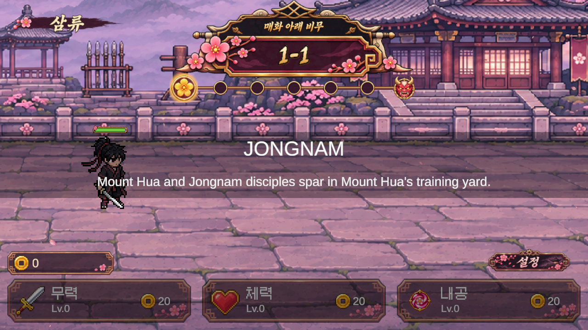
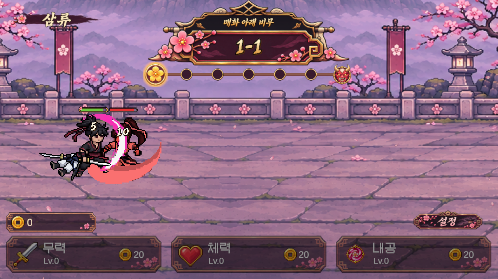
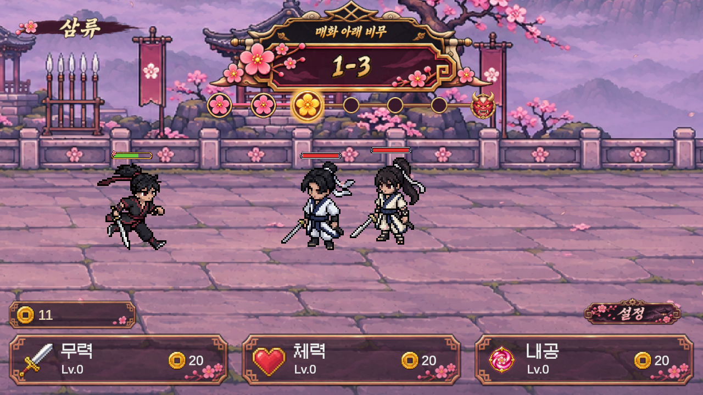

# 루프 증거: loop/20261122-160726 (묶음 balance)

- 판정: **통합 브랜치(`integration`)에 합침** — 관문 위반 0건, 합치기 전 전체 테스트 통과
- 합친 시각: 2026-11-22 16:32
- 병합 커밋: 태그 `loop-merged/20261122-160726` (`git show loop-merged/20261122-160726`)
- 작업 4건, 바뀐 파일 21개 (.meta 제외)
- 테스트 수: 764 → 795개. 합치기 전 실행: EditMode 989/989, PlayMode 174/174

이 문서는 루프 스크립트가 썼다. 테스트 결과와 관문은 스크립트가 직접 판정한 것이고, "완료 조건별 테스트"와 리뷰 의견은 교차 리뷰 에이전트의 판단이다. 가정과 화면은 사람이 본다.

## 사람이 볼 것

테스트로 판정하지 못한 것이다. 아래 화면 갈무리와 함께 본다.

- 없음

## 에이전트가 스스로 정한 것 (가정)

사양과 작업 문서에 없어 에이전트가 정한 것 전부다. 마음에 들지 않으면 후속 작업으로 고친다.

- `087_balance_table`: 밑과 선형 계수가 모두 0인 곡선은 지수 항이 무한대로 넘쳐도 결과를 0으로 취급했다.
- `087_balance_table`: 공개 연결 지점은 사양과 같으며 사양 변경은 없다.
- `088_balance_usage`: 없음. 공개 연결 지점의 모양과 기본 상수는 유지했다.
- `089_balance_substage`: 없음. 공개 연결 지점은 밸런스 사양과 같다.
- `090_balance_game_root`: 없음. 사양의 GameRoot 연결 예시와 필요 의존성을 작업에서 지정한 수치 표에 맞춰 갱신했으며 공개 타입이나 메서드는 바꾸지 않았다.

## 화면 갈무리

합치기 직전의 코드로 게임을 실행해 찍은 것이다 (플레이 모드 테스트, 파일 이름의 숫자는 실행 후 지난 게임 시간).

**game_001s.png**



**game_010s.png**



**game_030s.png**




## 작업 요약

| 작업 | 구현 | 리뷰 | 새 테스트 | 바뀐 화면 코드 |
| --- | --- | --- | --- | --- |
| `087_balance_table` | codex(시도 1) | claude (교차): 통과 | 14 | 0 |
| `088_balance_usage` | codex(시도 1) | claude (교차): 통과 | 8 | 0 |
| `089_balance_substage` | codex(시도 1) | claude (교차): 통과 | 7 | 0 |
| `090_balance_game_root` | codex(시도 1) | claude (교차): 통과 | 2 | 1 |

## 관문 (스크립트 판정)

- 위반: 0건
- 확인 필요: 없음

## 작업별 기록

### 087_balance_table

- 구현: codex(시도 1)
- 리뷰: claude (교차): 통과
- 바뀐 내용: 성장 곡선과 기본 수치 표, 검증 및 구간 순번을 구현하고 에딧 모드 테스트를 추가했다. Unity 테스트 판정은 루프에 맡긴다.
- 리뷰 의견: GrowthCurve와 BalanceTable이 사양의 연결 지점(속성 24개, 타입, 기본값, 검사 범위, 예외)대로 순수 C#으로 구현됐다. 완료 조건마다 숫자와 예외까지 확인하는 테스트가 있다. 하지 말 것 범위의 기존 기능 코드는 건드리지 않았다.
- 작업 문서 원본: `docs/history/087_balance_table.md`

| 완료 조건 | 대응하는 테스트 | 판정 |
| --- | --- | --- |
| `Assets/Tests/EditMode/Balance/GrowthCurveTests.cs`와 `Assets/Tests/EditMode/Balance/BalanceTableTests.cs`에 아래 조건마다 테스트가 하나 이상 있고 모두 통과한다. | 두 파일이 있고 아래 조건별 테스트가 들어 있음. 통과 여부는 루프 실행 결과로 확인 | 있음 |
| 1. `new GrowthCurve(20, 5, 1.0).Evaluate(3)`은 35다. | GrowthCurveTests.Evaluate_Linear_Returns35 | 있음 |
| 2. `new GrowthCurve(10, 0, 1.15).Evaluate(3)`은 15다. | GrowthCurveTests.Evaluate_Exponential_FloorsResult | 있음 |
| 3. `new GrowthCurve(1, 0, 2).Evaluate(2000)`은 `long.MaxValue`다. | GrowthCurveTests.Evaluate_Overflow_Clamps | 있음 |
| 4. `Evaluate(-1)`, `Evaluate(double.NaN)`은 각각 `ArgumentOutOfRangeException`을 던진다. | GrowthCurveTests.Evaluate_InvalidInput_Throws (TestCase -1, NaN, ±Infinity) | 있음 |
| 5. `new GrowthCurve(-1, 0, 1)`, `new GrowthCurve(0, -1, 1)`, `new GrowthCurve(0, 0, 0.9)`는 각각 `ArgumentOutOfRangeException`을 던진다. | GrowthCurveTests.Constructor_InvalidParameter_Throws (TestCase 세 경우 포함) | 있음 |
| 6. `BalanceTable.Default`의 값은 요구사항의 기본값과 모두 같다 (곡선은 `Base`, `Linear`, `Growth` 셋, 배열은 원소까지). | BalanceTableTests.Default_AllProperties_MatchDefaults | 있음 |
| 7. `BalanceTable.Default`를 두 번 부르면 서로 다른 객체이고, 하나의 `AttackPerLevel`을 99로 바꿔도 다른 하나와 `BalanceTable.Current`의 `AttackPerLevel`은 2다. | BalanceTableTests.Default_SeparateCalls_AreIndependent | 있음 |
| 8. `BalanceTable.Current = null`은 `ArgumentNullException`을 던지고 `Current`는 그대로다. | BalanceTableTests.Current_Null_ThrowsAndPreservesReference | 있음 |
| 9. `RealmBonusPercent`의 길이가 4인 표, `DiscipleAttackInterval`이 0인 표, `NormalHealth`가 `null`인 표를 `Current`에 넣으면 각각 `ArgumentOutOfRangeException`을 던지고 `Current`는 그대로다. | BalanceTableTests.Current_InvalidTables_ThrowAndPreserveReference | 있음 |
| 10. `SubstageStep`이 1/7인 표의 `SubstageIndex(1, 1)`은 0, `SubstageIndex(1, 7)`은 6/7(오차 1e-9), `SubstageIndex(2, 1)`은 1이다. | BalanceTableTests.SubstageIndex_SeventhSteps_CalculatesIndex | 있음 |
| 11. `SubstageIndex(1, 0)`과 `SubstageIndex(1, 8)`은 각각 `ArgumentOutOfRangeException`을 던진다. | BalanceTableTests.SubstageIndex_InvalidInput_Throws (TestCase (1,0), (1,8), (0,1)) | 있음 |
| 기존 테스트가 모두 통과한다. | 루프의 전체 테스트 실행 | 루프가 판정 |

리뷰 지적 (합친 뒤에도 남은 것):

- [note] Base와 Linear가 둘 다 0인 곡선을 0으로 돌려주는 분기(Assets/Scripts/Core/Balance/GrowthCurve.cs:25)는 사양에 없는 동작이다. 이 분기가 없으면 0 × 무한대가 NaN이 되어 long으로 바꿀 때 값이 정의되지 않으므로 합리적이다. 보고서 가정에 적혀 있고 테스트(Evaluate_ZeroCurveWithOverflow_ReturnsZero)도 있다.
- [note] 요구사항에는 '곡선 속성 7개'라고 적혀 있지만 실제 곡선 속성은 9개다. 구현(BalanceTable.cs:59-62)은 9개 모두 null을 검사하며, 사양 '곡선 속성이 null이어도'와 맞다.
- [note] GrowthCurveTests.cs:9의 `Is.EqualTo (35)`에 공백이 두 칸 들어가 있다 (정리 수준).

새 테스트 14개: `BalanceTableTests.Current_InvalidTables_ThrowAndPreserveReference`, `BalanceTableTests.Current_Null_ThrowsAndPreservesReference`, `BalanceTableTests.Current_ValidTable_StoresSameInstance`, `BalanceTableTests.Default_AllProperties_MatchDefaults`, `BalanceTableTests.Default_SeparateCalls_AreIndependent`, `BalanceTableTests.SubstageIndex_InvalidInput_Throws`, `BalanceTableTests.SubstageIndex_SeventhSteps_CalculatesIndex`, `BalanceTableTests.Validate_InvalidProperties_Throws`, `GrowthCurveTests.Constructor_InvalidParameter_Throws`, `GrowthCurveTests.Evaluate_Exponential_FloorsResult`, `GrowthCurveTests.Evaluate_InvalidInput_Throws`, `GrowthCurveTests.Evaluate_Linear_Returns35`, `GrowthCurveTests.Evaluate_Overflow_Clamps`, `GrowthCurveTests.Evaluate_ZeroCurveWithOverflow_ReturnsZero`

### 088_balance_usage

- 구현: codex(시도 1)
- 리뷰: claude (교차): 통과
- 바뀐 내용: 강화, 전투, 경지 계산이 현재 수치 표를 읽도록 연결하고 관련 테스트와 사양을 갱신했다. Unity 테스트는 루프 판정을 기다린다.
- 리뷰 의견: 강화 비용·능력치, 스킬 피해·재사용 대기, 제자·적 공격 간격, 경지 처치 수·보너스가 계산할 때마다 BalanceTable.Current를 읽도록 바뀌었고, 완료 조건마다 숫자까지 확인하는 테스트가 있다. 공개 상수와 연결 지점의 모양은 그대로이고, 하지 말 것에 적힌 범위도 건드리지 않았다.
- 작업 문서 원본: `docs/history/088_balance_usage.md`

| 완료 조건 | 대응하는 테스트 | 판정 |
| --- | --- | --- |
| `Assets/Tests/EditMode/Balance/BalanceTableUsageTests.cs`에 아래 조건마다 테스트가 하나 이상 있고 모두 통과한다 (089 가 같은 파일에 테스트를 더한다). | BalanceTableUsageTests 파일에 조건 12~20과 (추가) 두 조건의 테스트가 모두 있음. 통과 여부는 루프가 실행 | 있음 |
| 12. `AttackCost`를 (100, 0, 2)로 바꾸면 `new StatUpgrades(wallet, 10, 100, 3)`의 `GetCost(StatType.Attack)`은 800이고 `GetCost(StatType.Health)`는 20이다. | BalanceTableUsageTests.GetCost_ChangedAttackCurve_UsesIndependentCurvesOnExistingObject | 있음 |
| 13. `AttackPerLevel`을 5로, `HealthPerLevel`을 50으로 바꾸면 `new StatUpgrades(wallet, 10, 100, 2, 2)`의 `Attack`은 20, `MaxHealth`는 200이다. | BalanceTableUsageTests.Stats_ChangedPerLevel_UsesCurrentTableOnExistingObject | 있음 |
| 14. `SkillBasePercent`를 300으로, `SkillPercentPerInnerLevel`을 20으로 바꾸면 `Battle.CalculateSkillDamage(10, 2)`는 34다. | BalanceTableUsageTests.CalculateSkillDamage_ChangedPercentages_UsesCurrentTable | 있음 |
| 19. `RealmKillsRequired`를 {1, 2, 3, 4}로, `RealmBonusPercent`를 {0, 50, 60, 70, 80}으로 바꾸면 `RealmRules.KillsRequired(RealmLevel.ThirdRate)`는 1, `RealmRules.BonusPercent(RealmLevel.SecondRate)`는 50이다. | BalanceTableUsageTests.RealmRules_ChangedArrays_UsesCurrentTableAndPreservesBounds | 있음 |
| 20. `NormalAttackInterval`을 3.0으로 바꾸면 `EnemyStats.AttackInterval(EnemyKind.Normal)`은 3.0이다. | BalanceTableUsageTests.EnemyIntervals_ChangedValues_UsesKindSpecificValues | 있음 |
| (추가) `DiscipleAttackInterval`을 2.0으로 바꾸면 `new Battle(new StatUpgrades(new Wallet(0), 10, 100)).DiscipleAttackInterval`은 2.0이다. | BalanceTableUsageTests.DiscipleInterval_ChangedTable_UpdatesExistingBattleAndAttackCooldown | 있음 |
| (추가) `SkillCooldownSeconds`를 3.0으로 바꾸면, 스킬이 켜진 전투 `new Battle(new StatUpgrades(new Wallet(1000), 10, 100), null, true)`에 `AddEnemy(EnemyKind.Boss, 1, 0.8)`을 두고 `Step()` 1번 뒤 `SkillCooldown`은 3.0이다 (기본 표에서는 5.0이다). | BalanceTableUsageTests.SkillCooldown_ChangedTable_UsesValueWhenSkillFires | 있음 |
| 24. 기존 테스트가 모두 통과한다 (기본 표는 지금 수치와 같다). | 루프의 전체 에딧 모드 테스트 실행 | 루프가 판정 |

리뷰 지적 (합친 뒤에도 남은 것):

- [note] docs/spec/realm.md:9 의 '150은 추후 단계용으로 남겨 두며 현재 사용하지 않는다' 문장이 지워졌다. 같은 내용이 범위 밖 항목(realm.md:336)에 남아 있어 뜻은 그대로다.
- [note] Battle.cs:2 에서 `using PlumSword.Core.Balance;`가 `System.Collections.Generic` 앞에 들어가 using 순서가 기존 정렬과 다르다. 사소한 정리 문제다.
- [note] docs/spec/stat_upgrade.md 의 '보너스'·'내공' 줄에 경지 보너스와 스킬 배율의 고정 수치(0/10/20/30/40, 200%+10%p)가 아직 남아 있다. 연결 지점 절 밖이라 요구 범위는 아니지만, 이제는 기본값이라는 표시가 있으면 더 정확하다.

새 테스트 8개: `BalanceTableUsageTests.CalculateSkillDamage_ChangedPercentages_UsesCurrentTable`, `BalanceTableUsageTests.DiscipleInterval_ChangedTable_UpdatesExistingBattleAndAttackCooldown`, `BalanceTableUsageTests.DiscipleWindUp_ChangedInterval_UsesCurrentTable`, `BalanceTableUsageTests.EnemyIntervals_ChangedValues_UsesKindSpecificValues`, `BalanceTableUsageTests.GetCost_ChangedAttackCurve_UsesIndependentCurvesOnExistingObject`, `BalanceTableUsageTests.RealmRules_ChangedArrays_UsesCurrentTableAndPreservesBounds`, `BalanceTableUsageTests.SkillCooldown_ChangedTable_UsesValueWhenSkillFires`, `BalanceTableUsageTests.Stats_ChangedPerLevel_UsesCurrentTableOnExistingObject`

### 089_balance_substage

- 구현: codex(시도 1)
- 리뷰: claude (교차): 통과
- 바뀐 내용: 적 능력치와 보상에 구간별 수치 표를 적용하고 천마 고정값, 진행 연결 및 에딧 모드 테스트를 추가했다. Unity 테스트는 루프 판정을 기다린다.
- 리뷰 의견: EnemyStats·StageRewards 의 구간 메서드, 천마 고정값, AddEnemy 의 substage 인자, StageProgress 의 구간 전달이 요구사항과 balance.md 연결 지점대로 구현됐다. 각 완료 조건은 BalanceTableUsageTests 에서 기대 숫자와 함께 검사한다. 기존 테스트는 바뀌지 않았고, 하지 말 것으로 정한 범위도 건드리지 않았다.
- 작업 문서 원본: `docs/history/089_balance_substage.md`

| 완료 조건 | 대응하는 테스트 | 판정 |
| --- | --- | --- |
| `Assets/Tests/EditMode/Balance/BalanceTableUsageTests.cs`(088 이 만든 파일)에 아래 조건마다 테스트가 하나 이상 있고 모두 통과한다. | BalanceTableUsageTests 의 새 테스트 7개(15~23번 조건 대응). 통과 여부는 루프의 실행 결과 | 있음 |
| 15. `SubstageStep`을 1로, `NormalHealth`를 (30, 0, 2)로 바꾸면 `EnemyStats.MaxHealth(EnemyKind.Normal, 1, 3)`은 120이고, `EnemyStats.MaxHealth(EnemyKind.Normal, 1)`은 30이다. | BalanceTableUsageTests.EnemyHealth_UsesSubstageAndLegacyFirstSubstage | 있음 |
| 16. 15번과 같은 표에서 `battle.AddEnemy(EnemyKind.Normal, 1, 1.0, 3)`으로 만든 적의 `MaxHealth`는 120이다. | BalanceTableUsageTests.AddEnemy_UsesSubstageForHealthAndAttack | 있음 |
| 17. `FinalBossHealth`를 5000으로, `FinalBossAttack`을 300으로 바꾸면 `EnemyStats.MaxHealth(EnemyKind.Boss, 5)`와 `MaxHealth(EnemyKind.Boss, 10)`은 5000, `Attack(EnemyKind.Boss, 5)`는 300이고, `MaxHealth(EnemyKind.Boss, 4)`는 190이다. | BalanceTableUsageTests.FinalBoss_UsesFixedValuesOnEveryFifthStage | 있음 |
| 18. `SubstageStep`을 1로, `NormalGold`를 (10, 0, 2)로 바꾸면 `StageRewards.NormalGold(1, 3)`은 40이고 `NormalGold(1)`은 10이다. | BalanceTableUsageTests.Rewards_UseSubstageAndLegacyFirstSubstage | 있음 |
| 21. `EnemyStats.MaxHealth(EnemyKind.Normal, 1, 0)`, `StageRewards.NormalGold(1, 8)`, `battle.AddEnemy(EnemyKind.Normal, 1, 1.0, 0)`은 각각 `ArgumentOutOfRangeException`을 던지고, 마지막 경우 `battle.Enemies.Count`는 0 그대로다. | BalanceTableUsageTests.InvalidSubstage_ThrowsWithoutAddingOrNotifying | 있음 |
| 22. 기본 표에서 `StageProgress`가 2스테이지 3구간에 만든 일반 상대의 `MaxHealth`는 40이다 (`SubstageStep` 0이라 구간과 무관). | BalanceTableUsageTests.StageProgress_SpawnsWithCurrentSubstage(2, 3, false, 40) | 있음 |
| 23. `SubstageStep`을 1로, `NormalHealth`를 (30, 0, 2)로 바꾼 표에서 `StageProgress`(시작 번호 1)가 1구간을 이긴 뒤 2구간에 만든 일반 상대의 `MaxHealth`는 60이다. | BalanceTableUsageTests.StageProgress_SpawnsWithCurrentSubstage(1, 2, true, 60) | 있음 |
| 24. 기존 테스트가 모두 통과한다 (기본 표는 지금 수치와 같다). | 전체 테스트 실행 | 루프가 판정 |

리뷰 지적 (합친 뒤에도 남은 것):

- [note] docs/spec/combat.md:264 의 AddEnemy 주석에 'substage 가 1~7 밖이면 예외'가 빠져 있다. 코드 주석(Battle.cs:232)과 balance.md 에는 적혀 있다.
- [note] EnemyStats.cs 의 천마 판정이 사양 식 `(stage − 1) % 5 + 1 == 5` 대신 같은 뜻의 `(stage - 1) % 5 == 4` 로 쓰였다. 동작은 같다.

새 테스트 7개: `BalanceTableUsageTests.AddEnemy_UsesSubstageForHealthAndAttack`, `BalanceTableUsageTests.EnemyHealth_UsesSubstageAndLegacyFirstSubstage`, `BalanceTableUsageTests.FinalBoss_UsesFixedValuesOnEveryFifthStage`, `BalanceTableUsageTests.InvalidSubstage_ThrowsWithoutAddingOrNotifying`, `BalanceTableUsageTests.Rewards_UseSubstageAndLegacyFirstSubstage`, `BalanceTableUsageTests.StageProgress_AwardsCurrentSubstageGold`, `BalanceTableUsageTests.StageProgress_SpawnsWithCurrentSubstage`

### 090_balance_game_root

- 구현: codex(시도 1)
- 리뷰: claude (교차): 통과
- 바뀐 내용: GameRoot의 시작 능력치를 현재 수치 표에서 읽도록 변경하고 기본값과 변경값의 플레이 모드 테스트 및 사양을 갱신했다. Unity 테스트는 루프 판정을 기다린다.
- 리뷰 의견: GameRoot의 시작 능력치 두 인자만 BalanceTable.Current에서 읽도록 바뀌었다. 기본 표와 바꾼 표(15/150)로 새로 띄웠을 때의 값을 숫자로 확인하는 플레이 모드 테스트도 있다. 하지 말 것 침범, 화면 코드의 계산, 사양과 어긋나는 점은 찾지 못했다.
- 작업 문서 원본: `docs/history/090_balance_game_root.md`

| 완료 조건 | 대응하는 테스트 | 판정 |
| --- | --- | --- |
| 화면 코드가 컴파일되고 기존 테스트가 모두 통과한다. | - | 루프가 판정 |
| Assets/Tests/PlayMode/Flow/BalanceStartStatsFlowTests.cs`에 아래 조건마다 테스트가 하나 이상 있고 모두 통과한다. | BalanceStartStatsFlowTests (조건 3·4마다 테스트가 하나씩 있다) | 있음 |
| 추가) `BalanceTable.Current`를 `DiscipleBaseAttack` 15, `DiscipleBaseMaxHealth` 150인 표로 바꾼 뒤 `GameFlow.Relaunch(new MemorySaveStore(), StartEntry.Launch)`로 새로 띄우면 `GameRoot.StatUpgrades.Attack`은 15, `MaxHealth`는 150이다. | BalanceStartStatsFlowTests.Relaunch_WithChangedBalance_UsesChangedStartStats | 있음 |
| 추가) 기본 표로 새로 띄우면 `GameRoot.StatUpgrades.Attack`은 10, `MaxHealth`는 100이다. | BalanceStartStatsFlowTests.Relaunch_WithDefaultBalance_UsesDefaultStartStats | 있음 |

리뷰 지적 (합친 뒤에도 남은 것):

- [note] docs/spec/stat_upgrade.md: 요구사항은 '수치' 표 시작 능력치 줄의 비고만 고치라고 했다. 그런데 같은 줄의 값 칸, 연결 지점 예시(187줄), 의존 목록(221줄), 화면 절의 테스트 문구(244줄), 범위 밖 문구(267줄)도 함께 고쳤다. 모두 balance.md의 연결 지점(182줄)과 맞고 내용을 정확하게 고친 것이라 문제 삼지 않는다.
- [note] BalanceStartStatsFlowTests.cs:31: BalanceTable.Default는 부를 때마다 새 객체를 돌려준다. 그래서 그 객체를 고쳐도 기본 표는 바뀌지 않고, TearDown에서 Current를 Default로 되돌리므로 다른 테스트에 영향이 없다.

새 테스트 2개: `BalanceStartStatsFlowTests.Relaunch_WithChangedBalance_UsesChangedStartStats`, `BalanceStartStatsFlowTests.Relaunch_WithDefaultBalance_UsesDefaultStartStats`

## 확인하고 되돌리는 방법

```
git diff loop-merged/20261122-160726^1 loop-merged/20261122-160726            # 이 루프가 바꾼 것 전부
git merge --ff-only loop-merged/20261122-160726         # (main 에서) 이 루프까지만 올린다
git revert -m 1 loop-merged/20261122-160726             # (main 에 올린 뒤) 이 루프만 되돌린다
```
