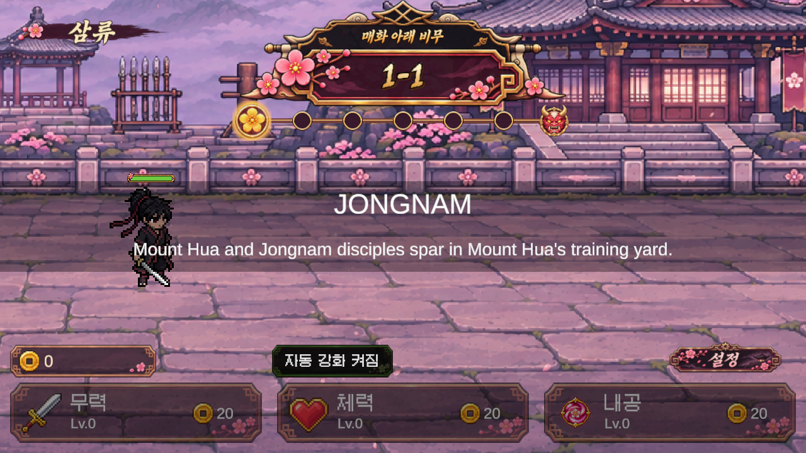
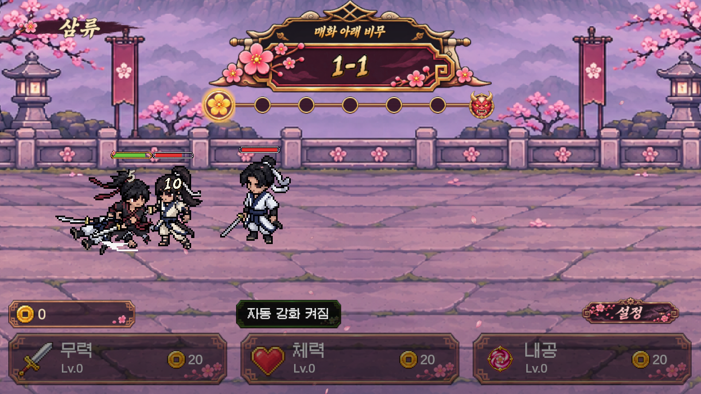
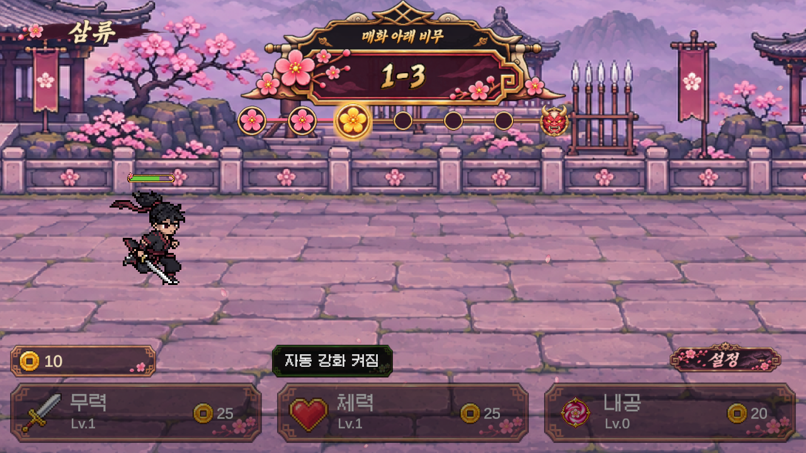

# 루프 증거: loop/20261122-163234 (묶음 auto_upgrade)

- 판정: **통합 브랜치(`integration`)에 합침** — 관문 위반 0건, 합치기 전 전체 테스트 통과
- 합친 시각: 2026-11-22 16:46
- 병합 커밋: 태그 `loop-merged/20261122-163234` (`git show loop-merged/20261122-163234`)
- 작업 2건, 바뀐 파일 10개 (.meta 제외)
- 테스트 수: 795 → 813개. 합치기 전 실행: EditMode 1005/1005, PlayMode 177/177

이 문서는 루프 스크립트가 썼다. 테스트 결과와 관문은 스크립트가 직접 판정한 것이고, "완료 조건별 테스트"와 리뷰 의견은 교차 리뷰 에이전트의 판단이다. 가정과 화면은 사람이 본다.

## 사람이 볼 것

테스트로 판정하지 못한 것이다. 아래 화면 갈무리와 함께 본다.

- `092_auto_upgrade_view`: 18. 게임을 실행하고 10초 뒤 화면에 금화 현판 오른쪽에 `자동 강화 켜짐` 버튼이 현판과 겹치지 않게 보인다 (갈무리로 확인). 금화가 쌓이는 대로 강화 레벨이 저절로 오르는지는 에디터에서 실행해 확인한다.
- `092_auto_upgrade_view`: 게임을 실행하고 10초 뒤 화면에 금화 현판 오른쪽에 `자동 강화 켜짐` 버튼이 현판과 겹치지 않게 보이는지 갈무리로 확인한다. 금화가 쌓이는 대로 강화 레벨이 저절로 오르는지 에디터에서 실행해 확인한다.

## 에이전트가 스스로 정한 것 (가정)

사양과 작업 문서에 없어 에이전트가 정한 것 전부다. 마음에 들지 않으면 후속 작업으로 고친다.

- `091_auto_upgrade`: 구매 알림을 받는 외부 코드가 구매 도중 자동 강화를 끄면 현재 구매를 마친 뒤 반복을 중단한다.
- `091_auto_upgrade`: 선택 후 `TryUpgrade`가 실패하면 무한 반복을 피하도록 이번 구매를 종료한다.
- `092_auto_upgrade_view`: 폰트를 불러올 수 없으면 기존 TMP 기본 글꼴로 표시한다. 버튼을 다시 초기화하면 이전 버튼과 구독을 정리한다.
- `092_auto_upgrade_view`: 화면과 연결 지점은 기존 사양과 같아 사양 변경은 없다.

## 화면 갈무리

합치기 직전의 코드로 게임을 실행해 찍은 것이다 (플레이 모드 테스트, 파일 이름의 숫자는 실행 후 지난 게임 시간).

**game_001s.png**



**game_010s.png**



**game_030s.png**




## 작업 요약

| 작업 | 구현 | 리뷰 | 새 테스트 | 바뀐 화면 코드 |
| --- | --- | --- | --- | --- |
| `091_auto_upgrade` | codex(시도 1) | claude (교차): 통과 | 15 | 0 |
| `092_auto_upgrade_view` | codex(시도 1) | claude (교차): 통과 | 3 | 2 |

## 관문 (스크립트 판정)

- 위반: 0건
- 확인 필요: 없음

## 작업별 기록

### 091_auto_upgrade

- 구현: codex(시도 1)
- 리뷰: claude (교차): 통과
- 바뀐 내용: 자동 강화의 최저 비용 구매, 재진입 방지와 버튼 글자를 구현하고 완료 조건별 테스트를 추가했다.
- 리뷰 의견: AutoUpgrade와 AutoUpgradeText가 사양의 연결 지점대로 Core에 구현됐습니다. 14개 조건마다 상황과 기대 숫자를 직접 확인하는 에딧 모드 테스트가 있고, 하지 말 것 침범이나 화면 코드의 계산은 없습니다.
- 작업 문서 원본: `docs/history/091_auto_upgrade.md`

| 완료 조건 | 대응하는 테스트 | 판정 |
| --- | --- | --- |
| `Assets/Tests/EditMode/StatUpgrade/AutoUpgradeTests.cs`에 아래 조건마다 테스트가 하나 이상 있고 모두 통과한다. | AutoUpgradeTests 전체 (조건 1~14 각각 대응 테스트 확인, 통과 여부는 루프 실행 결과) | 있음 |
| 1. `new AutoUpgrade(upgrades, wallet)`의 `Enabled`는 `true`이고, 만들 때 금화와 단계는 바뀌지 않는다. | AutoUpgradeTests.New_WithGold_DefaultEnabledAndDoesNotBuy | 있음 |
| 2. 켜진 상태에서 `wallet.Add(20)`이면 무력 단계 1, 체력·내공 0, 금화 0이다. | AutoUpgradeTests.BalanceChanged_Twenty_BuysAttack | 있음 |
| 3. 켜진 상태에서 `wallet.Add(100)`이면 무력·체력·내공 단계가 각각 2, 1, 1이고 금화는 15다 (20 + 20 + 20 + 25를 산 뒤 남은 15로는 다음 비용 25를 못 산다). | AutoUpgradeTests.BalanceChanged_Hundred_BuysCheapestInTieOrder | 있음 |
| 4. 꺼진 상태(`enabled: false`)에서 `wallet.Add(100)`이면 세 단계는 0이고 금화는 100이다. | AutoUpgradeTests.BalanceChanged_Disabled_DoesNotBuy | 있음 |
| 5. 4번 상태에서 `SetEnabled(true)`를 부르면 `EnabledChanged`가 `true`를 담아 1번 오고, 그 뒤 세 단계는 2, 1, 1, 금화는 15다. | AutoUpgradeTests.SetEnabled_True_NotifiesBeforeBuying | 있음 |
| 6. `upgrades.SetLocked(true)` 뒤 `wallet.Add(20)`이면 단계는 모두 0, 금화 20이다. 이어서 `SetLocked(false)`면 무력 단계 1, 금화 0이다. | AutoUpgradeTests.Unlock_WithGold_BuysAfterUnlock | 있음 |
| 7. 금화 0에서 `BuyAll()`은 0을 돌려준다. | AutoUpgradeTests.BuyAll_NoGold_ReturnsZero | 있음 |
| 8. `new StatUpgrades(wallet, 10, 100, 1, 0, 0)`(무력 비용 25)에서 `wallet.Add(20)`이면 체력 단계가 1이 된다 (더 싼 것 먼저). | AutoUpgradeTests.BalanceChanged_AttackMoreExpensive_BuysHealth | 있음 |
| 9. `SetEnabled(true)`를 켜진 상태에서 부르면 `EnabledChanged`는 0번 온다. | AutoUpgradeTests.SetEnabled_AlreadyEnabled_DoesNotNotify | 있음 |
| 10. `SetEnabled(false)` 뒤 `wallet.Add(100)`이면 사지 않는다. | AutoUpgradeTests.SetEnabled_False_StopsPurchases | 있음 |
| 11. 수치 표의 세 비용을 (0, 0, 1)로 바꾸고 `wallet.Add(1)`이면 이번 알림의 구매 수는 1000이다 (세 단계 합 1000). 테스트 끝에 표를 `Default`로 되돌린다. | AutoUpgradeTests.BalanceChanged_FreeUpgrades_StopsAtThousand (TearDown에서 Default로 되돌림) | 있음 |
| 12. `new AutoUpgrade(null, wallet)`과 `new AutoUpgrade(upgrades, null)`은 각각 `ArgumentNullException`을 던진다. | AutoUpgradeTests.New_NullArguments_Throws | 있음 |
| 13. `Dispose()` 뒤 `wallet.Add(100)`이면 사지 않는다. `Dispose()`를 두 번 불러도 예외가 없다. | AutoUpgradeTests.Dispose_Twice_UnsubscribesFromBalanceAndUnlock | 있음 |
| 14. `AutoUpgradeText.Label(true)`는 `"자동 강화 켜짐"`, `Label(false)`는 `"자동 강화 꺼짐"`이다. | AutoUpgradeTests.Label_State_ReturnsText (TestCase 2개) | 있음 |
| 기존 테스트가 모두 통과한다. | - | 루프가 판정 |

리뷰 지적 (합친 뒤에도 남은 것):

- [note] BuyAll 반복 조건에 Enabled를 다시 확인하는 부분(구매 알림 도중 꺼지면 멈춤)과 TryUpgrade가 실패하면 끝내는 부분은 보고서의 가정에 적혀 있습니다. 사양과 어긋나지 않습니다 (Assets/Scripts/Core/StatUpgrade/AutoUpgrade.cs:43,58).
- [note] Dispose 뒤에도 Enabled가 true면 BuyAll()을 직접 부를 때 여전히 삽니다. 사양은 '구독을 끊는다'만 요구하므로 문제는 아닙니다 (AutoUpgrade.cs:69-73).

새 테스트 15개: `AutoUpgradeTests.BalanceChanged_AttackMoreExpensive_BuysHealth`, `AutoUpgradeTests.BalanceChanged_Disabled_DoesNotBuy`, `AutoUpgradeTests.BalanceChanged_FreeUpgrades_StopsAtThousand`, `AutoUpgradeTests.BalanceChanged_Hundred_BuysCheapestInTieOrder`, `AutoUpgradeTests.BalanceChanged_Twenty_BuysAttack`, `AutoUpgradeTests.BuyAll_NoGold_ReturnsZero`, `AutoUpgradeTests.BuyAll_ReentrantBalanceNotification_ReturnsZero`, `AutoUpgradeTests.Dispose_Twice_UnsubscribesFromBalanceAndUnlock`, `AutoUpgradeTests.Label_State_ReturnsText`, `AutoUpgradeTests.New_NullArguments_Throws`, `AutoUpgradeTests.New_WithGold_DefaultEnabledAndDoesNotBuy`, `AutoUpgradeTests.SetEnabled_AlreadyEnabled_DoesNotNotify`, `AutoUpgradeTests.SetEnabled_False_StopsPurchases`, `AutoUpgradeTests.SetEnabled_True_NotifiesBeforeBuying`, `AutoUpgradeTests.Unlock_WithGold_BuysAfterUnlock`

### 092_auto_upgrade_view

- 구현: codex(시도 1)
- 리뷰: claude (교차): 통과
- 바뀐 내용: 자동 강화 버튼과 GameRoot 조립 및 수명 관리를 추가하고 흐름 테스트 도우미와 플레이 모드 테스트를 작성했습니다. Unity 테스트는 루프 판정을 기다립니다.
- 리뷰 의견: AutoUpgradeView, GameRoot 조립(속성·Awake 생성·화면 한 줄·OnDestroy의 Dispose), 흐름 테스트 도우미 변경이 요구사항대로 들어갔습니다. 15·16·17번 조건은 각각 위치·크기·글자, 클릭 뒤 Enabled·글자, 첫 씬 루트의 AutoUpgrade 상태를 직접 검사합니다.
- 작업 문서 원본: `docs/history/092_auto_upgrade_view.md`

| 완료 조건 | 대응하는 테스트 | 판정 |
| --- | --- | --- |
| 화면 코드가 컴파일되고 기존 테스트가 모두 통과한다. | 루프 실행 결과 | 루프가 판정 |
| Assets/Tests/PlayMode/StatUpgrade/AutoUpgradeViewTests.cs`에 아래 조건마다 테스트가 하나 이상 있고 모두 통과한다. 쓰는 법은 `docs/dev/architecture.md` "테스트" 절을 따른다 (15·16번은 테스트가 직접 만든 캔버스와 `AutoUpgrade`로, 17번은 첫 씬을 불러와 `[Game]`으로). | AutoUpgradeViewTests: 15·16번은 직접 만든 Canvas와 AutoUpgrade(false)로, 17번은 LoadSceneAsync(0) 뒤 [Game]으로 검사 | 있음 |
| 15. 꺼진 `AutoUpgrade`로 `AutoUpgradeView.Initialize`를 부르면 캔버스 아래 `AutoUpgradeButton`이 있고 `anchoredPosition`은 (216, 86), 크기는 (96, 26), `Label` 글자는 `"자동 강화 꺼짐"`이다. | AutoUpgradeViewTests.Initialize_Disabled_ShowsButtonAndLabel | 있음 |
| 16. 그 버튼을 누르면 `Enabled`는 `true`이고 `Label` 글자는 `"자동 강화 켜짐"`이다. | AutoUpgradeViewTests.Click_Disabled_EnablesAndUpdatesLabel | 있음 |
| 17. 첫 씬을 불러오면 `[Game]`의 `GameRoot.AutoUpgrade`가 `null`이 아니고 `Enabled`는 `true`다. | AutoUpgradeViewTests.FirstScene_GameRoot_StartsWithAutoUpgradeEnabled | 있음 |
| 18. 게임을 실행하고 10초 뒤 화면에 금화 현판 오른쪽에 `자동 강화 켜짐` 버튼이 현판과 겹치지 않게 보인다 (갈무리로 확인). 금화가 쌓이는 대로 강화 레벨이 저절로 오르는지는 에디터에서 실행해 확인한다. | - | 사람 확인 |

리뷰 지적 (합친 뒤에도 남은 것):

- [note] GameFlow.Relaunch의 대기 루프에서 `yield return null`을 확인 뒤로 옮겼습니다 (Assets/Tests/PlayMode/Flow/GameFlow.cs:42-47). '새 루트를 찾은 즉시(대기 프레임 전)'라는 요구에 맞는 변경입니다. 이전 루트는 SetActive(false)라서 Find에 잡히지 않으므로 기존 동작은 깨지지 않지만, 보고서에 이 변경이 적혀 있지 않습니다.
- [note] 17번 테스트가 첫 씬을 불러온 뒤 ResetToFreshLaunch로 루트를 새로 만들고 나서 검사합니다 (AutoUpgradeViewTests.cs:68-75). 앞선 테스트가 자동 강화를 꺼 두었을 수 있어서 새로 만든 것으로 보이며, 새로 만든 루트의 Awake 기본값을 검사하므로 조건의 뜻에는 맞습니다.
- [note] GameRoot.AutoUpgrade 속성에는 다른 속성과 달리 <summary> 주석이 없습니다 (Assets/Scripts/Game/GameRoot.cs:57). 테스트는 Label 글자를 리플렉션으로 읽습니다 (AutoUpgradeViewTests.cs:62-66).

새 테스트 3개: `AutoUpgradeViewTests.Click_Disabled_EnablesAndUpdatesLabel`, `AutoUpgradeViewTests.FirstScene_GameRoot_StartsWithAutoUpgradeEnabled`, `AutoUpgradeViewTests.Initialize_Disabled_ShowsButtonAndLabel`

## 확인하고 되돌리는 방법

```
git diff loop-merged/20261122-163234^1 loop-merged/20261122-163234            # 이 루프가 바꾼 것 전부
git merge --ff-only loop-merged/20261122-163234         # (main 에서) 이 루프까지만 올린다
git revert -m 1 loop-merged/20261122-163234             # (main 에 올린 뒤) 이 루프만 되돌린다
```
