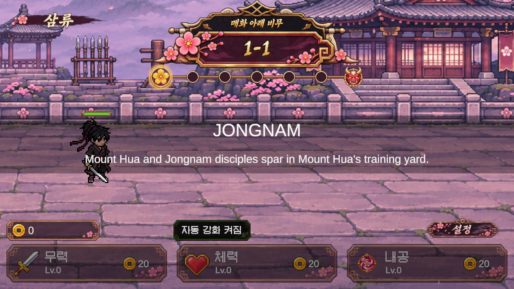
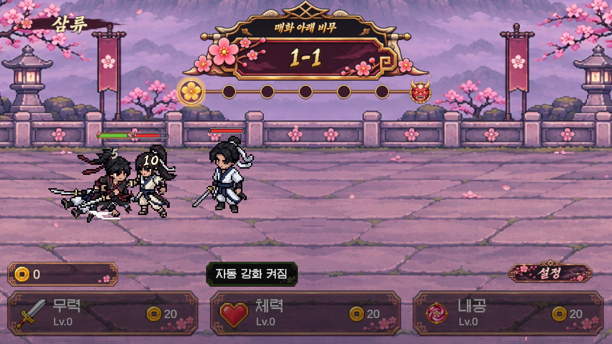
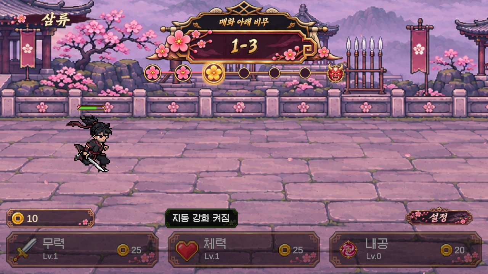

# 루프 증거: loop/20261122-164616 (묶음 regression)

- 판정: **통합 브랜치(`integration`)에 합침** — 관문 위반 0건, 합치기 전 전체 테스트 통과
- 합친 시각: 2026-11-22 17:12
- 병합 커밋: 태그 `loop-merged/20261122-164616` (`git show loop-merged/20261122-164616`)
- 작업 4건, 바뀐 파일 33개 (.meta 제외)
- 테스트 수: 813 → 842개. 합치기 전 실행: EditMode 1047/1047, PlayMode 181/181

이 문서는 루프 스크립트가 썼다. 테스트 결과와 관문은 스크립트가 직접 판정한 것이고, "완료 조건별 테스트"와 리뷰 의견은 교차 리뷰 에이전트의 판단이다. 가정과 화면은 사람이 본다.

## 사람이 볼 것

테스트로 판정하지 못한 것이다. 아래 화면 갈무리와 함께 본다.

- `096_ending_view`: 35. 에디터에서 약한 상태로 천마에게 지면 1-1로 돌아가고 금화·강화 레벨·경지가 그대로다. 에디터에서 실행해 확인한다.
- `096_ending_view`: 36. 천마를 이기면 엔딩 화면에 `천마 토벌`, 플레이 시간, 회귀 횟수가 보이고, `처음으로`를 누르면 시작 화면에 이어하기 없이 처음 시작만 있다. 에디터에서 실행해 확인한다.
- `096_ending_view`: 에디터에서 약한 상태로 천마에게 지면 1-1로 돌아가고 금화·강화 레벨·경지가 그대로인지 확인한다.
- `096_ending_view`: 천마를 이기면 엔딩 화면에 `천마 토벌`, 플레이 시간, 회귀 횟수가 보이고, `처음으로`를 누르면 시작 화면에 이어하기 없이 처음 시작만 있는지 에디터에서 확인한다.
- `096_ending_view`: 시작 버튼 그림에 포함된 기존 글자와 엔딩 버튼 글자가 겹쳐 보이는지 확인한다.

## 에이전트가 스스로 정한 것 (가정)

사양과 작업 문서에 없어 에이전트가 정한 것 전부다. 마음에 들지 않으면 후속 작업으로 고친다.

- `094_play_time_ending_text`: 사양에서 정의하지 않은 극단적인 누적 시간의 부동소수점 및 long 범위 초과는 별도 상한을 두지 않고 기본 숫자 연산에 따른다.
- `094_play_time_ending_text`: 공개 연결 지점과 기존 사양은 변경하지 않았다.
- `095_save_regression_fields`: `Disable`은 기존 변경 표시와 재시도 대기를 지우지 않으며, 다시 켜면 기존 상태를 이어간다. 기존 `Enabled` 검사만 바꾸라는 요구를 따랐다.
- `095_save_regression_fields`: 명시된 네 가짜 저장소 외에 추가 `ISaveStore` 구현은 없다. 공개 연결 지점은 회귀 사양과 같다.
- `096_ending_view`: 엔딩 화면을 찾는 공개 속성 이름은 `Ending`으로 정하고 회귀 사양의 연결 지점에 추가했다.
- `096_ending_view`: 글자 영역의 임시 크기는 제목 600×48, 시간과 회귀 횟수 각각 600×28로 정했다. 버튼 글자 자식 이름은 `Label`이다.
- `096_ending_view`: 기존 시작 버튼 그림에 원래 글자가 포함되어 있어도 지정된 그림을 그대로 사용한다.

## 화면 갈무리

합치기 직전의 코드로 게임을 실행해 찍은 것이다 (플레이 모드 테스트, 파일 이름의 숫자는 실행 후 지난 게임 시간).

**game_001s.png**



**game_010s.png**



**game_030s.png**




## 작업 요약

| 작업 | 구현 | 리뷰 | 새 테스트 | 바뀐 화면 코드 |
| --- | --- | --- | --- | --- |
| `093_stage_regression` | codex(시도 1) | claude (교차): 통과 | 8 | 0 |
| `094_play_time_ending_text` | codex(시도 1) | claude (교차): 통과 | 8 | 0 |
| `095_save_regression_fields` | codex(시도 1) | claude (교차): 통과 | 10 | 1 |
| `096_ending_view` | codex(시도 1) | claude (교차): 통과 | 3 | 2 |

## 관문 (스크립트 판정)

- 위반: 0건
- 확인 필요:
  - `Assets/Tests/PlayMode/Flow/FullRoundFlowTests.cs` — 있던 검사(Assert) 5줄을 지우거나 바꿈 (작업 096_ending_view)
    - 지워짐: `Assert.That(root.StageProgress.RoundNumber, Is.EqualTo(2), "천마 처치 후 2회차여야 합니다.");`
    - 지워짐: `Assert.That(root.StageProgress.DisplayStageNumber, Is.EqualTo(1), "2회차의 표시 스테이지는 1이어야 합니다.");`
    - 지워짐: `Assert.That(root.StageProgress.SubstageNumber, Is.EqualTo(1), "2회차는 첫 구간에서 시작해야 합니다.");`
    - 지워짐: `Assert.That(saved.Status, Is.EqualTo(SaveLoadStatus.Loaded), "자동 저장을 읽을 수 있어야 합니다.");`
    - 지워짐: `Assert.That(saved.Data.StageNumber, Is.EqualTo(6), "자동 저장에 다음 회차 스테이지가 기록되어야 합니다.");`
    - 새로 들어옴: `Assert.That(root.StageProgress.Phase, Is.EqualTo(StagePhase.Cleared));`
    - 새로 들어옴: `Assert.That(root.StageProgress.StageNumber, Is.EqualTo(5));`
    - 새로 들어옴: `Assert.That(root.StageProgress.RegressionCount, Is.EqualTo(0));`
    - 새로 들어옴: `Assert.That(root.transform.Find("[EndingView]"), Is.Not.Null);`
    - 새로 들어옴: `Assert.That(store.Text, Is.Null);`
    - 새로 들어옴: `Assert.That(root.AutoSave.Enabled, Is.False);`

## 작업별 기록

### 093_stage_regression

- 구현: codex(시도 1)
- 리뷰: claude (교차): 통과
- 바뀐 내용: 천마 패배 시 선택적 회귀와 천마 처치 후 종료 상태를 구현하고 회귀 테스트 및 스테이지 사양을 추가했다.
- 리뷰 의견: 회귀 규칙(시작 번호 정규화, 천마 패배 시 1로 회귀·횟수 증가·상한, 알림 순서)과 천마 처치 후 Cleared 종료가 요구사항대로 구현됐고, 완료 조건마다 숫자까지 확인하는 테스트가 있다. useRegression false 경로는 바뀌지 않았고 하지 말 것 범위도 건드리지 않았다.
- 작업 문서 원본: `docs/history/093_stage_regression.md`

| 완료 조건 | 대응하는 테스트 | 판정 |
| --- | --- | --- |
| `Assets/Tests/EditMode/Stage/StageProgressRegressionTests.cs`에 아래 조건마다 테스트가 하나 이상 있고 모두 통과한다. | StageProgressRegressionTests (아래 조건별 매핑) | 있음 |
| 1. `upgrades = new StatUpgrades(wallet, 1, 1)`, `new StageProgress(wallet, upgrades, battle, new MinRandom(), 5, 5, 0.0, true)`로 결판까지 가면 `Phase`는 `FadingOut`, `StageFailed`는 5를 담아 1번, `Regressed`는 1을 담아 1번 온다. | StageProgressRegressionTests.FifthStageDefeat_RegressesInOrderAndPreservesResources | 있음 |
| 2. 1번에서 알림 순서는 `StageFailed` → `Regressed` → `Changed`다. | StageProgressRegressionTests.FifthStageDefeat_RegressesInOrderAndPreservesResources | 있음 |
| 3. 1번 뒤 `Tick(0.5)`이면 `StageNumber`는 1, `SubstageNumber`는 1, `RegressionCount`는 1이다. | StageProgressRegressionTests.FifthStageDefeat_RegressesInOrderAndPreservesResources | 있음 |
| 4. 1번 전후로 `wallet.Balance`와 `upgrades`의 세 단계는 같다. | StageProgressRegressionTests.FifthStageDefeat_RegressesInOrderAndPreservesResources | 있음 |
| 5. 1번과 같되 `useRegression`을 주지 않으면(`false`) `Tick(0.5)` 뒤 `StageNumber`는 5이고 `Regressed`는 0번, `RegressionCount`는 0이다. | StageProgressRegressionTests.DefaultRegression_FifthStageDefeatRetries | 있음 |
| 6. `useRegression` `true`, 시작 번호 3에서 제자가 쓰러지면 `Tick(0.5)` 뒤 `StageNumber`는 3이고 `Regressed`는 0번이다. | StageProgressRegressionTests.EarlierStageDefeat_RetriesWithoutRegression | 있음 |
| 7. `regressionCount: 2`로 만들고 1번처럼 지면 `Regressed`는 3을 담아 온다. | StageProgressRegressionTests.FifthStageDefeat_IncrementsWithoutOverflow(2, 3) | 있음 |
| 8. `regressionCount: -4`로 만들면 `RegressionCount`는 0이다. | StageProgressRegressionTests.Constructor_NormalizesStageOnlyForRegression | 있음 |
| 9. `useRegression` `true`, 시작 번호 7이면 `StageNumber`는 2이고, 시작 번호 10이면 5다. | StageProgressRegressionTests.Constructor_NormalizesStageOnlyForRegression(7,true,2)/(10,true,5) | 있음 |
| 10. `useRegression` `false`, 시작 번호 7이면 `StageNumber`는 7이다. | StageProgressRegressionTests.Constructor_NormalizesStageOnlyForRegression(7,false,7) | 있음 |
| 11. `upgrades = new StatUpgrades(wallet, 100000, 100000)`, `new StageProgress(wallet, upgrades, battle, new MinRandom(), 5, 5, 1.5, true)`로 결판까지 가면 `Phase`는 `ClearWait`, `StageCleared`는 5를 담아 1번 왔다. | StageProgressRegressionTests.FifthStageVictory_WaitsThenClearsInOrderAndStaysCleared | 있음 |
| 12. 11번 뒤 `Tick(1.4)`이면 `Phase`는 `ClearWait`이고 `GameCleared`는 0번이다. | StageProgressRegressionTests.FifthStageVictory_WaitsThenClearsInOrderAndStaysCleared | 있음 |
| 13. 11번 뒤 `Tick(1.6)`이면 `Phase`는 `Cleared`, `GameCleared`는 1번, `battle.Paused`는 `true`, `upgrades.Locked`는 `true`다. | StageProgressRegressionTests.FifthStageVictory_WaitsThenClearsInOrderAndStaysCleared | 있음 |
| 14. 13번 뒤 `Tick(10)`을 부르면 `Phase`는 `Cleared`, `StageNumber`는 5 그대로이고 `GameCleared`는 1번 그대로다. | StageProgressRegressionTests.FifthStageVictory_WaitsThenClearsInOrderAndStaysCleared | 있음 |
| 15. 11번과 같되 대기 0.0이면 결판 즉시 `Phase`는 `Cleared`이고 `GameCleared`는 1번이다. | StageProgressRegressionTests.FifthStageVictory_ZeroWaitClearsImmediately | 있음 |
| 16. 11번에서 (13번처럼 `Tick(1.6)` 할 때) `GameCleared` 안에서 읽은 `Phase`는 `Cleared`이고, `GameCleared`는 `Changed`보다 먼저 온다. | StageProgressRegressionTests.FifthStageVictory_WaitsThenClearsInOrderAndStaysCleared | 있음 |
| 17. 11번과 같되 `useRegression` `false`면 `Tick(1.5)`, `Tick(0.5)` 뒤 `StageNumber`는 6이고 `GameCleared`는 0번이다. | StageProgressRegressionTests.RegressionDisabled_FifthStageVictoryAdvances | 있음 |
| (추가) `RegressionCount`가 `int.MaxValue`인 진행(`regressionCount: int.MaxValue`)에서 1번처럼 지면 `Regressed`는 `int.MaxValue`를 담아 오고 `RegressionCount`는 `int.MaxValue`다. | StageProgressRegressionTests.FifthStageDefeat_IncrementsWithoutOverflow(int.MaxValue, int.MaxValue) | 있음 |
| 기존 테스트가 모두 통과한다. | 루프의 전체 테스트 실행 | 루프가 판정 |

리뷰 지적 (합친 뒤에도 남은 것):

- [note] 13번 조건은 '11번 뒤 Tick(1.6)'인데, 테스트는 Tick(1.4) 뒤에 Tick(1.6)을 불러 누적 3.0초에서 확인한다 (StageProgressRegressionTests.cs:131-134). 1.6초만으로도 대기 1.5초를 넘으므로 판정 뜻은 같다.
- [note] 새 이벤트 Regressed·GameCleared와 속성 UseRegression·RegressionCount에 다른 멤버처럼 XML 주석이 없다 (StageProgress.cs:87-88, 104-105).

새 테스트 8개: `StageProgressRegressionTests.Constructor_NormalizesStageOnlyForRegression`, `StageProgressRegressionTests.DefaultRegression_FifthStageDefeatRetries`, `StageProgressRegressionTests.EarlierStageDefeat_RetriesWithoutRegression`, `StageProgressRegressionTests.FifthStageDefeat_IncrementsWithoutOverflow`, `StageProgressRegressionTests.FifthStageDefeat_RegressesInOrderAndPreservesResources`, `StageProgressRegressionTests.FifthStageVictory_WaitsThenClearsInOrderAndStaysCleared`, `StageProgressRegressionTests.FifthStageVictory_ZeroWaitClearsImmediately`, `StageProgressRegressionTests.RegressionDisabled_FifthStageVictoryAdvances`

### 094_play_time_ending_text

- 구현: codex(시도 1)
- 리뷰: claude (교차): 통과
- 바뀐 내용: 총 플레이 시간 누적과 엔딩 글자 생성 및 에딧 모드 테스트를 추가했다. Unity 테스트 판정은 루프가 수행한다.
- 리뷰 의견: PlayTime과 EndingText가 사양의 연결 지점과 수치대로 순수 C#으로 구현됐다. 완료 조건 18~24마다 기대값을 직접 확인하는 에딧 모드 테스트가 있다. 하지 말 것으로 정한 범위는 건드리지 않았다.
- 작업 문서 원본: `docs/history/094_play_time_ending_text.md`

| 완료 조건 | 대응하는 테스트 | 판정 |
| --- | --- | --- |
| `Assets/Tests/EditMode/Stage/PlayTimeTests.cs`와 `Assets/Tests/EditMode/Stage/EndingTextTests.cs`에 아래 조건마다 테스트가 하나 이상 있고 모두 통과한다. | PlayTimeTests, EndingTextTests 두 파일에 조건 18~24의 테스트가 모두 있음 (통과 여부는 루프가 실행) | 있음 |
| 18. `new PlayTime()`의 `Seconds`는 0이다. `Add(1.5)`를 두 번 부르면 3.0이고 `Milliseconds`는 3000이다. | PlayTimeTests.Add_ValidDeltas_AccumulatesSecondsAndMilliseconds | 있음 |
| 19. `new PlayTime(12.3456)`의 `Milliseconds`는 12345다. | PlayTimeTests.Milliseconds_FractionalMilliseconds_RoundsDown | 있음 |
| 20. `Add(-1)`, `Add(double.NaN)`, `Add(double.PositiveInfinity)`는 각각 `ArgumentOutOfRangeException`을 던지고 `Seconds`는 그대로다. | PlayTimeTests.Add_InvalidDelta_ThrowsAndPreservesTime (-1, NaN, +∞, -∞) | 있음 |
| 21. `new PlayTime(-5)`와 `new PlayTime(double.NaN)`의 `Seconds`는 0이다. | PlayTimeTests.Constructor_InvalidInitialSeconds_StartsAtZero | 있음 |
| 22. `EndingText.PlayTime(754.9)`는 `"플레이 시간 12:34"`, `PlayTime(0)`은 `"플레이 시간 00:00"`, `PlayTime(3725)`는 `"플레이 시간 62:05"`다. | EndingTextTests.PlayTime_ValidSeconds_FormatsMinutesAndSeconds | 있음 |
| 23. `EndingText.PlayTime(-1)`은 `ArgumentOutOfRangeException`을 던진다. | EndingTextTests.PlayTime_InvalidSeconds_Throws | 있음 |
| 24. `EndingText.Regressions(3)`은 `"회귀 3회"`, `Regressions(0)`은 `"회귀 0회"`다. `Title`은 `"천마 토벌"`, `ReturnButton`은 `"처음으로"`다. | EndingTextTests.Text_RegressionCountsAndConstants_ReturnExpectedStrings | 있음 |
| 기존 테스트가 모두 통과한다. | 루프의 전체 테스트 실행 | 루프가 판정 |

리뷰 지적 (합친 뒤에도 남은 것):

- [note] 구현 에이전트가 직접 지은 .meta guid(3f728c2e1a3e4c07914d859de6a3f101~104)는 번호만 이어지는 규칙적인 값이다. 형식은 맞지만 다른 파일과 겹치지 않는지는 유니티 가져오기 때 확인된다 (Assets/Scripts/Core/Stage/PlayTime.cs.meta:2 등).
- [note] EndingTextTests.Text_CustomCulture_UsesInvariantNumbers 는 NegativeSign 만 바꿔 검사한다. 문화권과 무관하게 숫자를 만드는지에 대한 보조 검사라서 완료 조건에는 영향이 없다 (Assets/Tests/EditMode/Stage/EndingTextTests.cs:38).

새 테스트 8개: `EndingTextTests.PlayTime_InvalidSeconds_Throws`, `EndingTextTests.PlayTime_ValidSeconds_FormatsMinutesAndSeconds`, `EndingTextTests.Text_CustomCulture_UsesInvariantNumbers`, `EndingTextTests.Text_RegressionCountsAndConstants_ReturnExpectedStrings`, `PlayTimeTests.Add_InvalidDelta_ThrowsAndPreservesTime`, `PlayTimeTests.Add_ValidDeltas_AccumulatesSecondsAndMilliseconds`, `PlayTimeTests.Constructor_InvalidInitialSeconds_StartsAtZero`, `PlayTimeTests.Milliseconds_FractionalMilliseconds_RoundsDown`

### 095_save_regression_fields

- 구현: codex(시도 1)
- 리뷰: claude (교차): 통과
- 바뀐 내용: 판 2 저장에 회귀 횟수·플레이 시간·자동 강화 상태를 추가하고 저장 삭제와 자동 저장 끄기를 구현했다. 호환성 및 삭제 회귀 테스트와 저장 사양을 갱신했다. Unity 테스트는 루프 판정을 기다린다.
- 리뷰 의견: 요구사항(세 줄 저장·읽기, TryDelete, Disable, Capture·AutoSave 선택 인자, 가짜 저장소 갱신, 사양 갱신)이 모두 코드에 있고, 25~30번과 플레이 모드 조건마다 상황과 기대값을 직접 검사하는 테스트가 있다. 판 번호, GameRoot, 다른 기능 내부 코드는 건드리지 않았다.
- 작업 문서 원본: `docs/history/095_save_regression_fields.md`

| 완료 조건 | 대응하는 테스트 | 판정 |
| --- | --- | --- |
| `Assets/Tests/EditMode/Save/SaveRegressionFieldsTests.cs`에 아래 25~30번 조건마다 테스트가 하나 이상 있고 모두 통과한다. | SaveRegressionFieldsTests (25~30번 각 테스트 존재, 통과 여부는 루프 실행) | 있음 |
| 25. `new SaveData(…, regressionCount: 3, playTimeMs: 754900, autoUpgrade: false)`을 `Encode`하면 마지막 세 줄이 `regressionCount=3`, `playTimeMs=754900`, `autoUpgrade=0`이고, `Decode`하면 같은 세 값이 나온다. | SaveRegressionFieldsTests.EncodeDecode_RegressionFields_RoundTrips | 있음 |
| 26. 세 줄이 없는 판 2 글자를 `Decode`하면 `Loaded`이고 `RegressionCount` 0, `PlayTimeMs` 0, `AutoUpgrade` `true`다. | SaveRegressionFieldsTests.Decode_OldVersionTwo_DefaultsNewFields | 있음 |
| 27. `playTimeMs=abc` 줄이 있으면 `Corrupt`다. `autoUpgrade=5`는 `true`로 읽는다. | SaveRegressionFieldsTests.Decode_InvalidNewField_IsCorrupt("playTimeMs=abc\n"), Decode_NonzeroAutoUpgrade_IsTrue | 있음 |
| 28. `Capture`에 `RegressionCount` 2인 `StageProgress`, `Seconds` 12.5인 `PlayTime`, 꺼진 `AutoUpgrade`를 넘기면 `RegressionCount` 2, `PlayTimeMs` 12500, `AutoUpgrade` `false`다. 둘을 `null`로 넘기면 0, `true`다. | SaveRegressionFieldsTests.Capture_NewValuesAndNullOptions_CopiesExpectedValues | 있음 |
| 29. `MemorySaveStore`에 `TryWrite("a")` 뒤 `TryDelete()`는 `true`이고 `Text`는 `null`이다. | SaveRegressionFieldsTests.MemoryStore_Delete_ClearsText | 있음 |
| 30. `AutoSave.Disable()` 뒤 금화가 바뀌고 `Flush`를 불러도 저장소에 쓰지 않는다. | SaveRegressionFieldsTests.Disable_StopsWritesUntilEnabled | 있음 |
| 추가) `Assets/Tests/PlayMode/Save/FileSaveStoreTests.cs`에 테스트를 더한다: 임시 폴더의 `FileSaveStore`에 `TryWrite("abc")` 뒤 `TryDelete()`는 `true`이고 `save.dat`는 없다. 파일이 없는 상태에서 `TryDelete()`도 `true`다. | FileSaveStoreTests.TryDelete_ExistingAndMissingFiles_Succeeds | 있음 |
| `SaveCodecTests.Encode_StandardData_ProducesExactText`가 요구사항의 새 `Standard` 값으로 통과한다. | SaveCodecTests.Encode_StandardData_ProducesExactText (Standard 상수가 요구사항 값과 정확히 같음) | 있음 |
| 기존 테스트가 모두 통과한다. | 루프 전체 테스트 실행 | 루프가 판정 |

리뷰 지적 (합친 뒤에도 남은 것):

- [note] Capture_NewValuesAndNullOptions_CopiesExpectedValues(SaveRegressionFieldsTests.cs:63)의 null 경우는 PlayTimeMs 0, AutoUpgrade true만 검사한다. 조건의 '0, true'와 맞으므로 문제는 아니다.
- [note] docs/spec/save.md의 AutoSave 주석이 'realm 은 구독하지 않는다'에서 'realm.ProgressChanged 를 구독한다'로 바뀌었다. 실제 코드(AutoSave.cs:35)와 맞추는 문서 정정이며 동작 변경은 아니다.
- [note] Disable은 IsDirty와 재시도 대기를 그대로 둔다(보고서의 가정). 작업 문서의 '지금 Enabled 검사 그대로' 요구와 regression.md의 Disable 설명과 어긋나지 않는다.

새 테스트 10개: `FileSaveStoreTests.TryDelete_ExistingAndMissingFiles_Succeeds`, `SaveRegressionFieldsTests.AutoSave_OptionalFields_AreWritten`, `SaveRegressionFieldsTests.Capture_NewValuesAndNullOptions_CopiesExpectedValues`, `SaveRegressionFieldsTests.Decode_InvalidNewField_IsCorrupt`, `SaveRegressionFieldsTests.Decode_NonzeroAutoUpgrade_IsTrue`, `SaveRegressionFieldsTests.Decode_OldVersionTwo_DefaultsNewFields`, `SaveRegressionFieldsTests.Disable_StopsWritesUntilEnabled`, `SaveRegressionFieldsTests.EncodeDecode_NegativeValues_ArePreserved`, `SaveRegressionFieldsTests.EncodeDecode_RegressionFields_RoundTrips`, `SaveRegressionFieldsTests.MemoryStore_Delete_ClearsText`

### 096_ending_view

- 구현: codex(시도 1)
- 리뷰: claude (교차): 통과
- 바뀐 내용: 회귀·플레이 시간·엔딩 화면과 저장 삭제를 연결하고 플레이 모드 및 흐름 테스트와 사양을 갱신했습니다. Unity 테스트는 루프 판정을 기다립니다.
- 리뷰 의견: EndingView 화면, GameRoot 의 PlayTime·회귀 규칙·저장된 세 값·엔딩 조립(자동 저장 끄기 → 저장 지우기 → 엔딩)이 요구사항대로 들어갔고, 완료 조건마다 그것을 직접 검사하는 테스트가 있다. FullRoundFlowTests 에서 지워진 2회차·저장 검사는 작업 문서가 바꾸라고 한 것이고, 검사 수는 14개에서 15개로 늘어 뜻이 약해지지 않았다.
- 작업 문서 원본: `docs/history/096_ending_view.md`

| 완료 조건 | 대응하는 테스트 | 판정 |
| --- | --- | --- |
| 화면 코드가 컴파일되고 기존 테스트가 모두 통과한다 (`FullRoundFlowTests`는 요구사항에 적은 본문으로). | 루프의 컴파일·전체 테스트 실행 | 루프가 판정 |
| 31. `Assets/Tests/PlayMode/Stage/EndingViewTests.cs`: `EndingView.Initialize(canvas, 754.9, 3, onReturn)`이면 `EndingPanel`, `EndingTitle`(`"천마 토벌"`), `EndingPlayTime`(`"플레이 시간 12:34"`), `EndingRegressions`(`"회귀 3회"`), `EndingReturnButton`이 있고, 버튼을 누르면 `onReturn`이 1번 불린다. | EndingViewTests.Initialize_ShowsEndingAndReturnsOnce | 있음 |
| 32. `Assets/Tests/PlayMode/Stage/GameRootRegressionTests.cs`: 첫 씬을 불러오면 `GameRoot.StageProgress.UseRegression`은 `true`이고 `GameRoot.PlayTime`은 `null`이 아니다. | GameRootRegressionTests.FirstScene_EnablesRegressionAndCreatesPlayTime | 있음 |
| 33. 같은 파일: 첫 씬에서 게임을 시작해(`GameFlow.ResetToFreshLaunch()` 뒤) 실제 시간 2초가 지나면 `GameRoot.PlayTime.Seconds`는 1.0보다 크다. | GameRootRegressionTests.FreshGame_AfterTwoSeconds_AccumulatesPlayTime | 있음 |
| 34. `FullRoundFlowTests.FreshLaunch_DefeatFinalBoss_ShowsEndingAndClearsSave`: 지금처럼 강하게 강화해 진행하면 천마 처치 뒤 `Phase`가 `Cleared`가 되고, `[EndingView]`가 있으며, 배치 저장소의 `Text`는 `null`이다 (요구사항의 검사 15개). | FullRoundFlowTests.FreshLaunch_DefeatFinalBoss_ShowsEndingAndClearsSave | 있음 |
| 35. 에디터에서 약한 상태로 천마에게 지면 1-1로 돌아가고 금화·강화 레벨·경지가 그대로다. 에디터에서 실행해 확인한다. | - | 사람 확인 |
| 36. 천마를 이기면 엔딩 화면에 `천마 토벌`, 플레이 시간, 회귀 횟수가 보이고, `처음으로`를 누르면 시작 화면에 이어하기 없이 처음 시작만 있다. 에디터에서 실행해 확인한다. | - | 사람 확인 |

리뷰 지적 (합친 뒤에도 남은 것):

- [note] FullRoundFlowTests.cs:59-67 에 새로 넣은 검사 6개에는 실패 메시지가 없다. 원래 검사들에는 메시지가 붙어 있었다. 동작에는 영향이 없다.
- [note] EndingView.cs:48 버튼 바탕으로 시작 버튼 그림을 그대로 쓴다. 그 그림에 원래 글자가 들어 있으면 `처음으로` 글자와 겹칠 수 있다. 보고서의 '사람이 확인할 것'에 이미 적혀 있다.
- [note] 공개 속성 이름 `Ending`, 글자 영역 크기(600×48, 600×28), 버튼 글자 자식 이름 `Label`은 보고서의 가정에 적혀 있고, regression.md 의 연결 지점·화면 절에도 반영되어 있다.

새 테스트 3개: `EndingViewTests.Initialize_ShowsEndingAndReturnsOnce`, `GameRootRegressionTests.FirstScene_EnablesRegressionAndCreatesPlayTime`, `GameRootRegressionTests.FreshGame_AfterTwoSeconds_AccumulatesPlayTime`

관문 확인 필요:

- `Assets/Tests/PlayMode/Flow/FullRoundFlowTests.cs` — 있던 검사(Assert) 5줄을 지우거나 바꿈
    - 지워짐: `Assert.That(root.StageProgress.RoundNumber, Is.EqualTo(2), "천마 처치 후 2회차여야 합니다.");`
    - 지워짐: `Assert.That(root.StageProgress.DisplayStageNumber, Is.EqualTo(1), "2회차의 표시 스테이지는 1이어야 합니다.");`
    - 지워짐: `Assert.That(root.StageProgress.SubstageNumber, Is.EqualTo(1), "2회차는 첫 구간에서 시작해야 합니다.");`
    - 지워짐: `Assert.That(saved.Status, Is.EqualTo(SaveLoadStatus.Loaded), "자동 저장을 읽을 수 있어야 합니다.");`
    - 지워짐: `Assert.That(saved.Data.StageNumber, Is.EqualTo(6), "자동 저장에 다음 회차 스테이지가 기록되어야 합니다.");`
    - 새로 들어옴: `Assert.That(root.StageProgress.Phase, Is.EqualTo(StagePhase.Cleared));`
    - 새로 들어옴: `Assert.That(root.StageProgress.StageNumber, Is.EqualTo(5));`
    - 새로 들어옴: `Assert.That(root.StageProgress.RegressionCount, Is.EqualTo(0));`
    - 새로 들어옴: `Assert.That(root.transform.Find("[EndingView]"), Is.Not.Null);`
    - 새로 들어옴: `Assert.That(store.Text, Is.Null);`
    - 새로 들어옴: `Assert.That(root.AutoSave.Enabled, Is.False);`

## 확인하고 되돌리는 방법

```
git diff loop-merged/20261122-164616^1 loop-merged/20261122-164616            # 이 루프가 바꾼 것 전부
git merge --ff-only loop-merged/20261122-164616         # (main 에서) 이 루프까지만 올린다
git revert -m 1 loop-merged/20261122-164616             # (main 에 올린 뒤) 이 루프만 되돌린다
```
