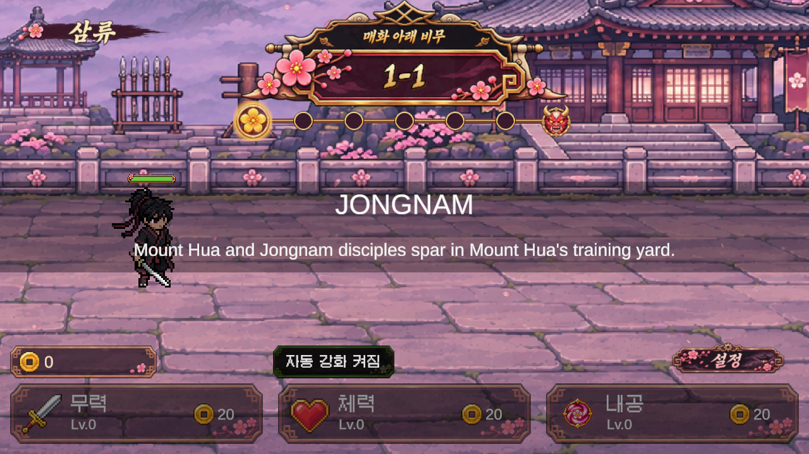
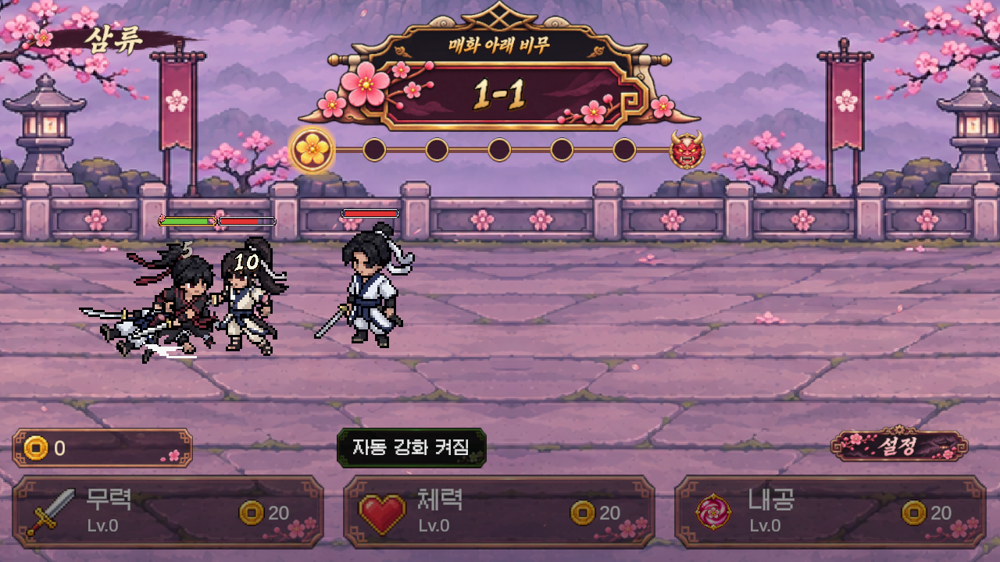
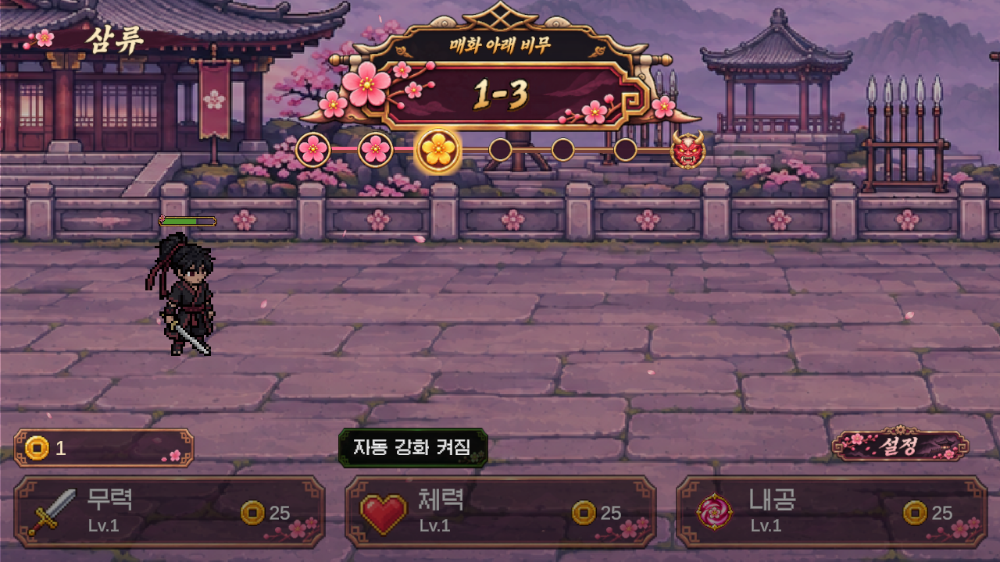

# 루프 증거: loop/20261122-224840 (묶음 balance_tuning)

- 판정: **통합 브랜치(`integration`)에 합침** — 관문 위반 0건, 합치기 전 전체 테스트 통과
- 합친 시각: 2026-11-22 22:57
- 병합 커밋: 태그 `loop-merged/20261122-224840` (`git show loop-merged/20261122-224840`)
- 작업 1건, 바뀐 파일 22개 (.meta 제외)
- 테스트 수: 842 → 847개. 합치기 전 실행: EditMode 1056/1056, PlayMode 181/181

이 문서는 루프 스크립트가 썼다. 테스트 결과와 관문은 스크립트가 직접 판정한 것이고, "완료 조건별 테스트"와 리뷰 의견은 교차 리뷰 에이전트의 판단이다. 가정과 화면은 사람이 본다.

## 사람이 볼 것

테스트로 판정하지 못한 것이다. 아래 화면 갈무리와 함께 본다.

- 없음

## 에이전트가 스스로 정한 것 (가정)

사양과 작업 문서에 없어 에이전트가 정한 것 전부다. 마음에 들지 않으면 후속 작업으로 고친다.

- `097_balance_tuned_defaults`: 작업 요구사항에 따라 세 사양 문서의 현재 기본값과 완료 조건을 갱신했다. 공개 연결 지점과 계산식은 바꾸지 않았다.
- `097_balance_tuned_defaults`: 추가 가정이나 임시 수치는 없다.

## 화면 갈무리

합치기 직전의 코드로 게임을 실행해 찍은 것이다 (플레이 모드 테스트, 파일 이름의 숫자는 실행 후 지난 게임 시간).

**game_001s.png**



**game_010s.png**



**game_030s.png**




## 작업 요약

| 작업 | 구현 | 리뷰 | 새 테스트 | 바뀐 화면 코드 |
| --- | --- | --- | --- | --- |
| `097_balance_tuned_defaults` | codex(시도 1) | claude (교차): 통과 | 5 | 0 |

## 관문 (스크립트 판정)

- 위반: 0건
- 확인 필요:
  - `Assets/Tests/EditMode/Balance/BalanceTableTests.cs` — 있던 검사(Assert) 1줄을 지우거나 바꿈
    - 지워짐: `Assert.That(t.FinalBossHealth, Is.Zero); Assert.That(t.FinalBossAttack, Is.Zero);`
    - 새로 들어옴: `Assert.That(t.FinalBossHealth, Is.EqualTo(1500)); Assert.That(t.FinalBossAttack, Is.EqualTo(80));`
  - `Assets/Tests/EditMode/Combat/BattleAttackTests.cs` — 있던 검사(Assert) 5줄을 지우거나 바꿈
    - 지워짐: `Assert.AreEqual(90L, _battle.DiscipleHealth);`
    - 지워짐: `Assert.AreEqual(50L, _battle.DiscipleHealth);`
    - 지워짐: `Assert.AreEqual(86L, _battle.DiscipleHealth);`
    - 지워짐: `Assert.AreEqual(81L, _battle.DiscipleHealth);`
    - 지워짐: `Assert.AreEqual(90L, _battle.DiscipleHealth);`
    - 새로 들어옴: `Assert.AreEqual(96L, _battle.DiscipleHealth);`
    - 새로 들어옴: `Assert.AreEqual(80L, _battle.DiscipleHealth);`
    - 새로 들어옴: `Assert.AreEqual(92L, _battle.DiscipleHealth);`
    - 새로 들어옴: `Assert.AreEqual(87L, _battle.DiscipleHealth);`
    - 새로 들어옴: `Assert.AreEqual(96L, _battle.DiscipleHealth);`
  - `Assets/Tests/EditMode/Combat/BattleHoldPositionTests.cs` — 있던 검사(Assert) 1줄을 지우거나 바꿈
    - 지워짐: `Assert.AreEqual(86L, _battle.DiscipleHealth);`
    - 새로 들어옴: `Assert.AreEqual(92L, _battle.DiscipleHealth);`
  - `Assets/Tests/EditMode/Combat/BattleRealmTests.cs` — 있던 검사(Assert) 4줄을 지우거나 바꿈
    - 지워짐: `Assert.AreEqual(90L, _battle.DiscipleHealth);`
    - 지워짐: `Assert.AreEqual(100L, _battle.DiscipleHealth);`
    - 지워짐: `Assert.AreEqual(122L, _battle.DiscipleHealth);`
    - 지워짐: `Assert.AreEqual(90L, _battle.DiscipleHealth);`
    - 새로 들어옴: `Assert.AreEqual(96L, _battle.DiscipleHealth);`
    - 새로 들어옴: `Assert.AreEqual(106L, _battle.DiscipleHealth);`
    - 새로 들어옴: `Assert.AreEqual(128L, _battle.DiscipleHealth);`
    - 새로 들어옴: `Assert.AreEqual(96L, _battle.DiscipleHealth);`
  - `Assets/Tests/EditMode/Combat/BattleSkillTests.cs` — 있던 검사(Assert) 1줄을 지우거나 바꿈
    - 지워짐: `Assert.AreEqual(90, battle.DiscipleHealth);`
    - 새로 들어옴: `Assert.AreEqual(96, battle.DiscipleHealth);`
  - `Assets/Tests/EditMode/Combat/BattleTests.cs` — 있던 검사(Assert) 1줄을 지우거나 바꿈
    - 지워짐: `Assert.AreEqual(10L, boss.Attack);`
    - 새로 들어옴: `Assert.AreEqual(4L, boss.Attack);`
  - `Assets/Tests/EditMode/Combat/BattleUpgradeTests.cs` — 있던 검사(Assert) 6줄을 지우거나 바꿈
    - 지워짐: `Assert.That(_battle.DiscipleHealth, Is.EqualTo(90));`
    - 지워짐: `Assert.That(_battle.DiscipleHealth, Is.EqualTo(110));`
    - 지워짐: `Assert.That(_battle.DiscipleHealth, Is.EqualTo(110));`
    - 지워짐: `Assert.That(_battle.DiscipleHealth, Is.EqualTo(90));`
    - 지워짐: `Assert.That(_battle.DiscipleHealth, Is.EqualTo(130));`
    - 지워짐: `Assert.That(_battle.DiscipleHealth, Is.EqualTo(85));`
    - 새로 들어옴: `Assert.That(_battle.DiscipleHealth, Is.EqualTo(96));`
    - 새로 들어옴: `Assert.That(_battle.DiscipleHealth, Is.EqualTo(116));`
    - 새로 들어옴: `Assert.That(_battle.DiscipleHealth, Is.EqualTo(116));`
    - 새로 들어옴: `Assert.That(_battle.DiscipleHealth, Is.EqualTo(96));`
    - 새로 들어옴: `Assert.That(_battle.DiscipleHealth, Is.EqualTo(136));`
    - 새로 들어옴: `Assert.That(_battle.DiscipleHealth, Is.EqualTo(91));`
  - `Assets/Tests/EditMode/Combat/EnemyStatsTests.cs` — 있던 검사(Assert) 1줄을 지우거나 바꿈
    - 지워짐: `Assert.AreEqual(8589934594L, EnemyStats.Attack(EnemyKind.Boss, int.MaxValue));`
    - 새로 들어옴: `Assert.AreEqual(8589934588L, EnemyStats.Attack(EnemyKind.Boss, int.MaxValue));`
  - `Assets/Tests/EditMode/Combat/JongnamBossBehaviorTests.cs` — 있던 검사(Assert) 3줄을 지우거나 바꿈
    - 지워짐: `Assert.That(battle.DiscipleHealth, Is.EqualTo(980));`
    - 지워짐: `Assert.That(battle.DiscipleHealth, Is.EqualTo(980));`
    - 지워짐: `Assert.That(battle.DiscipleHealth, Is.EqualTo(970));`
    - 새로 들어옴: `Assert.That(battle.DiscipleHealth, Is.EqualTo(992));`
    - 새로 들어옴: `Assert.That(battle.DiscipleHealth, Is.EqualTo(992));`
    - 새로 들어옴: `Assert.That(battle.DiscipleHealth, Is.EqualTo(988));`
  - `Assets/Tests/EditMode/Stage/StageProgressFadeTests.cs` — 있던 검사(Assert) 1줄을 지우거나 바꿈
    - 지워짐: `Assert.That(_battle.DiscipleHealth, Is.EqualTo(90));`
    - 새로 들어옴: `Assert.That(_battle.DiscipleHealth, Is.EqualTo(96));`
  - `Assets/Tests/EditMode/Stage/StageProgressFinalTests.cs` — 있던 검사(Assert) 6줄을 지우거나 바꿈
    - 지워짐: `Assert.That(boss.MaxHealth, Is.EqualTo(220));`
    - 지워짐: `Assert.That(boss.Attack, Is.EqualTo(26));`
    - 지워짐: `Assert.That(_battle.Enemies[0].MaxHealth, Is.EqualTo(370));`
    - 지워짐: `Assert.That(_battle.Enemies[0].Attack, Is.EqualTo(46));`
    - 지워짐: `Assert.That(_battle.Enemies[0].MaxHealth, Is.EqualTo(220));`
    - 지워짐: `Assert.That(_battle.Enemies[0].Health, Is.EqualTo(220));`
    - 새로 들어옴: `Assert.That(boss.MaxHealth, Is.EqualTo(1500));`
    - 새로 들어옴: `Assert.That(boss.Attack, Is.EqualTo(80));`
    - 새로 들어옴: `Assert.That(_battle.Enemies[0].MaxHealth, Is.EqualTo(1500));`
    - 새로 들어옴: `Assert.That(_battle.Enemies[0].Attack, Is.EqualTo(80));`
    - 새로 들어옴: `Assert.That(_battle.Enemies[0].MaxHealth, Is.EqualTo(1500));`
    - 새로 들어옴: `Assert.That(_battle.Enemies[0].Health, Is.EqualTo(1500));`
  - `Assets/Tests/EditMode/Stage/StageProgressOutcomeTests.cs` — 있던 검사(Assert) 1줄을 지우거나 바꿈
    - 지워짐: `Assert.That(_battle.DiscipleHealth, Is.EqualTo(90));`
    - 새로 들어옴: `Assert.That(_battle.DiscipleHealth, Is.EqualTo(96));`
  - `Assets/Tests/EditMode/Stage/StageProgressRoundTests.cs` — 있던 검사(Assert) 2줄을 지우거나 바꿈
    - 지워짐: `Assert.That(boss.Attack, Is.EqualTo(30));`
    - 지워짐: `Assert.That(_battle.DiscipleHealth, Is.EqualTo(30));`
    - 새로 들어옴: `Assert.That(boss.Attack, Is.EqualTo(24));`
    - 새로 들어옴: `Assert.That(_battle.DiscipleHealth, Is.EqualTo(24));`
  - `Assets/Tests/PlayMode/Combat/JongnamBossSpriteTests.cs` — 있던 검사(Assert) 1줄을 지우거나 바꿈
    - 지워짐: `Assert.That(battle.DiscipleHealth, Is.EqualTo(970), "스킬 모션도 기존 공격 피해를 유지한다");`
    - 새로 들어옴: `Assert.That(battle.DiscipleHealth, Is.EqualTo(988), "스킬 모션도 기존 공격 피해를 유지한다");`

## 작업별 기록

### 097_balance_tuned_defaults

- 구현: codex(시도 1)
- 리뷰: claude (교차): 통과
- 바뀐 내용: 보스 공격력 곡선과 천마 기본 능력치를 조정하고 지정된 테스트 및 사양을 갱신했다. 새 기본값 검증 테스트를 추가했으며 Unity 테스트는 루프 판정을 기다린다.
- 리뷰 의견: BalanceTable.Default에서는 작업 문서가 지정한 세 값(BossAttack (4,4,1), FinalBossHealth 1500, FinalBossAttack 80)만 바뀌었다. 기존 테스트의 기대값·준비값 변경은 요구사항 목록과 한 줄씩 일치하고, 새 테스트는 완료 조건의 숫자를 그대로 검사한다. 지워지거나 바뀐 검사는 모두 작업 문서가 명시한 값 교체이며, 검사 수와 뜻은 줄지 않았다.
- 작업 문서 원본: `docs/history/097_balance_tuned_defaults.md`

| 완료 조건 | 대응하는 테스트 | 판정 |
| --- | --- | --- |
| `Assets/Tests/EditMode/Balance/BalanceTunedDefaultsTests.cs`에 아래 조건마다 테스트가 하나 이상 있고 모두 통과한다. | BalanceTunedDefaultsTests (조건 2~9마다 메서드가 있음, SetUp·TearDown에서 Current=Default로 맞춤) | 있음 |
| 기본 표의 `BossAttack.Evaluate(0)`, `Evaluate(1)`, `Evaluate(2)`, `Evaluate(3)`은 각각 4, 8, 12, 16이다. | BalanceTunedDefaultsTests.BossAttackCurve_DefaultValues (TestCase 0→4, 1→8, 2→12, 3→16) | 있음 |
| 기본 표에서 `EnemyStats.Attack(EnemyKind.Boss, 4)`는 16이다. | BalanceTunedDefaultsTests.FourthStage_BossUsesCurves | 있음 |
| 기본 표에서 `EnemyStats.MaxHealth(EnemyKind.Boss, 4)`는 190이다 (보스 체력 곡선은 그대로). | BalanceTunedDefaultsTests.FourthStage_BossUsesCurves | 있음 |
| 기본 표에서 `EnemyStats.MaxHealth(EnemyKind.Boss, 5)`는 1500이다. | BalanceTunedDefaultsTests.FinalStages_BossUsesFixedStats(5) | 있음 |
| 기본 표에서 `EnemyStats.Attack(EnemyKind.Boss, 5)`는 80이다. | BalanceTunedDefaultsTests.FinalStages_BossUsesFixedStats(5) | 있음 |
| 기본 표에서 `EnemyStats.MaxHealth(EnemyKind.Boss, 10)`은 1500이고 `EnemyStats.Attack(EnemyKind.Boss, 10)`은 80이다. | BalanceTunedDefaultsTests.FinalStages_BossUsesFixedStats(10) | 있음 |
| 기본 표에서 `EnemyStats.Attack(EnemyKind.Boss, 6)`은 24이다 (2회차 1스테이지 보스는 천마가 아니다). | BalanceTunedDefaultsTests.SixthStage_BossUsesAttackCurve | 있음 |
| 기본 표에서 `EnemyStats.Attack(EnemyKind.Normal, 4)`는 11이고 `StageRewards.BossGold(5)`는 90이다 (바꾸지 않은 값은 그대로). | BalanceTunedDefaultsTests.NormalAttackAndBossGold_AreUnchanged | 있음 |
| 요구사항에 적은 기존 테스트는 모두 이름이 그대로이고, 적힌 값만 바뀐 채 통과한다. | diff 대조: 요구사항 목록의 테스트 22개 항목과 값이 모두 일치, 메서드 이름 변경과 검사 삭제 없음, 목록 밖 기대값 변경 없음 (통과 여부는 루프 실행 결과) | 있음 |
| 기존 테스트가 모두 통과한다. | 루프 전체 테스트 | 루프가 판정 |

리뷰 지적 (합친 뒤에도 남은 것):

- [note] docs/spec/stage.md:119 완료 조건 42가 아직 '체력 370, 공격력 46'이다. 실제 테스트 StageProgressFinalTests.TenthStage_…는 1500·80으로 바뀌었다. 작업 문서는 41·44만 고치라고 했기 때문에 범위 밖이지만, 사양과 테스트가 어긋나므로 후속 정리가 필요하다.
- [note] docs/spec/balance.md:104 코드 예시 주석이 아직 '지금 게임의 수치로 채운 새 객체'로 되어 있어 새 기본값 설명과 맞지 않는다 (사소함).
- [note] 구현 에이전트는 Unity 테스트를 직접 돌리지 않았다고 보고했다. 통과 여부는 루프의 전체 테스트 결과에 달려 있다.

새 테스트 5개: `BalanceTunedDefaultsTests.BossAttackCurve_DefaultValues`, `BalanceTunedDefaultsTests.FinalStages_BossUsesFixedStats`, `BalanceTunedDefaultsTests.FourthStage_BossUsesCurves`, `BalanceTunedDefaultsTests.NormalAttackAndBossGold_AreUnchanged`, `BalanceTunedDefaultsTests.SixthStage_BossUsesAttackCurve`

관문 확인 필요:

- `Assets/Tests/EditMode/Balance/BalanceTableTests.cs` — 있던 검사(Assert) 1줄을 지우거나 바꿈
    - 지워짐: `Assert.That(t.FinalBossHealth, Is.Zero); Assert.That(t.FinalBossAttack, Is.Zero);`
    - 새로 들어옴: `Assert.That(t.FinalBossHealth, Is.EqualTo(1500)); Assert.That(t.FinalBossAttack, Is.EqualTo(80));`
- `Assets/Tests/EditMode/Combat/BattleAttackTests.cs` — 있던 검사(Assert) 5줄을 지우거나 바꿈
    - 지워짐: `Assert.AreEqual(90L, _battle.DiscipleHealth);`
    - 지워짐: `Assert.AreEqual(50L, _battle.DiscipleHealth);`
    - 지워짐: `Assert.AreEqual(86L, _battle.DiscipleHealth);`
    - 지워짐: `Assert.AreEqual(81L, _battle.DiscipleHealth);`
    - 지워짐: `Assert.AreEqual(90L, _battle.DiscipleHealth);`
    - 새로 들어옴: `Assert.AreEqual(96L, _battle.DiscipleHealth);`
    - 새로 들어옴: `Assert.AreEqual(80L, _battle.DiscipleHealth);`
    - 새로 들어옴: `Assert.AreEqual(92L, _battle.DiscipleHealth);`
    - 새로 들어옴: `Assert.AreEqual(87L, _battle.DiscipleHealth);`
    - 새로 들어옴: `Assert.AreEqual(96L, _battle.DiscipleHealth);`
- `Assets/Tests/EditMode/Combat/BattleHoldPositionTests.cs` — 있던 검사(Assert) 1줄을 지우거나 바꿈
    - 지워짐: `Assert.AreEqual(86L, _battle.DiscipleHealth);`
    - 새로 들어옴: `Assert.AreEqual(92L, _battle.DiscipleHealth);`
- `Assets/Tests/EditMode/Combat/BattleRealmTests.cs` — 있던 검사(Assert) 4줄을 지우거나 바꿈
    - 지워짐: `Assert.AreEqual(90L, _battle.DiscipleHealth);`
    - 지워짐: `Assert.AreEqual(100L, _battle.DiscipleHealth);`
    - 지워짐: `Assert.AreEqual(122L, _battle.DiscipleHealth);`
    - 지워짐: `Assert.AreEqual(90L, _battle.DiscipleHealth);`
    - 새로 들어옴: `Assert.AreEqual(96L, _battle.DiscipleHealth);`
    - 새로 들어옴: `Assert.AreEqual(106L, _battle.DiscipleHealth);`
    - 새로 들어옴: `Assert.AreEqual(128L, _battle.DiscipleHealth);`
    - 새로 들어옴: `Assert.AreEqual(96L, _battle.DiscipleHealth);`
- `Assets/Tests/EditMode/Combat/BattleSkillTests.cs` — 있던 검사(Assert) 1줄을 지우거나 바꿈
    - 지워짐: `Assert.AreEqual(90, battle.DiscipleHealth);`
    - 새로 들어옴: `Assert.AreEqual(96, battle.DiscipleHealth);`
- `Assets/Tests/EditMode/Combat/BattleTests.cs` — 있던 검사(Assert) 1줄을 지우거나 바꿈
    - 지워짐: `Assert.AreEqual(10L, boss.Attack);`
    - 새로 들어옴: `Assert.AreEqual(4L, boss.Attack);`
- `Assets/Tests/EditMode/Combat/BattleUpgradeTests.cs` — 있던 검사(Assert) 6줄을 지우거나 바꿈
    - 지워짐: `Assert.That(_battle.DiscipleHealth, Is.EqualTo(90));`
    - 지워짐: `Assert.That(_battle.DiscipleHealth, Is.EqualTo(110));`
    - 지워짐: `Assert.That(_battle.DiscipleHealth, Is.EqualTo(110));`
    - 지워짐: `Assert.That(_battle.DiscipleHealth, Is.EqualTo(90));`
    - 지워짐: `Assert.That(_battle.DiscipleHealth, Is.EqualTo(130));`
    - 지워짐: `Assert.That(_battle.DiscipleHealth, Is.EqualTo(85));`
    - 새로 들어옴: `Assert.That(_battle.DiscipleHealth, Is.EqualTo(96));`
    - 새로 들어옴: `Assert.That(_battle.DiscipleHealth, Is.EqualTo(116));`
    - 새로 들어옴: `Assert.That(_battle.DiscipleHealth, Is.EqualTo(116));`
    - 새로 들어옴: `Assert.That(_battle.DiscipleHealth, Is.EqualTo(96));`
    - 새로 들어옴: `Assert.That(_battle.DiscipleHealth, Is.EqualTo(136));`
    - 새로 들어옴: `Assert.That(_battle.DiscipleHealth, Is.EqualTo(91));`
- `Assets/Tests/EditMode/Combat/EnemyStatsTests.cs` — 있던 검사(Assert) 1줄을 지우거나 바꿈
    - 지워짐: `Assert.AreEqual(8589934594L, EnemyStats.Attack(EnemyKind.Boss, int.MaxValue));`
    - 새로 들어옴: `Assert.AreEqual(8589934588L, EnemyStats.Attack(EnemyKind.Boss, int.MaxValue));`
- `Assets/Tests/EditMode/Combat/JongnamBossBehaviorTests.cs` — 있던 검사(Assert) 3줄을 지우거나 바꿈
    - 지워짐: `Assert.That(battle.DiscipleHealth, Is.EqualTo(980));`
    - 지워짐: `Assert.That(battle.DiscipleHealth, Is.EqualTo(980));`
    - 지워짐: `Assert.That(battle.DiscipleHealth, Is.EqualTo(970));`
    - 새로 들어옴: `Assert.That(battle.DiscipleHealth, Is.EqualTo(992));`
    - 새로 들어옴: `Assert.That(battle.DiscipleHealth, Is.EqualTo(992));`
    - 새로 들어옴: `Assert.That(battle.DiscipleHealth, Is.EqualTo(988));`
- `Assets/Tests/EditMode/Stage/StageProgressFadeTests.cs` — 있던 검사(Assert) 1줄을 지우거나 바꿈
    - 지워짐: `Assert.That(_battle.DiscipleHealth, Is.EqualTo(90));`
    - 새로 들어옴: `Assert.That(_battle.DiscipleHealth, Is.EqualTo(96));`
- `Assets/Tests/EditMode/Stage/StageProgressFinalTests.cs` — 있던 검사(Assert) 6줄을 지우거나 바꿈
    - 지워짐: `Assert.That(boss.MaxHealth, Is.EqualTo(220));`
    - 지워짐: `Assert.That(boss.Attack, Is.EqualTo(26));`
    - 지워짐: `Assert.That(_battle.Enemies[0].MaxHealth, Is.EqualTo(370));`
    - 지워짐: `Assert.That(_battle.Enemies[0].Attack, Is.EqualTo(46));`
    - 지워짐: `Assert.That(_battle.Enemies[0].MaxHealth, Is.EqualTo(220));`
    - 지워짐: `Assert.That(_battle.Enemies[0].Health, Is.EqualTo(220));`
    - 새로 들어옴: `Assert.That(boss.MaxHealth, Is.EqualTo(1500));`
    - 새로 들어옴: `Assert.That(boss.Attack, Is.EqualTo(80));`
    - 새로 들어옴: `Assert.That(_battle.Enemies[0].MaxHealth, Is.EqualTo(1500));`
    - 새로 들어옴: `Assert.That(_battle.Enemies[0].Attack, Is.EqualTo(80));`
    - 새로 들어옴: `Assert.That(_battle.Enemies[0].MaxHealth, Is.EqualTo(1500));`
    - 새로 들어옴: `Assert.That(_battle.Enemies[0].Health, Is.EqualTo(1500));`
- `Assets/Tests/EditMode/Stage/StageProgressOutcomeTests.cs` — 있던 검사(Assert) 1줄을 지우거나 바꿈
    - 지워짐: `Assert.That(_battle.DiscipleHealth, Is.EqualTo(90));`
    - 새로 들어옴: `Assert.That(_battle.DiscipleHealth, Is.EqualTo(96));`
- `Assets/Tests/EditMode/Stage/StageProgressRoundTests.cs` — 있던 검사(Assert) 2줄을 지우거나 바꿈
    - 지워짐: `Assert.That(boss.Attack, Is.EqualTo(30));`
    - 지워짐: `Assert.That(_battle.DiscipleHealth, Is.EqualTo(30));`
    - 새로 들어옴: `Assert.That(boss.Attack, Is.EqualTo(24));`
    - 새로 들어옴: `Assert.That(_battle.DiscipleHealth, Is.EqualTo(24));`
- `Assets/Tests/PlayMode/Combat/JongnamBossSpriteTests.cs` — 있던 검사(Assert) 1줄을 지우거나 바꿈
    - 지워짐: `Assert.That(battle.DiscipleHealth, Is.EqualTo(970), "스킬 모션도 기존 공격 피해를 유지한다");`
    - 새로 들어옴: `Assert.That(battle.DiscipleHealth, Is.EqualTo(988), "스킬 모션도 기존 공격 피해를 유지한다");`

## 확인하고 되돌리는 방법

```
git diff loop-merged/20261122-224840^1 loop-merged/20261122-224840            # 이 루프가 바꾼 것 전부
git merge --ff-only loop-merged/20261122-224840         # (main 에서) 이 루프까지만 올린다
git revert -m 1 loop-merged/20261122-224840             # (main 에 올린 뒤) 이 루프만 되돌린다
```
